# THIẾT KẾ CHI TIẾT HỆ THỐNG

# 1. Giới thiệu

## 1.1. Mục đích

Tài liệu này mô tả thiết kế kỹ thuật cho **Hệ thống quản lý và đặt lịch sân thể thao**, được xây dựng từ tài liệu đặc tả yêu cầ. Tài liệu là đầu vào trực tiếp cho đội phát triển backend, frontend và quản trị cơ sở dữ liệu, gồm bốn phần chính:

- **Thiết kế kiến trúc**: kiểu kiến trúc, thành phần, công nghệ, xác thực – phân quyền, chống trùng lịch, luồng thanh toán VietQR, tác vụ nền và triển khai.
- **Thiết kế cơ sở dữ liệu**: mô hình quan hệ (ERD), đặc tả từng bảng, ràng buộc, chỉ mục và quy tắc tính toán tiền.
- **Thiết kế API backend**: quy ước REST, danh sách endpoint theo module, đặc tả chi tiết các endpoint nghiệp vụ chính, webhook và sự kiện realtime.
- **Thiết kế frontend**: điều hướng, design token lấy từ Figma, quản lý trạng thái, thành phần dùng chung và thiết kế chi tiết 11 màn hình.

## 1.2. Phạm vi

Phạm vi thiết kế bám theo 19 yêu cầu chức năng và 24 use case trong SRS, phục vụ ba nhóm tác nhân chính: **Khách hàng**, **Nhân viên sân** và **Chủ sân**, cùng tác nhân hệ thống ngoài là **Cổng thanh toán**

## 1.3. Thuật ngữ

| **Thuật ngữ** | **Giải thích** |
| --- | --- |
| Chi nhánh / Cơ sở (Branch) | Một địa điểm kinh doanh có địa chỉ, giờ hoạt động, tài khoản ngân hàng nhận tiền và nhiều sân. |
| Sân (Court) | Một sân thi đấu cụ thể thuộc một chi nhánh và một bộ môn (Pickleball, Bóng đá mini, Cầu lông, Tennis, Bóng rổ). |
| Đơn đặt sân (Booking) | Một lượt thuê một sân trong một khoảng thời gian liên tục; mã dạng BK + yyyyMMdd + số thứ tự (vd. BK2026111001). |
| Ô thời gian (Slot) | Đơn vị thời gian 30 phút dùng để khóa lịch ở mức CSDL; một đơn chiếm nhiều ô liên tiếp. |
| Ô lịch (Grid block) | Ô hiển thị trên bảng lịch (vd. 2 giờ với Pickleball, 90 phút với Bóng đá), cấu hình theo bộ môn. |
| Giữ chỗ tạm thời (Hold) | Khoảng thời gian (mặc định 10 phút) khung giờ được giữ cho đơn “Chờ thanh toán”. |
| Tất toán | Thu nốt phần tiền còn lại của đơn đã đặt cọc khi khách đến nhận sân. |
| Khách vãng lai (Walk-in) | Khách đặt tại quầy, không có tài khoản; chỉ lưu họ tên và số điện thoại trên đơn. |
| Doanh thu thực thu | Tổng tiền đã thực nhận (tiền mặt + chuyển khoản) trừ khoản đã hoàn; không gồm đơn đóng. |
| VietQR | Chuẩn mã QR chuyển khoản liên ngân hàng (EMVCo) của NAPAS, chứa sẵn số tài khoản, số tiền và nội dung. |
| RBAC | Role-Based Access Control – phân quyền theo vai trò. |
| JWT | JSON Web Token – token truy cập không trạng thái. |
| POS | Point of Sale – giao diện vận hành tại quầy (Thể thao 88 POS). |

# 2. Thiết kế kiến trúc

## 2.1. Lựa chọn kiến trúc

Hệ thống được xây dựng theo kiến trúc **Modular Monolith** ở backend kết hợp **Single Page Application** ở frontend, giao tiếp qua **REST API (JSON)** và **WebSocket (Socket.IO)** cho cập nhật thời gian thực. Toàn bộ dữ liệu nằm trong một CSDL.

## 2.2. Sơ đồ kiến trúc tổng thể

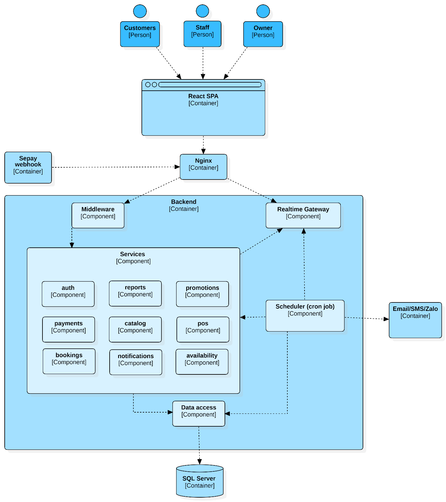

Hệ thống được thiết kế theo mô hình **client – server nhiều tầng**. Giao diện là một ứng dụng web. Phía sau là một backend nguyên khối được chia module (modular monolith) và một cơ sở dữ liệu quan hệ dùng chung. Mọi yêu cầu từ bên ngoài đều đi qua Nginx, gồm yêu cầu của người dùng và tín hiệu từ cổng thanh toán. Bên trong backend, các thành phần được tách rõ trách nhiệm: tiếp nhận và kiểm soát yêu cầu, xử lý nghiệp vụ, đẩy dữ liệu thời gian thực, chạy tác vụ định kỳ và truy cập dữ liệu.

### Tác nhân sử dụng

- Hệ thống có ba nhóm người dùng, cùng truy cập qua một ứng dụng web duy nhất. Giao diện và quyền thao tác của mỗi nhóm khác nhau theo vai trò:
- **Khách hàng:** tìm sân trống, đặt sân, thanh toán bằng QR, xem lịch đặt của mình, hủy đơn và nhận thông báo.
- **Nhân viên:** quản lý bảng lịch sân tại cơ sở, tạo đơn tại quầy, thu tiền, tất toán khi khách nhận sân và hủy đơn.
- **Chủ sân:** quản lý cơ sở, sân, giờ hoạt động, nhân viên và chương trình khuyến mãi, xem dashboard và báo cáo doanh thu.

### Tầng giao diện

- React SPA là ứng dụng chạy trên trình duyệt, chịu trách nhiệm hiển thị và tương tác với người dùng. Ứng dụng giao tiếp với backend theo hai kênh:
- **HTTP/REST:** dùng cho các thao tác nghiệp vụ như đặt sân, thanh toán, quản lý danh mục và xem báo cáo.
- **Kết nối thời gian thực (WebSocket):** dùng để nhận cập nhật tức thời, ví dụ một khung giờ vừa bị đặt, một đơn vừa được thanh toán thành công hay một thông báo mới.

### Cổng vào – Nginx

- Nginx là điểm vào duy nhất của hệ thống, đóng vai trò **reverse proxy**:
- Tiếp nhận toàn bộ yêu cầu từ React SPA và chuyển tiếp theo loại yêu cầu. Yêu cầu REST đi tới **Middleware**, kết nối thời gian thực đi tới **Realtime Gateway**.
- Tiếp nhận **webhook từ Sepay** (cổng thanh toán) khi có giao dịch chuyển khoản, rồi chuyển vào backend để xử lý.
- Có thể đảm nhận thêm việc phục vụ file tĩnh của SPA, mã hóa HTTPS và giới hạn tần suất truy cập.

### Backend

- **Middleware** là lớp tiền xử lý cho mọi yêu cầu REST trước khi tới tầng nghiệp vụ. Lớp này xác thực người dùng, phân quyền theo vai trò (Khách hàng / Nhân viên / Chủ sân), kiểm tra dữ liệu đầu vào, ghi log và xử lý lỗi chung. Với webhook Sepay, lớp này còn kiểm tra tính hợp lệ của tín hiệu trước khi chuyển cho module thanh toán.
- **Services** là tầng nghiệp vụ, được chia thành các module theo nhóm chức năng:

| **Module** | **Trách nhiệm chính** |
| --- | --- |
| **auth** | Đăng ký, đăng nhập, đăng xuất, quản lý tài khoản nhân viên (thêm, sửa, khóa) |
| **catalog** | Quản lý cơ sở, sân, loại sân/môn thể thao, bảng giá theo khung giờ, mức đặt cọc |
| **availability** | Giờ hoạt động, ngày nghỉ, khóa/bảo trì sân; tính toán khung giờ trống và chặn đặt ngoài giờ hợp lệ |
| **bookings** | Tạo đơn, giữ chỗ tạm thời, quản lý vòng đời trạng thái đơn (Chờ thanh toán → Đã xác nhận → Đang sử dụng → Hoàn thành / Quá hạn / Đã hủy), hủy đơn và tính hoàn tiền |
| **payments** | Sinh mã QR động, xử lý webhook Sepay (đối soát theo mã đơn, chống xử lý trùng), ghi nhận giao dịch, đánh dấu giao dịch “Cần đối soát” |
| **pos** | Nghiệp vụ tại quầy: tạo đơn cho khách vãng lai, thu tiền mặt hoặc QR, tất toán khi nhận sân, phát hành phiếu thu |
| **promotions** | Chương trình sale, mã ưu đãi/voucher, kiểm tra điều kiện áp dụng, hoàn lượt dùng mã khi đơn bị hủy |
| **notifications** | Tạo và quản lý thông báo trong ứng dụng; chuẩn bị nội dung gửi qua kênh bên ngoài |
| **reports** | Dashboard vận hành trong ngày, thống kê doanh thu thực thu, lượt đặt, đơn hủy, hiệu quả khuyến mãi |

- **Realtime Gateway** quản lý các kết nối thời gian thực của client và đẩy sự kiện xuống trình duyệt. Nhờ vậy, bảng lịch sân của nhân viên và khách hàng luôn đồng bộ, và màn hình thanh toán QR tự chuyển sang “thành công” ngay khi webhook được xử lý. Thành phần này nhận sự kiện từ hai nguồn: Services và Scheduler.
- **Scheduler (cron job)** chạy định kỳ các tác vụ tự động không do người dùng kích hoạt:
- Chuyển đơn hết thời hạn giữ chỗ sang “Quá hạn thanh toán” và giải phóng khung giờ.
- Gửi nhắc lịch trước giờ chơi 1 giờ.
- Tự động hủy đơn khi khách không đến nhận sân quá thời gian quy định.
- Kích hoạt hoặc kết thúc chương trình khuyến mãi theo lịch.
- Scheduler gọi tầng Services để dùng lại logic nghiệp vụ, truy cập Data access khi cần quét dữ liệu, đẩy cập nhật qua Realtime Gateway, và gửi thông báo ra **Email/SMS/Zalo**.
- **Data access** là lớp truy cập dữ liệu dùng chung. Lớp này đóng gói mọi thao tác đọc ghi xuống SQL Server và quản lý transaction, giúp tầng nghiệp vụ không phụ thuộc trực tiếp vào cơ sở dữ liệu. Transaction đặc biệt quan trọng khi giữ chỗ và xác nhận thanh toán để tránh đặt trùng sân.

### Cơ sở dữ liệu

SQL Server lưu toàn bộ dữ liệu của hệ thống: tài khoản, cơ sở, sân, bảng giá, lịch hoạt động, đơn đặt sân, giao dịch thanh toán, khuyến mãi, thông báo và dữ liệu phục vụ báo cáo. Chỉ lớp Data access được phép truy cập cơ sở dữ liệu.

### Hệ thống bên ngoài

Sepay: cổng thanh toán chuyển khoản. Sepay gửi webhook về hệ thống mỗi khi có giao dịch khớp với tài khoản của cơ sở, nhờ đó đơn được xác nhận tự động.

Email/SMS/Zalo: các kênh gửi thông báo ra ngoài ứng dụng, gồm xác nhận đặt sân, nhắc lịch, thông báo hủy hoặc thay đổi lịch và thông báo khuyến mãi.

## 2.3. Kiến trúc BE

Mỗi module nghiệp vụ tuân theo 4 lớp; lớp trên chỉ gọi lớp ngay dưới, module khác chỉ được gọi qua **service** (không truy cập repository của module khác)

| **Lớp** | **Trách nhiệm** |
| --- | --- |
| Route | Khai báo đường dẫn, gắn middleware xác thực, phân quyền, validate. |
| Controller | Đọc request, gọi service, định dạng response chuẩn; không chứa nghiệp vụ. |
| Service | Nghiệp vụ, quy tắc, giao dịch; phát sự kiện domain (socket, thông báo). |
| Repository | Truy cập dữ liệu qua Prisma / SQL thuần; không chứa nghiệp vụ. |

Các module chính:

| **Module** | **Trách nhiệm chính** |
| --- | --- |
| auth | Đăng nhập, đăng ký, làm mới token, đăng xuất, khóa tạm khi sai mật khẩu. |
| catalog | Chi nhánh, bộ môn, sân, bảng giá công khai cho trang chủ. |
| availability | Tính lưới lịch: giờ mở cửa, ngày nghỉ, khóa sân, ô đã đặt/đang giữ, giá từng ô. |
| pricing | Tính tiền theo khung giờ, tiền cọc, áp mã khuyến mãi, tính hoàn tiền. |
| bookings | Tạo đơn online, xem/lọc đơn của khách, hủy đơn, chuyển trạng thái. |
| payments | Sinh VietQR, nhận webhook, khớp giao dịch, phiếu thu, đối soát, hoàn tiền. |
| pos | Đặt tại quầy, tra cứu khách theo SĐT, thu tiền, tất toán, nhận sân, kết thúc sớm. |
| promotions | Quản lý chương trình/mã, kiểm tra điều kiện áp dụng, gửi thông báo ưu đãi. |
| notifications | Lưu và đẩy thông báo (in-app, socket; tùy chọn Email/SMS/Zalo). |
| dashboard | Chỉ số vận hành trong ngày theo chi nhánh. |
| reports | Doanh thu thực thu, lượt đặt, công suất, hiệu quả khuyến mãi. |
| admin | Nhân viên, sân, bảng giá, giờ hoạt động – ngày nghỉ, khóa sân, đơn bị ảnh hưởng. |
| jobs | Hết hạn giữ chỗ, nhắc lịch, hủy no-show, tự hoàn thành, hết hạn QR. |

## 2.4. Xác thực và phân quyền

Tên đăng nhập là **số điện thoại hoặc email**; mật khẩu băm bằng **bcrypt**.

Đăng nhập thành công trả về **access token JWT** (hết hạn 15 phút, chứa sub, role, branchId, tv = TokenVersion) trong body, và **refresh token** ngẫu nhiên (7 ngày) trong cookie HttpOnly; Secure; SameSite=Strict. Refresh token lưu dạng băm SHA-256 ở bảng RefreshTokens để thu hồi được

Frontend giữ access token trong bộ nhớ. khi nhận 401 TOKEN_EXPIRED sẽ gọi /auth/refresh một lần rồi gửi lại request.

**Đăng xuất**: thu hồi refresh token hiện tại, xóa cookie, client xóa state và chuyển về /login.

**Sai mật khẩu**: tăng FailedLoginCount; đạt 5 lần thì đặt LockedUntil = now + 5 phút và trả ACCOUNT_TEMP_LOCKED; đăng nhập đúng thì đặt lại bộ đếm.

**Khóa tài khoản nhân viên**: đặt Status = LOCKED, tăng TokenVersion và thu hồi mọi refresh token ⇒ phiên đang mở bị ngắt ngay ở request kế tiếp (middleware so khớp tv).

Ma trận phân quyền:

Ký hiệu: ✔ toàn quyền; **CS** chỉ trong chi nhánh được phân công; **Của mình** chỉ dữ liệu của chính khách hàng; — không có quyền.

| **Chức năng** | **Khách hàng** | **Nhân viên** | **Chủ sân** |
| --- | --- | --- | --- |
| Xem chi nhánh, sân, lịch trống, khuyến mãi công khai | ✔ | ✔ | ✔ |
| Đặt sân trực tuyến, thanh toán QR | ✔ | — | — |
| Xem lịch đặt, thông báo, hủy đơn | Của mình | **CS** | ✔ |
| Đặt sân tại quầy, thu tiền, tất toán, nhận sân | — | **CS** | ✔ |
| Dashboard trong ngày | — | **CS** | ✔ |
| Xử lý đơn bị ảnh hưởng (chuyển sân / đóng do cơ sở) | — | **CS** | ✔ |
| Đối soát giao dịch “Cần đối soát” | — | **CS** | ✔ |
| Quản lý nhân viên | — | — | ✔ |
| Quản lý sân, bảng giá, giờ hoạt động, khóa sân | — | — | ✔ |
| Quản lý khuyến mãi & tri ân | — | — | ✔ |
| Báo cáo doanh thu – lượt đặt | — | — | ✔ |

Middleware branchScope được gắn cho mọi route POS/admin: với STAFF, tham số branchId của request bị ép bằng user.branchId; mọi truy vấn đơn theo id đều kiểm tra booking.BranchId = user.branchId, sai thì trả 403 BRANCH_FORBIDDEN (UC 021-2c).

## 2.5. Xử lý đồng thời và chống trùng lịch

Yêu cầu quan trọng nhất của hệ thống là **không bao giờ để hai đơn còn hiệu lực chiếm cùng một sân tại cùng thời điểm**, kể cả khi khách online và nhân viên tại quầy thao tác cùng lúc (UC 004-2a, UC 010-4a). Thiết kế dùng hai lớp bảo vệ:

1. **Chốt chặn ở CSDL**: mỗi đơn sinh các bản ghi BookingSlots cho từng ô 30 phút. Chỉ mục duy nhất có lọc UX_BookingSlots_Court_Slot (CourtId, SlotStart) WHERE IsActive = 1 đảm bảo một ô chỉ thuộc tối đa một đơn còn hiệu lực. Khi đơn chuyển sang CANCELED/EXPIRED, các ô được đặt IsActive = 0 để giải phóng.
1. **Kiểm tra nghiệp vụ trong giao dịch**: trước khi INSERT, service kiểm tra giờ mở cửa, ngày nghỉ, CourtBlocks, trạng thái sân. Vi phạm chỉ mục duy nhất (lỗi SQL 2601/2627) được dịch thành 409 SLOT_TAKEN với thông báo “Khung giờ đã có người đặt, vui lòng chọn khung giờ khác”.

Các thao tác đổi trạng thái (thanh toán, nhận sân, hủy) dùng **optimistic concurrency** qua cột RowVer (rowversion): client gửi version đã đọc; câu UPDATE có điều kiện WHERE BookingId=@id AND RowVer=@ver, không khớp thì trả 409 BOOKING_STATE_CHANGED – đáp ứng yêu cầu “Trạng thái đơn đã thay đổi, vui lòng tải lại”. Việc ghi nhận tiền từ webhook dùng UPDLOCK thay vì version để không bỏ sót giao dịch.

Các request tạo đơn và thu tiền nhận header Idempotency-Key (UUID do client sinh). Khóa được lưu kèm kết quả 24 giờ; request lặp lại (do mạng chập chờn, bấm hai lần) trả lại đúng kết quả cũ thay vì tạo đơn mới.

## 2.6. Luồng thanh toán QR và đối soát

### a. Sinh mã QR

Mã QR được sinh tại backend theo chuẩn EMVCo/VietQR từ: BIN ngân hàng và số tài khoản của **chi nhánh sở hữu sân** (Branches.BankBin, BankAccountNo), số tiền cần thu, nội dung THANHTOAN {BookingCode}.

Mỗi lần sinh tạo một bản ghi PaymentRequests (Purpose = DEPOSIT / FULL / REMAINING, ExpiresAt). Đơn online: ExpiresAt = HoldExpireAt. Tại quầy: QR_EXPIRE_MINUTES và có thể “Tạo lại mã QR” nếu đơn còn hạn (UC 012-3c).

Frontend nhận chuỗi qrPayload và vẽ bằng qrcode.react (không phụ thuộc dịch vụ ảnh bên ngoài).

### b. Khớp giao dịch

1. Webhook POST /api/v1/webhooks/bank/{provider} xác thực chữ ký (HMAC/API key của nhà cung cấp) và IP nguồn; sai thì trả 401.
1. INSERT BankTransactions với ràng buộc duy nhất (Provider, ProviderTxnId). Trùng ⇒ trả 200 và bỏ qua (UC 005-2e: chỉ xử lý một lần).
1. Tách mã đơn từ nội dung bằng biểu thức BK\d{10,} (không phân biệt chữ hoa/thường, bỏ khoảng trắng). Đối chiếu số tài khoản nhận với chi nhánh của đơn.
1. Khóa đơn WITH (UPDLOCK) và áp quy tắc: đơn PENDING_PAYMENT còn hạn và số tiền = AmountDueNow ⇒ ghi Payments, cập nhật PaidAmount, PaymentStatus (DEPOSITED nếu PaymentOption = DEPOSIT, ngược lại PAID), Status = CONFIRMED, HoldExpireAt = NULL, PaymentRequests.Status = PAID. Đơn CONFIRMED + DEPOSITED và số tiền = phần còn lại ⇒ tất toán (PAID).
1. Các trường hợp còn lại – sai số tiền, không tìm thấy mã đơn, đơn đã EXPIRED/CANCELED (UC 005-2c, 2d; UC 012-3d) – đặt MatchStatus = NEEDS_REVIEW, tạo thông báo STAFF_ALERT cho nhân viên chi nhánh và Chủ sân, không tự xác nhận đơn.
1. Sau khi xác nhận: tạo thông báo PAYMENT_RESULT cho khách có tài khoản, phát socket booking.paid (màn 04 tự chuyển trạng thái, màn 06/07 cập nhật “Đã nhận tiền”).

## 2.7. Vòng đời đặt sân

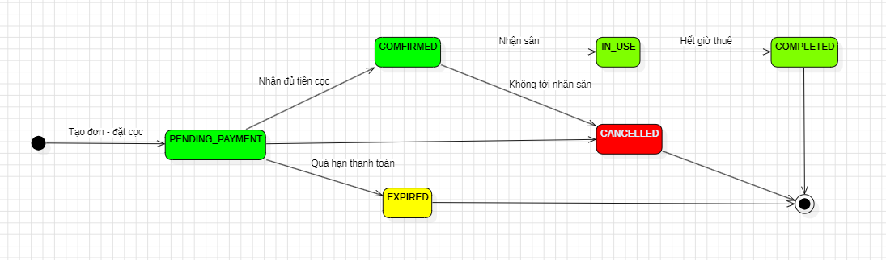

| **Chuyển trạng thái** | **Tác nhân** | **Điều kiện bắt buộc** | **Tác động** |
| --- | --- | --- | --- |
| (mới) → PENDING_PAYMENT | Khách, Nhân viên | Ô trống, trong giờ mở cửa, sân không khóa | Giữ ô, HoldExpireAt = now + 10 phút, trừ lượt KM |
| PENDING_PAYMENT → CONFIRMED | Webhook QR hoặc Nhân viên xác nhận thu tiền mặt | Số tiền = AmountDueNow, còn hạn giữ chỗ | PaymentStatus = DEPOSITED hoặc PAID; tạo phiếu thu; lên lịch nhắc |
| PENDING_PAYMENT → EXPIRED | Job expireHolds | now > HoldExpireAt | Giải phóng ô, hoàn lượt KM, QR → EXPIRED |
| PENDING_PAYMENT → CANCELED | Khách hủy hoặc nhân vi“Hủy tạo đơn” | — | CancelType = CUSTOMER_REQUEST / COUNTER_ABORT; giải phóng ô, hoàn lượt KM |
| CONFIRMED | Nhân viên tất toán / webhook QR | Số tiền = RemainingAmount | Ghi Payments |
| CONFIRMED → IN_USE | Nhân viên “Nhận sân” | PaymentStatus = PAID; không có đơn IN_USE khác trên cùng sân | CheckInAt = now |
| IN_USE → COMPLETED | Job autoComplete / NV “Kết thúc sớm” | now ≥ EndAt hoặc thao tác thủ công | CompletedAt = now |
| CONFIRMED → CANCELED | Khách, Nhân viên, Job noShow, Xử lý đơn bị ảnh hưởng | CUSTOMER_REQUEST: trước StartAt. NO_SHOW: now ≥ StartAt + 30 phút. BY_FACILITY: do khóa sân/ngày nghỉ | Giải phóng ô; tính RefundRate/RefundAmount; tạo Refunds nếu > 0 |

## 2.8. Tác vụ chạy nền

Các job chạy trong tiến trình backend bằng node-cron. Khi chạy nhiều instance (PM2 cluster), chỉ instance giữ khóa ứng dụng sp_getapplock(@Resource="sporthub-jobs") mới thực thi, tránh chạy trùng. Mọi job đều **idempotent** (điều kiện WHERE theo trạng thái).

| **Job** | **Chu kỳ** | **Điều kiện chọn đơn** | **Hành động** |
| --- | --- | --- | --- |
| expireHolds | 30 giây | Status='PENDING_PAYMENT' AND HoldExpireAt < now | Status = EXPIRED; BookingSlots.IsActive = 0; hoàn lượt KM; PaymentRequests → EXPIRED; socket slot.updated (UC 004-4a, 005-2a, 011-2c) |
| sendReminders | 1 phút | Status='CONFIRMED' AND ReminderSentAt IS NULL AND StartAt <= now + 60 phút | Tạo thông báo REMINDER (giờ nhận sân, địa chỉ, tên sân, số tiền còn thiếu); ReminderSentAt = now (FR 11) |
| cancelNoShows | 1 phút | Status='CONFIRMED' AND now >= StartAt + 30 phút | Status = CANCELED, CancelType = NO_SHOW, RefundRate = 0; giải phóng ô (UC 007-4a) |
| autoComplete | 1 phút | Status='IN_USE' AND EndAt <= now | Status = COMPLETED (UC 014-3) |
| expireQr | 1 phút | PaymentRequests.Status='PENDING' AND ExpiresAt < now | Status = EXPIRED |
| retryPromoNotify | 15 phút | Promotions.NotifyStatus='FAILED' | Gửi lại thông báo ưu đãi (UC 022-3a) |

# 3. Thiết kế cơ sở dữ liệu

## 3.1. Tổng quan

Cơ sở dữ liệu gồm **26 bảng**, chia thành 6 nhóm, đáp ứng đủ 19 chức năng cùng 24 use case trong SRS.

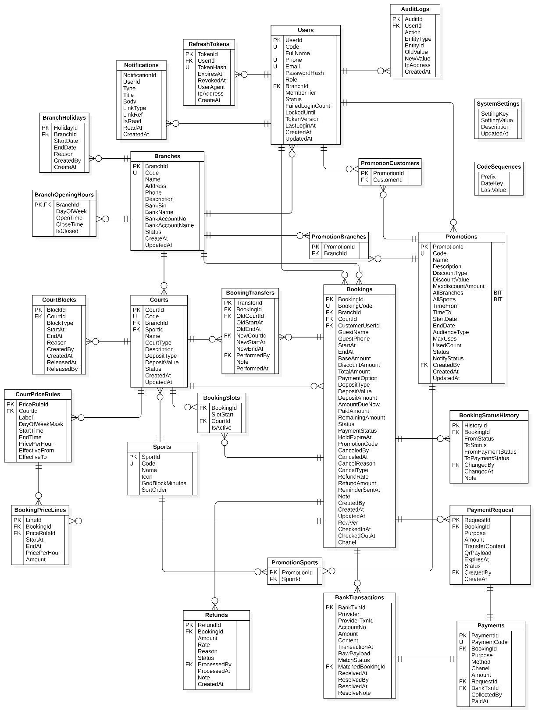

| Nhóm | Bảng | Vai trò |
| --- | --- | --- |
| Người dùng, bảo mật & thông báo | Users, RefreshTokens, AuditLogs, Notifications | Tài khoản 3 vai trò, phiên đăng nhập, nhật ký thao tác, thông báo cho khách hàng |
| Chi nhánh & sân | Branches, BranchOpeningHours, BranchHolidays, Sports, Courts, CourtPriceRules, CourtBlocks | Cơ sở, giờ mở cửa, ngày nghỉ, môn thể thao, sân, bảng giá, lịch khóa sân |
| Đặt sân | Bookings, BookingSlots, BookingPriceLines, BookingStatusHistory, BookingTransfers | Đơn đặt, ô lịch chống trùng, đơn giá bảo lưu, lịch sử trạng thái, chuyển sân |
| Thanh toán & hoàn tiền | PaymentRequests, Payments, BankTransactions, Refunds | Mã QR, phiếu thu, giao dịch ngân hàng, hoàn tiền |
| Khuyến mãi | Promotions, PromotionBranches, PromotionSports, PromotionCustomers | Chương trình, mã ưu đãi và phạm vi áp dụng |
| Hệ thống | SystemSettings, CodeSequences | Tham số cấu hình, sinh mã nghiệp vụ |

## 3.2. Quy ước chung

| Nội dung | Quy ước |
| --- | --- |
| Khóa chính | INT IDENTITY cho bảng danh mục (Branches, Sports, Courts, Promotions); BIGINT IDENTITY cho bảng giao dịch và nhật ký |
| Tiền | DECIMAL(18,0), đơn vị VNĐ, không âm |
| Tỷ lệ hoặc giá trị cọc, giảm giá | DECIMAL(18,2): khi là % thì từ 0 đến 100; khi là số tiền thì tính bằng VNĐ |
| Thời điểm | DATETIME2(0), lưu giờ Việt Nam (UTC+7) vì mọi cơ sở cùng múi giờ |
| Giờ trong ngày, ngày | TIME(0) cho giờ mở cửa và khung giá; DATE cho ngày nghỉ và hạn khuyến mãi |
| Văn bản | NVARCHAR cho nội dung tiếng Việt; VARCHAR cho mã, số điện thoại, email, trạng thái |
| Trạng thái, phân loại | VARCHAR(20) mã tiếng Anh viết hoa + ràng buộc CHECK; danh mục giá trị ở mục 11 |
| Mã nghiệp vụ | Tiền tố + ngày yyyyMMdd + số thứ tự trong ngày, sinh từ CodeSequences. Ví dụ BK2026111001 (đơn), PT2026111001 (phiếu thu) |
| Cột thời gian hệ thống | CreatedAt mặc định SYSDATETIME(); UpdatedAt cập nhật mỗi lần sửa |
| Xóa dữ liệu | Không xóa cứng Users, Branches, Courts, Promotions đã phát sinh giao dịch; chuyển Status (UC 016, UC 022) |
| Đồng thời | Bookings.RowVer cho khóa lạc quan; chỉ mục duy nhất trên BookingSlots chặn trùng lịch ở mức CSDL |

## 3.3. Đặc tả chi tiết

### a. Nhóm người dùng, bảo mật & thông báo

#### Users – Tài khoản người dùng

| Cột | Kiểu dữ liệu | Ràng buộc | Mô tả |
| --- | --- | --- | --- |
| UserId | BIGINT | PK, IDENTITY | Khóa nội bộ |
| Code | VARCHAR(20) | U, NN | Mã người dùng hiển thị (KH…, NV…), sinh từ CodeSequences |
| FullName | NVARCHAR(100) | NN | Họ tên, 2–100 ký tự |
| Phone | VARCHAR(10) | U, NN; CHECK 10 chữ số, bắt đầu bằng 0 | Số điện thoại, dùng làm tên đăng nhập |
| Email | VARCHAR(255) | U (lọc WHERE Email IS NOT NULL), N | Bắt buộc với Khách hàng (UC 003), tùy chọn với nhân viên (UC 016); đăng nhập được bằng email |
| PasswordHash | VARCHAR(255) | NN | Mật khẩu đã băm (bcrypt/Argon2); mật khẩu gốc 6–32 ký tự, không lưu |
| Role | VARCHAR(20) | NN; CHECK OWNER, STAFF, CUSTOMER | Vai trò, quyết định giao diện sau đăng nhập |
| BranchId | INT | FK → Branches, N | Cơ sở được phân công. CHECK: bắt buộc khi Role = STAFF; NULL khi OWNER hoặc CUSTOMER |
| MemberTier | VARCHAR(20) | N | Hạng thành viên của khách hàng, dùng chọn đối tượng tri ân. SRS chưa định nghĩa các hạng |
| Status | VARCHAR(20) | NN, DF ACTIVE; CHECK ACTIVE, LOCKED | LOCKED chặn đăng nhập nhưng giữ lịch sử giao dịch (FR 03) |
| FailedLoginCount | TINYINT | NN, DF 0 | Số lần sai mật khẩu liên tiếp; về 0 khi đăng nhập thành công |
| LockedUntil | DATETIME2(0) | N | Khóa tạm: khi sai 5 lần, gán = hiện tại + 5 phút (UC 001, luồng 2b) |
| TokenVersion | INT | NN, DF 0 | Tăng khi khóa tài khoản hoặc đặt lại mật khẩu để vô hiệu token cũ, ngắt phiên đang mở (UC 016) |
| LastLoginAt | DATETIME2(0) | N | Lần đăng nhập gần nhất |
| CreatedAt | DATETIME2(0) | NN, DF | Thời điểm tạo |
| UpdatedAt | DATETIME2(0) | NN, DF | Thời điểm sửa gần nhất |

Mỗi nhân viên chỉ thuộc một cơ sở và chỉ thao tác trên dữ liệu của cơ sở đó; Chủ sân xem được toàn hệ thống.

#### RefreshTokens – Phiên đăng nhập

Lưu refresh token theo từng thiết bị để duy trì và kết thúc phiên

| Cột | Kiểu dữ liệu | Ràng buộc | Mô tả |
| --- | --- | --- | --- |
| TokenId | BIGINT | PK, IDENTITY | Khóa nội bộ |
| UserId | BIGINT | FK → Users, NN | Chủ phiên |
| TokenHash | VARCHAR(128) | U, NN | Băm SHA-256 của refresh token; không lưu token gốc |
| ExpiresAt | DATETIME2(0) | NN | Hết hạn token |
| RevokedAt | DATETIME2(0) | N | Gán khi đăng xuất, khóa tài khoản hoặc đổi mật khẩu |
| UserAgent | NVARCHAR(500) | N | Trình duyệt, thiết bị |
| IpAddress | VARCHAR(45) | N | IPv4 hoặc IPv6 |
| CreatedAt | DATETIME2(0) | NN, DF | Thời điểm cấp (nên đổi thành CreatedAt) |

Token hợp lệ khi RevokedAt IS NULL và ExpiresAt lớn hơn thời điểm hiện tại.

#### AuditLogs – Nhật ký thao tác

Ghi vết các thay đổi quan trọng: tài khoản, giá sân, cấu hình, khuyến mãi (mục tiêu minh bạch dữ liệu trong SRS).

| Cột | Kiểu dữ liệu | Ràng buộc | Mô tả |
| --- | --- | --- | --- |
| AuditId | BIGINT | PK, IDENTITY | Khóa nội bộ |
| UserId | BIGINT | FK → Users, N | Người thao tác; NULL khi do tác vụ tự động |
| Action | VARCHAR(50) | NN | CREATE, UPDATE, DELETE, LOCK, UNLOCK, RESET_PASSWORD… |
| EntityType | VARCHAR(50) | NN | Tên bảng bị tác động |
| EntityId | VARCHAR(50) | NN | Khóa bản ghi (chuỗi để hỗ trợ khóa ghép) |
| OldValue | NVARCHAR(MAX) | N | Giá trị trước, dạng JSON |
| NewValue | NVARCHAR(MAX) | N | Giá trị sau, dạng JSON |
| IpAddress | VARCHAR(45) | N | Địa chỉ IP |
| CreatedAt | DATETIME2(0) | NN, DF | Thời điểm ghi |

Chỉ mục: (EntityType, EntityId) và (UserId, CreatedAt).

#### Notifications – Thông báo

Hộp thông báo của khách hàng có tài khoản: kết quả thanh toán, nhắc lịch trước 1 giờ, khuyến mãi – tri ân, thay đổi lịch. Khách vãng lai không có tài khoản nên không nhận.

| Cột | Kiểu dữ liệu | Ràng buộc | Mô tả |
| --- | --- | --- | --- |
| NotificationId | BIGINT | PK, IDENTITY | Khóa nội bộ |
| UserId | BIGINT | FK → Users, NN | Người nhận (Role = CUSTOMER) |
| Type | VARCHAR(20) | NN; CHECK PAYMENT_RESULT, REMINDER, PROMOTION, SCHEDULE_CHANGE | Loại thông báo; dùng cho bộ lọc theo loại ở UC 026 |
| Title | NVARCHAR(150) | NN | Tiêu đề hiển thị trong danh sách |
| Body | NVARCHAR(1000) | NN | Nội dung chi tiết: mã đơn, số tiền đã nhận, giờ nhận sân, số tiền còn thiếu, mã voucher… (đã dựng sẵn lúc gửi) |
| LinkType | VARCHAR(20) | N; CHECK BOOKING, PROMOTION | Loại đối tượng được liên kết khi khách bấm vào thông báo |
| LinkRef | VARCHAR(50) | N | Khóa của đối tượng: BookingId hoặc PromotionId. CHECK: LinkType và LinkRef cùng NULL hoặc cùng có giá trị |
| IsRead | BIT | NN, DF 0 | Đã đọc; đếm số chưa đọc trên biểu tượng Thông báo |
| ReadAt | DATETIME2(0) | N | Thời điểm đọc; có giá trị khi IsRead = 1 |
| CreatedAt | DATETIME2(0) | NN, DF | Thời điểm gửi; sắp xếp mới nhất trước |

LinkType/LinkRef là liên kết đa hình nên không tạo được FK; ứng dụng kiểm tra đối tượng còn tồn tại khi mở. Chỉ mục: (UserId, IsRead, CreatedAt).

### b. Nhóm chi nhánh & sân

#### Branches – Cơ sở

Thông tin cơ sở và tài khoản ngân hàng nhận tiền riêng của từng cơ sở, dùng để sinh mã VietQR.

| Cột | Kiểu dữ liệu | Ràng buộc | Mô tả |
| --- | --- | --- | --- |
| BranchId | INT | PK, IDENTITY | Khóa nội bộ |
| Code | VARCHAR(20) | U, NN | Mã cơ sở, ví dụ CS01 |
| Name | NVARCHAR(150) | NN | Tên cơ sở, ví dụ "Cơ sở 1 - Cầu Giấy" |
| Address | NVARCHAR(255) | NN | Địa chỉ |
| Phone | VARCHAR(15) | N | Số liên hệ |
| Description | NVARCHAR(1000) | N | Giới thiệu, tiện ích |
| BankBin | VARCHAR(8) | N | Mã BIN ngân hàng theo chuẩn VietQR (6 chữ số) |
| BankName | NVARCHAR(100) | N | Tên ngân hàng |
| BankAccountNo | VARCHAR(30) | N | Số tài khoản nhận tiền; cũng dùng để nhận biết cơ sở của giao dịch đến |
| BankAccountName | NVARCHAR(100) | N | Tên chủ tài khoản (in hoa, không dấu) |
| Status | VARCHAR(20) | NN, DF ACTIVE; CHECK ACTIVE, INACTIVE | Cơ sở INACTIVE không hiện khi đặt sân |
| CreateAt | DATETIME2(0) | NN, DF | Thời điểm tạo (nên đổi thành CreatedAt) |
| UpdatedAt | DATETIME2(0) | NN, DF | Thời điểm sửa |

Bốn cột Bank* để NULL khi mới tạo cơ sở, nhưng phải đủ trước khi cơ sở nhận thanh toán chuyển khoản (tiền điều kiện UC 005).

#### BranchOpeningHours – Giờ mở cửa theo ngày trong tuần

Mỗi cơ sở có tối đa 7 dòng. Khóa chính ghép (BranchId, DayOfWeek).

| Cột | Kiểu dữ liệu | Ràng buộc | Mô tả |
| --- | --- | --- | --- |
| BranchId | INT | PK, FK → Branches | Cơ sở |
| DayOfWeek | TINYINT | PK; CHECK 1–7 | 1 = Thứ 2 … 7 = Chủ nhật |
| OpenTime | TIME(0) | N | Giờ mở cửa |
| CloseTime | TIME(0) | N | Giờ đóng cửa. CHECK: IsClosed = 1 hoặc OpenTime < CloseTime (UC 020, luồng 2a) |
| IsClosed | BIT | NN, DF 0 | 1 = nghỉ cố định ngày đó |

Thiết kế này không hỗ trợ mở cửa qua nửa đêm, phù hợp ví dụ 05:00–23:00 trong SRS.

#### BranchHolidays – Ngày nghỉ lễ, tạm nghỉ

Lịch nghỉ chung của cơ sở. Khi Chủ sân chọn "Tất cả cơ sở", ứng dụng tạo một dòng cho mỗi cơ sở.

| Cột | Kiểu dữ liệu | Ràng buộc | Mô tả |
| --- | --- | --- | --- |
| HolidayId | INT | PK, IDENTITY | Khóa nội bộ |
| BranchId | INT | FK → Branches, NN | Cơ sở nghỉ |
| StartDate | DATE | NN | Ngày bắt đầu nghỉ |
| EndDate | DATE | NN; CHECK StartDate <= EndDate | Ngày kết thúc nghỉ (UC 020, luồng 2c) |
| Reason | NVARCHAR(255) | N | Lý do, ví dụ "Nghỉ Tết Dương lịch" |
| CreatedBy | BIGINT | FK → Users, NN | Người tạo |
| CreateAt | DATETIME2(0) | NN, DF | Thời điểm tạo (nên đổi thành CreatedAt) |

#### Sports – Môn thể thao

Danh mục môn: bóng đá, cầu lông, tennis, bóng rổ, pickleball.

| Cột | Kiểu dữ liệu | Ràng buộc | Mô tả |
| --- | --- | --- | --- |
| SportId | INT | PK, IDENTITY | Khóa nội bộ |
| Code | VARCHAR(20) | U, NN | FOOTBALL, BADMINTON, TENNIS, BASKETBALL, PICKLEBALL |
| Name | NVARCHAR(100) | NN | Tên hiển thị |
| Icon | VARCHAR(255) | N | Đường dẫn hoặc tên biểu tượng |
| GridBlockMinutes | SMALLINT | NN, DF 30; CHECK 15, 30, 60 | Độ dài một ô trên lưới lịch; giờ bắt đầu và kết thúc đơn phải là bội số của giá trị này |
| SortOrder | INT | NN, DF 0 | Thứ tự hiển thị |

#### Courts – Sân

Sân thuộc một cơ sở và một môn, kèm cấu hình đặt cọc (FR 05, 06; UC 017, 018).

| Cột | Kiểu dữ liệu | Ràng buộc | Mô tả |
| --- | --- | --- | --- |
| CourtId | INT | PK, IDENTITY | Khóa nội bộ |
| Code | VARCHAR(20) | U, NN | Mã sân, ví dụ SAN_BD_03 |
| BranchId | INT | FK → Branches, NN | Cơ sở trực thuộc. Chỉ đổi khi sân không còn đơn chưa hoàn thành (UC 018, luồng 2b) |
| SportId | INT | FK → Sports, NN | Môn thể thao |
| Name | NVARCHAR(100) | NN; U (BranchId, Name) | Tên sân, không trùng trong cùng cơ sở (UC 017, luồng 1a) |
| CourtType | NVARCHAR(50) | N | Loại sân trong môn, ví dụ "Sân 7 người" |
| Description | NVARCHAR(500) | N | Mô tả, tối đa 500 ký tự. ERD đang lặp cột này 2 lần, cần bỏ một |
| DepositType | VARCHAR(10) | NN; CHECK PERCENT, FIXED | Cách tính cọc: theo % giá trị đơn hoặc số tiền cố định |
| DepositValue | DECIMAL(18,2) | NN | PERCENT: 10–100; FIXED: lớn hơn 0 VNĐ |
| Status | VARCHAR(20) | NN, DF ACTIVE; CHECK ACTIVE, INACTIVE | INACTIVE = ngừng khai thác. Tạm khóa có thời hạn ghi ở CourtBlocks |
| CreatedAt | DATETIME2(0) | NN, DF | Thời điểm tạo |
| UpdatedAt | DATETIME2(0) | NN, DF | Thời điểm sửa |

#### CourtPriceRules – Bảng giá theo khung giờ

Mỗi dòng là một khung giá của sân trong một khoảng hiệu lực. Khi sửa giá, ứng dụng đóng dòng cũ bằng EffectiveTo và tạo dòng mới, nên giá cũ vẫn còn để tra cứu.

| Cột | Kiểu dữ liệu | Ràng buộc | Mô tả |
| --- | --- | --- | --- |
| PriceRuleId | BIGINT | PK, IDENTITY | Khóa nội bộ |
| CourtId | INT | FK → Courts, NN | Sân |
| Label | NVARCHAR(50) | NN | Tên khung, ví dụ "Giờ thường", "Giờ cao điểm" |
| DayOfWeekMask | TINYINT | NN; CHECK 1–127 | Mặt nạ bit ngày áp dụng: bit 0 = Thứ 2 … bit 6 = Chủ nhật; 127 = mọi ngày |
| StartTime | TIME(0) | NN | Giờ bắt đầu khung |
| EndTime | TIME(0) | NN; CHECK StartTime < EndTime | Giờ kết thúc khung |
| PricePerHour | DECIMAL(18,0) | NN; CHECK > 0 | Đơn giá VNĐ/giờ |
| EffectiveFrom | DATETIME2(0) | NN | Bắt đầu hiệu lực |
| EffectiveTo | DATETIME2(0) | N | Kết thúc hiệu lực; NULL = đang áp dụng |

Quy tắc kiểm tra ở tầng ứng dụng: các dòng cùng sân, cùng ngày (mặt nạ giao nhau) và cùng thời gian hiệu lực không được chồng lấp khung giờ (UC 017, luồng 2a).

#### CourtBlocks – Lịch khóa sân

Khóa sân để bảo trì có thời hạn hoặc ngừng khai thác. Trong khoảng hiệu lực, hệ thống không nhận đơn mới trên sân.

| Cột | Kiểu dữ liệu | Ràng buộc | Mô tả |
| --- | --- | --- | --- |
| BlockId | BIGINT | PK, IDENTITY | Khóa nội bộ |
| CourtId | INT | FK → Courts, NN | Sân bị khóa |
| BlockType | VARCHAR(20) | NN; CHECK MAINTENANCE, DECOMMISSION | Tạm khóa có thời hạn / Ngừng khai thác |
| StartAt | DATETIME2(0) | NN | Bắt đầu khóa |
| EndAt | DATETIME2(0) | N; CHECK StartAt < EndAt | Bắt buộc với MAINTENANCE; NULL với DECOMMISSION |
| Reason | NVARCHAR(255) | NN | Lý do khóa (UC 019, luồng 1a) |
| CreatedBy | BIGINT | FK → Users, NN | Người khóa |
| CreatedAt | DATETIME2(0) | NN, DF | Thời điểm tạo |
| ReleasedAt | DATETIME2(0) | N | Mở khóa sớm (UC 019, luồng 1b) |
| ReleasedBy | BIGINT | FK → Users, N | Người mở khóa |

Khoảng khóa thực tế = từ StartAt đến giá trị sớm nhất trong ReleasedAt và EndAt; nếu cả hai NULL thì khóa vô thời hạn.

### c. Nhóm đặt sân

#### Bookings – Đơn đặt sân

Mỗi đơn là một sân trong một khoảng thời gian liên tục; đặt nhiều sân hoặc nhiều khung rời sẽ tạo nhiều đơn. Các cột tiền và cọc được chụp lại lúc tạo đơn, nên sửa giá sân về sau không ảnh hưởng đơn cũ.

| Cột | Kiểu dữ liệu | Ràng buộc | Mô tả |
| --- | --- | --- | --- |
| BookingId | BIGINT | PK, IDENTITY | Khóa nội bộ |
| BookingCode | VARCHAR(20) | U, NN | Mã đơn, ví dụ BK2026111001; dùng trong nội dung chuyển khoản |
| BranchId | INT | FK → Branches, NN | Cơ sở của đơn, lưu dư để lọc và phân quyền theo cơ sở |
| CourtId | INT | FK → Courts, NN | Sân hiện tại; cập nhật khi chuyển sân (UC 021) |
| CustomerUserId | BIGINT | FK → Users, N | Khách có tài khoản; NULL = khách vãng lai |
| GuestName | NVARCHAR(100) | N | Tên khách vãng lai (UC 010) |
| GuestPhone | VARCHAR(10) | N | SĐT khách vãng lai. CHECK: CustomerUserId IS NOT NULL hoặc cả GuestName và GuestPhone có giá trị |
| StartAt | DATETIME2(0) | NN | Giờ bắt đầu chơi |
| EndAt | DATETIME2(0) | NN; CHECK StartAt < EndAt | Giờ kết thúc; cùng ngày với StartAt |
| BaseAmount | DECIMAL(18,0) | NN | Tổng tiền gốc = tổng BookingPriceLines.Amount |
| DiscountAmount | DECIMAL(18,0) | NN, DF 0 | Số tiền giảm từ khuyến mãi |
| TotalAmount | DECIMAL(18,0) | NN; CHECK >= 0 | = BaseAmount − DiscountAmount |
| PaymentOption | VARCHAR(10) | NN, DF FULL; CHECK FULL, DEPOSIT | Thanh toán 100% hoặc Đặt cọc giữ sân |
| DepositType | VARCHAR(10) | N | Chụp từ Courts.DepositType lúc tạo đơn |
| DepositValue | DECIMAL(18,2) | N | Chụp từ Courts.DepositValue lúc tạo đơn |
| DepositAmount | DECIMAL(18,0) | NN, DF 0; CHECK <= TotalAmount | Tiền cọc phải đóng; = 0 khi FULL. Nếu cọc tính ra bằng TotalAmount thì xử lý như FULL (UC 007, luồng 1a) |
| AmountDueNow | DECIMAL(18,0) | NN | Số tiền cần thu ngay = DepositAmount (DEPOSIT) hoặc TotalAmount (FULL) |
| PaidAmount | DECIMAL(18,0) | NN, DF 0 | Tổng tiền đã thu, cộng dồn từ Payments |
| RemainingAmount | DECIMAL(18,0) | NN | = TotalAmount − PaidAmount; phải bằng 0 trước khi nhận sân (FR 13) |
| Status | VARCHAR(20) | NN, DF PENDING_PAYMENT | Trạng thái đơn, 6 giá trị (mục 11) |
| PaymentStatus | VARCHAR(20) | NN, DF UNPAID | Trạng thái tiền: UNPAID, DEPOSITED, PAID |
| HoldExpireAt | DATETIME2(0) | N | Hết hạn giữ chỗ tạm = thời điểm tạo + BOOKING_HOLD_MINUTES; quá hạn mà chưa thu tiền thì tác vụ nền chuyển EXPIRED |
| PromotionCode | VARCHAR(20) | N | Mã khuyến mãi đã áp dụng (bản chụp); tra Promotions qua Promotions.Code |
| CanceledBy | BIGINT | FK → Users, N | Người hủy; NULL khi hệ thống tự hủy do khách không đến |
| CanceledAt | DATETIME2(0) | N | Thời điểm hủy, dùng tính mốc hoàn tiền |
| CancelReason | NVARCHAR(255) | N | Lý do hủy; bắt buộc khi Status = CANCELED (UC 009, luồng 2a) |
| CancelType | VARCHAR(20) | N | CUSTOMER_REQUEST, NO_SHOW, BY_FACILITY, COUNTER_ABORT (mục 11) |
| RefundRate | DECIMAL(5,2) | N; CHECK 0, 50, 100 | Tỷ lệ hoàn: trước giờ chơi từ 5 ngày = 100; từ 2 đến dưới 5 ngày = 50; dưới 2 ngày hoặc NO_SHOW = 0 |
| RefundAmount | DECIMAL(18,0) | N | = (PaidAmount − DepositAmount) × RefundRate / 100; tiền cọc không bao giờ được hoàn |
| ReminderSentAt | DATETIME2(0) | N | Đã gửi nhắc lịch trước 1 giờ; chống gửi lặp. Đặt lại NULL khi chuyển giờ (UC 021) |
| Note | NVARCHAR(500) | N | Ghi chú |
| CreatedBy | BIGINT | FK → Users, N | Người lập đơn: nhân viên (tại quầy) hoặc chính khách hàng (trực tuyến) |
| CreatedAt | DATETIME2(0) | NN, DF | Thời điểm tạo |
| UpdatedAt | DATETIME2(0) | NN, DF | Thời điểm sửa |
| RowVer | ROWVERSION | NN | Khóa lạc quan: chặn hủy khi đơn vừa đổi trạng thái (UC 009, luồng 2d) |
| CheckedInAt | DATETIME2(0) | N | Thời điểm nhận sân thực tế, khi đơn chuyển sang IN_USE (UC 014 bước 2) |
| CheckedOutAt | DATETIME2(0) | N | Thời điểm trả sân, khi đơn chuyển sang COMPLETED: tự động lúc hết giờ hoặc nhân viên kết thúc sớm (UC 014 luồng 3a). CHECK CheckedInAt <= CheckedOutAt |
| Chanel | VARCHAR(20) | NN; CHECK ONLINE, COUNTER | Kênh đặt: trực tuyến (UC 004) / tại quầy (UC 010) (nên sửa chính tả thành Channel) |

Chỉ mục: (BranchId, StartAt), (CourtId, StartAt), (CustomerUserId, StartAt), (Status, HoldExpireAt) cho tác vụ quét đơn quá hạn.

#### BookingSlots – Ô lịch đã chiếm

Tách đơn thành các ô theo Sports.GridBlockMinutes để CSDL tự chặn trùng lịch khi hai người đặt cùng lúc. Khóa chính ghép (BookingId, CourtId, SlotStart).

| Cột | Kiểu dữ liệu | Ràng buộc | Mô tả |
| --- | --- | --- | --- |
| BookingId | BIGINT | PK, FK → Bookings | Đơn chiếm ô |
| CourtId | INT | PK, FK → Courts | Sân |
| SlotStart | DATETIME2(0) | PK | Mốc bắt đầu ô. Ví dụ đơn 18:00–20:00, ô 30 phút → 4 dòng 18:00, 18:30, 19:00, 19:30 |
| IsActive | BIT | NN, DF 1 | 1 khi đơn ở PENDING_PAYMENT, CONFIRMED, IN_USE; về 0 khi đơn hủy, quá hạn hoặc ô cũ sau chuyển sân |

Ràng buộc chính: chỉ mục duy nhất có lọc (CourtId, SlotStart) WHERE IsActive = 1. Lịch khóa sân và ngày nghỉ vẫn kiểm tra ở tầng ứng dụng.

#### BookingPriceLines – Chi tiết giá của đơn

Lưu đơn giá đã dùng cho từng đoạn thời gian; một đơn vắt qua hai khung giá có hai dòng (FR 06 bảo lưu giá).

| Cột | Kiểu dữ liệu | Ràng buộc | Mô tả |
| --- | --- | --- | --- |
| LineId | BIGINT | PK, IDENTITY | Khóa nội bộ |
| BookingId | BIGINT | FK → Bookings, NN | Đơn |
| PriceRuleId | BIGINT | FK → CourtPriceRules, NN | Khung giá đã áp dụng |
| StartAt | DATETIME2(0) | NN | Đầu đoạn |
| EndAt | DATETIME2(0) | NN; CHECK StartAt < EndAt | Cuối đoạn |
| PricePerHour | DECIMAL(18,0) | NN | Đơn giá chụp lại lúc tạo đơn |
| Amount | DECIMAL(18,0) | NN | = PricePerHour × số phút của đoạn / 60 |

Ví dụ: đơn 15:00–17:00, giờ thường 300.000đ/h đến 16:00 và cao điểm 600.000đ/h từ 16:00 → 2 dòng, BaseAmount = 900.000đ.

#### BookingStatusHistory – Lịch sử trạng thái đơn

Mỗi lần Status hoặc PaymentStatus thay đổi ghi một dòng (FR 13, UC 014), dùng để truy vết ai đổi và đổi lúc nào.

| Cột | Kiểu dữ liệu | Ràng buộc | Mô tả |
| --- | --- | --- | --- |
| HistoryId | BIGINT | PK, IDENTITY | Khóa nội bộ |
| BookingId | BIGINT | FK → Bookings, NN | Đơn |
| FromStatus | VARCHAR(20) | N | Trạng thái cũ; NULL ở dòng tạo đơn |
| ToStatus | VARCHAR(20) | NN | Trạng thái mới |
| FromPaymentStatus | VARCHAR(20) | N | Trạng thái tiền cũ |
| ToPaymentStatus | VARCHAR(20) | N | Trạng thái tiền mới |
| ChangedBy | BIGINT | FK → Users, N | Người thay đổi; NULL = hệ thống (hết hạn, tự hoàn thành, webhook) |
| ChangedAt | DATETIME2(0) | NN, DF | Thời điểm |
| Note | NVARCHAR(500) | N | Ghi chú |

#### BookingTransfers – Nhật ký chuyển sân, đổi giờ

Ghi lại khi đơn bị ảnh hưởng bởi khóa sân hoặc ngày nghỉ được chuyển sang sân/khung giờ khác trong cùng cơ sở. Mã đơn, giá trị đơn và số tiền đã đóng giữ nguyên.

| Cột | Kiểu dữ liệu | Ràng buộc | Mô tả |
| --- | --- | --- | --- |
| TransferId | BIGINT | PK, IDENTITY | Khóa nội bộ |
| BookingId | BIGINT | FK → Bookings, NN | Đơn được chuyển |
| OldCourtId | INT | FK → Courts, NN | Sân cũ |
| OldStartAt | DATETIME2(0) | NN | Giờ bắt đầu cũ |
| OldEndAt | DATETIME2(0) | NN | Giờ kết thúc cũ |
| NewCourtId | INT | FK → Courts, NN | Sân mới, cùng cơ sở với sân cũ |
| NewStartAt | DATETIME2(0) | NN | Giờ bắt đầu mới |
| NewEndAt | DATETIME2(0) | NN; CHECK NewStartAt < NewEndAt | Giờ kết thúc mới |
| PerformedBy | BIGINT | FK → Users, NN | Người thực hiện |
| Note | NVARCHAR(255) | N | Ghi chú xử lý |
| PerformedAt | DATETIME2(0) | NN, DF | Thời điểm chuyển (UC 021 bước 3) |

### d. Nhóm thanh toán & hoàn tiền

Luồng chuyển khoản gồm 3 bước: sinh mã QR (PaymentRequests) → nhận webhook từ cổng thanh toán (BankTransactions) → khớp được đơn thì tạo phiếu thu (Payments). Tiền mặt tại quầy đi thẳng vào Payments.

#### PaymentRequests – Yêu cầu thanh toán QR

Mỗi lần sinh hoặc tạo lại mã QR là một dòng (UC 005, UC 012 luồng 3c).

| Cột | Kiểu dữ liệu | Ràng buộc | Mô tả |
| --- | --- | --- | --- |
| RequestId | BIGINT | PK, IDENTITY | Khóa nội bộ |
| BookingId | BIGINT | FK → Bookings, NN | Đơn cần thu |
| Purpose | VARCHAR(20) | NN; CHECK DEPOSIT, FULL, REMAINING | Thu cọc / thu 100% / thu phần còn lại khi tất toán |
| Amount | DECIMAL(18,0) | NN; CHECK > 0 | Số tiền trong mã QR |
| TransferContent | VARCHAR(50) | NN | Nội dung chuyển khoản chứa mã đơn, ví dụ THANHTOAN BK2026111001 |
| QrPayload | VARCHAR(1000) | NN | Chuỗi VietQR (EMVCo) để vẽ mã QR |
| ExpiresAt | DATETIME2(0) | NN | Hết hiệu lực mã; không vượt Bookings.HoldExpireAt khi đơn đang chờ |
| Status | VARCHAR(20) | NN, DF PENDING; CHECK PENDING, PAID, EXPIRED, CANCELED | Trạng thái mã |
| CreatedBy | BIGINT | FK → Users, N | Nhân viên tạo tại quầy; NULL khi khách thanh toán trực tuyến |
| CreateAt | DATETIME2(0) | NN, DF | Thời điểm tạo (nên đổi thành CreatedAt) |

Mỗi đơn chỉ có một yêu cầu PENDING tại một thời điểm: chỉ mục duy nhất có lọc (BookingId) WHERE Status = 'PENDING'. Tạo mã mới thì chuyển mã cũ sang EXPIRED; hủy đơn thì chuyển sang CANCELED (UC 009 bước 3).

#### BankTransactions – Giao dịch ngân hàng nhận được

Lưu nguyên văn mọi giao dịch cổng thanh toán báo về, kể cả giao dịch không khớp, để đối soát (UC 005 luồng 2c–2e, UC 012 luồng 3d).

| Cột | Kiểu dữ liệu | Ràng buộc | Mô tả |
| --- | --- | --- | --- |
| BankTxnId | BIGINT | PK, IDENTITY | Khóa nội bộ |
| Provider | VARCHAR(30) | NN | Tên cổng/dịch vụ báo giao dịch |
| ProviderTxnId | VARCHAR(100) | NN; U (Provider, ProviderTxnId) | Mã giao dịch phía cổng; ràng buộc duy nhất giúp bỏ qua webhook gửi trùng (UC 005, luồng 2e) |
| AccountNo | VARCHAR(30) | NN | Tài khoản nhận; xác định cơ sở qua Branches.BankAccountNo |
| Amount | DECIMAL(18,0) | NN | Số tiền thực nhận |
| Content | NVARCHAR(500) | N | Nội dung chuyển khoản gốc |
| TransactionAt | DATETIME2(0) | NN | Thời điểm ngân hàng ghi nhận |
| RawPayload | NVARCHAR(MAX) | NN | Dữ liệu webhook gốc (JSON) |
| MatchStatus | VARCHAR(20) | NN, DF PENDING | PENDING, MATCHED, NEEDS_REVIEW, RESOLVED, IGNORED (mục 11) |
| MatchedBookingId | BIGINT | FK → Bookings, N | Đơn khớp được; NULL khi không tìm thấy |
| ReceivedAt | DATETIME2(0) | NN, DF | Thời điểm hệ thống nhận webhook |
| ResolvedBy | BIGINT | FK → Users, N | Người đối soát thủ công |
| ResolvedAt | DATETIME2(0) | N | Thời điểm đối soát |
| ResolveNote | NVARCHAR(500) | N | Ghi chú xử lý |

Quy tắc khớp tự động: tìm PaymentRequests PENDING có TransferContent nằm trong Content và Amount bằng nhau, đơn còn PENDING_PAYMENT hoặc CONFIRMED. Sai số tiền, sai nội dung, hoặc đơn đã EXPIRED/CANCELED → NEEDS_REVIEW và cảnh báo Chủ sân/Nhân viên.

#### Payments – Phiếu thu

Mỗi khoản tiền thực sự thu được, tiền mặt hoặc chuyển khoản, là một dòng (FR 16, FR 17; UC 005, 011–013). Đây là nguồn tính doanh thu thực thu.

| Cột | Kiểu dữ liệu | Ràng buộc | Mô tả |
| --- | --- | --- | --- |
| PaymentId | BIGINT | PK, IDENTITY | Khóa nội bộ |
| PaymentCode | VARCHAR(20) | U, NN | Mã phiếu thu, ví dụ PT2026111001 |
| BookingId | BIGINT | FK → Bookings, NN | Đơn được thu |
| Purpose | VARCHAR(20) | NN; CHECK DEPOSIT, FULL, REMAINING | Mục đích khoản thu |
| Method | VARCHAR(20) | NN; CHECK CASH, BANK_TRANSFER | Tiền mặt / Chuyển khoản |
| Channel | VARCHAR(20) | NN; CHECK ONLINE, COUNTER | Kênh thu: khách tự chuyển trực tuyến / tại quầy (nên sửa chính tả thành Channel) |
| Amount | DECIMAL(18,0) | NN; CHECK > 0 | Số tiền thu |
| RequestId | BIGINT | FK → PaymentRequest, U, N | Yêu cầu QR tương ứng; NULL với tiền mặt |
| BankTxnId | BIGINT | FK → BankTransactions, U, N | Giao dịch ngân hàng; duy nhất để một giao dịch không bị ghi nhận hai lần |
| CollectedBy | BIGINT | FK → Users, N | Nhân viên thu; bắt buộc khi kênh COUNTER (UC 011) |
| PaidAt | DATETIME2(0) | NN | Thời điểm thu; dùng thống kê doanh thu theo ngày |

CHECK: Method = CASH thì BankTxnId và RequestId là NULL; Method = BANK_TRANSFER thì BankTxnId có giá trị. Sau mỗi phiếu thu, cập nhật Bookings.PaidAmount, RemainingAmount, PaymentStatus trong cùng giao tác.

#### Refunds – Hoàn tiền

Phần tiền trả lại khách khi hủy đơn theo chính sách FR 12, hoặc khi cơ sở đóng đơn (UC 021). Hoàn thất bại thì giữ ở PENDING để xử lý thủ công (UC 009, luồng 3a).

| Cột | Kiểu dữ liệu | Ràng buộc | Mô tả |
| --- | --- | --- | --- |
| RefundId | BIGINT | PK, IDENTITY | Khóa nội bộ |
| BookingId | BIGINT | FK → Bookings, NN | Đơn được hoàn |
| Amount | DECIMAL(18,0) | NN; CHECK > 0 | Số tiền hoàn = Bookings.RefundAmount (hoặc toàn bộ tiền đã thu với BY_FACILITY) |
| Rate | DECIMAL(5,2) | NN | Tỷ lệ áp dụng: 100 hoặc 50 |
| Reason | NVARCHAR(255) | N | Lý do hoàn |
| Status | VARCHAR(20) | NN, DF PENDING; CHECK PENDING, COMPLETED, FAILED | Trạng thái hoàn |
| ProcessedBy | BIGINT | FK → Users, N | Người xử lý hoàn |
| ProcessedAt | DATETIME2(0) | N | Thời điểm hoàn xong |
| Note | NVARCHAR(500) | N | Ghi chú, ví dụ số tài khoản nhận hoàn |
| CreatedAt | DATETIME2(0) | NN, DF | Thời điểm tạo yêu cầu hoàn |

### e. Nhóm khuyến mãi

#### Promotions – Chương trình khuyến mãi, mã tri ân

Mỗi chương trình có một mã code dùng chung cho mọi lượt áp dụng (FR 15; UC 008, UC 022). Phạm vi cơ sở, môn và đối tượng lấy từ 3 bảng nối bên dưới khi cờ tương ứng tắt.

| Cột | Kiểu dữ liệu | Ràng buộc | Mô tả |
| --- | --- | --- | --- |
| PromotionId | INT | PK, IDENTITY | Khóa nội bộ |
| Code | VARCHAR(20) | U, NN; 4–20 ký tự in hoa và số | Mã ưu đãi, ví dụ SANGVUI20. Không đổi khi đã có lượt dùng (UC 022, luồng 1a) |
| Name | NVARCHAR(150) | NN; 5–150 ký tự | Tên chương trình |
| Description | NVARCHAR(1000) | N | Mô tả, nội dung thông báo |
| DiscountType | VARCHAR(10) | NN; CHECK PERCENT, FIXED | Giảm theo % hoặc số tiền |
| DiscountValue | DECIMAL(18,2) | NN | PERCENT: 1–100; FIXED: lớn hơn 0 VNĐ |
| MaxDiscountAmount | DECIMAL(18,0) | N | Trần số tiền giảm cho loại PERCENT, ví dụ tối đa 100.000đ (nên đổi thành MaxDiscountAmount) |
| AllBranches | BIT | NN, DF 1 | 1 = mọi cơ sở; 0 = theo PromotionBranches |
| AllSports | BIT | NN, DF 1 | 1 = mọi môn; 0 = theo PromotionSports |
| TimeFrom | TIME(0) | N | Đầu khung giờ áp dụng; NULL = cả ngày |
| TimeTo | TIME(0) | N; CHECK TimeFrom < TimeTo | Cuối khung giờ. Đơn phải nằm trọn trong khung |
| StartDate | DATE | NN | Ngày bắt đầu hiệu lực |
| EndDate | DATE | NN; CHECK StartDate <= EndDate | Ngày kết thúc hiệu lực |
| AudienceType | VARCHAR(20) | NN, DF ALL; CHECK ALL, SPECIFIC | Tất cả khách / Khách được chỉ định. Khách vãng lai chỉ dùng được ALL (UC 008, luồng 2d) |
| MaxUses | INT | NN; CHECK > 0 | Số lượt dùng tối đa của cả chương trình |
| UsedCount | INT | NN, DF 0; CHECK 0 <= UsedCount <= MaxUses | Đã dùng; +1 khi áp mã, −1 khi gỡ mã hoặc hủy đơn chưa thanh toán (UC 008 luồng 3a, UC 009 bước 3) |
| Status | VARCHAR(20) | NN, DF ACTIVE; CHECK ACTIVE, PAUSED, DISCONTINUED | Đang chạy / Tạm dừng / Ngừng áp dụng (thay cho xóa khi đã có đơn dùng) |
| NotifyStatus | VARCHAR(20) | NN, DF NONE; CHECK NONE, PENDING, SENT, FAILED | Trạng thái gửi thông báo ưu đãi; FAILED cho phép gửi lại (UC 022, luồng 3a) |
| CreatedBy | BIGINT | FK → Users, NN | Chủ sân tạo |
| CreatedAt | DATETIME2(0) | NN, DF | Thời điểm tạo |
| UpdatedAt | DATETIME2(0) | NN, DF | Thời điểm sửa |

Tăng UsedCount bằng một câu lệnh có điều kiện (UPDATE … WHERE UsedCount < MaxUses) để không vượt số lượt khi nhiều người áp mã cùng lúc.

#### PromotionBranches – Cơ sở áp dụng

Dùng khi Promotions.AllBranches = 0. Khóa chính ghép (PromotionId, BranchId).

| Cột | Kiểu dữ liệu | Ràng buộc | Mô tả |
| --- | --- | --- | --- |
| PromotionId | INT | PK, FK → Promotions | Chương trình |
| BranchId | INT | PK, FK → Branches | Cơ sở được áp dụng |

#### PromotionSports – Môn áp dụng

Dùng khi Promotions.AllSports = 0. Khóa chính ghép (PromotionId, SportId).

| Cột | Kiểu dữ liệu | Ràng buộc | Mô tả |
| --- | --- | --- | --- |
| PromotionId | INT | PK, FK → Promotions | Chương trình |
| SportId | INT | PK, FK → Sports | Môn được áp dụng |

#### PromotionCustomers – Khách hàng được chỉ định

Dùng khi Promotions.AudienceType = SPECIFIC (voucher tri ân). Khóa chính ghép (PromotionId, CustomerId).

| Cột | Kiểu dữ liệu | Ràng buộc | Mô tả |
| --- | --- | --- | --- |
| PromotionId | INT | PK, FK → Promotions | Chương trình |
| CustomerId | BIGINT | PK, FK → Users | Khách hàng (Role = CUSTOMER) được dùng mã |

### f. Nhóm hệ thống

#### SystemSettings – Tham số cấu hình

Giữ các ngưỡng nghiệp vụ để đổi mà không phải sửa mã nguồn. ERD chưa đánh dấu khóa chính; đề xuất SettingKey là PK.

| Cột | Kiểu dữ liệu | Ràng buộc | Mô tả |
| --- | --- | --- | --- |
| SettingKey | VARCHAR(100) | PK | Tên tham số |
| SettingValue | NVARCHAR(500) | NN | Giá trị (ứng dụng ép kiểu khi đọc) |
| Description | NVARCHAR(255) | N | Giải thích |
| UpdatedAt | DATETIME2(0) | NN, DF | Thời điểm sửa |

Các tham số cần có. Giá trị ghi "cần chốt" là do SRS chưa quy định con số.

| SettingKey | Giá trị | Nguồn SRS |
| --- | --- | --- |
| BOOKING_HOLD_MINUTES | Cần chốt (ví dụ 15) | Thời hạn giữ chỗ tạm thời, UC 004 |
| REMINDER_BEFORE_MINUTES | 60 | Nhắc lịch trước 1 giờ, FR 11 |
| NO_SHOW_GRACE_MINUTES | Cần chốt | "Giờ nhận sân quy định", UC 007 luồng 4a |
| REFUND_FULL_DAYS | 5 | Hủy trước từ 5 ngày hoàn 100%, FR 12 |
| REFUND_HALF_DAYS | 2 | Hủy trước từ 2 đến dưới 5 ngày hoàn 50%, FR 12 |
| REFUND_HALF_RATE | 50 | FR 12 |
| LOGIN_MAX_FAILED | 5 | UC 001 luồng 2b |
| LOGIN_LOCK_MINUTES | 5 | UC 001 luồng 2b |
| QR_EXPIRE_MINUTES | Cần chốt | Thời gian hiệu lực mã QR tại quầy, UC 012 |

#### CodeSequences – Bộ đếm sinh mã

Sinh mã nghiệp vụ tuần tự theo tiền tố và ngày. ERD chưa đánh dấu khóa chính; đề xuất PK ghép (Prefix, DateKey).

| Cột | Kiểu dữ liệu | Ràng buộc | Mô tả |
| --- | --- | --- | --- |
| Prefix | VARCHAR(10) | PK | Tiền tố: BK (đơn), PT (phiếu thu), KH (khách hàng), NV (nhân viên)… |
| DateKey | CHAR(8) | PK | Ngày dạng yyyyMMdd; '00000000' cho mã không đánh theo ngày |
| LastValue | INT | NN, DF 0 | Số thứ tự đã cấp gần nhất |

Lấy số mới bằng một câu UPDATE … SET LastValue = LastValue + 1 OUTPUT inserted.LastValue, chạy trong cùng giao tác tạo đơn, nên hai đơn đồng thời không trùng mã.

## 3.4. Danh mục giá trị trạng thái

Mã lưu trong CSDL là tiếng Anh viết hoa; nhãn hiển thị lấy đúng thuật ngữ SRS.

| Bảng.Cột | Mã | Nhãn hiển thị (SRS) |
| --- | --- | --- |
| Bookings.Status | PENDING_PAYMENT | Chờ thanh toán |
|  | CONFIRMED | Đã xác nhận |
|  | IN_USE | Đang sử dụng |
|  | COMPLETED | Hoàn thành |
|  | CANCELED | Đã hủy |
|  | EXPIRED | Quá hạn thanh toán |
| Bookings.PaymentStatus | UNPAID | Chưa thanh toán |
|  | DEPOSITED | Đã đặt cọc |
|  | PAID | Đã thanh toán (100%) |
| Bookings.PaymentOption | FULL / DEPOSIT | Thanh toán 100% / Đặt cọc giữ sân |
| Bookings.Channel, Payments.Channel | ONLINE / COUNTER | Trực tuyến / Tại quầy |
| Bookings.CancelType | CUSTOMER_REQUEST | Khách báo hủy trước giờ |
|  | NO_SHOW | Khách không đến nhận sân – Quá giờ |
|  | BY_FACILITY | Đóng đơn do cơ sở (UC 021) |
|  | COUNTER_ABORT | Hủy tạo đơn tại quầy (UC 011 luồng 2a) |
| Users.Role | OWNER / STAFF / CUSTOMER | Chủ sân / Nhân viên sân / Khách hàng |
| Users.Status | ACTIVE / LOCKED | Đang hoạt động / Đã khóa |
| Notifications.Type | PAYMENT_RESULT / REMINDER / PROMOTION / SCHEDULE_CHANGE | Kết quả thanh toán / Nhắc lịch / Khuyến mãi – tri ân / Thay đổi lịch |
| Notifications.LinkType | BOOKING / PROMOTION | Đơn đặt sân / Chương trình khuyến mãi |
| Branches.Status, Courts.Status | ACTIVE / INACTIVE | Đang hoạt động / Ngừng hoạt động |
| CourtBlocks.BlockType | MAINTENANCE / DECOMMISSION | Tạm khóa bảo trì / Ngừng khai thác |
| Courts.DepositType, Promotions.DiscountType | PERCENT / FIXED | Theo % / Số tiền cố định |
| PaymentRequests.Purpose, Payments.Purpose | DEPOSIT / FULL / REMAINING | Tiền cọc / 100% tiền sân / Phần còn lại khi tất toán |
| PaymentRequests.Status | PENDING / PAID / EXPIRED / CANCELED | Chờ thanh toán / Đã nhận tiền / Hết hạn / Đã hủy |
| Payments.Method | CASH / BANK_TRANSFER | Tiền mặt / Chuyển khoản |
| BankTransactions.MatchStatus | PENDING | Mới nhận, chưa xử lý |
|  | MATCHED | Đã khớp đơn tự động |
|  | NEEDS_REVIEW | Cần đối soát |
|  | RESOLVED | Đã đối soát thủ công |
|  | IGNORED | Không liên quan đơn nào |
| Refunds.Status | PENDING / COMPLETED / FAILED | Chờ xử lý / Đã hoàn / Thất bại |
| Promotions.AudienceType | ALL / SPECIFIC | Tất cả khách hàng / Khách hàng được chỉ định |
| Promotions.Status | ACTIVE / PAUSED / DISCONTINUED | Đang áp dụng / Tạm dừng / Ngừng áp dụng |
| Promotions.NotifyStatus | NONE / PENDING / SENT / FAILED | Không gửi / Chờ gửi / Đã gửi / Chưa gửi được thông báo |

Trạng thái hoàn tiền hiển thị cho khách (Hoàn 100% / Hoàn 50% / Không hoàn tiền, UC 009) suy ra từ Bookings.RefundRate, không cần cột riêng.

## 3.5. Quy tắc tính toán

### a. Tiền thuê sân

Tiền thuê sân là tổng tiền của các đoạn thời gian, mỗi đoạn tính theo đơn giá của khung giá mà nó rơi vào. Một đơn có thể vắt qua nhiều khung giá (ví dụ giờ thường và giờ cao điểm), mỗi đoạn được lưu thành một dòng BookingPriceLines.

**Quy tắc chọn khung giá**: một khung giá được dùng khi thỏa cả 4 điều kiện

1. Cùng sân với đơn (CourtId).
1. Đang hiệu lực tại thời điểm tạo đơn: EffectiveFrom ≤ thời điểm tạo đơn và (EffectiveTo rỗng hoặc EffectiveTo > thời điểm tạo đơn).
1. Áp dụng cho thứ của ngày chơi theo DayOfWeekMask (bit 0 = Thứ 2 … bit 6 = Chủ nhật; 127 = cả tuần).
1. Khung [StartTime, EndTime) giao với khung giờ đặt [StartAt, EndAt).

**Công thức** — với mỗi khung giá i thỏa điều kiện, đoạn giao là từ max(StartAt, StartTimeᵢ) đến min(EndAt, EndTimeᵢ):

$$
{Amount}_{i}=\mathrm{ROUND}\left({PricePerHour}_{i}\times \frac{{\text{Số phút của đoạn}}_{i}}{60}, 0\right)
$$

$$
BaseAmount=\sum_{i} {Amount}_{i}
$$

**Ràng buộc khi tính:**

- Tổng số phút được khung giá bao phủ phải bằng thời lượng đơn; thiếu bất kỳ đoạn nào thì từ chối “Chưa có bảng giá cho toàn bộ khung giờ đã chọn”.
- Giờ bắt đầu và thời lượng phải là bội số của bước đặt của môn (Sports.GridBlockMinutes: 15, 30 hoặc 60 phút).
- Khung giờ nằm trong giờ mở cửa của cơ sở, không trùng ngày nghỉ, không trùng lịch khóa sân hay đơn khác.
- Đơn giá được bảo lưu: nếu chủ sân đổi giá sau khi đơn đã tạo, đơn vẫn giữ giá cũ.

### b. Tiền khuyến mãi

Tiền khuyến mãi tính trên tiền thuê sân gốc và không bao giờ vượt quá mức trần của mã hoặc chính tiền thuê sân. Không nhập mã, hoặc mã không hợp lệ, thì DiscountAmount = 0. Mỗi đơn áp dụng tối đa một mã.

**Bước 1 — Giảm thô theo loại mã**

$$
\text{Giảm thô} =\begin{cases} \mathrm{ROUND}\left(BaseAmount\times \frac{DiscountValue}{100}, 0\right) & \text{nếu PERCENT (1–100%)} \\ DiscountValue & \text{nếu FIXED (số tiền)} \end{cases}
$$

**Bước 2 — Giới hạn số tiền giảm**

$$
DiscountAmount=\mathrm{min}\left(\text{Giảm thô}, MaxDiscountAmount, BaseAmount\right)
$$

**Bước 3 — Tổng tiền đơn**

$$
TotalAmount=BaseAmount-DiscountAmount \left(\ge 0\right)
$$

Nếu TotalAmount = 0 (mã giảm toàn bộ), đơn không phát sinh khoản thu, được xác nhận ngay với trạng thái Đã thanh toán.

### c. Khuyến mãi

Một mã khuyến mãi chỉ được áp vào đơn khi thỏa tất cả điều kiện dưới đây. Hệ thống kiểm tra theo đúng thứ tự trong bảng và dừng ở điều kiện đầu tiên không đạt, hiển thị thông báo tương ứng.

| **#** | **Điều kiện** | **Cột / bảng dùng để kiểm tra** | **Thông báo khi không đạt** |
| --- | --- | --- | --- |
| 1 | Mã tồn tại | Promotions.Code | Mã khuyến mãi không tồn tại. |
| 2 | Mã đang áp dụng | Status = ACTIVE (không phải PAUSED, DISCONTINUED) | Mã khuyến mãi đang tạm dừng hoặc đã ngừng áp dụng. |
| 3 | Ngày chơi trong thời hạn mã | StartDate ≤ ngày của StartAt ≤ EndDate | Ngày chơi nằm ngoài thời gian áp dụng mã. |
| 4 | Giờ chơi nằm trọn trong khung giờ của mã | TimeFrom ≤ giờ StartAt và giờ EndAt ≤ TimeTo; bỏ qua nếu TimeFrom/TimeTo trống (cả ngày) | Giờ chơi nằm ngoài khung giờ của mã. |
| 5 | Đúng cơ sở | AllBranches = 1, hoặc cơ sở của đơn có trong PromotionBranches | Mã không áp dụng cho cơ sở này. |
| 6 | Đúng môn thể thao | AllSports = 1, hoặc môn của sân có trong PromotionSports | Mã không áp dụng cho môn thể thao của sân. |
| 7 | Đúng đối tượng | AudienceType = ALL, hoặc khách của đơn có trong PromotionCustomers | Mã chỉ dành cho khách hàng được chỉ định. |
| 8 | Còn lượt sử dụng | UsedCount < MaxUses | Mã khuyến mãi đã hết lượt sử dụng. |

Khách vãng lai không có tài khoản nên không dùng được mã dành cho khách được chỉ định.

**Quy tắc đếm lượt dùng (Promotions.UsedCount):**

| **Sự kiện** | **Thay đổi UsedCount** |
| --- | --- |
| Tạo đơn có mã hợp lệ | +1, cập nhật nguyên tử kèm điều kiện UsedCount < MaxUses; hết lượt đúng lúc đó thì không tạo được đơn (“Mã khuyến mãi vừa hết lượt sử dụng”) |
| Đơn Chờ thanh toán bị hủy | −1 (trả lại lượt) |
| Đơn Chờ thanh toán quá hạn giữ chỗ (EXPIRED) | −1 (trả lại lượt) |
| Đơn đã xác nhận rồi mới hủy, hoặc bị hủy do không đến | Không đổi (lượt đã dùng) |

Mã và số tiền giảm được lưu snapshot vào đơn (Bookings.PromotionCode, DiscountAmount). Chủ sân sửa hoặc tạm dừng mã sau đó không làm thay đổi đơn đã tạo.

### d. Tiền cọc và số tiền cần trả

Tiền cọc tính trên tổng tiền sau giảm giá (TotalAmount), theo mức cọc của sân. Khách chọn một trong hai hình thức (Bookings.PaymentOption): Thanh toán 100% (Full) hoặc Đặt cọc giữ sân (DEPOSIT).

**Tiền cọc** - mức cọc chụp từ Courts.DepositType, Courts.DepositValue vào đơn lúc tạo:

$$
DepositAmount=\begin{cases} 0 & \text{nếu FULL} \\ \mathrm{ROUND}\left(TotalAmount\times \frac{DepositValue}{100}, 0\right) & \text{nếu DEPOSIT, loại PERCENT (10–100%)} \\ \mathrm{min}\left(DepositValue, TotalAmount\right) & \text{nếu DEPOSIT, loại FIXED} \end{cases}
$$

**Số tiền cần trả ngay và trả khi nhận sân:**

$$
AmountDueNow=\begin{cases} TotalAmount & \text{nếu FULL} \\ DepositAmount & \text{nếu DEPOSIT} \end{cases}
$$

$$
Thu khi nh\text{ậ}n s\text{â}n=TotalAmount-DepositAmountRemainingAmount=TotalAmount-PaidAmount, PaidAmount=\sum \text{Payments.Amount của đơn}
$$

**Quy tắc thu tiền:**

- Khoản thu đầu tiên phải đúng bằng AmountDueNow và trước hạn giữ chỗ. Hạn giữ chỗ HoldExpireAt = min(thời điểm tạo + 10 phút, StartAt) (tham số BOOKING_HOLD_MINUTES).
- Khoản tất toán (REMAINING) phải đúng bằng RemainingAmount. Không nhận thanh toán một phần.
- Chuyển khoản sai số tiền, sai nội dung hoặc đến sau hạn QR không tự xác nhận đơn; giao dịch chuyển sang Cần đối soát (NEEDS_REVIEW).
- Đơn phải thanh toán đủ (RemainingAmount = 0) trước khi nhận sân (FR 13).

**Trạng thái thanh toán (PaymentStatus) suy ra từ số tiền đã thu:**

| Điều kiện | PaymentStatus | Hiển thị |
| --- | --- | --- |
| PaidAmount = 0 | UNPAID | Chưa thanh toán |
| 0 < PaidAmount < TotalAmount | DEPOSITED | Đã đặt cọc |
| PaidAmount ≥ TotalAmount | PAID | Đã thanh toán |

**Ví dụ:**

| Đơn | Mức cọc sân | TotalAmount (đ) | DepositAmount (đ) | Trả ngay (đ) | Thu khi nhận sân (đ) |
| --- | --- | --- | --- | --- | --- |
| Bóng đá Mini 03, mã SANGVUI20, đặt cọc | 30% | 360.000 | 108.000 | 108.000 | 252.000 |
| Cầu lông 17:00–18:00, đặt cọc | 50.000 đ/đơn | 120.000 | 50.000 | 50.000 | 70.000 |
| Cầu lông 08:00–09:00, mã TRIAN10, đặt cọc | 50.000 đ/đơn | 30.000 | 30.000 (bằng tổng) | 30.000 | 0 |
| Pickleball 01 18:00–20:00, thanh toán 100% | 30% | 500.000 | 0 | 500.000 | 0 |

### e. Hoàn tiền khi hủy

Tiền cọc không bao giờ được hoàn; tỷ lệ hoàn 100% / 50% / 0% chỉ áp trên phần đã trả ngoài tiền cọc, tùy khoảng cách từ lúc hủy đến giờ chơi (FR 12). Chỉ hủy được đơn Chờ thanh toán hoặc Đã xác nhận, và phải trước StartAt.

**Bước 1: Thời gian trước giờ chơi**

$$
T=StartAt-CanceledAt \text{(tính đến giây, quy ra ngày: 1 ngày = 86.400 giây)}
$$

**Bước 2: Tỷ lệ hoàn**

| **Thời điểm hủy** | **RefundRate** | **Tham số** |
| --- | --- | --- |
| T ≥ 5 ngày | 100% | REFUND_FULL_DAYS = 5 |
| 2 ngày ≤ T < 5 ngày | 50% | REFUND_HALF_DAYS = 2, REFUND_HALF_RATE = 50 |
| T < 2 ngày | 0% | — |
| Đơn còn Chờ thanh toán | Không xét (để trống) | Chưa thu tiền |

**Bước 3: Tiền cọc giữ lại, phần được xét hoàn và tiền hoàn**

$$
\text{Tiền cọc giữ lại}=\begin{cases} \mathrm{min}\left(PaidAmount, DepositAmount\right) & \text{nếu DEPOSIT} \\ 0 & \text{nếu FULL} \end{cases}
$$

$$
\text{Phần được xét hoàn}=\mathrm{max}\left(PaidAmount-DepositAmount, 0\right)
$$

$$
RefundAmount=\mathrm{ROUND}\left(\text{Phần được xét hoàn}\times \frac{RefundRate}{100}, 0\right)
$$

| **Loại hủy** | **Khi nào** | **Tiền hoàn** |
| --- | --- | --- |
| CUSTOMER_REQUEST | Khách, nhân viên hoặc chủ sân hủy trước giờ chơi | Theo công thức trên |
| NO_SHOW | Đơn Đã đặt cọc, quá StartAt + 30 phút (NO_SHOW_GRACE_MINUTES) chưa nhận sân; hệ thống tự hủy | 0 (RefundRate = 0), giữ toàn bộ tiền cọc |
| COUNTER_ABORT | Nhân viên hủy đơn tại quầy khi khách bỏ đi, chưa thanh toán | Không xét (chưa thu tiền) |
| BY_FACILITY | Cơ sở đóng đơn (UC 021) | Hoàn toàn bộ PaidAmount, kể cả tiền cọc |

Đơn đã thanh toán 100% mà khách không đến thì không bị hủy: sân được giữ đến hết EndAt, sau đó đơn chuyển Đã hủy với nguyên nhân là khách không tới và không hoàn tiền.

### f. Doanh thu thực thu

Doanh thu thực thu là số tiền cơ sở thực giữ lại: tổng tiền đã thu trừ tiền phải hoàn, không tính đơn do cơ sở đóng (BY_FACILITY). Nguồn số liệu là phiếu thu Payments, không phải giá trị đơn TotalAmount.

$$
Thực thu =\sum_{\text{kỳ}} Payments.Amount - \sum_{\text{kỳ}} Bookings.RefundAmount
$$

# 4. Thiết kế giao diện người dùng

| **Mã** | **Tên use-case** | **Tác nhân** | **Màn hình** | **Ghi chú** |
| --- | --- | --- | --- | --- |
| UC 001 | Đăng nhập | Khách hàng, Nhân viên, Chủ sân | MH.01 |  |
| UC 002 | Đăng xuất | Khách hàng, Nhân viên, Chủ sân | MH.02 | Trên thanh header |
| UC 003 | Đăng ký tài khoản | Khách hàng | MH.03 |  |
| UC 004 | Đặt sân trực tuyến | Khách hàng | MH.04 |  |
| UC 005 | Thanh toán qua chuyển khoản | Khách hàng, Cổng thanh toán | MH.05 |  |
| UC 006 | Xem lịch đặt sân | Khách hàng | MH.06 |  |
| UC 007 | Đặt cọc giữ sân | Khách hàng, Nhân viên | MH.04 |  |
| UC 008 | Áp dụng khuyến mãi | Khách hàng, Nhân viên | MH.04 |  |
| UC 009 | Hủy đơn đặt sân | Khách hàng, Nhân viên | MH.06 |  |
| UC 010 | Tạo đơn đặt sân tại quầy | Nhân viên | MH.07 |  |
| UC 011 | Thu tiền tại quầy | Nhân viên | MH.07 |  |
| UC 012 | Thanh toán QR | Nhân viên, Cổng thanh toán | MH.07 |  |
| UC 013 | Thu tiền tất toán nhận sân | Nhân viên | MH.08 |  |
| UC 014 | Cập nhật trạng thái đơn – bàn giao sân | Nhân viên | MH.08 |  |
| UC 015 | Xem dashboard trong ngày | Nhân viên, Chủ sân | MH.09 |  |
| UC 016 | Quản lý nhân viên | Chủ sân | MH.10 |  |
| UC 017 | Quản lý danh mục sân – Thêm sân | Chủ sân | MH.11.1 |  |
| UC 018 | Quản lý danh mục sân – Sửa thông tin sân | Chủ sân | MH.11.1 |  |
| UC 019 | Khóa – ngừng hoạt động sân | Chủ sân | MH.11.2 |  |
| UC 020 | Thiết lập giờ hoạt động và ngày nghỉ | Chủ sân | MH.11.3 |  |
| UC 021 | Xử lý đơn đặt sân bị ảnh hưởng | Chủ sân, Nhân viên |  |  |
| UC 022 | Quản lý khuyến mãi và tri ân | Chủ sân | MH.12 |  |
| UC 023 | Xem thống kê doanh thu - lượt đặt | Chủ sân | MH.13 |  |
| UC 026 | Thông báo | Khách hàng | MH.06 | Side bar bên phải |

## MH.01. Đăng nhập

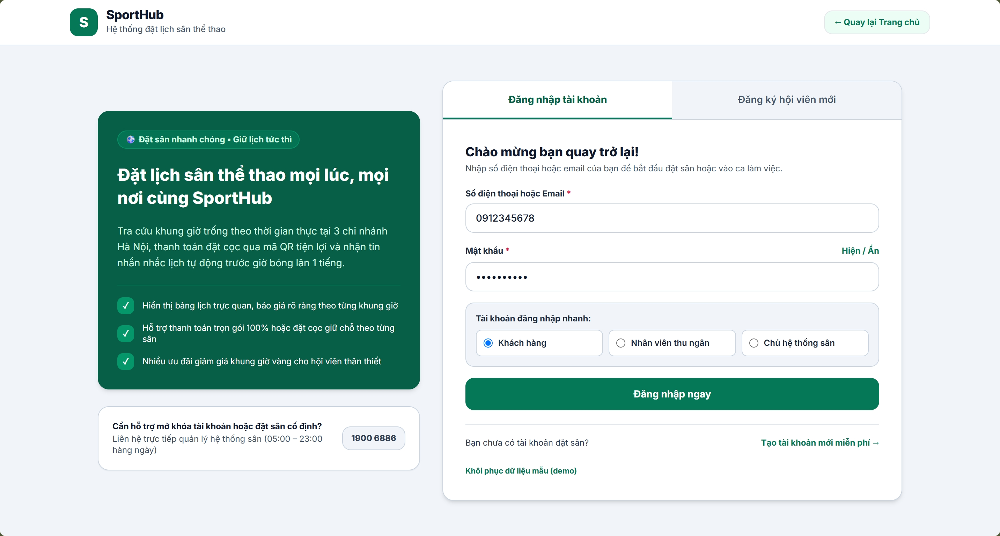

## MH.02. Trang chủ

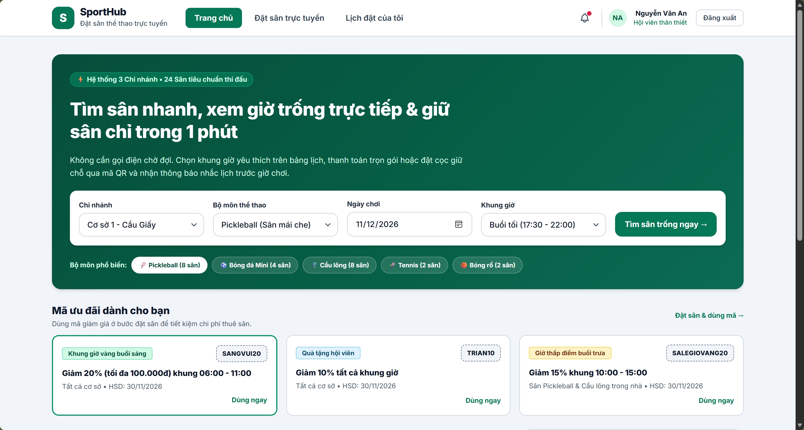

## MH.03. Đăng ký tài khoản

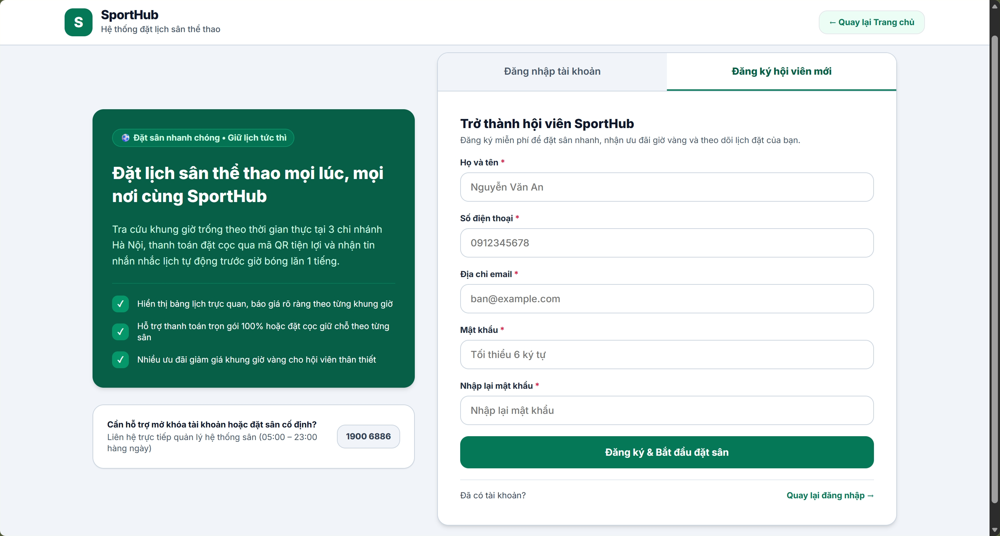

## MH.04. Đặt sân trực tuyến

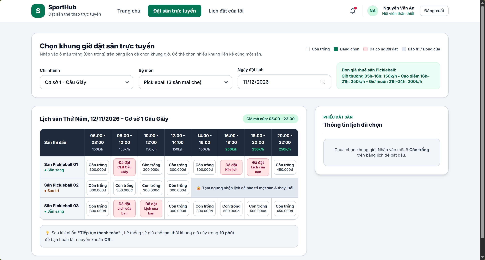

## MH.05. Thanh toán

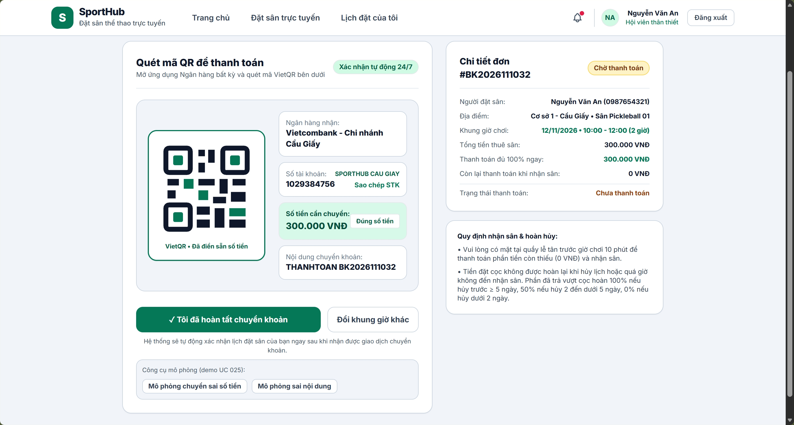

## MH.06. Lịch đặt của tôi

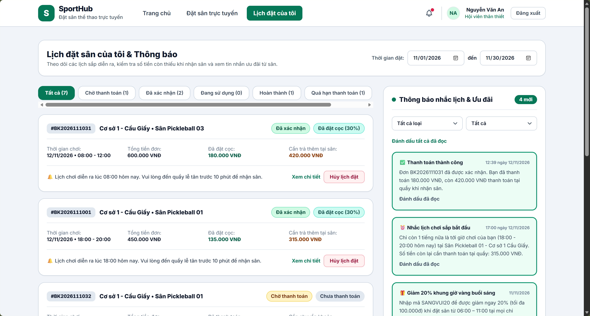

## MH.07. Đặt sân tại quầy

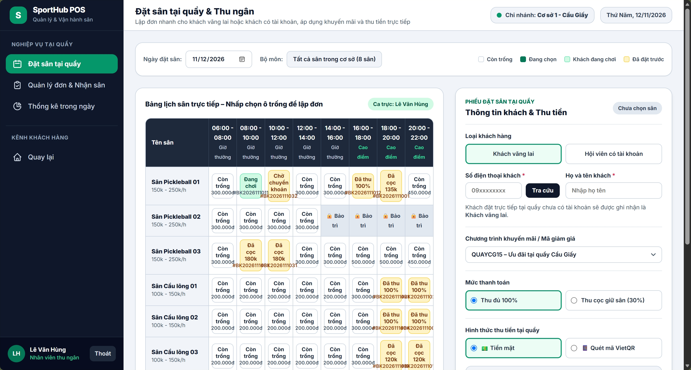

## MH.08. Quản lý đơn

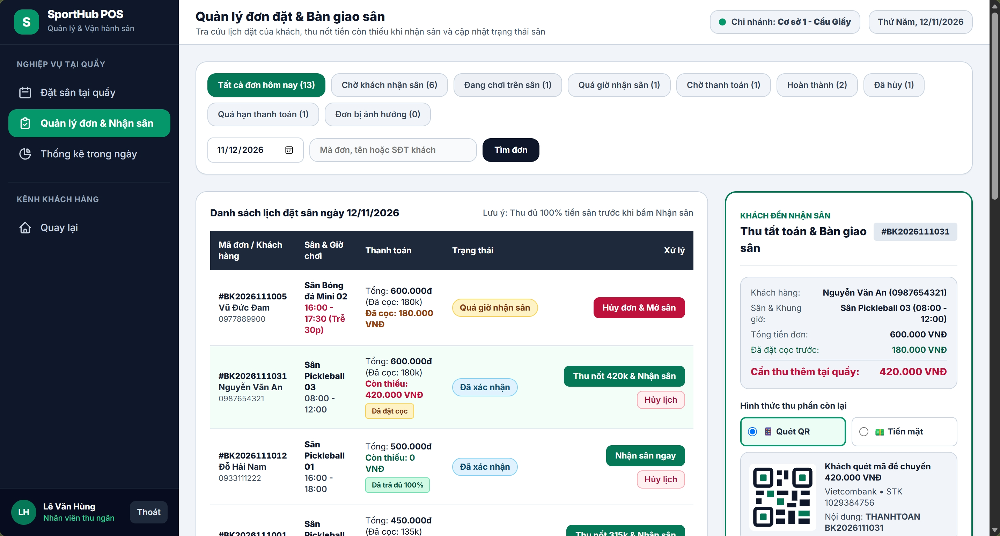

## MH.09. Thống kê trong ngày

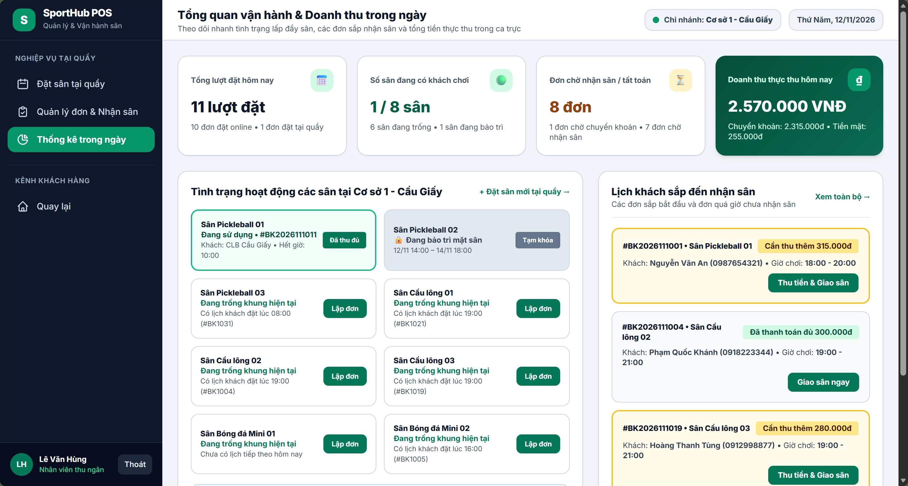

## MH.10. Quản lý nhân viên

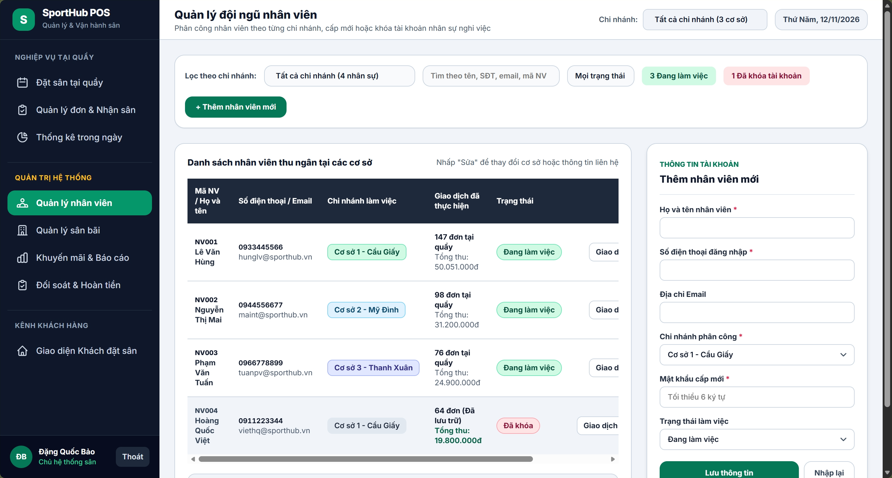

## MH.11.1. Quản lý sân bãi – Danh sách sân

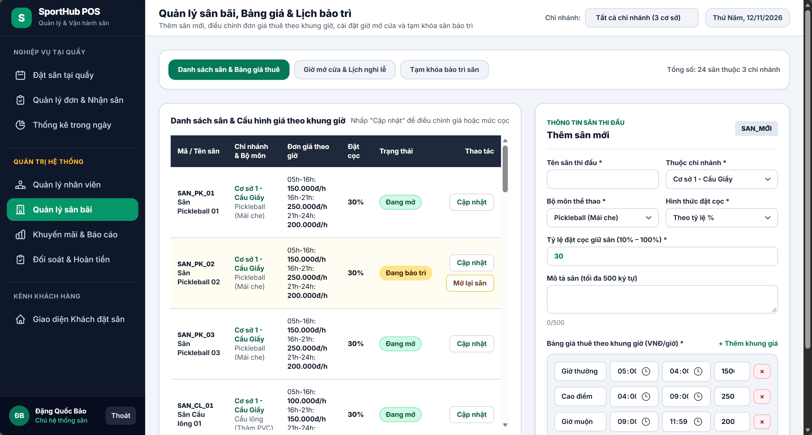

## MH.11.2. Quản lý sân bãi – Tạm khóa sân

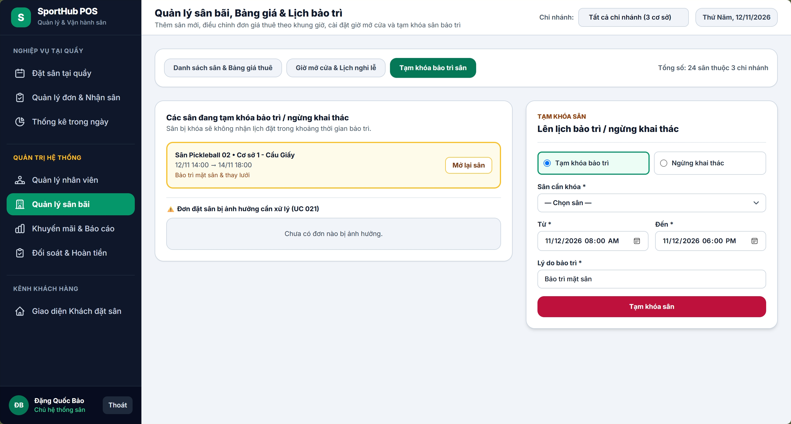

## MH.11.3. Quản lý sân bãi – Giờ mở cửa, bảo trì

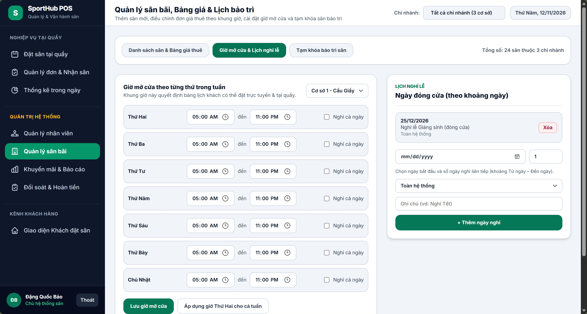

## MH.12. Quản lý khuyến mãi

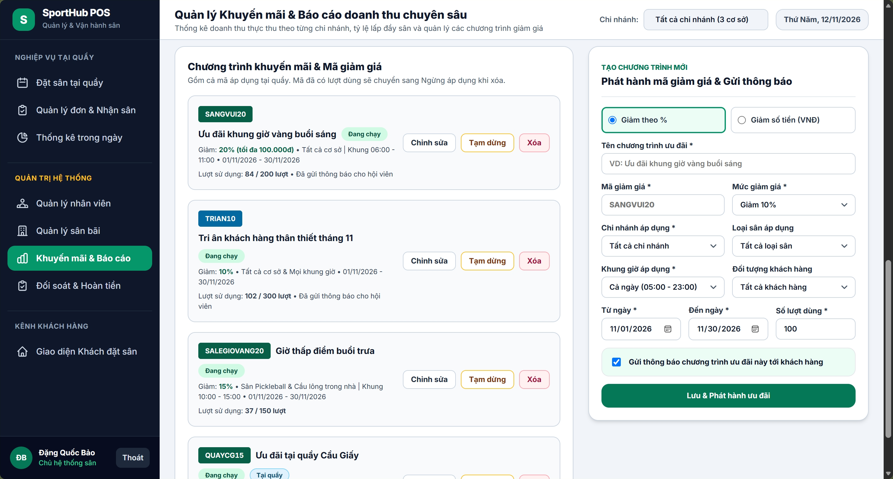

## MH.13. Thống kê báo cáo chuyên sâu

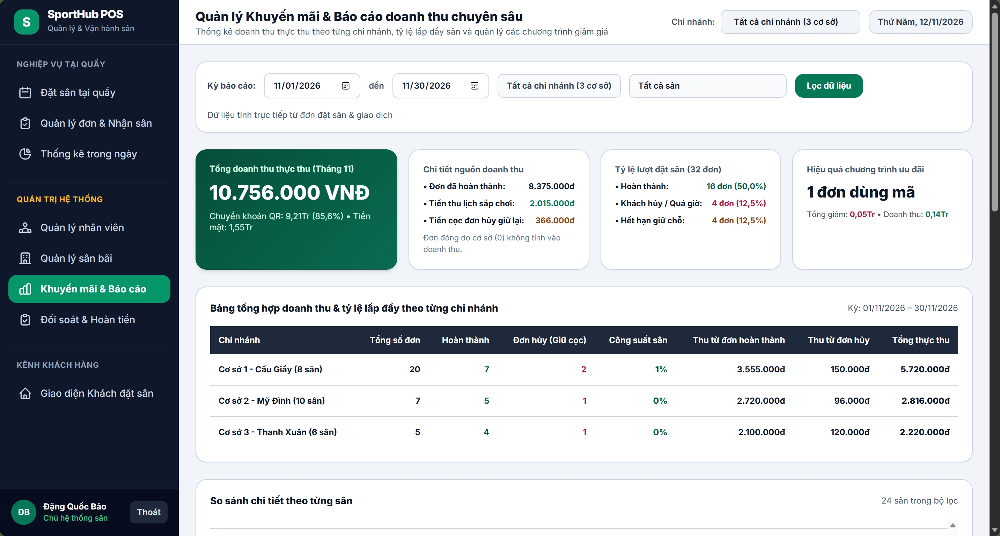

# 5. Thiết kế API

## 5.1. Quy ước chung

| **Nội dung** | **Quy ước** |
| --- | --- |
| Base URL | `https://{domain}/api/v1` — tiền tố phiên bản `v1` trong đường dẫn. Kết nối realtime: `wss://{domain}/socket.io` (mục 5.7). |
| Định dạng | JSON, UTF-8. Tên trường dùng camelCase. Giá trị liệt kê (status, type…) giữ nguyên mã tiếng Anh viết hoa của CSDL (mục 3.4), ví dụ `PENDING_PAYMENT`; frontend tự ánh xạ sang nhãn tiếng Việt. |
| Xác thực | Header `Authorization: Bearer <accessToken>` (JWT 15 phút, mục 2.4). Refresh token nằm trong cookie `sh_rt` (HttpOnly; Secure; SameSite=Strict; Path=/api/v1/auth). Nhận 401 `TOKEN_EXPIRED` thì gọi `POST /auth/refresh` một lần rồi gửi lại request. |
| Ký hiệu quyền | **PUBLIC**: không cần đăng nhập. **PUBLIC\*:** không bắt buộc đăng nhập, có token thì trả thêm dữ liệu theo người dùng. **AUTH**: mọi vai trò đã đăng nhập. **CUSTOMER**, **STAFF**, **OWNER**: theo vai trò. **STAFF+**: Nhân viên (bị ép trong chi nhánh được phân công qua middleware branchScope) và Chủ sân. |
| Định danh trong URL | Đơn đặt sân dùng mã nghiệp vụ `bookingCode` (BK2026111001) vì mã này xuất hiện trên QR, phiếu thu, thông báo và đường dẫn /payment/:id của frontend. Các tài nguyên khác dùng khóa số: `branchId`, `courtId`, `userId`, `promotionId`, `blockId`, `holidayId`, `requestId`, `bankTxnId`, `refundId`, `notificationId`. |
| Thời gian | Thời điểm: ISO 8601 kèm múi giờ, ví dụ `2026-11-12T18:00:00+07:00`. Ngày: `YYYY-MM-DD`. Giờ trong ngày: `HH:mm`. Mọi phản hồi có `meta.serverTime` để frontend đếm ngược thời hạn giữ chỗ theo giờ máy chủ, không theo đồng hồ máy khách. |
| Tiền | Số nguyên, đơn vị VNĐ (khớp DECIMAL(18,0)). Tỷ lệ phần trăm là số thực (ví dụ `30`, `50.5`). |
| Phân trang, sắp xếp | `?page=1&pageSize=20` (tối đa 100). Phản hồi danh sách có `meta.page`, `meta.pageSize`, `meta.totalItems`, `meta.totalPages`. Sắp xếp: `?sort=startAt` hoặc `?sort=-createdAt` (dấu trừ là giảm dần). |
| Idempotency-Key | Bắt buộc với các POST tạo đơn, thu tiền, tạo mã QR (UUID v4 do client sinh). Server lưu khóa kèm kết quả 24 giờ (mục 2.5); gửi lại cùng khóa trả lại đúng kết quả cũ, cùng khóa nhưng khác body trả 409 `IDEMPOTENCY_CONFLICT`. |
| Khóa lạc quan | Các API đổi trạng thái đơn (hủy, thu tiền, nhận sân, kết thúc, chuyển sân, đóng đơn) nhận trường `version` — giá trị RowVer dạng base64 lấy từ lần đọc đơn gần nhất. Không khớp trả 409 `BOOKING_STATE_CHANGED` (“Trạng thái đơn đã thay đổi, vui lòng tải lại”). |
| Giới hạn tần suất | `/auth/login`, `/auth/register`: 10 request/phút/IP. `/payment-requests/{id}/recheck`: 1 request/5 giây/đơn. Vượt ngưỡng trả 429 kèm header `Retry-After`. Webhook chỉ nhận từ dải IP của cổng thanh toán. |
| Thông báo lỗi | Tiếng Việt, dùng đúng câu chữ trong SRS/source; frontend hiển thị nguyên `error.message`, còn `error.code` dùng để rẽ nhánh xử lý. |

## 5.2. Định dạng phản hồi và mã lỗi

Mọi phản hồi thành công bọc dữ liệu trong `data`; thông tin phụ (phân trang, giờ máy chủ, số lượng theo tab) nằm trong `meta`. Phản hồi lỗi chỉ có khối `error`.

**Thành công – một đối tượng (200/201):**

```json
{
  "data": {"bookingCode": "BK2026111001", "status": "CONFIRMED"},
  "meta": {"serverTime": "2026-11-12T17:00:05+07:00"}
}
```

**Thành công – danh sách có phân trang:**

```json
{
  "data": [{"bookingCode": "BK2026111001"}, {"bookingCode": "BK2026111008"}],
  "meta": {
    "page": 1,
    "pageSize": 20,
    "totalItems": 2,
    "totalPages": 1,
    "serverTime": "2026-11-12T17:00:05+07:00"
  }
}
```

**Lỗi (4xx/5xx):**

```json
{
  "error": {
    "code": "VALIDATION_ERROR",
    "message": "Dữ liệu không hợp lệ.",
    "details": [
      {
        "field": "phone",
        "message": "Số điện thoại phải gồm 10 chữ số và bắt đầu bằng 0."
      }
    ],
    "traceId": "8f2c1e7a9b"
  }
}
```

**Bảng mã lỗi dùng chung** — mã lỗi riêng của từng nghiệp vụ được liệt kê trong đặc tả API tương ứng ở mục 5.5.

| **HTTP** | **error.code** | **Ý nghĩa** |
| --- | --- | --- |
| 400 | VALIDATION_ERROR | Dữ liệu đầu vào sai định dạng/thiếu trường; `details` liệt kê lỗi theo từng trường. |
| 400 | INVALID_DATE_RANGE | Từ ngày lớn hơn Đến ngày, hoặc khoảng tra cứu quá 366 ngày. |
| 401 | UNAUTHENTICATED | Thiếu hoặc sai access token. |
| 401 | TOKEN_EXPIRED | Access token hết hạn — frontend gọi /auth/refresh. |
| 401 | TOKEN_REVOKED | TokenVersion không khớp (tài khoản bị khóa/đổi chi nhánh) — về màn đăng nhập. |
| 401 | ACCOUNT_NOT_FOUND / WRONG_PASSWORD | Đăng nhập sai tên đăng nhập / mật khẩu (UC 001). |
| 403 | FORBIDDEN | Vai trò không đủ quyền gọi API. |
| 403 | BRANCH_FORBIDDEN | Nhân viên thao tác dữ liệu chi nhánh khác (UC 021-2c). |
| 403 | BOOKING_FORBIDDEN | Khách hàng truy cập đơn không phải của mình. |
| 403 | ACCOUNT_LOCKED | Tài khoản nhân viên đã bị khóa. |
| 404 | NOT_FOUND | Không tìm thấy tài nguyên (đơn, sân, mã KM…). |
| 409 | SLOT_TAKEN | Khung giờ đã có người đặt (vi phạm UX_BookingSlots_Court_Slot). |
| 409 | BOOKING_STATE_CHANGED | version không khớp RowVer. |
| 409 | COURT_IN_USE | Sân đang có đơn IN_USE khác khi nhận sân. |
| 409 | PHONE_TAKEN / EMAIL_TAKEN | Trùng số điện thoại / email với tài khoản khác. |
| 409 | PROMO_EXHAUSTED | Mã khuyến mãi vừa hết lượt khi tạo đơn. |
| 409 | IDEMPOTENCY_CONFLICT | Cùng Idempotency-Key nhưng body khác. |
| 422 | Mã lỗi nghiệp vụ | Vi phạm quy tắc nghiệp vụ, ví dụ OUTSIDE_OPENING_HOURS, HOLD_EXPIRED, PAYMENT_INCOMPLETE… (liệt kê ở từng API). |
| 423 | ACCOUNT_TEMP_LOCKED | Sai mật khẩu 5 lần, khóa tạm 5 phút; `details.lockedUntil`. |
| 429 | TOO_MANY_REQUESTS | Vượt giới hạn tần suất. |
| 502 | PAYMENT_GATEWAY_ERROR | Không truy vấn được cổng thanh toán (UC 012-3b). |
| 500 | INTERNAL_ERROR | Lỗi hệ thống; kèm traceId để tra log. |

**Mã lý do khi kiểm tra mã khuyến mãi** — trả trong `promotion.reasonCode` của API báo giá hoặc `details.reasonCode` của lỗi PROMO_INVALID; thứ tự kiểm tra theo mục 3.5c.

| **reasonCode** | **Thông báo hiển thị** |
| --- | --- |
| PROMO_NOT_FOUND | Mã khuyến mãi không tồn tại. |
| PROMO_INACTIVE | Mã khuyến mãi đang tạm dừng hoặc đã ngừng áp dụng. |
| PROMO_OUT_OF_DATE | Ngày chơi nằm ngoài thời gian áp dụng mã. |
| PROMO_OUT_OF_TIME | Giờ chơi nằm ngoài khung giờ của mã. |
| PROMO_WRONG_BRANCH | Mã không áp dụng cho cơ sở này. |
| PROMO_WRONG_SPORT | Mã không áp dụng cho môn thể thao của sân. |
| PROMO_WRONG_AUDIENCE | Mã chỉ dành cho khách hàng được chỉ định. |
| PROMO_EXHAUSTED | Mã khuyến mãi đã hết lượt sử dụng. |
| PROMO_WRONG_CHANNEL | Mã chỉ áp dụng khi đặt tại quầy (chỉ dùng nếu chốt bổ sung cột Channel — mục 5.8). |

## 5.3. Đối tượng dữ liệu dùng chung

Các đối tượng dưới đây được nhiều API trả về; đặc tả từng API chỉ ghi tên đối tượng thay vì lặp lại danh sách trường.

### a. User – người dùng đăng nhập

| **Trường** | **Kiểu** | **Nguồn CSDL** | **Mô tả** |
| --- | --- | --- | --- |
| userId | number | Users.UserId |  |
| code | string | Users.Code | KH000001, NV000002, CH000001 |
| fullName | string | Users.FullName |  |
| phone, email | string | Users.Phone, Email |  |
| role | enum | Users.Role | CUSTOMER \| STAFF \| OWNER — frontend chọn trang chủ theo vai trò (homeOf) |
| branchId, branchName | number, string | Users.BranchId → Branches | Chỉ có với STAFF; dùng cố định bộ chọn chi nhánh |
| memberTier | string | Users.MemberTier | Hạng hội viên của khách |
| title | string | (tính toán) | Nhãn hiển thị dưới tên: “Hội viên”, “Nhân viên thu ngân”, “Chủ hệ thống sân” |

### b. BookingSummary – đơn trong danh sách

Dùng ở các API danh sách đơn (MH.06, MH.08, MH.09, đơn bị ảnh hưởng). Trong danh sách, các trường branch, court, customer được làm phẳng thành branchName, courtName, customerName, customerPhone, isGuest.

| **Trường** | **Kiểu** | **Nguồn CSDL** | **Mô tả** |
| --- | --- | --- | --- |
| bookingCode | string | Bookings.BookingCode | Khóa định danh trong URL |
| channel | enum | Bookings.Channel | ONLINE \| COUNTER |
| status | enum | Bookings.Status | PENDING_PAYMENT \| CONFIRMED \| IN_USE \| COMPLETED \| CANCELED \| EXPIRED |
| paymentStatus | enum | Bookings.PaymentStatus | UNPAID \| DEPOSITED \| PAID |
| isOverdue | boolean | (tính toán) | true khi CONFIRMED, chưa nhận sân và now ≥ StartAt + NO_SHOW_GRACE_MINUTES — thay cho trạng thái “Quá giờ nhận sân” (overdue) chỉ có ở frontend |
| branch | object | Branches | { branchId, name, address } |
| court | object | Courts, Sports | { courtId, code, name, sportCode, sportName } |
| customer | object | Users / GuestName, GuestPhone | { userId \| null, fullName, phone, isGuest } |
| date, startTime, endTime | string | Bookings.StartAt, EndAt | Tách sẵn để hiển thị; kèm startAt, endAt dạng ISO |
| durationMinutes | number | (tính toán) |  |
| baseAmount | number | Bookings.BaseAmount | Tiền thuê gốc |
| promotionCode, discountAmount | string, number | Bookings.PromotionCode, DiscountAmount | Snapshot lúc tạo đơn |
| totalAmount | number | Bookings.TotalAmount |  |
| paymentOption | enum | Bookings.PaymentOption | FULL \| DEPOSIT |
| deposit | object | Bookings.DepositType, DepositValue, DepositAmount | { type, value, amount } — snapshot mức cọc |
| amountDueNow, paidAmount, remainingAmount | number | Bookings.* | remainingAmount = 0 với đơn CANCELED/EXPIRED khi hiển thị |
| holdExpireAt | string\|null | Bookings.HoldExpireAt | Chỉ có khi PENDING_PAYMENT |
| cancel | object\|null | Bookings.Cancel*, Refund* | { cancelType, reason, canceledAt, canceledByName, refundRate, refundAmount, depositKept } |
| checkedInAt, checkedOutAt | string\|null | Bookings.CheckedInAt, CheckedOutAt |  |
| allowedActions | string[] | (tính toán) | Thao tác hợp lệ với người gọi: PAY, CANCEL, SETTLE, CHECK_IN, COMPLETE, NO_SHOW_CANCEL, REASSIGN, CLOSE_BY_FACILITY — frontend dựa vào đây để hiện/ẩn nút |
| version | string | Bookings.RowVer (base64) | Gửi lại ở các API đổi trạng thái |
| createdAt | string | Bookings.CreatedAt |  |

### c. BookingDetail – chi tiết đơn

Gồm toàn bộ trường của BookingSummary (dạng lồng branch/court/customer) cộng thêm:

| **Trường** | **Kiểu** | **Nguồn CSDL** | **Mô tả** |
| --- | --- | --- | --- |
| priceLines[] | array | BookingPriceLines | { label, startTime, endTime, pricePerHour, amount } |
| payments[] | array | Payments | { paymentCode, purpose, method, channel, amount, paidAt, collectedByName } |
| statusHistory[] | array | BookingStatusHistory | { fromStatus, toStatus, fromPaymentStatus, toPaymentStatus, changedAt, changedByName, note } |
| transfers[] | array | BookingTransfers | { oldCourtName, oldStartAt, newCourtName, newStartAt, performedByName, performedAt, note } |
| refund | object\|null | Refunds | { refundId, amount, rate, status } |

**Ví dụ BookingDetail:**

```json
{
  "bookingCode": "BK2026111001",
  "channel": "ONLINE",
  "status": "CONFIRMED",
  "paymentStatus": "DEPOSITED",
  "isOverdue": false,
  "branch": {
    "branchId": 1,
    "name": "Cơ sở 1 - Cầu Giấy",
    "address": "128 Nguyễn Phong Sắc, Cầu Giấy, Hà Nội"
  },
  "court": {
    "courtId": 1,
    "code": "SAN_PK_01",
    "name": "Sân Pickleball 01",
    "sportCode": "PICKLEBALL",
    "sportName": "Pickleball"
  },
  "customer": {
    "userId": 15,
    "fullName": "Nguyễn Văn An",
    "phone": "0987654321",
    "isGuest": false
  },
  "date": "2026-11-12",
  "startTime": "18:00",
  "endTime": "20:00",
  "startAt": "2026-11-12T18:00:00+07:00",
  "endAt": "2026-11-12T20:00:00+07:00",
  "durationMinutes": 120,
  "baseAmount": 500000,
  "promotionCode": "TRIAN10",
  "discountAmount": 50000,
  "totalAmount": 450000,
  "paymentOption": "DEPOSIT",
  "deposit": {"type": "PERCENT", "value": 30, "amount": 135000},
  "amountDueNow": 135000,
  "paidAmount": 135000,
  "remainingAmount": 315000,
  "holdExpireAt": null,
  "cancel": null,
  "checkedInAt": null,
  "checkedOutAt": null,
  "allowedActions": ["CANCEL"],
  "version": "AAAAAAAAB9E=",
  "createdAt": "2026-11-10T09:15:00+07:00",
  "priceLines": [
    {
      "label": "Cao điểm",
      "startTime": "18:00",
      "endTime": "20:00",
      "pricePerHour": 250000,
      "amount": 500000
    }
  ],
  "payments": [
    {
      "paymentCode": "PT2026111003",
      "purpose": "DEPOSIT",
      "method": "BANK_TRANSFER",
      "channel": "ONLINE",
      "amount": 135000,
      "paidAt": "2026-11-10T09:17:42+07:00",
      "collectedByName": null
    }
  ],
  "statusHistory": [
    {
      "fromStatus": null,
      "toStatus": "PENDING_PAYMENT",
      "fromPaymentStatus": null,
      "toPaymentStatus": "UNPAID",
      "changedAt": "2026-11-10T09:15:00+07:00",
      "changedByName": "Nguyễn Văn An",
      "note": "Khách đặt trực tuyến"
    },
    {
      "fromStatus": "PENDING_PAYMENT",
      "toStatus": "CONFIRMED",
      "fromPaymentStatus": "UNPAID",
      "toPaymentStatus": "DEPOSITED",
      "changedAt": "2026-11-10T09:17:42+07:00",
      "changedByName": null,
      "note": "Webhook SEPAY – khớp giao dịch"
    }
  ],
  "transfers": [],
  "refund": null
}
```

### d. PaymentRequest – mã QR thanh toán

| **Trường** | **Kiểu** | **Nguồn CSDL** | **Mô tả** |
| --- | --- | --- | --- |
| requestId | number | PaymentRequests.RequestId |  |
| bookingCode | string | Bookings.BookingCode |  |
| purpose | enum | PaymentRequests.Purpose | DEPOSIT \| FULL \| REMAINING |
| amount | number | PaymentRequests.Amount | Số tiền đã điền sẵn trong QR |
| transferContent | string | PaymentRequests.TransferContent | THANHTOAN {BookingCode} |
| qrPayload | string | PaymentRequests.QrPayload | Chuỗi EMVCo/VietQR — frontend vẽ bằng qrcode.react |
| expiresAt | string | PaymentRequests.ExpiresAt | Đếm ngược hiệu lực mã |
| status | enum | PaymentRequests.Status | PENDING \| PAID \| EXPIRED \| CANCELED |
| bank | object | Branches.Bank* | { bin, bankName, accountNo, accountName } của chi nhánh sở hữu sân — VietQrBox hiển thị và nút “Sao chép STK” |

### e. Receipt – phiếu thu

| **Trường** | **Kiểu** | **Nguồn CSDL** | **Mô tả** |
| --- | --- | --- | --- |
| paymentCode | string | Payments.PaymentCode | PT2026111209 |
| bookingCode | string | Bookings.BookingCode |  |
| purpose, method | enum | Payments.Purpose, Method |  |
| amount | number | Payments.Amount | Thực thu |
| collectedByName | string | Users.FullName (CollectedBy) | Thu ngân |
| paidAt | string | Payments.PaidAt |  |

## 5.4. Danh sách endpoint

Tổng cộng **73 API REST**, 1 webhook và 7 sự kiện realtime. Tiền tố `/api/v1` được lược bỏ trong bảng.

| **Mã** | **Method** | **Endpoint** | **Quyền** | **Màn hình** |
| --- | --- | --- | --- | --- |
| API-01 | GET | `/auth/me` | AUTH | Dùng chung |
| API-02 | POST | `/auth/refresh` | PUBLIC (cookie) | Dùng chung |
| API-03 | GET | `/branches` | PUBLIC | Dùng chung, MH.02, MH.04, MH.11.1, MH.12 |
| API-04 | GET | `/sports` | PUBLIC | Dùng chung, MH.02, MH.11.1, MH.12 |
| API-05 | GET | `/me/notifications/unread-count` | AUTH | Dùng chung |
| API-06 | POST | `/auth/login` | PUBLIC | MH.01 |
| API-07 | GET | `/promotions/public` | PUBLIC* | MH.02, MH.04 |
| API-08 | GET | `/branches/{branchId}/sport-summary` | PUBLIC | MH.02, MH.04 |
| API-09 | POST | `/auth/logout` | AUTH | MH.02 |
| API-10 | POST | `/auth/register` | PUBLIC | MH.03 |
| API-11 | GET | `/availability` | PUBLIC* | MH.04 |
| API-12 | POST | `/bookings/quote` | PUBLIC* | MH.04, MH.07 |
| API-13 | POST | `/bookings` | CUSTOMER | MH.04 |
| API-14 | GET | `/bookings/{bookingCode}` | AUTH | MH.05, MH.06 |
| API-15 | GET | `/bookings/{bookingCode}/payment-request` | AUTH | MH.05 |
| API-16 | POST | `/bookings/{bookingCode}/payment-requests` | CUSTOMER (đơn của mình), STAFF+ | MH.05, MH.07, MH.08 |
| API-17 | POST | `/payment-requests/{requestId}/recheck` | CUSTOMER (đơn của mình), STAFF+ | MH.05, MH.07 |
| API-18 | POST | `/bookings/{bookingCode}/cancel` | CUSTOMER (đơn của mình), STAFF+ | MH.05, MH.06, MH.08 |
| API-19 | GET | `/me/bookings` | CUSTOMER | MH.06 |
| API-20 | GET | `/bookings/{bookingCode}/cancel-preview` | CUSTOMER (đơn của mình), STAFF+ | MH.06, MH.08 |
| API-21 | GET | `/me/notifications` | AUTH | MH.06 |
| API-22 | PATCH | `/me/notifications/{notificationId}` | AUTH | MH.06 |
| API-23 | POST | `/me/notifications/read-all` | AUTH | MH.06 |
| API-24 | GET | `/promotions/public/{code}` | PUBLIC* | MH.06 |
| API-25 | GET | `/pos/schedule` | STAFF+ | MH.07 |
| API-26 | GET | `/pos/customers` | STAFF+ | MH.07 |
| API-27 | GET | `/pos/promotions` | STAFF+ | MH.07 |
| API-28 | POST | `/pos/bookings` | STAFF+ | MH.07 |
| API-29 | POST | `/pos/bookings/{bookingCode}/payments` | STAFF+ | MH.07 |
| API-30 | POST | `/pos/bookings/{bookingCode}/abort` | STAFF+ | MH.07 |
| API-31 | GET | `/pos/receipts/latest` | STAFF+ | MH.07 |
| API-32 | GET | `/pos/bookings` | STAFF+ | MH.08 |
| API-33 | POST | `/pos/bookings/{bookingCode}/settle` | STAFF+ | MH.08 |
| API-34 | POST | `/pos/bookings/{bookingCode}/check-in` | STAFF+ | MH.08, MH.09 |
| API-35 | POST | `/pos/bookings/{bookingCode}/complete` | STAFF+ | MH.08 |
| API-36 | GET | `/affected-bookings` | STAFF+ | MH.08, MH.11.2, MH.11.3 |
| API-37 | GET | `/affected-bookings/{bookingCode}/reassign-options` | STAFF+ | MH.08, MH.11.2, MH.11.3 |
| API-38 | POST | `/affected-bookings/{bookingCode}/reassign` | STAFF+ | MH.08, MH.11.2, MH.11.3 |
| API-39 | POST | `/affected-bookings/{bookingCode}/close` | STAFF+ | MH.08, MH.11.2, MH.11.3 |
| API-40 | GET | `/dashboard/daily` | STAFF+ | MH.09 |
| API-41 | GET | `/dashboard/daily/bookings` | STAFF+ | MH.09 |
| API-42 | GET | `/admin/staff` | OWNER | MH.10 |
| API-43 | POST | `/admin/staff` | OWNER | MH.10 |
| API-44 | PUT | `/admin/staff/{userId}` | OWNER | MH.10 |
| API-45 | POST | `/admin/staff/{userId}/lock  ·  /unlock` | OWNER | MH.10 |
| API-46 | GET | `/admin/staff/{userId}/payments` | OWNER | MH.10 |
| API-47 | GET | `/admin/courts` | OWNER | MH.11.1, MH.11.2, MH.13 |
| API-48 | GET | `/admin/courts/{courtId}` | OWNER | MH.11.1 |
| API-49 | POST | `/admin/courts` | OWNER | MH.11.1 |
| API-50 | PUT | `/admin/courts/{courtId}` | OWNER | MH.11.1 |
| API-51 | GET | `/admin/court-blocks` | OWNER | MH.11.2 |
| API-52 | POST | `/admin/court-blocks` | OWNER | MH.11.2 |
| API-53 | POST | `/admin/court-blocks/{blockId}/release` | OWNER | MH.11.1, MH.11.2 |
| API-54 | GET | `/admin/branches/{branchId}/opening-hours` | OWNER | MH.11.3 |
| API-55 | PUT | `/admin/branches/{branchId}/opening-hours` | OWNER | MH.11.3 |
| API-56 | GET | `/admin/holidays` | OWNER | MH.11.3 |
| API-57 | POST | `/admin/holidays` | OWNER | MH.11.3 |
| API-58 | DELETE | `/admin/holidays/{holidayId}` | OWNER | MH.11.3 |
| API-59 | GET | `/admin/promotions` | OWNER | MH.12 |
| API-60 | GET | `/admin/promotions/{promotionId}` | OWNER | MH.12 |
| API-61 | POST | `/admin/promotions` | OWNER | MH.12 |
| API-62 | PUT | `/admin/promotions/{promotionId}` | OWNER | MH.12 |
| API-63 | POST | `/admin/promotions/{promotionId}/pause  ·  /resume` | OWNER | MH.12 |
| API-64 | DELETE | `/admin/promotions/{promotionId}` | OWNER | MH.12 |
| API-65 | POST | `/admin/promotions/{promotionId}/notify` | OWNER | MH.12 |
| API-66 | GET | `/reports/revenue` | OWNER | MH.13 |
| API-67 | GET | `/reconciliation/transactions` | STAFF+ | MH.14 |
| API-68 | GET | `/reconciliation/transactions/{bankTxnId}/candidates` | STAFF+ | MH.14 |
| API-69 | POST | `/reconciliation/transactions/{bankTxnId}/match` | STAFF+ | MH.14 |
| API-70 | POST | `/reconciliation/transactions/{bankTxnId}/refund-to-customer` | STAFF+ | MH.14 |
| API-71 | POST | `/reconciliation/transactions/{bankTxnId}/ignore` | STAFF+ | MH.14 |
| API-72 | GET | `/refunds` | OWNER | MH.14 |
| API-73 | POST | `/refunds/{refundId}/complete  ·  /fail` | OWNER | MH.14 |

## 5.5. Đặc tả API theo màn hình

Mỗi màn hình gồm bảng ánh xạ thao tác trên giao diện sang API/sự kiện, tiếp theo là đặc tả các API được giới thiệu lần đầu ở màn đó. API đã đặc tả ở màn trước chỉ được tham chiếu theo mã.

### Dùng chung (header, sidebar, bộ chọn chi nhánh)

Route frontend: `CustomerLayout, StaffLayout`. Các API được layout gọi ở mọi màn hình sau khi đăng nhập.

| **Thao tác trên màn hình** | **API / sự kiện** | **Ghi chú** |
| --- | --- | --- |
| Tải lại trang khi đã đăng nhập | API-02 · `POST /auth/refresh`<br>API-01 · `GET /auth/me` | Access token chỉ giữ trong bộ nhớ, tải lại trang thì refresh rồi lấy user |
| Chấm đỏ chuông thông báo | API-05 · `GET /me/notifications/unread-count`<br>Socket `notification.created` |  |
| Bộ chọn chi nhánh ở topbar (Chủ sân) | API-03 · `GET /branches` | Nhân viên cố định theo branchId trong token |
| Tài khoản bị khóa khi đang mở phiên | Socket `auth.revoked` | Hoặc nhận 401 TOKEN_REVOKED ở request kế tiếp |

#### API-01. Lấy thông tin người dùng hiện tại

| Endpoint | `GET /api/v1/auth/me` |
| --- | --- |
| Quyền | AUTH |
| Use case | UC 001 |
| Mô tả | Layout gọi khi tải lại trang (sau khi refresh token) để dựng header/sidebar: tên, nhãn vai trò, chi nhánh của nhân viên. Thay cho việc đọc user từ localStorage trong prototype. |

**Response 200:**

```json
{
  "data": {
    "userId": 15,
    "code": "KH000001",
    "fullName": "Nguyễn Văn An",
    "phone": "0987654321",
    "email": "khachhang@sporthub.vn",
    "role": "CUSTOMER",
    "branchId": null,
    "branchName": null,
    "memberTier": "Hội viên thân thiết",
    "title": "Hội viên thân thiết"
  }
}
```

#### API-02. Làm mới access token

| Endpoint | `POST /api/v1/auth/refresh` |
| --- | --- |
| Quyền | PUBLIC (cookie) |
| Use case | UC 001 |
| Mô tả | Gọi tự động khi nhận 401 TOKEN_EXPIRED hoặc khi tải lại trang. Xoay vòng refresh token: thu hồi token cũ, cấp token mới. |

**Response 200:**

```json
{
  "data": {
    "accessToken": "eyJhbGciOi…",
    "expiresIn": 900,
    "user": {
      "userId": 15,
      "code": "KH000001",
      "fullName": "Nguyễn Văn An",
      "phone": "0987654321",
      "email": "khachhang@sporthub.vn",
      "role": "CUSTOMER",
      "branchId": null,
      "branchName": null,
      "memberTier": "Hội viên thân thiết",
      "title": "Hội viên thân thiết"
    }
  }
}
```

**Lỗi nghiệp vụ:**

| **HTTP** | **Mã lỗi** | **Điều kiện / thông báo** |
| --- | --- | --- |
| 401 | REFRESH_INVALID | Cookie thiếu, hết hạn hoặc đã bị thu hồi — frontend về /login. |

#### API-03. Danh sách chi nhánh

| Endpoint | `GET /api/v1/branches` |
| --- | --- |
| Quyền | PUBLIC |
| Use case | UC 004, 010, 015 |
| Mô tả | Dùng cho bộ chọn chi nhánh ở Trang chủ, Đặt sân, thanh chọn chi nhánh của khu vực quản lý và các form quản trị. Không trả thông tin tài khoản ngân hàng (chỉ trả trong PaymentRequest). |

**Tham số:**

| **Tên** | **Vị trí** | **Kiểu** | **Bắt buộc** | **Mô tả** |
| --- | --- | --- | --- | --- |
| status | query | enum | Không | ACTIVE (mặc định) \| ALL — ALL chỉ dành cho OWNER |

**Response 200:**

```json
{
  "data": [
    {
      "branchId": 1,
      "code": "CS01",
      "name": "Cơ sở 1 - Cầu Giấy",
      "address": "128 Nguyễn Phong Sắc, Cầu Giấy, Hà Nội",
      "phone": "02438881111",
      "courtCount": 8,
      "status": "ACTIVE",
      "openingHours": [
        {"dayOfWeek": 1, "openTime": "05:00", "closeTime": "23:00", "isClosed": false},
        "… 7 phần tử, 1 = Thứ Hai … 7 = Chủ nhật"
      ]
    }
  ]
}
```

#### API-04. Danh sách bộ môn

| Endpoint | `GET /api/v1/sports` |
| --- | --- |
| Quyền | PUBLIC |
| Use case | UC 004 |
| Mô tả | Danh mục bộ môn kèm số sân đang hoạt động — dùng cho chip “Bộ môn phổ biến (n sân)” ở Trang chủ và các dropdown bộ môn. |

**Tham số:**

| **Tên** | **Vị trí** | **Kiểu** | **Bắt buộc** | **Mô tả** |
| --- | --- | --- | --- | --- |
| branchId | query | number | Không | Lọc số sân theo chi nhánh; bỏ trống là toàn hệ thống |

**Response 200:**

```json
{
  "data": [
    {
      "sportId": 5,
      "code": "PICKLEBALL",
      "name": "Pickleball",
      "icon": "sport-pickleball",
      "gridBlockMinutes": 60,
      "activeCourtCount": 8
    }
  ]
}
```

#### API-05. Đếm thông báo chưa đọc

| Endpoint | `GET /api/v1/me/notifications/unread-count` |
| --- | --- |
| Quyền | AUTH |
| Use case | UC 026 |
| Mô tả | Chấm đỏ trên biểu tượng chuông ở header. Sau lần gọi đầu, số này được cập nhật qua sự kiện realtime `notification.created`. |

**Response 200:**

```json
{"data": {"unreadCount": 2}}
```

### MH.01. Đăng nhập

Route frontend: `/login (tab Đăng nhập)`. UC 001.

| **Thao tác trên màn hình** | **API / sự kiện** | **Ghi chú** |
| --- | --- | --- |
| Bấm “Đăng nhập ngay” | API-06 · `POST /auth/login` | Thành công: điều hướng theo role (khách → /, nhân viên → /staff/booking, chủ sân → /owner/staff) hoặc quay lại trang trước |
| Khối “Tài khoản đăng nhập nhanh”, “Khôi phục dữ liệu mẫu (demo)” | (không gọi API) | Chỉ có ở bản demo, bỏ khi lên production |

#### API-06. Đăng nhập

| Endpoint | `POST /api/v1/auth/login` |
| --- | --- |
| Quyền | PUBLIC |
| Use case | UC 001 |
| Mô tả | Đăng nhập bằng số điện thoại hoặc email; hệ thống tự nhận diện vai trò. Thành công trả access token trong body và đặt refresh token vào cookie. |

**Request body:**

| **Trường** | **Kiểu** | **Bắt buộc** | **Mô tả / ràng buộc** |
| --- | --- | --- | --- |
| identity | string | Có | Số điện thoại hoặc email, cắt khoảng trắng hai đầu |
| password | string | Có | 6–32 ký tự |

**Ví dụ request:**

```json
{"identity": "0912345678", "password": "Matkhau123"}
```

**Response 200:**

```json
{
  "data": {
    "accessToken": "eyJhbGciOi…",
    "tokenType": "Bearer",
    "expiresIn": 900,
    "user": {
      "userId": 15,
      "code": "KH000001",
      "fullName": "Nguyễn Văn An",
      "phone": "0987654321",
      "email": "khachhang@sporthub.vn",
      "role": "CUSTOMER",
      "branchId": null,
      "branchName": null,
      "memberTier": "Hội viên thân thiết",
      "title": "Hội viên thân thiết"
    }
  }
}
```

**Xử lý phía server:**

- Tìm Users theo Phone hoặc Email (không phân biệt hoa thường).
- Nếu LockedUntil > now → 423. Nếu Status = LOCKED → 403.
- Sai mật khẩu: FailedLoginCount + 1; đạt LOGIN_MAX_FAILED (5) thì đặt LockedUntil = now + LOGIN_LOCK_MINUTES (5) và đặt lại bộ đếm.
- Đúng: đặt FailedLoginCount = 0, LastLoginAt = now; ký JWT (sub, role, branchId, tv = TokenVersion); sinh refresh token 7 ngày, lưu SHA-256 vào RefreshTokens kèm UserAgent, IpAddress; trả `Set-Cookie: sh_rt=…`.

**Lỗi nghiệp vụ:**

| **HTTP** | **Mã lỗi** | **Điều kiện / thông báo** |
| --- | --- | --- |
| 400 | VALIDATION_ERROR | “Vui lòng nhập số điện thoại hoặc email.” / “Mật khẩu phải có tối thiểu 6 ký tự.” |
| 401 | ACCOUNT_NOT_FOUND | “Không tìm thấy tài khoản với thông tin này.” |
| 401 | WRONG_PASSWORD | “Mật khẩu không chính xác.” — `details.remainingAttempts` |
| 423 | ACCOUNT_TEMP_LOCKED | “Bạn đã nhập sai mật khẩu quá 5 lần liên tiếp. Tài khoản bị tạm khóa trong 5 phút.” — `details.lockedUntil` |
| 403 | ACCOUNT_LOCKED | “Tài khoản nhân viên đã bị khóa, vui lòng liên hệ chủ hệ thống.” |

### MH.02. Trang chủ

Route frontend: `/`. Trang công khai cho cả khách chưa đăng nhập. UC 002 (Đăng xuất) nằm trên header.

| **Thao tác trên màn hình** | **API / sự kiện** | **Ghi chú** |
| --- | --- | --- |
| Khung tìm kiếm: chi nhánh, bộ môn | API-03 · `GET /branches`<br>API-04 · `GET /sports` |  |
| Bấm “Tìm sân trống ngay →” | (điều hướng) | Chuyển /booking?branchId=&sportId=&date=; MH.04 gọi API lưới lịch |
| Khối “Mã ưu đãi dành cho bạn” | API-07 · `GET /promotions/public` | limit=3 |
| Khối “Các cụm sân đang mở nhận lịch hôm nay”, chọn chi nhánh ở cột phải | API-08 · `GET /branches/{branchId}/sport-summary` | Gọi lại khi đổi chi nhánh |
| Nút “Đăng xuất” trên header | API-09 · `POST /auth/logout` | UC 002 |

#### API-07. Mã ưu đãi đang chạy

| Endpoint | `GET /api/v1/promotions/public` |
| --- | --- |
| Quyền | PUBLIC* |
| Use case | UC 008 |
| Mô tả | Khối “Mã ưu đãi dành cho bạn” ở Trang chủ và các chip gợi ý mã ở phiếu đặt sân (MH.04). Chỉ trả mã ACTIVE, còn hạn, còn lượt; mã SPECIFIC chỉ trả khi người gọi thuộc PromotionCustomers. |

**Tham số:**

| **Tên** | **Vị trí** | **Kiểu** | **Bắt buộc** | **Mô tả** |
| --- | --- | --- | --- | --- |
| branchId, sportId | query | number | Không | Chỉ lấy mã áp dụng được cho chi nhánh/bộ môn |
| limit | query | number | Không | Mặc định 10; Trang chủ dùng 3, phiếu đặt sân dùng 2 |

**Response 200:**

```json
{
  "data": [
    {
      "promotionId": 1,
      "code": "SANGVUI20",
      "name": "Ưu đãi khung giờ vàng buổi sáng",
      "discountType": "PERCENT",
      "discountValue": 20,
      "maxDiscountAmount": 100000,
      "timeFrom": "06:00",
      "timeTo": "11:00",
      "startDate": "2026-11-01",
      "endDate": "2026-11-30",
      "scopeText": "Tất cả cơ sở",
      "branchIds": [],
      "sportIds": [],
      "audienceType": "ALL",
      "remainingUses": 116
    }
  ]
}
```

#### API-08. Tổng quan cụm sân của chi nhánh

| Endpoint | `GET /api/v1/branches/{branchId}/sport-summary` |
| --- | --- |
| Quyền | PUBLIC |
| Use case | UC 004 |
| Mô tả | Khối “Các cụm sân đang mở nhận lịch hôm nay” ở Trang chủ và danh sách bộ môn có sân của chi nhánh ở MH.04. Thay cho hàm freeSlots() đang đếm ô trống ở trình duyệt. |

**Tham số:**

| **Tên** | **Vị trí** | **Kiểu** | **Bắt buộc** | **Mô tả** |
| --- | --- | --- | --- | --- |
| branchId | path | number | Có |  |
| date | query | date | Không | Mặc định hôm nay |

**Response 200:**

```json
{
  "data": {
    "branch": {
      "branchId": 1,
      "name": "Cơ sở 1 - Cầu Giấy",
      "address": "128 Nguyễn Phong Sắc…",
      "openTime": "05:00",
      "closeTime": "23:00",
      "isClosed": false,
      "holiday": null
    },
    "sports": [
      {
        "sportId": 5,
        "code": "PICKLEBALL",
        "name": "Pickleball",
        "courtCount": 3,
        "minPricePerHour": 150000,
        "maxPricePerHour": 250000,
        "deposit": {"type": "PERCENT", "value": 30},
        "freeSlotCount": 14
      }
    ]
  }
}
```

**Xử lý phía server:**

- courtCount: số Courts ACTIVE của chi nhánh theo môn.
- min/maxPricePerHour: từ CourtPriceRules đang hiệu lực.
- freeSlotCount: số ô lịch còn FREE trong ngày (cùng thuật toán với API Lưới lịch trống).

#### API-09. Đăng xuất

| Endpoint | `POST /api/v1/auth/logout` |
| --- | --- |
| Quyền | AUTH |
| Use case | UC 002 |
| Mô tả | Nút “Đăng xuất” trên header khách hàng và “Thoát” trên sidebar quản lý. Thu hồi refresh token hiện tại (RevokedAt = now), xóa cookie; frontend xóa state và chuyển về /login. |

**Response 204:** không có nội dung.

### MH.03. Đăng ký tài khoản

Route frontend: `/login (tab Đăng ký hội viên mới)`. UC 003. Frontend vẫn kiểm tra định dạng trước khi gửi, server kiểm tra lại toàn bộ.

| **Thao tác trên màn hình** | **API / sự kiện** | **Ghi chú** |
| --- | --- | --- |
| Bấm “Đăng ký & Bắt đầu đặt sân” | API-10 · `POST /auth/register` | Thành công: lưu token, chuyển /booking |

#### API-10. Đăng ký tài khoản khách hàng

| Endpoint | `POST /api/v1/auth/register` |
| --- | --- |
| Quyền | PUBLIC |
| Use case | UC 003 |
| Mô tả | Tạo tài khoản CUSTOMER và đăng nhập luôn (frontend chuyển thẳng sang /booking sau khi đăng ký thành công). |

**Request body:**

| **Trường** | **Kiểu** | **Bắt buộc** | **Mô tả / ràng buộc** |
| --- | --- | --- | --- |
| fullName | string | Có | 2–100 ký tự, chỉ chữ cái và khoảng trắng |
| phone | string | Có | 10 chữ số, bắt đầu bằng 0; duy nhất trên toàn bộ Users |
| email | string | Có | Định dạng email; duy nhất (UX_Users_Email) |
| password | string | Có | 6–32 ký tự, không chứa khoảng trắng |
| confirmPassword | string | Có | Trùng password |

**Ví dụ request:**

```json
{
  "fullName": "Nguyễn Văn An",
  "phone": "0912345678",
  "email": "ban@example.com",
  "password": "Matkhau123",
  "confirmPassword": "Matkhau123"
}
```

**Response 201:**

```json
{
  "data": {
    "accessToken": "eyJhbGciOi…",
    "expiresIn": 900,
    "user": {
      "userId": 15,
      "code": "KH000006",
      "fullName": "Nguyễn Văn An",
      "phone": "0987654321",
      "email": "khachhang@sporthub.vn",
      "role": "CUSTOMER",
      "branchId": null,
      "branchName": null,
      "memberTier": null,
      "title": "Hội viên mới"
    }
  }
}
```

**Xử lý phía server:**

- Kiểm tra trùng Phone/Email trên mọi vai trò.
- Sinh Code qua usp_NextCode('KH'); băm bcrypt; Role = CUSTOMER, BranchId = NULL.
- Cấp token như API đăng nhập.

**Lỗi nghiệp vụ:**

| **HTTP** | **Mã lỗi** | **Điều kiện / thông báo** |
| --- | --- | --- |
| 400 | VALIDATION_ERROR | Các thông báo theo trường: “Họ và tên phải từ 2–100 ký tự…”, “Số điện thoại phải gồm 10 chữ số và bắt đầu bằng 0.”, “Mật khẩu nhập lại không khớp.”, “Email là bắt buộc khi đăng ký hội viên.” |
| 409 | PHONE_TAKEN | “Số điện thoại này đã được sử dụng. Vui lòng đăng nhập hoặc dùng số khác.” |
| 409 | EMAIL_TAKEN | “Email này đã được sử dụng. Vui lòng đăng nhập hoặc dùng email khác.” |

### MH.04. Đặt sân trực tuyến

Route frontend: `/booking`. UC 004, 007, 008. Mở công khai; chỉ bước giữ chỗ yêu cầu đăng nhập.

| **Thao tác trên màn hình** | **API / sự kiện** | **Ghi chú** |
| --- | --- | --- |
| Dropdown chi nhánh / bộ môn | API-03 · `GET /branches`<br>API-08 · `GET /branches/{branchId}/sport-summary` | Bộ môn chỉ liệt kê môn có sân tại chi nhánh |
| Đổi chi nhánh, bộ môn, ngày → vẽ lại bảng lịch | API-11 · `GET /availability` |  |
| Bảng lịch tự cập nhật khi người khác đặt/hủy | Socket `slot.updated` | Phòng availability:{branchId}:{date} |
| Chọn/bỏ ô, nhập mã và bấm “Áp dụng”, chọn “Thanh toán đủ / Đặt cọc” | API-12 · `POST /bookings/quote` | Debounce khoảng 300 ms |
| Chip gợi ý mã ưu đãi dưới ô nhập mã | API-07 · `GET /promotions/public` | branchId, sportId, limit=2 |
| Bấm “Tiếp tục thanh toán QR →” | API-13 · `POST /bookings` | Chưa đăng nhập: chuyển /login kèm state.from; thành công: chuyển /payment/{bookingCode} |

#### API-11. Lưới lịch trống theo chi nhánh – bộ môn – ngày

| Endpoint | `GET /api/v1/availability` |
| --- | --- |
| Quyền | PUBLIC* |
| Use case | UC 004 |
| Mô tả | Dựng bảng lịch “Chọn khung giờ đặt sân trực tuyến”. Backend tính khung giờ theo giờ mở cửa, ngày nghỉ, khóa sân, đơn đang giữ/đã đặt và đơn giá từng ô — thay cho slotsFor(), blocker(), lockAt(), slotPrice() ở frontend. Không trả thông tin cá nhân của khách khác. |

**Tham số:**

| **Tên** | **Vị trí** | **Kiểu** | **Bắt buộc** | **Mô tả** |
| --- | --- | --- | --- | --- |
| branchId | query | number | Có |  |
| sportId | query | number | Có |  |
| date | query | date | Có | ≥ hôm nay |

**Response 200:**

```json
{
  "data": {
    "date": "2026-11-12",
    "dayOfWeek": 4,
    "branch": {
      "branchId": 1,
      "name": "Cơ sở 1 - Cầu Giấy",
      "openTime": "05:00",
      "closeTime": "23:00",
      "isClosed": false
    },
    "holiday": null,
    "slotMinutes": 120,
    "slots": [
      {"start": "06:00", "end": "08:00", "priceLabel": "Giờ thường"},
      {"start": "08:00", "end": "10:00", "priceLabel": "Giờ thường"}
    ],
    "priceHint": "Giờ thường 05h–16h: 150k/h • Cao điểm 16h–21h: 250k/h • Giờ muộn 21h–24h: 200k/h",
    "courts": [
      {
        "courtId": 1,
        "code": "SAN_PK_01",
        "name": "Sân Pickleball 01",
        "state": "READY",
        "cells": [
          {"start": "06:00", "end": "08:00", "state": "FREE", "price": 300000},
          {"start": "08:00", "end": "10:00", "state": "BOOKED", "label": "Kín lịch"},
          {"start": "18:00", "end": "20:00", "state": "MINE", "label": "Lịch của bạn"},
          {"start": "20:00", "end": "22:00", "state": "HELD", "label": "Đang giữ chỗ"}
        ]
      },
      {
        "courtId": 2,
        "code": "SAN_PK_02",
        "name": "Sân Pickleball 02",
        "state": "MAINTENANCE",
        "cells": [
          {
            "start": "14:00",
            "end": "16:00",
            "state": "LOCKED",
            "blockId": 7,
            "blockType": "MAINTENANCE",
            "reason": "Bảo trì mặt sân & thay lưới"
          }
        ]
      }
    ]
  },
  "meta": {"serverTime": "2026-11-12T17:00:05+07:00"}
}
```

**Xử lý phía server:**

- slots: chia [OpenTime, CloseTime) của ngày theo slotMinutes (cấu hình theo bộ môn — xem mục 5.8). Ngày nghỉ hoặc IsClosed → `slots = []`, `holiday` có giá trị.
- Trạng thái ô: LOCKED (giao CourtBlocks chưa giải phóng; DECOMMISSION khóa cả hàng) → MINE (đơn còn hiệu lực của chính người gọi) → HELD (PENDING_PAYMENT của người khác) → BOOKED (CONFIRMED/IN_USE) → PAST (ô đã qua giờ) → FREE.
- price: tính theo mục 3.5a với khung giá đang hiệu lực. Ô LOCKED liên tiếp cùng blockId để frontend gộp colSpan.

#### API-12. Báo giá đơn (tính tiền, áp mã, tiền cọc)

| Endpoint | `POST /api/v1/bookings/quote` |
| --- | --- |
| Quyền | PUBLIC* |
| Use case | UC 004, 007, 008 |
| Mô tả | Gọi lại mỗi khi khách chọn/bỏ ô, nhập mã, đổi phương thức giữ sân để hiển thị phiếu đặt sân: giá gốc, ưu đãi, tổng tiền, tiền cọc, “Cần thanh toán ngay”, “Thanh toán thêm khi nhận sân”. Thay cho evalPromo(), depositFor(), slotsPrice() ở frontend. Không giữ chỗ, không trừ lượt mã. MH.07 dùng lại API này với `channel = COUNTER`. |

**Request body:**

| **Trường** | **Kiểu** | **Bắt buộc** | **Mô tả / ràng buộc** |
| --- | --- | --- | --- |
| courtId | number | Có |  |
| date | date | Có |  |
| startTime, endTime | HH:mm | Có | Khoảng liên tục; frontend gửi từ ô đầu đến ô cuối đã chọn |
| promotionCode | string | Không | Viết hoa trước khi gửi |
| paymentOption | enum | Không | FULL (mặc định) \| DEPOSIT |
| channel | enum | Không | ONLINE (mặc định) \| COUNTER — COUNTER chỉ cho STAFF+ |
| customerPhone | string | Không | Chỉ dùng tại quầy để xét mã dành cho khách chỉ định |

**Ví dụ request:**

```json
{
  "courtId": 1,
  "date": "2026-11-12",
  "startTime": "18:00",
  "endTime": "20:00",
  "promotionCode": "TRIAN10",
  "paymentOption": "DEPOSIT"
}
```

**Response 200:**

```json
{
  "data": {
    "court": {
      "courtId": 1,
      "name": "Sân Pickleball 01",
      "branchName": "Cơ sở 1 - Cầu Giấy"
    },
    "date": "2026-11-12",
    "startTime": "18:00",
    "endTime": "20:00",
    "durationMinutes": 120,
    "slotAvailable": true,
    "priceLines": [
      {
        "label": "Cao điểm",
        "startTime": "18:00",
        "endTime": "20:00",
        "pricePerHour": 250000,
        "amount": 500000
      }
    ],
    "baseAmount": 500000,
    "promotion": {
      "code": "TRIAN10",
      "applied": true,
      "reasonCode": null,
      "discountAmount": 50000,
      "message": "Đã áp dụng mã TRIAN10: Giảm 10% tiền thuê sân."
    },
    "discountAmount": 50000,
    "totalAmount": 450000,
    "deposit": {
      "type": "PERCENT",
      "value": 30,
      "amount": 135000,
      "fullPaymentRequired": false
    },
    "paymentOption": "DEPOSIT",
    "amountDueNow": 135000,
    "remainingOnArrival": 315000
  }
}
```

**Xử lý phía server:**

- Tính BaseAmount theo mục 3.5a; kiểm tra mã theo đúng thứ tự 8 điều kiện ở mục 3.5c, dừng ở điều kiện đầu tiên không đạt.
- Mã không hợp lệ vẫn trả 200 với `promotion.applied = false`, `reasonCode` và `message` (bảng mã lý do ở mục 5.2) để phiếu hiển thị dòng đỏ.
- `deposit.fullPaymentRequired = true` khi tiền cọc ≥ tổng tiền (UC 007-1a) — frontend khóa lựa chọn “Đặt cọc”.
- `slotAvailable = false` khi ô vừa bị người khác giữ — frontend bỏ chọn và tải lại lưới.

**Lỗi nghiệp vụ:**

| **HTTP** | **Mã lỗi** | **Điều kiện / thông báo** |
| --- | --- | --- |
| 422 | PRICE_NOT_CONFIGURED | “Chưa có bảng giá cho toàn bộ khung giờ đã chọn.” |
| 422 | INVALID_TIME_STEP | Giờ bắt đầu/thời lượng không phải bội số bước đặt của môn. |
| 422 | OUTSIDE_OPENING_HOURS / BRANCH_CLOSED | Ngoài giờ mở cửa / cơ sở nghỉ ngày đã chọn. |

#### API-13. Tạo đơn đặt sân trực tuyến (giữ chỗ)

| Endpoint | `POST /api/v1/bookings` |
| --- | --- |
| Quyền | CUSTOMER |
| Use case | UC 004, 007, 008 |
| Mô tả | Nút “Tiếp tục thanh toán QR →”. Tạo đơn Chờ thanh toán, giữ ô trong BOOKING_HOLD_MINUTES (10 phút) và sinh luôn mã QR, frontend chuyển sang /payment/{bookingCode}. Khách chưa đăng nhập: frontend chuyển /login trước, không gọi API. |
| Header | `Idempotency-Key: <uuid>` (bắt buộc) |

**Request body:**

| **Trường** | **Kiểu** | **Bắt buộc** | **Mô tả / ràng buộc** |
| --- | --- | --- | --- |
| courtId | number | Có | Sân ACTIVE |
| date | date | Có |  |
| startTime, endTime | HH:mm | Có |  |
| paymentOption | enum | Có | FULL \| DEPOSIT |
| promotionCode | string | Không |  |
| note | string | Không | ≤ 500 ký tự |

**Ví dụ request:**

```json
{
  "courtId": 9,
  "date": "2026-11-14",
  "startTime": "19:00",
  "endTime": "21:00",
  "paymentOption": "DEPOSIT",
  "promotionCode": null
}
```

**Response 201:**

```json
{
  "data": {
    "booking": {
      "bookingCode": "BK2026111008",
      "channel": "ONLINE",
      "status": "PENDING_PAYMENT",
      "paymentStatus": "UNPAID",
      "isOverdue": false,
      "branchName": "Cơ sở 1 - Cầu Giấy",
      "courtName": "Sân Cầu lông 05",
      "customerName": "Nguyễn Văn An",
      "customerPhone": "0987654321",
      "isGuest": false,
      "date": "2026-11-14",
      "startTime": "19:00",
      "endTime": "21:00",
      "totalAmount": 300000,
      "amountDueNow": 90000,
      "paidAmount": 0,
      "remainingAmount": 300000,
      "holdExpireAt": "2026-11-12T17:10:00+07:00",
      "cancel": null,
      "allowedActions": ["PAY", "CANCEL"],
      "version": "AAAAAAAAB9E="
    },
    "paymentRequest": {
      "requestId": 3021,
      "bookingCode": "BK2026111008",
      "purpose": "DEPOSIT",
      "amount": 90000,
      "transferContent": "THANHTOAN BK2026111008",
      "qrPayload": "00020101021238570010A000000727012700069704360113102938475602080QRIBFTTA53037045405900005802VN62260822THANHTOAN BK20261110086304A1B2",
      "expiresAt": "2026-11-12T17:10:00+07:00",
      "status": "PENDING",
      "bank": {
        "bin": "970436",
        "bankName": "Vietcombank",
        "accountNo": "1029384756",
        "accountName": "SPORTHUB CAU GIAY"
      }
    }
  }
}
```

**Xử lý phía server:**

- Trong một giao tác: kiểm tra lại toàn bộ điều kiện như API báo giá; sinh BookingCode bằng usp_NextCode('BK', yyyyMMdd).
- INSERT Bookings (Status = PENDING_PAYMENT, PaymentStatus = UNPAID, Channel = ONLINE, HoldExpireAt = min(now + 10 phút, StartAt), snapshot giá/cọc/mã), BookingSlots (IsActive = 1), BookingPriceLines, BookingStatusHistory.
- Có mã: `UPDATE Promotions SET UsedCount += 1 WHERE … AND UsedCount < MaxUses`; 0 dòng → rollback, 409 PROMO_EXHAUSTED.
- INSERT PaymentRequests (Purpose = DEPOSIT/FULL, ExpiresAt = HoldExpireAt). Vi phạm UX_BookingSlots_Court_Slot (lỗi 2601/2627) → 409 SLOT_TAKEN.
- TotalAmount = 0: đơn chuyển thẳng CONFIRMED + PAID, không sinh QR (mục 3.5b).
- Sau commit: phát `slot.updated` tới phòng availability của chi nhánh.

**Lỗi nghiệp vụ:**

| **HTTP** | **Mã lỗi** | **Điều kiện / thông báo** |
| --- | --- | --- |
| 409 | SLOT_TAKEN | “Khung giờ đã có người đặt, vui lòng chọn khung giờ khác.” |
| 409 | PROMO_EXHAUSTED | “Mã khuyến mãi vừa hết lượt sử dụng.” |
| 422 | PROMO_INVALID | Mã không hợp lệ; `details.reasonCode` theo bảng mục 5.2 |
| 422 | BOOKING_IN_PAST | “Không thể đặt khung giờ đã qua.” |
| 422 | OUTSIDE_OPENING_HOURS / BRANCH_CLOSED / COURT_UNAVAILABLE | Ngoài giờ mở cửa / ngày nghỉ / sân bảo trì hoặc ngừng hoạt động |
| 422 | PRICE_NOT_CONFIGURED / INVALID_TIME_STEP | Như API báo giá |
| 422 | DEPOSIT_NOT_ALLOWED | “Sân này yêu cầu cọc 100% tiền thuê — vui lòng chọn Thanh toán đủ.” |
| 403 | FORBIDDEN | Người gọi không phải CUSTOMER (nhân viên đặt hộ dùng API tại quầy) |

### MH.05. Thanh toán

Route frontend: `/payment/:bookingCode`. UC 005. Ba trạng thái hiển thị theo `status` của đơn: chờ thanh toán (QR + đếm ngược), biên nhận thành công, quá hạn/đã hủy.

| **Thao tác trên màn hình** | **API / sự kiện** | **Ghi chú** |
| --- | --- | --- |
| Mở trang | API-14 · `GET /bookings/{bookingCode}`<br>API-15 · `GET /bookings/{bookingCode}/payment-request` | Đếm ngược theo holdExpireAt và meta.serverTime |
| Khung VietQR (ngân hàng, STK, số tiền, nội dung, “Sao chép STK”) | (dữ liệu từ PaymentRequest) | Vẽ QR từ qrPayload |
| Tự chuyển sang biên nhận khi khách chuyển khoản xong | Socket `booking.paid` | Phòng booking:{bookingCode}; webhook mục 5.6 là nguồn xác nhận |
| Bấm “✓ Tôi đã hoàn tất chuyển khoản” | API-17 · `POST /payment-requests/{requestId}/recheck` | Không tự xác nhận đơn như prototype — chỉ kiểm tra lại với cổng thanh toán |
| Mã QR hết hạn trong khi đơn còn giữ chỗ | API-16 · `POST /bookings/{bookingCode}/payment-requests` | Trường hợp hiếm với đơn online vì ExpiresAt = HoldExpireAt |
| Bấm “Đổi khung giờ khác” | API-18 · `POST /bookings/{bookingCode}/cancel` | reason = “Khách đổi khung giờ khác”, rồi quay lại /booking với bộ lọc cũ |
| Hết giờ giữ chỗ | Socket `booking.updated` | Job expireHolds chuyển EXPIRED, trang hiện “Đơn đã quá hạn thanh toán” |
| Nút “Mô phỏng chuyển sai số tiền / sai nội dung” | (không gọi API) | Công cụ demo; khi kiểm thử dùng chế độ Test mode của SePay gửi webhook thật |

#### API-14. Chi tiết đơn đặt sân

| Endpoint | `GET /api/v1/bookings/{bookingCode}` |
| --- | --- |
| Quyền | AUTH |
| Use case | UC 005, 006 |
| Mô tả | Dùng chung cho màn Thanh toán (trạng thái chờ, biên nhận thành công, đơn quá hạn/đã hủy), modal “Chi tiết đơn” ở MH.06 và MH.08. Trả BookingDetail đầy đủ (mục 5.3). |

**Tham số:**

| **Tên** | **Vị trí** | **Kiểu** | **Bắt buộc** | **Mô tả** |
| --- | --- | --- | --- | --- |
| bookingCode | path | string | Có |  |

**Response 200:**

```json
{
  "data": {
    "bookingCode": "BK2026111001",
    "channel": "ONLINE",
    "status": "CONFIRMED",
    "paymentStatus": "DEPOSITED",
    "isOverdue": false,
    "branch": {
      "branchId": 1,
      "name": "Cơ sở 1 - Cầu Giấy",
      "address": "128 Nguyễn Phong Sắc, Cầu Giấy, Hà Nội"
    },
    "court": {
      "courtId": 1,
      "code": "SAN_PK_01",
      "name": "Sân Pickleball 01",
      "sportCode": "PICKLEBALL",
      "sportName": "Pickleball"
    },
    "customer": {
      "userId": 15,
      "fullName": "Nguyễn Văn An",
      "phone": "0987654321",
      "isGuest": false
    },
    "date": "2026-11-12",
    "startTime": "18:00",
    "endTime": "20:00",
    "startAt": "2026-11-12T18:00:00+07:00",
    "endAt": "2026-11-12T20:00:00+07:00",
    "durationMinutes": 120,
    "baseAmount": 500000,
    "promotionCode": "TRIAN10",
    "discountAmount": 50000,
    "totalAmount": 450000,
    "paymentOption": "DEPOSIT",
    "deposit": {"type": "PERCENT", "value": 30, "amount": 135000},
    "amountDueNow": 135000,
    "paidAmount": 135000,
    "remainingAmount": 315000,
    "holdExpireAt": null,
    "cancel": null,
    "checkedInAt": null,
    "checkedOutAt": null,
    "allowedActions": ["CANCEL"],
    "version": "AAAAAAAAB9E=",
    "createdAt": "2026-11-10T09:15:00+07:00",
    "priceLines": [
      {
        "label": "Cao điểm",
        "startTime": "18:00",
        "endTime": "20:00",
        "pricePerHour": 250000,
        "amount": 500000
      }
    ],
    "payments": [
      {
        "paymentCode": "PT2026111003",
        "purpose": "DEPOSIT",
        "method": "BANK_TRANSFER",
        "channel": "ONLINE",
        "amount": 135000,
        "paidAt": "2026-11-10T09:17:42+07:00",
        "collectedByName": null
      }
    ],
    "statusHistory": [
      {
        "fromStatus": null,
        "toStatus": "PENDING_PAYMENT",
        "fromPaymentStatus": null,
        "toPaymentStatus": "UNPAID",
        "changedAt": "2026-11-10T09:15:00+07:00",
        "changedByName": "Nguyễn Văn An",
        "note": "Khách đặt trực tuyến"
      },
      {
        "fromStatus": "PENDING_PAYMENT",
        "toStatus": "CONFIRMED",
        "fromPaymentStatus": "UNPAID",
        "toPaymentStatus": "DEPOSITED",
        "changedAt": "2026-11-10T09:17:42+07:00",
        "changedByName": null,
        "note": "Webhook SEPAY – khớp giao dịch"
      }
    ],
    "transfers": [],
    "refund": null
  },
  "meta": {"serverTime": "2026-11-12T17:00:05+07:00"}
}
```

**Xử lý phía server:**

- CUSTOMER chỉ xem đơn có CustomerUserId = mình; STAFF chỉ xem đơn thuộc chi nhánh được phân công; OWNER xem tất cả.

**Lỗi nghiệp vụ:**

| **HTTP** | **Mã lỗi** | **Điều kiện / thông báo** |
| --- | --- | --- |
| 403 | BOOKING_FORBIDDEN | “Không có quyền truy cập đơn đặt sân này.” — đơn thuộc khách khác |
| 403 | BRANCH_FORBIDDEN | Nhân viên xem đơn chi nhánh khác |
| 404 | NOT_FOUND | “Không tìm thấy đơn đặt sân” |

#### API-15. Mã QR đang hiệu lực của đơn

| Endpoint | `GET /api/v1/bookings/{bookingCode}/payment-request` |
| --- | --- |
| Quyền | AUTH |
| Use case | UC 005, 012 |
| Mô tả | Khi mở lại /payment/{code} (tải lại trang hoặc bấm “Thanh toán QR ngay” ở MH.06) để vẽ lại VietQrBox. Trả PaymentRequest có Status = PENDING (mục 5.3). |

**Response 200:**

```json
{
  "data": {
    "requestId": 3021,
    "bookingCode": "BK2026111008",
    "purpose": "DEPOSIT",
    "amount": 90000,
    "transferContent": "THANHTOAN BK2026111008",
    "qrPayload": "00020101021238570010A000000727012700069704360113102938475602080QRIBFTTA53037045405900005802VN62260822THANHTOAN BK20261110086304A1B2",
    "expiresAt": "2026-11-12T17:10:00+07:00",
    "status": "PENDING",
    "bank": {
      "bin": "970436",
      "bankName": "Vietcombank",
      "accountNo": "1029384756",
      "accountName": "SPORTHUB CAU GIAY"
    }
  }
}
```

**Lỗi nghiệp vụ:**

| **HTTP** | **Mã lỗi** | **Điều kiện / thông báo** |
| --- | --- | --- |
| 404 | NOT_FOUND | Không có mã PENDING — frontend gọi API Tạo mã QR nếu đơn còn hạn giữ chỗ |

#### API-16. Tạo / tạo lại mã QR thanh toán

| Endpoint | `POST /api/v1/bookings/{bookingCode}/payment-requests` |
| --- | --- |
| Quyền | CUSTOMER (đơn của mình), STAFF+ |
| Use case | UC 005, 012, 013 |
| Mô tả | Sinh mã VietQR mới cho đơn. Dùng khi khách mở lại đơn chưa có QR, nhân viên chọn “Quét mã VietQR” ở MH.07, nhân viên chọn tất toán bằng QR ở MH.08, và nút “Tạo lại mã QR” khi mã hết hạn (UC 012-3c). |
| Header | `Idempotency-Key: <uuid>` (bắt buộc) |

**Request body:**

| **Trường** | **Kiểu** | **Bắt buộc** | **Mô tả / ràng buộc** |
| --- | --- | --- | --- |
| purpose | enum | Không | Bỏ trống để server tự xác định: đơn PENDING_PAYMENT → DEPOSIT/FULL theo PaymentOption; CONFIRMED + DEPOSITED → REMAINING |

**Ví dụ request:**

```json
{"purpose": null}
```

**Response 201:**

```json
{
  "data": {
    "requestId": 3021,
    "bookingCode": "BK2026111008",
    "purpose": "DEPOSIT",
    "amount": 90000,
    "transferContent": "THANHTOAN BK2026111008",
    "qrPayload": "00020101021238570010A000000727012700069704360113102938475602080QRIBFTTA53037045405900005802VN62260822THANHTOAN BK20261110086304A1B2",
    "expiresAt": "2026-11-12T17:10:00+07:00",
    "status": "PENDING",
    "bank": {
      "bin": "970436",
      "bankName": "Vietcombank",
      "accountNo": "1029384756",
      "accountName": "SPORTHUB CAU GIAY"
    }
  }
}
```

**Xử lý phía server:**

- Amount = AmountDueNow (DEPOSIT/FULL) hoặc RemainingAmount (REMAINING).
- ExpiresAt: đơn online = HoldExpireAt; tại quầy = min(now + QR_EXPIRE_MINUTES, HoldExpireAt nếu đơn đang chờ).
- Mã PENDING cũ chuyển EXPIRED trước khi INSERT (UX_PaymentRequest_Booking_Pending).
- QrPayload sinh theo EMVCo từ Branches.BankBin, BankAccountNo của chi nhánh sở hữu sân, Amount và TransferContent = “THANHTOAN {BookingCode}”.

**Lỗi nghiệp vụ:**

| **HTTP** | **Mã lỗi** | **Điều kiện / thông báo** |
| --- | --- | --- |
| 422 | HOLD_EXPIRED | “Đơn đã hết thời hạn giữ chỗ, không thể tạo mã QR mới.” |
| 422 | NOTHING_TO_PAY | Đơn không còn khoản phải thu (RemainingAmount = 0) |
| 422 | BOOKING_NOT_PAYABLE | Đơn đã COMPLETED/CANCELED/EXPIRED |
| 422 | BRANCH_BANK_NOT_CONFIGURED | Chi nhánh chưa cấu hình tài khoản nhận tiền |

#### API-17. Kiểm tra lại giao dịch

| Endpoint | `POST /api/v1/payment-requests/{requestId}/recheck` |
| --- | --- |
| Quyền | CUSTOMER (đơn của mình), STAFF+ |
| Use case | UC 005, 012-3a |
| Mô tả | Nút “Kiểm tra lại giao dịch” ở quầy và nút “Tôi đã hoàn tất chuyển khoản” ở MH.05. Server truy vấn cổng thanh toán theo tài khoản nhận + nội dung; tìm thấy giao dịch chưa ghi nhận thì xử lý y như webhook (mục 5.6). Bình thường đơn đã được xác nhận tự động qua webhook và đẩy socket, API này chỉ là đường dự phòng. |
| Ghi chú | Chưa có giao dịch: 200 với `status = PENDING`, `message = “Chưa nhận được giao dịch báo có. Vui lòng kiểm tra lại sau ít giây.”` |

**Response 200:**

```json
{
  "data": {
    "requestId": 3021,
    "status": "PAID",
    "message": "Đã nhận giao dịch 90.000 VNĐ đúng số tiền & nội dung.",
    "booking": {
      "bookingCode": "BK2026111008",
      "status": "CONFIRMED",
      "paymentStatus": "DEPOSITED",
      "paidAmount": 90000,
      "remainingAmount": 210000,
      "version": "AAAAAAAAB+A="
    }
  }
}
```

**Lỗi nghiệp vụ:**

| **HTTP** | **Mã lỗi** | **Điều kiện / thông báo** |
| --- | --- | --- |
| 502 | PAYMENT_GATEWAY_ERROR | “Không xác nhận được giao dịch” — cho phép thử lại hoặc chuyển sang thu tiền mặt (UC 012-3b) |
| 429 | TOO_MANY_REQUESTS | Gọi quá 1 lần/5 giây |

#### API-18. Hủy đơn đặt sân

| Endpoint | `POST /api/v1/bookings/{bookingCode}/cancel` |
| --- | --- |
| Quyền | CUSTOMER (đơn của mình), STAFF+ |
| Use case | UC 009, 007-4a |
| Mô tả | Nút “Hủy đơn”/“Hủy lịch đặt” ở MH.06, “Đổi khung giờ khác” ở MH.05 (hủy giữ chỗ rồi quay lại lưới), “Hủy lịch”/“Hủy đơn & Mở sân” ở MH.08 và MH.09. Đóng đơn do cơ sở dùng API riêng của UC 021. |

**Request body:**

| **Trường** | **Kiểu** | **Bắt buộc** | **Mô tả / ràng buộc** |
| --- | --- | --- | --- |
| cancelType | enum | Không | CUSTOMER_REQUEST (mặc định) \| NO_SHOW — NO_SHOW chỉ STAFF+ |
| reason | string | Có | 1–255 ký tự; frontend ghép lý do chọn sẵn + ghi chú |
| version | string | Có | RowVer đã đọc |

**Ví dụ request:**

```json
{
  "cancelType": "CUSTOMER_REQUEST",
  "reason": "Bận công việc đột xuất không thể tham gia",
  "version": "AAAAAAAAB9E="
}
```

**Response 200:**

```json
{
  "data": {
    "booking": {
      "bookingCode": "BK2026111001",
      "channel": "ONLINE",
      "status": "CANCELED",
      "paymentStatus": "DEPOSITED",
      "isOverdue": false,
      "branchName": "Cơ sở 1 - Cầu Giấy",
      "courtName": "Sân Pickleball 01",
      "customerName": "Nguyễn Văn An",
      "customerPhone": "0987654321",
      "isGuest": false,
      "date": "2026-11-12",
      "startTime": "18:00",
      "endTime": "20:00",
      "totalAmount": 450000,
      "amountDueNow": 135000,
      "paidAmount": 135000,
      "remainingAmount": 0,
      "holdExpireAt": null,
      "cancel": {
        "cancelType": "CUSTOMER_REQUEST",
        "reason": "Bận công việc đột xuất không thể tham gia",
        "canceledAt": "2026-11-12T17:02:10+07:00",
        "canceledByName": "Nguyễn Văn An",
        "refundRate": 0,
        "refundAmount": 0,
        "depositKept": 135000
      },
      "allowedActions": [],
      "version": "AAAAAAAAB9E="
    },
    "refund": null
  }
}
```

**Xử lý phía server:**

- Chỉ hủy được PENDING_PAYMENT hoặc CONFIRMED (không hủy IN_USE). CUSTOMER_REQUEST phải trước StartAt; NO_SHOW yêu cầu now ≥ StartAt + NO_SHOW_GRACE_MINUTES.
- Tính RefundRate/RefundAmount theo mục 3.5e (tiền cọc không hoàn); đơn PENDING_PAYMENT để trống RefundRate và trả lại lượt mã (UsedCount − 1).
- Cập nhật Status = CANCELED, CancelType, CancelReason, CanceledBy, CanceledAt; BookingSlots.IsActive = 0; PaymentRequests PENDING → CANCELED; ghi BookingStatusHistory.
- RefundAmount > 0 → INSERT Refunds (PENDING). Nhân viên/chủ sân hủy → tạo thông báo SCHEDULE_CHANGE cho khách có tài khoản.
- Phát `booking.updated` và `slot.updated`.

**Lỗi nghiệp vụ:**

| **HTTP** | **Mã lỗi** | **Điều kiện / thông báo** |
| --- | --- | --- |
| 422 | BOOKING_NOT_CANCELABLE | “Chỉ hủy được đơn Chờ thanh toán hoặc Đã xác nhận, trước giờ chơi.” |
| 422 | NO_SHOW_NOT_ELIGIBLE | “Chưa quá giờ nhận sân quy định (30 phút) — không thể chọn ‘Khách không đến nhận sân’.” |
| 400 | VALIDATION_ERROR | “Vui lòng nhập lý do hủy.” / “Lý do hủy tối đa 255 ký tự.” |
| 409 | BOOKING_STATE_CHANGED | Đơn vừa được thanh toán/nhận sân ở nơi khác |

### MH.06. Lịch đặt của tôi

Route frontend: `/my-bookings`. UC 006, 009 và trung tâm thông báo UC 026 ở cột phải.

| **Thao tác trên màn hình** | **API / sự kiện** | **Ghi chú** |
| --- | --- | --- |
| Bộ lọc “Thời gian đặt: từ – đến”, các tab trạng thái (kèm số lượng) | API-19 · `GET /me/bookings` | Khoảng ngày sai: giữ nguyên danh sách, hiện lỗi |
| Đồng hồ “còn mm phút ss giây” của đơn chờ | (dữ liệu holdExpireAt) |  |
| “Xem chi tiết” (modal giá, khuyến mãi, thanh toán, lịch sử trạng thái) | API-14 · `GET /bookings/{bookingCode}` |  |
| “Thanh toán QR ngay” | (điều hướng) | Chuyển MH.05 |
| Mở hộp xác nhận hủy | API-20 · `GET /bookings/{bookingCode}/cancel-preview` |  |
| Bấm “Xác nhận hủy” | API-18 · `POST /bookings/{bookingCode}/cancel` | Thành công: tải lại danh sách |
| “Đặt lại sân này →” | (điều hướng) | /booking?branchId=&sportId= |
| Danh sách thông báo, lọc loại / đã đọc | API-21 · `GET /me/notifications`<br>Socket `notification.created` |  |
| “Đánh dấu đã đọc”, “Đánh dấu tất cả đã đọc” | API-22 · `PATCH /me/notifications/{notificationId}`<br>API-23 · `POST /me/notifications/read-all` |  |
| “Dùng mã …” trong thông báo ưu đãi | API-22 · `PATCH /me/notifications/{notificationId}`<br>API-24 · `GET /promotions/public/{code}` | usable = true thì chuyển /booking?promo=CODE |

#### API-19. Danh sách đơn của tôi

| Endpoint | `GET /api/v1/me/bookings` |
| --- | --- |
| Quyền | CUSTOMER |
| Use case | UC 006 |
| Mô tả | Danh sách thẻ đơn ở “Lịch đặt sân của tôi”, các tab trạng thái kèm số lượng và bộ lọc “Thời gian đặt: từ – đến”. |

**Tham số:**

| **Tên** | **Vị trí** | **Kiểu** | **Bắt buộc** | **Mô tả** |
| --- | --- | --- | --- | --- |
| from, to | query | date | Có | Lọc theo ngày chơi; from ≤ to, tối đa 366 ngày |
| status | query | enum | Không | ALL (mặc định) \| PENDING_PAYMENT \| CONFIRMED \| IN_USE \| COMPLETED \| EXPIRED \| CANCELED |
| page, pageSize | query | number | Không |  |

**Response 200:**

```json
{
  "data": [
    {
      "bookingCode": "BK2026111001",
      "channel": "ONLINE",
      "status": "CONFIRMED",
      "paymentStatus": "DEPOSITED",
      "isOverdue": false,
      "branchName": "Cơ sở 1 - Cầu Giấy",
      "courtName": "Sân Pickleball 01",
      "customerName": "Nguyễn Văn An",
      "customerPhone": "0987654321",
      "isGuest": false,
      "date": "2026-11-12",
      "startTime": "18:00",
      "endTime": "20:00",
      "totalAmount": 450000,
      "amountDueNow": 135000,
      "paidAmount": 135000,
      "remainingAmount": 315000,
      "holdExpireAt": null,
      "cancel": null,
      "allowedActions": ["CANCEL"],
      "version": "AAAAAAAAB9E="
    }
  ],
  "meta": {
    "page": 1,
    "pageSize": 20,
    "totalItems": 4,
    "totalPages": 1,
    "statusCounts": {
      "ALL": 4,
      "PENDING_PAYMENT": 1,
      "CONFIRMED": 1,
      "IN_USE": 0,
      "COMPLETED": 1,
      "EXPIRED": 0,
      "CANCELED": 1
    },
    "serverTime": "2026-11-12T17:00:05+07:00"
  }
}
```

**Xử lý phía server:**

- Sắp xếp: nhóm sắp diễn ra (CONFIRMED, IN_USE) → PENDING_PAYMENT → COMPLETED → EXPIRED/CANCELED, trong nhóm theo StartAt.
- statusCounts tính trên cùng khoảng ngày, không phụ thuộc tham số status.

**Lỗi nghiệp vụ:**

| **HTTP** | **Mã lỗi** | **Điều kiện / thông báo** |
| --- | --- | --- |
| 400 | INVALID_DATE_RANGE | “Khoảng thời gian tra cứu không hợp lệ (Từ ngày phải trước hoặc bằng Đến ngày).” |

#### API-20. Xem trước số tiền hoàn khi hủy

| Endpoint | `GET /api/v1/bookings/{bookingCode}/cancel-preview` |
| --- | --- |
| Quyền | CUSTOMER (đơn của mình), STAFF+ |
| Use case | UC 009 |
| Mô tả | Nội dung hộp xác nhận hủy: tiền cọc giữ lại, phần vượt cọc, tỷ lệ hoàn dự kiến, số tiền hoàn. Thay cho calculateRefund() ở frontend. |

**Tham số:**

| **Tên** | **Vị trí** | **Kiểu** | **Bắt buộc** | **Mô tả** |
| --- | --- | --- | --- | --- |
| cancelType | query | enum | Không | CUSTOMER_REQUEST (mặc định) \| NO_SHOW |

**Response 200:**

```json
{
  "data": {
    "cancelType": "CUSTOMER_REQUEST",
    "canCancel": true,
    "reasonIfNot": null,
    "daysBeforeStart": 0.04,
    "paidAmount": 135000,
    "depositKept": 135000,
    "refundableBase": 0,
    "refundRate": 0,
    "refundAmount": 0,
    "retainedAmount": 135000,
    "policyText": "hủy dưới 2 ngày"
  }
}
```

#### API-21. Danh sách thông báo

| Endpoint | `GET /api/v1/me/notifications` |
| --- | --- |
| Quyền | AUTH |
| Use case | UC 026 |
| Mô tả | Cột “Thông báo nhắc lịch & Ưu đãi” bên phải MH.06, có lọc theo loại và trạng thái đọc. |
| Ghi chú | Thông báo gửi “tất cả khách” được backend nhân bản thành từng dòng Notifications theo UserId; frontend không còn trường `to = ALL`/`readBy[]`. |

**Tham số:**

| **Tên** | **Vị trí** | **Kiểu** | **Bắt buộc** | **Mô tả** |
| --- | --- | --- | --- | --- |
| type | query | enum | Không | PAYMENT_RESULT \| REMINDER \| PROMOTION \| SCHEDULE_CHANGE |
| isRead | query | boolean | Không | Bỏ trống = tất cả |
| page, pageSize | query | number | Không |  |

**Response 200:**

```json
{
  "data": [
    {
      "notificationId": 101,
      "type": "REMINDER",
      "title": "⏰ Nhắc lịch chơi sắp bắt đầu",
      "body": "Chỉ còn 1 tiếng nữa là tới giờ chơi của bạn (18:00 - 20:00 hôm nay) tại Sân Pickleball 01 - Cơ sở 1 Cầu Giấy. Số tiền còn lại cần thanh toán tại quầy: 315.000 VNĐ.",
      "linkType": "BOOKING",
      "bookingCode": "BK2026111001",
      "promotionCode": null,
      "isRead": false,
      "readAt": null,
      "createdAt": "2026-11-12T17:00:00+07:00"
    }
  ],
  "meta": {"page": 1, "pageSize": 20, "totalItems": 3, "unreadCount": 2}
}
```

#### API-22. Đánh dấu một thông báo đã đọc

| Endpoint | `PATCH /api/v1/me/notifications/{notificationId}` |
| --- | --- |
| Quyền | AUTH |
| Use case | UC 026 |
| Mô tả | Link “Đánh dấu đã đọc” và khi bấm “Dùng mã …”. |

**Request body:**

| **Trường** | **Kiểu** | **Bắt buộc** | **Mô tả / ràng buộc** |
| --- | --- | --- | --- |
| isRead | boolean | Có | Chỉ nhận true |

**Ví dụ request:**

```json
{"isRead": true}
```

**Response 200:**

```json
{
  "data": {
    "notificationId": 101,
    "isRead": true,
    "readAt": "2026-11-12T17:05:00+07:00",
    "unreadCount": 1
  }
}
```

#### API-23. Đánh dấu tất cả đã đọc

| Endpoint | `POST /api/v1/me/notifications/read-all` |
| --- | --- |
| Quyền | AUTH |
| Use case | UC 026 |
| Mô tả | Link “Đánh dấu tất cả đã đọc”. |

**Response 200:**

```json
{"data": {"updated": 2, "unreadCount": 0}}
```

#### API-24. Kiểm tra nhanh một mã ưu đãi

| Endpoint | `GET /api/v1/promotions/public/{code}` |
| --- | --- |
| Quyền | PUBLIC* |
| Use case | UC 026, 008 |
| Mô tả | Nút “Dùng mã …” trong thông báo: kiểm tra mã còn dùng được trước khi điều hướng sang /booking?promo=CODE. |
| Ghi chú | Mã DISCONTINUED hoặc quá EndDate vẫn trả 200 với `usable = false`, `message = “Chương trình ưu đãi đã kết thúc.”` |

**Response 200:**

```json
{
  "data": {
    "code": "SANGVUI20",
    "name": "Ưu đãi khung giờ vàng buổi sáng",
    "status": "ACTIVE",
    "endDate": "2026-11-30",
    "usable": true,
    "message": null
  }
}
```

**Lỗi nghiệp vụ:**

| **HTTP** | **Mã lỗi** | **Điều kiện / thông báo** |
| --- | --- | --- |
| 404 | PROMO_NOT_FOUND | “Mã khuyến mãi không tồn tại.” |

### MH.07. Đặt sân tại quầy

Route frontend: `/staff/booking`. UC 010, 011, 012, 008. Màn của Nhân viên/Chủ sân.

| **Thao tác trên màn hình** | **API / sự kiện** | **Ghi chú** |
| --- | --- | --- |
| Đổi ngày, bộ môn; bảng lịch trực tiếp | API-25 · `GET /pos/schedule`<br>Socket `slot.updated` | Phòng branch:{branchId} |
| Bấm “Tra cứu” số điện thoại | API-26 · `GET /pos/customers` |  |
| Dropdown mã khuyến mãi | API-27 · `GET /pos/promotions` |  |
| Phần tổng tiền (tiền sân, giảm giá, cần thu ngay, còn lại) | API-12 · `POST /bookings/quote` | channel = COUNTER, customerPhone |
| Thu tiền mặt: “✓ Xác nhận thu tiền & Tạo đơn” | API-28 · `POST /pos/bookings` | Có payment.method = CASH |
| Chọn “📱 Quét mã VietQR” | API-28 · `POST /pos/bookings`<br>API-16 · `POST /bookings/{bookingCode}/payment-requests` | Tạo đơn chờ (không payment) rồi sinh QR — khác prototype đang đoán trước mã đơn |
| Màn quầy tự báo “Đã nhận giao dịch” | Socket `booking.paid` |  |
| “Kiểm tra lại giao dịch” | API-17 · `POST /payment-requests/{requestId}/recheck` |  |
| “Tạo lại mã QR” | API-16 · `POST /bookings/{bookingCode}/payment-requests` | Mã cũ chuyển EXPIRED |
| “Chuyển thu tiền mặt” khi đang ở QR | API-29 · `POST /pos/bookings/{bookingCode}/payments` |  |
| “Hủy tạo đơn” | API-30 · `POST /pos/bookings/{bookingCode}/abort` | Chỉ gọi khi đơn chờ đã được tạo |
| Khung “Phiếu thu gần nhất tại quầy” | API-31 · `GET /pos/receipts/latest` | Hoặc lấy ngay từ receipt trong phản hồi tạo đơn |

#### API-25. Bảng lịch sân tại quầy

| Endpoint | `GET /api/v1/pos/schedule` |
| --- | --- |
| Quyền | STAFF+ |
| Use case | UC 010 |
| Mô tả | “Bảng lịch sân trực tiếp” của nhân viên. Khác API công khai ở chỗ ô đã đặt có mã đơn, tình trạng tiền (Chờ chuyển khoản / Đã thu 100% / Đã cọc …k), khách đang chơi, khách lẻ/hội viên và cờ quá giờ nhận sân. |
| Ghi chú | Trạng thái ô: FREE, PENDING_PAYMENT, BOOKED, IN_USE, LOCKED. Dữ liệu được làm mới theo sự kiện `slot.updated` của phòng branch:{branchId}. **Bổ sung 25/11/2026 (R-16):** `slots`/`slotMinutes` ở đầu response là lưới thời gian dùng làm header; `cells` của **mỗi sân** được chia theo `DisplayBlockMinutes` của bộ môn sân đó (Pickleball 120', Bóng đá 90'…). Khi lọc một bộ môn, độ rộng ô trùng `slotMinutes`; khi bỏ trống `sportId`, `slotMinutes` là ước chung lớn nhất các độ rộng ô và một ô chiếm `(end − start) / slotMinutes` cột header. Giá của ô tính trên cả khoảng `[start, end)` của ô đó. |

**Tham số:**

| **Tên** | **Vị trí** | **Kiểu** | **Bắt buộc** | **Mô tả** |
| --- | --- | --- | --- | --- |
| branchId | query | number | Có | STAFF bị ép bằng chi nhánh của mình |
| date | query | date | Có |  |
| sportId | query | number | Không | Bỏ trống = tất cả sân trong cơ sở |

**Response 200:**

```json
{
  "data": {
    "date": "2026-11-12",
    "branch": {
      "branchId": 1,
      "name": "Cơ sở 1 - Cầu Giấy",
      "openTime": "05:00",
      "closeTime": "23:00"
    },
    "holiday": null,
    "slotMinutes": 120,
    "slots": [
      {"start": "16:00", "end": "18:00", "priceLabel": "Cao điểm", "isPeak": true}
    ],
    "courts": [
      {
        "courtId": 4,
        "code": "SAN_CL_01",
        "name": "Sân Cầu lông 01",
        "minPricePerHour": 100000,
        "maxPricePerHour": 150000,
        "cells": [
          {
            "start": "08:00",
            "end": "10:00",
            "state": "IN_USE",
            "booking": {"bookingCode": "BK2026111002", "isGuest": true}
          },
          {
            "start": "19:00",
            "end": "21:00",
            "state": "BOOKED",
            "booking": {
              "bookingCode": "BK2026111021",
              "paymentStatus": "PAID",
              "paidAmount": 300000,
              "totalAmount": 300000,
              "isOverdue": false
            }
          },
          {"start": "16:00", "end": "18:00", "state": "FREE", "price": 300000}
        ]
      }
    ]
  }
}
```

#### API-26. Tra cứu khách theo số điện thoại

| Endpoint | `GET /api/v1/pos/customers` |
| --- | --- |
| Quyền | STAFF+ |
| Use case | UC 010 |
| Mô tả | Nút “Tra cứu” cạnh ô số điện thoại khách. |
| Ghi chú | Không tìm thấy: 200 với `found = false` — frontend ghi nhận là khách vãng lai. |

**Tham số:**

| **Tên** | **Vị trí** | **Kiểu** | **Bắt buộc** | **Mô tả** |
| --- | --- | --- | --- | --- |
| phone | query | string | Có | 10 chữ số, bắt đầu bằng 0 |

**Response 200:**

```json
{
  "data": {
    "found": true,
    "customer": {
      "userId": 15,
      "code": "KH000001",
      "fullName": "Nguyễn Văn An",
      "phone": "0987654321",
      "email": "khachhang@sporthub.vn",
      "memberTier": "Hội viên thân thiết"
    }
  }
}
```

**Lỗi nghiệp vụ:**

| **HTTP** | **Mã lỗi** | **Điều kiện / thông báo** |
| --- | --- | --- |
| 400 | VALIDATION_ERROR | “Số điện thoại không hợp lệ (10 chữ số, bắt đầu bằng 0).” |

#### API-27. Mã khuyến mãi áp dụng được tại quầy

| Endpoint | `GET /api/v1/pos/promotions` |
| --- | --- |
| Quyền | STAFF+ |
| Use case | UC 008, 010 |
| Mô tả | Dropdown “Chương trình khuyến mãi / Mã giảm giá”: mỗi mã kèm số tiền giảm nếu áp được cho ô đang chọn (hiển thị “(-50.000đ)”) và mã mặc định của chi nhánh. |

**Tham số:**

| **Tên** | **Vị trí** | **Kiểu** | **Bắt buộc** | **Mô tả** |
| --- | --- | --- | --- | --- |
| branchId | query | number | Có |  |
| courtId, date, startTime, endTime | query |  | Không | Có thì server tính applicable/discountAmount từng mã |
| customerPhone | query | string | Không | Xét mã dành cho khách chỉ định |

**Response 200:**

```json
{
  "data": {
    "defaultCode": null,
    "items": [
      {
        "code": "SALEGIOVANG20",
        "name": "Giờ thấp điểm buổi trưa",
        "applicable": false,
        "discountAmount": 0,
        "reasonCode": "PROMO_OUT_OF_TIME",
        "message": "Giờ chơi nằm ngoài khung giờ của mã."
      },
      {
        "code": "TRIAN10",
        "name": "Tri ân khách hàng thân thiết tháng 11",
        "applicable": true,
        "discountAmount": 30000,
        "reasonCode": null,
        "message": null
      }
    ]
  }
}
```

#### API-28. Tạo đơn tại quầy (và thu tiền mặt)

| Endpoint | `POST /api/v1/pos/bookings` |
| --- | --- |
| Quyền | STAFF+ |
| Use case | UC 010, 011 |
| Mô tả | Nút “✓ Xác nhận thu tiền & Tạo đơn”. Có `payment` (tiền mặt): tạo đơn và phiếu thu trong cùng giao tác, đơn CONFIRMED ngay. Không có `payment`: tạo đơn PENDING_PAYMENT giữ chỗ để thu bằng QR (frontend gọi tiếp API Tạo mã QR). |
| Header | `Idempotency-Key: <uuid>` (bắt buộc) |

**Request body:**

| **Trường** | **Kiểu** | **Bắt buộc** | **Mô tả / ràng buộc** |
| --- | --- | --- | --- |
| branchId, courtId | number | Có | Sân phải thuộc chi nhánh |
| date, startTime, endTime |  | Có |  |
| customer.type | enum | Có | GUEST (khách vãng lai) \| MEMBER (hội viên) |
| customer.userId | number | Khi MEMBER | Lấy từ API tra cứu khách |
| customer.phone, customer.fullName | string | Có | Lưu GuestPhone/GuestName khi GUEST |
| promotionCode | string | Không |  |
| paymentOption | enum | Có | FULL \| DEPOSIT |
| payment.method | enum | Không | CASH — bỏ trống khi thu bằng QR |
| payment.amount | number | Khi có payment | Phải bằng amountDueNow (chống lệch giá giữa lúc xem và lúc thu) |
| note | string | Không |  |

**Ví dụ request:**

```json
{
  "branchId": 1,
  "courtId": 4,
  "date": "2026-11-12",
  "startTime": "19:00",
  "endTime": "21:00",
  "customer": {
    "type": "GUEST",
    "userId": null,
    "phone": "0905112233",
    "fullName": "Trần Minh Hoàng"
  },
  "promotionCode": "QUAYCG15",
  "paymentOption": "FULL",
  "payment": {"method": "CASH", "amount": 255000}
}
```

**Response 201:**

```json
{
  "data": {
    "booking": {
      "bookingCode": "BK2026111015",
      "channel": "COUNTER",
      "status": "CONFIRMED",
      "paymentStatus": "PAID",
      "isOverdue": false,
      "branchName": "Cơ sở 1 - Cầu Giấy",
      "courtName": "Sân Cầu lông 01",
      "customerName": "Trần Minh Hoàng",
      "customerPhone": "0905112233",
      "isGuest": true,
      "date": "2026-11-12",
      "startTime": "19:00",
      "endTime": "21:00",
      "totalAmount": 255000,
      "amountDueNow": 255000,
      "paidAmount": 255000,
      "remainingAmount": 0,
      "holdExpireAt": null,
      "cancel": null,
      "allowedActions": ["CHECK_IN", "CANCEL"],
      "version": "AAAAAAAAB9E="
    },
    "receipt": {
      "paymentCode": "PT2026111209",
      "bookingCode": "BK2026111015",
      "purpose": "FULL",
      "method": "CASH",
      "amount": 255000,
      "collectedByName": "Lê Văn Hùng",
      "paidAt": "2026-11-12T16:41:00+07:00"
    }
  }
}
```

**Xử lý phía server:**

- Kiểm tra như API tạo đơn online; Channel = COUNTER, CreatedBy = nhân viên.
- Có payment CASH: INSERT Payments (Method = CASH, Channel = COUNTER, CollectedBy, PaymentCode = usp_NextCode('PT')), cập nhật PaidAmount/RemainingAmount/PaymentStatus, Status = CONFIRMED, HoldExpireAt = NULL.
- Không có payment: Status = PENDING_PAYMENT, HoldExpireAt = min(now + 10 phút, StartAt), `receipt = null`.
- Phát `slot.updated`; khách hội viên nhận thông báo PAYMENT_RESULT.

**Lỗi nghiệp vụ:**

| **HTTP** | **Mã lỗi** | **Điều kiện / thông báo** |
| --- | --- | --- |
| 400 | VALIDATION_ERROR | “Số điện thoại khách không hợp lệ (10 chữ số).” / “Vui lòng nhập họ và tên khách.” |
| 422 | MEMBER_NOT_FOUND | “Chưa xác định được hội viên — hãy bấm Tra cứu hoặc chuyển sang Khách vãng lai.” |
| 422 | AMOUNT_MISMATCH | payment.amount khác số tiền cần thu hiện tại — frontend gọi lại báo giá |
| 409 / 422 | SLOT_TAKEN, PROMO_*, OUTSIDE_OPENING_HOURS… | Như API tạo đơn online |
| 403 | BRANCH_FORBIDDEN | Sân không thuộc chi nhánh của nhân viên |

#### API-29. Thu tiền mặt cho đơn đang chờ

| Endpoint | `POST /api/v1/pos/bookings/{bookingCode}/payments` |
| --- | --- |
| Quyền | STAFF+ |
| Use case | UC 011, 012-3b |
| Mô tả | Nút “Chuyển thu tiền mặt” khi đã sinh QR nhưng khách muốn trả tiền mặt (hoặc cổng thanh toán lỗi). |
| Header | `Idempotency-Key: <uuid>` (bắt buộc) |

**Request body:**

| **Trường** | **Kiểu** | **Bắt buộc** | **Mô tả / ràng buộc** |
| --- | --- | --- | --- |
| method | enum | Có | CASH |
| amount | number | Có | = AmountDueNow |
| version | string | Có |  |

**Ví dụ request:**

```json
{"method": "CASH", "amount": 255000, "version": "AAAAAAAAB9E="}
```

**Response 201:**

```json
{
  "data": {
    "booking": {
      "bookingCode": "BK2026111015",
      "channel": "COUNTER",
      "status": "CONFIRMED",
      "paymentStatus": "PAID",
      "isOverdue": false,
      "branchName": "Cơ sở 1 - Cầu Giấy",
      "courtName": "Sân Cầu lông 01",
      "customerName": "Trần Minh Hoàng",
      "customerPhone": "0905112233",
      "isGuest": true,
      "date": "2026-11-12",
      "startTime": "19:00",
      "endTime": "21:00",
      "totalAmount": 255000,
      "amountDueNow": 255000,
      "paidAmount": 255000,
      "remainingAmount": 0,
      "holdExpireAt": null,
      "cancel": null,
      "allowedActions": ["CHECK_IN", "CANCEL"],
      "version": "AAAAAAAAB9E="
    },
    "receipt": {
      "paymentCode": "PT2026111209",
      "bookingCode": "BK2026111015",
      "purpose": "FULL",
      "method": "CASH",
      "amount": 255000,
      "collectedByName": "Lê Văn Hùng",
      "paidAt": "2026-11-12T16:41:00+07:00"
    }
  }
}
```

**Xử lý phía server:**

- Chỉ cho đơn PENDING_PAYMENT còn hạn giữ chỗ. PaymentRequests PENDING của đơn → CANCELED.
- Ghi Payments và cập nhật đơn như trên.

**Lỗi nghiệp vụ:**

| **HTTP** | **Mã lỗi** | **Điều kiện / thông báo** |
| --- | --- | --- |
| 422 | HOLD_EXPIRED | Đơn đã quá hạn giữ chỗ |
| 422 | AMOUNT_MISMATCH | “Số tiền thu phải bằng đúng số tiền cần thu.” |
| 409 | BOOKING_STATE_CHANGED | Webhook vừa xác nhận chuyển khoản |

#### API-30. Hủy tạo đơn tại quầy

| Endpoint | `POST /api/v1/pos/bookings/{bookingCode}/abort` |
| --- | --- |
| Quyền | STAFF+ |
| Use case | UC 011-2a |
| Mô tả | Nút “Hủy tạo đơn” khi đơn đã được tạo ở trạng thái chờ (đang chờ khách quét QR) nhưng khách bỏ đi. Nếu chưa gọi API tạo đơn thì frontend chỉ xóa form. |

**Request body:**

| **Trường** | **Kiểu** | **Bắt buộc** | **Mô tả / ràng buộc** |
| --- | --- | --- | --- |
| reason | string | Không | Mặc định “Khách bỏ đi, chưa thanh toán” |
| version | string | Có |  |

**Response 200:**

```json
{
  "data": {
    "bookingCode": "BK2026111030",
    "status": "CANCELED",
    "cancelType": "COUNTER_ABORT"
  }
}
```

**Xử lý phía server:**

- Chỉ cho đơn Channel = COUNTER, PENDING_PAYMENT, PaidAmount = 0.
- CancelType = COUNTER_ABORT, giải phóng ô, trả lượt mã, QR → CANCELED.

**Lỗi nghiệp vụ:**

| **HTTP** | **Mã lỗi** | **Điều kiện / thông báo** |
| --- | --- | --- |
| 422 | BOOKING_NOT_CANCELABLE | Đơn đã thu tiền hoặc không phải đơn tại quầy |

#### API-31. Phiếu thu gần nhất tại quầy

| Endpoint | `GET /api/v1/pos/receipts/latest` |
| --- | --- |
| Quyền | STAFF+ |
| Use case | UC 011 |
| Mô tả | Khung “🧾 Phiếu thu gần nhất tại quầy” dưới bảng lịch. |

**Tham số:**

| **Tên** | **Vị trí** | **Kiểu** | **Bắt buộc** | **Mô tả** |
| --- | --- | --- | --- | --- |
| branchId | query | number | Có |  |

**Response 200:**

```json
{
  "data": {
    "paymentCode": "PT2026111209",
    "bookingCode": "BK2026111015",
    "purpose": "FULL",
    "method": "CASH",
    "amount": 255000,
    "collectedByName": "Lê Văn Hùng",
    "paidAt": "2026-11-12T16:41:00+07:00"
  }
}
```

### MH.08. Quản lý đơn & Nhận sân

Route frontend: `/staff/orders`. UC 013, 014, 009 và tab “Đơn bị ảnh hưởng” của UC 021.

| **Thao tác trên màn hình** | **API / sự kiện** | **Ghi chú** |
| --- | --- | --- |
| Tab trạng thái (kèm số lượng), chọn ngày, ô tìm đơn | API-32 · `GET /pos/bookings` | Mở từ MH.09: ?q={bookingCode} |
| “Thu nốt …k” — tiền mặt | API-33 · `POST /pos/bookings/{bookingCode}/settle` |  |
| “Thu nốt …k” — VietQR | API-16 · `POST /bookings/{bookingCode}/payment-requests`<br>Socket `booking.paid` | purpose = REMAINING; nhận sân là bước riêng (API-34) |
| “Nhận sân ngay” | API-34 · `POST /pos/bookings/{bookingCode}/check-in` |  |
| “✓ Kết thúc & Hoàn thành” | API-35 · `POST /pos/bookings/{bookingCode}/complete` |  |
| Khung hủy đơn: chọn phân loại, lý do, xem tiền hoàn | API-20 · `GET /bookings/{bookingCode}/cancel-preview` | cancelType = CUSTOMER_REQUEST \| NO_SHOW |
| “Hủy lịch”, “Hủy đơn & Mở sân” | API-18 · `POST /bookings/{bookingCode}/cancel` |  |
| Tab “Đơn bị ảnh hưởng” | API-36 · `GET /affected-bookings` |  |
| “Chuyển sân / Đổi giờ” → chọn ngày, giờ, sân | API-37 · `GET /affected-bookings/{bookingCode}/reassign-options`<br>API-38 · `POST /affected-bookings/{bookingCode}/reassign` |  |
| “Đóng đơn do cơ sở” | API-39 · `POST /affected-bookings/{bookingCode}/close` |  |
| Danh sách tự cập nhật | Socket `booking.updated` | Phòng branch:{branchId} |

#### API-32. Danh sách đơn theo ngày tại chi nhánh

| Endpoint | `GET /api/v1/pos/bookings` |
| --- | --- |
| Quyền | STAFF+ |
| Use case | UC 013, 014, 009 |
| Mô tả | Bảng “Danh sách lịch đặt sân ngày …” với các tab và ô tìm “Mã đơn, tên hoặc SĐT khách”. Mở từ thông báo/MH.09 bằng `?q={bookingCode}`. |

**Tham số:**

| **Tên** | **Vị trí** | **Kiểu** | **Bắt buộc** | **Mô tả** |
| --- | --- | --- | --- | --- |
| branchId | query | number | Có |  |
| date | query | date | Có |  |
| tab | query | enum | Không | ALL \| WAITING (CONFIRMED chưa nhận sân) \| IN_USE \| OVERDUE \| PENDING_PAYMENT \| COMPLETED \| CANCELED \| EXPIRED |
| q | query | string | Không | Khớp một phần BookingCode, tên khách, SĐT (bỏ ký tự #) |
| page, pageSize | query | number | Không |  |

**Response 200:**

```json
{
  "data": [
    {
      "bookingCode": "BK2026111015",
      "channel": "COUNTER",
      "status": "CONFIRMED",
      "paymentStatus": "PAID",
      "isOverdue": false,
      "branchName": "Cơ sở 1 - Cầu Giấy",
      "courtName": "Sân Cầu lông 01",
      "customerName": "Trần Minh Hoàng",
      "customerPhone": "0905112233",
      "isGuest": true,
      "date": "2026-11-12",
      "startTime": "19:00",
      "endTime": "21:00",
      "totalAmount": 255000,
      "amountDueNow": 255000,
      "paidAmount": 255000,
      "remainingAmount": 0,
      "holdExpireAt": null,
      "cancel": null,
      "allowedActions": ["CHECK_IN", "CANCEL"],
      "version": "AAAAAAAAB9E="
    }
  ],
  "meta": {
    "tabCounts": {
      "ALL": 9,
      "WAITING": 4,
      "IN_USE": 1,
      "OVERDUE": 1,
      "PENDING_PAYMENT": 1,
      "COMPLETED": 0,
      "CANCELED": 0,
      "EXPIRED": 0,
      "AFFECTED": 1
    },
    "page": 1,
    "pageSize": 50,
    "totalItems": 9
  }
}
```

**Xử lý phía server:**

- Sắp xếp: quá giờ nhận sân → chờ nhận sân → chờ thanh toán → đang chơi → hoàn thành → đã hủy → quá hạn; trong nhóm theo giờ bắt đầu.
- `tabCounts.AFFECTED` lấy từ cùng truy vấn của API Đơn bị ảnh hưởng để hiện số trên tab “Đơn bị ảnh hưởng”.

#### API-33. Tất toán và nhận sân

| Endpoint | `POST /api/v1/pos/bookings/{bookingCode}/settle` |
| --- | --- |
| Quyền | STAFF+ |
| Use case | UC 013 |
| Mô tả | Khung “Khách đến nhận sân – Thu tất toán”, nút “Thu nốt …k” với hình thức tiền mặt. **Chỉ thu phần còn lại (R-16, bổ sung 25/11/2026)**: đơn vẫn `CONFIRMED`, `PaymentStatus = PAID`, không tự chuyển `IN_USE`; nhận sân là bước riêng (API-34). Với VietQR: frontend gọi API Tạo mã QR (purpose REMAINING) và chờ sự kiện `booking.paid`. |
| Header | `Idempotency-Key: <uuid>` (bắt buộc) |

**Request body:**

| **Trường** | **Kiểu** | **Bắt buộc** | **Mô tả / ràng buộc** |
| --- | --- | --- | --- |
| method | enum | Có | CASH |
| amount | number | Có | = RemainingAmount |
| version | string | Có |  |

**Ví dụ request:**

```json
{"method": "CASH", "amount": 315000, "version": "AAAAAAAAB9E="}
```

**Response 200:**

```json
{
  "data": {
    "booking": {
      "bookingCode": "BK2026111001",
      "channel": "ONLINE",
      "status": "CONFIRMED",
      "paymentStatus": "PAID",
      "isOverdue": false,
      "branchName": "Cơ sở 1 - Cầu Giấy",
      "courtName": "Sân Pickleball 01",
      "customerName": "Nguyễn Văn An",
      "customerPhone": "0987654321",
      "isGuest": false,
      "date": "2026-11-12",
      "startTime": "18:00",
      "endTime": "20:00",
      "totalAmount": 450000,
      "amountDueNow": 135000,
      "paidAmount": 450000,
      "remainingAmount": 0,
      "holdExpireAt": null,
      "cancel": null,
      "allowedActions": ["CHECK_IN"],
      "version": "AAAAAAAAB9E="
    },
    "receipt": {
      "paymentCode": "PT2026111212",
      "bookingCode": "BK2026111001",
      "purpose": "REMAINING",
      "method": "CASH",
      "amount": 315000,
      "collectedByName": "Lê Văn Hùng",
      "paidAt": "2026-11-12T16:41:00+07:00"
    }
  }
}
```

**Xử lý phía server:**

- Điều kiện: CONFIRMED, RemainingAmount > 0, ngày chơi là hôm nay.
- INSERT Payments (Purpose = REMAINING, CASH, COUNTER); PaymentStatus = PAID; Status giữ nguyên CONFIRMED, CheckedInAt giữ NULL (R-16). Không kiểm tra COURT_IN_USE hay cửa sổ nhận sân sớm ở API này — các kiểm tra đó thuộc API-34.

**Lỗi nghiệp vụ:**

| **HTTP** | **Mã lỗi** | **Điều kiện / thông báo** |
| --- | --- | --- |
| 422 | NOTHING_TO_PAY | Đơn đã thanh toán đủ — dùng API Nhận sân |
| 422 | AMOUNT_MISMATCH |  |
| 409 | BOOKING_STATE_CHANGED |  |

#### API-34. Nhận sân (bàn giao sân)

| Endpoint | `POST /api/v1/pos/bookings/{bookingCode}/check-in` |
| --- | --- |
| Quyền | STAFF+ |
| Use case | UC 014, 013 |
| Mô tả | Nút “Nhận sân ngay” (MH.08) và “Giao sân ngay” (MH.09) cho đơn đã thanh toán đủ. |

**Request body:**

| **Trường** | **Kiểu** | **Bắt buộc** | **Mô tả / ràng buộc** |
| --- | --- | --- | --- |
| version | string | Có |  |

**Ví dụ request:**

```json
{"version": "AAAAAAAAB9E="}
```

**Response 200:**

```json
{
  "data": {
    "booking": {
      "bookingCode": "BK2026111015",
      "channel": "COUNTER",
      "status": "IN_USE",
      "paymentStatus": "PAID",
      "isOverdue": false,
      "branchName": "Cơ sở 1 - Cầu Giấy",
      "courtName": "Sân Cầu lông 01",
      "customerName": "Trần Minh Hoàng",
      "customerPhone": "0905112233",
      "isGuest": true,
      "date": "2026-11-12",
      "startTime": "19:00",
      "endTime": "21:00",
      "totalAmount": 255000,
      "amountDueNow": 255000,
      "paidAmount": 255000,
      "remainingAmount": 0,
      "holdExpireAt": null,
      "cancel": null,
      "allowedActions": ["COMPLETE"],
      "version": "AAAAAAAAB9E="
    }
  }
}
```

**Xử lý phía server:**

- Điều kiện: CONFIRMED, RemainingAmount = 0 (FR 13), ngày chơi là hôm nay, sân không có đơn IN_USE khác.
- Status = IN_USE, CheckedInAt = now; ghi lịch sử; phát `booking.updated`, `slot.updated`.

**Lỗi nghiệp vụ:**

| **HTTP** | **Mã lỗi** | **Điều kiện / thông báo** |
| --- | --- | --- |
| 422 | PAYMENT_INCOMPLETE | “Vui lòng thu đủ 100% tiền sân trước khi nhận sân.” |
| 409 | COURT_IN_USE | Như trên |
| 409 | BOOKING_STATE_CHANGED |  |

#### API-35. Kết thúc lượt chơi

| Endpoint | `POST /api/v1/pos/bookings/{bookingCode}/complete` |
| --- | --- |
| Quyền | STAFF+ |
| Use case | UC 014 |
| Mô tả | Nút “✓ Kết thúc & Hoàn thành” (kết thúc sớm). Hết giờ mà nhân viên chưa bấm thì job autoComplete tự chuyển. |

**Request body:**

| **Trường** | **Kiểu** | **Bắt buộc** | **Mô tả / ràng buộc** |
| --- | --- | --- | --- |
| note | string | Không |  |
| version | string | Có |  |

**Response 200:**

```json
{
  "data": {
    "booking": {
      "bookingCode": "BK2026111015",
      "channel": "COUNTER",
      "status": "COMPLETED",
      "paymentStatus": "PAID",
      "isOverdue": false,
      "branchName": "Cơ sở 1 - Cầu Giấy",
      "courtName": "Sân Cầu lông 01",
      "customerName": "Trần Minh Hoàng",
      "customerPhone": "0905112233",
      "isGuest": true,
      "date": "2026-11-12",
      "startTime": "19:00",
      "endTime": "21:00",
      "totalAmount": 255000,
      "amountDueNow": 255000,
      "paidAmount": 255000,
      "remainingAmount": 0,
      "holdExpireAt": null,
      "cancel": null,
      "allowedActions": [],
      "version": "AAAAAAAAB9E="
    }
  }
}
```

**Xử lý phía server:**

- IN_USE → COMPLETED, CheckedOutAt = now; phát `slot.updated` để mở ô còn lại cho khách khác.

**Lỗi nghiệp vụ:**

| **HTTP** | **Mã lỗi** | **Điều kiện / thông báo** |
| --- | --- | --- |
| 422 | BOOKING_NOT_IN_USE | Đơn không ở trạng thái Đang sử dụng |

#### API-36. Danh sách đơn bị ảnh hưởng

| Endpoint | `GET /api/v1/affected-bookings` |
| --- | --- |
| Quyền | STAFF+ |
| Use case | UC 021 |
| Mô tả | Tab “Đơn bị ảnh hưởng” ở MH.08 và khối “Đơn đặt sân bị ảnh hưởng cần xử lý” ở MH.11.2, MH.11.3. Danh sách được tính trực tiếp từ dữ liệu, không cần cột cờ isAffected như prototype. |

**Tham số:**

| **Tên** | **Vị trí** | **Kiểu** | **Bắt buộc** | **Mô tả** |
| --- | --- | --- | --- | --- |
| branchId | query | number | Không | STAFF bị ép theo chi nhánh; OWNER bỏ trống = tất cả |

**Response 200:**

```json
{
  "data": [
    {
      "bookingCode": "BK2026111014",
      "channel": "ONLINE",
      "status": "PENDING_PAYMENT",
      "paymentStatus": "DEPOSITED",
      "isOverdue": false,
      "branchName": "Cơ sở 1 - Cầu Giấy",
      "courtName": "Sân Pickleball 02",
      "customerName": "Nguyễn Văn An",
      "customerPhone": "0987654321",
      "isGuest": false,
      "date": "2026-11-12",
      "startTime": "18:00",
      "endTime": "20:00",
      "totalAmount": 450000,
      "amountDueNow": 135000,
      "paidAmount": 135000,
      "remainingAmount": 315000,
      "holdExpireAt": null,
      "cancel": null,
      "allowedActions": ["REASSIGN", "CLOSE_BY_FACILITY"],
      "version": "AAAAAAAAB9E=",
      "affectedReasons": [
        {
          "type": "COURT_BLOCK",
          "refId": 7,
          "description": "Sân Pickleball 02 tạm khóa bảo trì: Bảo trì mặt sân & thay lưới"
        }
      ]
    }
  ]
}
```

**Xử lý phía server:**

- Chọn đơn PENDING_PAYMENT/CONFIRMED có StartAt ≥ now và thỏa ít nhất một điều kiện: giao CourtBlocks chưa giải phóng; rơi vào BranchHolidays; nằm ngoài BranchOpeningHours hiện tại; sân Status = INACTIVE.
- Mỗi đơn kèm `affectedReasons[]` (type = COURT_BLOCK | HOLIDAY | OPENING_HOURS | COURT_INACTIVE).

#### API-37. Lựa chọn chuyển sân / đổi giờ

| Endpoint | `GET /api/v1/affected-bookings/{bookingCode}/reassign-options` |
| --- | --- |
| Quyền | STAFF+ |
| Use case | UC 021 |
| Mô tả | Dữ liệu cho hộp thoại “Chuyển sân / Đổi giờ”: các khung giờ cùng thời lượng trong ngày được chọn và các sân trống phù hợp. |

**Tham số:**

| **Tên** | **Vị trí** | **Kiểu** | **Bắt buộc** | **Mô tả** |
| --- | --- | --- | --- | --- |
| date | query | date | Không | Mặc định ngày chơi hiện tại |
| startTime, endTime | query | HH:mm | Không | Mặc định giữ nguyên giờ |

**Response 200:**

```json
{
  "data": {
    "durationMinutes": 120,
    "timeOptions": [{"startTime": "20:00", "endTime": "22:00"}],
    "courts": [{"courtId": 3, "code": "SAN_PK_03", "name": "Sân Pickleball 03"}]
  }
}
```

**Xử lý phía server:**

- Sân ứng viên: cùng chi nhánh, cùng bộ môn, ACTIVE, khác sân hiện tại, không khóa, không trùng đơn khác (bỏ qua chính đơn này), ngày không nghỉ.

#### API-38. Chuyển sân / đổi giờ

| Endpoint | `POST /api/v1/affected-bookings/{bookingCode}/reassign` |
| --- | --- |
| Quyền | STAFF+ |
| Use case | UC 021 |
| Mô tả | Nút “Xác nhận chuyển”. Giữ nguyên mã đơn, giá trị đơn và số tiền đã đóng. |

**Request body:**

| **Trường** | **Kiểu** | **Bắt buộc** | **Mô tả / ràng buộc** |
| --- | --- | --- | --- |
| newCourtId | number | Có |  |
| date | date | Có | ≥ hôm nay |
| startTime, endTime | HH:mm | Có | Cùng thời lượng với đơn gốc |
| note | string | Không | ≤ 255 |
| version | string | Có |  |

**Ví dụ request:**

```json
{
  "newCourtId": 3,
  "date": "2026-11-12",
  "startTime": "20:00",
  "endTime": "22:00",
  "note": "Sân 02 bảo trì",
  "version": "AAAAAAAAB9E="
}
```

**Response 200:**

```json
{
  "data": {
    "booking": {
      "bookingCode": "BK2026111014",
      "channel": "ONLINE",
      "status": "PENDING_PAYMENT",
      "paymentStatus": "DEPOSITED",
      "isOverdue": false,
      "branchName": "Cơ sở 1 - Cầu Giấy",
      "courtName": "Sân Pickleball 03",
      "customerName": "Nguyễn Văn An",
      "customerPhone": "0987654321",
      "isGuest": false,
      "date": "2026-11-12",
      "startTime": "20:00",
      "endTime": "22:00",
      "totalAmount": 450000,
      "amountDueNow": 135000,
      "paidAmount": 135000,
      "remainingAmount": 315000,
      "holdExpireAt": null,
      "cancel": null,
      "allowedActions": ["PAY", "CANCEL"],
      "version": "AAAAAAAAB9E=",
      "affectedReasons": []
    },
    "transfer": {
      "transferId": 55,
      "oldCourtName": "Sân Pickleball 02",
      "newCourtName": "Sân Pickleball 03",
      "performedAt": "2026-11-12T17:20:00+07:00"
    }
  }
}
```

**Xử lý phía server:**

- Trong giao tác: BookingSlots cũ IsActive = 0, INSERT BookingSlots mới (vi phạm chỉ mục → 409 SLOT_TAKEN); cập nhật Bookings.CourtId, StartAt, EndAt; INSERT BookingTransfers; ghi lịch sử.
- Không tính lại tiền. Tạo thông báo SCHEDULE_CHANGE “🔁 Lịch đặt của bạn được chuyển sân” cho khách có tài khoản; phát `slot.updated` cho cả ô cũ và ô mới.

**Lỗi nghiệp vụ:**

| **HTTP** | **Mã lỗi** | **Điều kiện / thông báo** |
| --- | --- | --- |
| 409 | SLOT_TAKEN |  |
| 422 | DURATION_MISMATCH | Khung giờ mới khác thời lượng đơn gốc |
| 422 | INVALID_TARGET_COURT | Sân đích khác chi nhánh/bộ môn hoặc đang khóa |
| 409 | BOOKING_STATE_CHANGED |  |

#### API-39. Đóng đơn do cơ sở

| Endpoint | `POST /api/v1/affected-bookings/{bookingCode}/close` |
| --- | --- |
| Quyền | STAFF+ |
| Use case | UC 021 |
| Mô tả | Nút “Xác nhận đóng đơn”: hủy đơn với phân loại do cơ sở, hoàn toàn bộ tiền đã thu (kể cả tiền cọc), không tính vào doanh thu thực thu. |

**Request body:**

| **Trường** | **Kiểu** | **Bắt buộc** | **Mô tả / ràng buộc** |
| --- | --- | --- | --- |
| note | string | Không | Ghi chú hiển thị trong lý do hủy |
| version | string | Có |  |

**Response 200:**

```json
{
  "data": {
    "bookingCode": "BK2026111014",
    "status": "CANCELED",
    "cancelType": "BY_FACILITY",
    "refund": {"refundId": 9, "amount": 150000, "rate": 100, "status": "PENDING"}
  }
}
```

**Xử lý phía server:**

- Status = CANCELED, CancelType = BY_FACILITY, RefundRate = 100, RefundAmount = PaidAmount; giải phóng ô; đơn chưa thanh toán thì trả lượt mã.
- PaidAmount > 0 → INSERT Refunds (PENDING) để xử lý ở màn Đối soát & Hoàn tiền; thông báo SCHEDULE_CHANGE cho khách.

### MH.09. Thống kê trong ngày

Route frontend: `/staff/stats`. UC 015. Chủ sân xem được “Tất cả chi nhánh”.

| **Thao tác trên màn hình** | **API / sự kiện** | **Ghi chú** |
| --- | --- | --- |
| 4 thẻ KPI, sơ đồ sân, doanh thu, đơn sắp nhận sân | API-40 · `GET /dashboard/daily` | Làm mới khi có booking.updated / slot.updated của chi nhánh |
| Bấm vào thẻ KPI | API-41 · `GET /dashboard/daily/bookings` |  |
| “Giao sân ngay” (đơn đã trả đủ) | API-34 · `POST /pos/bookings/{bookingCode}/check-in` |  |
| “Thu tiền & Giao sân”, “Hủy lịch & Mở sân”, “Lập đơn” | (điều hướng) | Sang MH.08 / MH.07 |

#### API-40. Tổng quan vận hành trong ngày

| Endpoint | `GET /api/v1/dashboard/daily` |
| --- | --- |
| Quyền | STAFF+ |
| Use case | UC 015 |
| Mô tả | Toàn bộ dữ liệu MH.09: 4 thẻ KPI, sơ đồ trạng thái từng sân, khối doanh thu thực thu và danh sách đơn sắp đến giờ nhận sân. Thay cho computeDailyStats() ở frontend. |

**Tham số:**

| **Tên** | **Vị trí** | **Kiểu** | **Bắt buộc** | **Mô tả** |
| --- | --- | --- | --- | --- |
| branchId | query | number \| all | Có | `all` chỉ dành cho OWNER |
| date | query | date | Không | Mặc định hôm nay |

**Response 200:**

```json
{
  "data": {
    "date": "2026-11-12",
    "branchId": 1,
    "kpis": {
      "totalBookings": 9,
      "onlineBookings": 7,
      "counterBookings": 2,
      "playingCourts": 1,
      "totalCourts": 8,
      "freeCourts": 6,
      "maintenanceCourts": 1,
      "waitingPayment": 1,
      "waitingCheckin": 5
    },
    "revenue": {
      "total": 1770000,
      "bankTransfer": 1515000,
      "cash": 255000,
      "fullyPaidAmount": 1355000,
      "depositCollected": 315000,
      "depositKept": 0
    },
    "courtBoard": [
      {
        "courtId": 4,
        "name": "Sân Cầu lông 01",
        "state": "PLAYING",
        "currentBooking": {
          "bookingCode": "BK2026111002",
          "customerName": "Trần Minh Hoàng",
          "endTime": "10:00"
        },
        "nextBooking": {"bookingCode": "BK2026111021", "startTime": "19:00"},
        "block": null
      },
      {
        "courtId": 2,
        "name": "Sân Pickleball 02",
        "state": "MAINTENANCE",
        "currentBooking": null,
        "nextBooking": null,
        "block": {
          "reason": "Bảo trì mặt sân & thay lưới",
          "endAt": "2026-11-14T18:00:00+07:00"
        }
      }
    ],
    "upcoming": [
      {
        "bookingCode": "BK2026111015",
        "channel": "COUNTER",
        "status": "CONFIRMED",
        "paymentStatus": "PAID",
        "isOverdue": false,
        "branchName": "Cơ sở 1 - Cầu Giấy",
        "courtName": "Sân Cầu lông 01",
        "customerName": "Trần Minh Hoàng",
        "customerPhone": "0905112233",
        "isGuest": true,
        "date": "2026-11-12",
        "startTime": "19:00",
        "endTime": "21:00",
        "totalAmount": 255000,
        "amountDueNow": 255000,
        "paidAmount": 255000,
        "remainingAmount": 0,
        "holdExpireAt": null,
        "cancel": null,
        "allowedActions": ["CHECK_IN", "CANCEL"],
        "version": "AAAAAAAAB9E="
      }
    ]
  }
}
```

**Xử lý phía server:**

- KPI đếm trên đơn có ngày chơi = date, loại CANCELED/EXPIRED khỏi tổng lượt đặt.
- Doanh thu thực thu theo mục 3.5f: Σ Payments.Amount có PaidAt trong ngày − Σ RefundAmount của đơn hủy trong ngày, bỏ đơn BY_FACILITY; tách bankTransfer/cash theo Payments.Method.
- upcoming: tối đa 4 đơn CONFIRMED sắp đến giờ + các đơn isOverdue.

**Lỗi nghiệp vụ:**

| **HTTP** | **Mã lỗi** | **Điều kiện / thông báo** |
| --- | --- | --- |
| 403 | BRANCH_FORBIDDEN | Nhân viên gửi branchId khác hoặc `all` |

#### API-41. Danh sách đơn theo thẻ KPI

| Endpoint | `GET /api/v1/dashboard/daily/bookings` |
| --- | --- |
| Quyền | STAFF+ |
| Use case | UC 015 |
| Mô tả | Hộp thoại mở khi bấm vào một thẻ KPI. |
| Ghi chú | Với `kpi = REVENUE`, mỗi đơn kèm `retainedAmount` (số tiền cơ sở thực giữ lại). |

**Tham số:**

| **Tên** | **Vị trí** | **Kiểu** | **Bắt buộc** | **Mô tả** |
| --- | --- | --- | --- | --- |
| branchId, date | query |  | Có | Như trên |
| kpi | query | enum | Có | TOTAL \| PLAYING \| PENDING \| REVENUE |

**Response 200:**

```json
{
  "data": [
    {
      "bookingCode": "BK2026111015",
      "channel": "COUNTER",
      "status": "CONFIRMED",
      "paymentStatus": "PAID",
      "isOverdue": false,
      "branchName": "Cơ sở 1 - Cầu Giấy",
      "courtName": "Sân Cầu lông 01",
      "customerName": "Trần Minh Hoàng",
      "customerPhone": "0905112233",
      "isGuest": true,
      "date": "2026-11-12",
      "startTime": "19:00",
      "endTime": "21:00",
      "totalAmount": 255000,
      "amountDueNow": 255000,
      "paidAmount": 255000,
      "remainingAmount": 0,
      "holdExpireAt": null,
      "cancel": null,
      "allowedActions": ["CHECK_IN", "CANCEL"],
      "version": "AAAAAAAAB9E=",
      "retainedAmount": 255000
    }
  ]
}
```

### MH.10. Quản lý nhân viên

Route frontend: `/owner/staff`. UC 016. Chỉ Chủ sân.

| **Thao tác trên màn hình** | **API / sự kiện** | **Ghi chú** |
| --- | --- | --- |
| Danh sách, tìm kiếm, lọc chi nhánh/trạng thái | API-42 · `GET /admin/staff` |  |
| “+ Thêm nhân viên mới” → “Lưu thông tin” | API-43 · `POST /admin/staff` |  |
| “Sửa” → “Lưu thông tin” | API-44 · `PUT /admin/staff/{userId}` |  |
| “Khóa” / “Mở khóa” | API-45 · `POST /admin/staff/{userId}/lock  ·  /unlock` |  |
| “Giao dịch” | API-46 · `GET /admin/staff/{userId}/payments` |  |

#### API-42. Danh sách nhân viên

| Endpoint | `GET /api/v1/admin/staff` |
| --- | --- |
| Quyền | OWNER |
| Use case | UC 016 |
| Mô tả | Bảng nhân sự, ô tìm kiếm, bộ lọc trạng thái và các con số “đang làm việc / đã khóa”. |
| Ghi chú | counterBookingCount = số đơn khác nhau có Payments.CollectedBy = nhân viên; collectedAmount = Σ Payments.Amount do nhân viên thu — thay cho số liệu orders/revenue/archived cứng trong prototype. |

**Tham số:**

| **Tên** | **Vị trí** | **Kiểu** | **Bắt buộc** | **Mô tả** |
| --- | --- | --- | --- | --- |
| branchId | query | number | Không |  |
| status | query | enum | Không | ACTIVE \| LOCKED |
| q | query | string | Không | Tìm theo tên, SĐT, email, mã NV |
| page, pageSize | query | number | Không |  |

**Response 200:**

```json
{
  "data": [
    {
      "userId": 21,
      "code": "NV000001",
      "fullName": "Lê Văn Hùng",
      "phone": "0933445566",
      "email": "hunglv@sporthub.vn",
      "branch": {"branchId": 1, "name": "Cơ sở 1 - Cầu Giấy"},
      "status": "ACTIVE",
      "counterBookingCount": 142,
      "collectedAmount": 48500000,
      "lastLoginAt": "2026-11-12T07:58:00+07:00"
    }
  ],
  "meta": {
    "totalItems": 4,
    "activeCount": 3,
    "lockedCount": 1,
    "countByBranch": {"1": 2, "2": 1, "3": 1}
  }
}
```

#### API-43. Thêm nhân viên

| Endpoint | `POST /api/v1/admin/staff` |
| --- | --- |
| Quyền | OWNER |
| Use case | UC 016 |
| Mô tả | Form “Thêm nhân viên mới” → “Lưu thông tin”. |

**Request body:**

| **Trường** | **Kiểu** | **Bắt buộc** | **Mô tả / ràng buộc** |
| --- | --- | --- | --- |
| fullName | string | Có | 2–100 ký tự, chỉ chữ cái và khoảng trắng |
| phone | string | Có | 10 chữ số bắt đầu bằng 0, duy nhất |
| email | string | Không | Duy nhất nếu có |
| branchId | number | Có | Chi nhánh phân công |
| password | string | Có | 6–32 ký tự, không khoảng trắng |
| status | enum | Không | ACTIVE (mặc định) \| LOCKED |

**Ví dụ request:**

```json
{
  "fullName": "Nguyễn Thị Lan",
  "phone": "0977000111",
  "email": "lannt@sporthub.vn",
  "branchId": 2,
  "password": "Nv123456",
  "status": "ACTIVE"
}
```

**Response 201:**

```json
{
  "data": {
    "userId": 25,
    "code": "NV000005",
    "fullName": "Nguyễn Thị Lan",
    "phone": "0933445566",
    "email": "hunglv@sporthub.vn",
    "branch": {"branchId": 1, "name": "Cơ sở 1 - Cầu Giấy"},
    "status": "ACTIVE",
    "counterBookingCount": 0,
    "collectedAmount": 0,
    "lastLoginAt": "2026-11-12T07:58:00+07:00"
  }
}
```

**Xử lý phía server:**

- Role = STAFF, Code = usp_NextCode('NV'); ghi AuditLogs (CREATE).

**Lỗi nghiệp vụ:**

| **HTTP** | **Mã lỗi** | **Điều kiện / thông báo** |
| --- | --- | --- |
| 409 | PHONE_TAKEN | “Số điện thoại này đã được sử dụng bởi tài khoản {khách hàng \| nhân viên \| chủ hệ thống} khác.” — `details.takenByRole` |
| 409 | EMAIL_TAKEN | Tương tự cho email |
| 400 | VALIDATION_ERROR | Các thông báo như form |

#### API-44. Cập nhật nhân viên

| Endpoint | `PUT /api/v1/admin/staff/{userId}` |
| --- | --- |
| Quyền | OWNER |
| Use case | UC 016 |
| Mô tả | Nút “Sửa” → “Lưu thông tin”. Body như API thêm; `password` bỏ trống là giữ nguyên. |

**Request body:**

| **Trường** | **Kiểu** | **Bắt buộc** | **Mô tả / ràng buộc** |
| --- | --- | --- | --- |
| … |  |  | Như API thêm nhân viên; password không bắt buộc |

**Response 200:**

```json
{
  "data": {
    "userId": 21,
    "code": "NV000001",
    "fullName": "Lê Văn Hùng",
    "phone": "0933445566",
    "email": "hunglv@sporthub.vn",
    "branch": {"branchId": 1, "name": "Cơ sở 1 - Cầu Giấy"},
    "status": "ACTIVE",
    "counterBookingCount": 142,
    "collectedAmount": 48500000,
    "lastLoginAt": "2026-11-12T07:58:00+07:00"
  }
}
```

**Xử lý phía server:**

- Đổi chi nhánh hoặc chuyển LOCKED: TokenVersion + 1 và thu hồi mọi RefreshTokens để phiên đang mở bị ngắt ngay (mục 2.4). Ghi AuditLogs (UPDATE) với OldValue/NewValue.

#### API-45. Khóa / mở khóa tài khoản nhân viên

| Endpoint | `POST /api/v1/admin/staff/{userId}/lock  ·  /unlock` |
| --- | --- |
| Quyền | OWNER |
| Use case | UC 016 |
| Mô tả | Nút “Khóa” / “Mở khóa” trên từng dòng. |

**Response 200:**

```json
{
  "data": {
    "userId": 21,
    "code": "NV000001",
    "fullName": "Lê Văn Hùng",
    "phone": "0933445566",
    "email": "hunglv@sporthub.vn",
    "branch": {"branchId": 1, "name": "Cơ sở 1 - Cầu Giấy"},
    "status": "LOCKED",
    "counterBookingCount": 142,
    "collectedAmount": 48500000,
    "lastLoginAt": "2026-11-12T07:58:00+07:00"
  }
}
```

**Xử lý phía server:**

- lock: Status = LOCKED, TokenVersion + 1, RevokedAt cho mọi refresh token, phát `auth.revoked` tới phòng user:{userId}. Lịch sử giao dịch giữ nguyên.
- unlock: Status = ACTIVE, FailedLoginCount = 0, LockedUntil = NULL.

#### API-46. Giao dịch thu tiền của nhân viên

| Endpoint | `GET /api/v1/admin/staff/{userId}/payments` |
| --- | --- |
| Quyền | OWNER |
| Use case | UC 016 |
| Mô tả | Hộp thoại “Giao dịch” của từng nhân viên. |

**Tham số:**

| **Tên** | **Vị trí** | **Kiểu** | **Bắt buộc** | **Mô tả** |
| --- | --- | --- | --- | --- |
| from, to | query | date | Không |  |
| page, pageSize | query | number | Không |  |

**Response 200:**

```json
{
  "data": [
    {
      "paymentCode": "PT2026111209",
      "bookingCode": "BK2026111015",
      "purpose": "FULL",
      "method": "CASH",
      "amount": 255000,
      "collectedByName": "Lê Văn Hùng",
      "paidAt": "2026-11-12T16:41:00+07:00"
    }
  ],
  "meta": {"totalAmount": 48500000, "totalItems": 142}
}
```

### MH.11.1. Quản lý sân bãi – Danh sách sân

Route frontend: `/owner/courts (tab 1)`. UC 017, 018.

| **Thao tác trên màn hình** | **API / sự kiện** | **Ghi chú** |
| --- | --- | --- |
| Bảng sân, giá theo khung, mức cọc, trạng thái | API-47 · `GET /admin/courts` |  |
| Dropdown chi nhánh, bộ môn trong form | API-03 · `GET /branches`<br>API-04 · `GET /sports` |  |
| “Cập nhật” một sân | API-48 · `GET /admin/courts/{courtId}` |  |
| Lưu form thêm mới / cập nhật | API-49 · `POST /admin/courts`<br>API-50 · `PUT /admin/courts/{courtId}` |  |
| “Mở lại sân” trên dòng đang bảo trì | API-53 · `POST /admin/court-blocks/{blockId}/release` |  |

#### API-47. Danh sách sân & bảng giá

| Endpoint | `GET /api/v1/admin/courts` |
| --- | --- |
| Quyền | OWNER |
| Use case | UC 017, 018 |
| Mô tả | Tab “Danh sách sân & Bảng giá thuê”; cũng dùng làm nguồn cho dropdown chọn sân ở tab khóa sân và bộ lọc sân ở MH.13. |
| Ghi chú | displayStatus: ACTIVE (Đang mở) \| MAINTENANCE (Đang bảo trì) \| DECOMMISSIONED (Ngừng khai thác) \| INACTIVE (Ngừng hoạt động); priceRules chỉ gồm dòng đang hiệu lực. |

**Tham số:**

| **Tên** | **Vị trí** | **Kiểu** | **Bắt buộc** | **Mô tả** |
| --- | --- | --- | --- | --- |
| branchId, sportId | query | number | Không |  |
| status | query | enum | Không | ACTIVE \| INACTIVE |

**Response 200:**

```json
{
  "data": [
    {
      "courtId": 1,
      "code": "SAN_PK_01",
      "name": "Sân Pickleball 01",
      "branch": {"branchId": 1, "name": "Cơ sở 1 - Cầu Giấy"},
      "sport": {"sportId": 5, "code": "PICKLEBALL", "name": "Pickleball"},
      "courtType": "Sân tiêu chuẩn",
      "description": "Pickleball (Mái che)",
      "depositType": "PERCENT",
      "depositValue": 30,
      "status": "ACTIVE",
      "displayStatus": "ACTIVE",
      "priceRules": [
        {
          "priceRuleId": 11,
          "label": "Giờ thường",
          "dayOfWeekMask": 127,
          "startTime": "05:00",
          "endTime": "16:00",
          "pricePerHour": 150000
        },
        {
          "priceRuleId": 12,
          "label": "Cao điểm",
          "dayOfWeekMask": 127,
          "startTime": "16:00",
          "endTime": "21:00",
          "pricePerHour": 250000
        }
      ],
      "activeBlock": null
    }
  ]
}
```

#### API-48. Chi tiết sân

| Endpoint | `GET /api/v1/admin/courts/{courtId}` |
| --- | --- |
| Quyền | OWNER |
| Use case | UC 018 |
| Mô tả | Nạp form khi bấm “Cập nhật”; kèm `hasOpenBookings` để cảnh báo trước khi đổi chi nhánh. |

**Response 200:**

```json
{
  "data": {
    "courtId": 1,
    "code": "SAN_PK_01",
    "name": "Sân Pickleball 01",
    "branch": {"branchId": 1, "name": "Cơ sở 1 - Cầu Giấy"},
    "sport": {"sportId": 5, "code": "PICKLEBALL", "name": "Pickleball"},
    "courtType": "Sân tiêu chuẩn",
    "description": "Pickleball (Mái che)",
    "depositType": "PERCENT",
    "depositValue": 30,
    "status": "ACTIVE",
    "displayStatus": "ACTIVE",
    "priceRules": [
      {
        "priceRuleId": 11,
        "label": "Giờ thường",
        "dayOfWeekMask": 127,
        "startTime": "05:00",
        "endTime": "16:00",
        "pricePerHour": 150000
      },
      {
        "priceRuleId": 12,
        "label": "Cao điểm",
        "dayOfWeekMask": 127,
        "startTime": "16:00",
        "endTime": "21:00",
        "pricePerHour": 250000
      }
    ],
    "activeBlock": null,
    "hasOpenBookings": true
  }
}
```

#### API-49. Thêm sân

| Endpoint | `POST /api/v1/admin/courts` |
| --- | --- |
| Quyền | OWNER |
| Use case | UC 017 |
| Mô tả | Form “Thêm sân mới”. |

**Request body:**

| **Trường** | **Kiểu** | **Bắt buộc** | **Mô tả / ràng buộc** |
| --- | --- | --- | --- |
| name | string | Có | ≤ 100 ký tự, duy nhất trong chi nhánh |
| branchId, sportId | number | Có |  |
| courtType | string | Không |  |
| description | string | Không | ≤ 500 ký tự |
| depositType | enum | Có | PERCENT \| FIXED |
| depositValue | number | Có | PERCENT: 10–100; FIXED: > 0 |
| status | enum | Không | ACTIVE (mặc định) \| INACTIVE |
| priceRules[] | array | Có | ≥ 1 dòng: { label, dayOfWeekMask (mặc định 127), startTime, endTime, pricePerHour > 0 }, không chồng chéo |

**Ví dụ request:**

```json
{
  "name": "Sân Pickleball 08",
  "branchId": 3,
  "sportId": 5,
  "description": "Pickleball (Mái che)",
  "depositType": "PERCENT",
  "depositValue": 30,
  "status": "ACTIVE",
  "priceRules": [
    {
      "label": "Giờ thường",
      "startTime": "05:00",
      "endTime": "16:00",
      "pricePerHour": 150000
    },
    {
      "label": "Cao điểm",
      "startTime": "16:00",
      "endTime": "21:00",
      "pricePerHour": 250000
    }
  ]
}
```

**Response 201:**

```json
{
  "data": {
    "courtId": 20,
    "code": "SAN_PK_08",
    "name": "Sân Pickleball 08",
    "branch": {"branchId": 1, "name": "Cơ sở 1 - Cầu Giấy"},
    "sport": {"sportId": 5, "code": "PICKLEBALL", "name": "Pickleball"},
    "courtType": "Sân tiêu chuẩn",
    "description": "Pickleball (Mái che)",
    "depositType": "PERCENT",
    "depositValue": 30,
    "status": "ACTIVE",
    "displayStatus": "ACTIVE",
    "priceRules": [
      {
        "priceRuleId": 11,
        "label": "Giờ thường",
        "dayOfWeekMask": 127,
        "startTime": "05:00",
        "endTime": "16:00",
        "pricePerHour": 150000
      },
      {
        "priceRuleId": 12,
        "label": "Cao điểm",
        "dayOfWeekMask": 127,
        "startTime": "16:00",
        "endTime": "21:00",
        "pricePerHour": 250000
      }
    ],
    "activeBlock": null
  }
}
```

**Xử lý phía server:**

- Code tự sinh SAN_{mã môn}_{STT}. CourtPriceRules.EffectiveFrom = now, EffectiveTo = NULL.

**Lỗi nghiệp vụ:**

| **HTTP** | **Mã lỗi** | **Điều kiện / thông báo** |
| --- | --- | --- |
| 409 | COURT_NAME_DUPLICATE | “Tên sân đã tồn tại trong chi nhánh này.” |
| 422 | PRICE_RULE_OVERLAP | “Các khung giá không được chồng chéo thời gian.” |
| 422 | INVALID_PRICE_RULE | “Khung giá …: giờ kết thúc phải sau giờ bắt đầu.” / “Đơn giá thuê của mỗi khung phải lớn hơn 0.” |
| 422 | INVALID_DEPOSIT | “Tỷ lệ đặt cọc phải nằm trong khoảng 10% – 100%.” / “Tiền đặt cọc cố định phải lớn hơn 0.” |

#### API-50. Cập nhật sân & bảng giá

| Endpoint | `PUT /api/v1/admin/courts/{courtId}` |
| --- | --- |
| Quyền | OWNER |
| Use case | UC 018 |
| Mô tả | Nút “Cập nhật” → “Lưu”. Body như API thêm sân (không gửi sportId — bộ môn không đổi được). |

**Request body:**

| **Trường** | **Kiểu** | **Bắt buộc** | **Mô tả / ràng buộc** |
| --- | --- | --- | --- |
| … |  |  | Như API thêm sân, trừ sportId |

**Response 200:**

```json
{
  "data": {
    "court": {
      "courtId": 1,
      "code": "SAN_PK_01",
      "name": "Sân Pickleball 01",
      "branch": {"branchId": 1, "name": "Cơ sở 1 - Cầu Giấy"},
      "sport": {"sportId": 5, "code": "PICKLEBALL", "name": "Pickleball"},
      "courtType": "Sân tiêu chuẩn",
      "description": "Pickleball (Mái che)",
      "depositType": "PERCENT",
      "depositValue": 30,
      "status": "ACTIVE",
      "displayStatus": "ACTIVE",
      "priceRules": [
        {
          "priceRuleId": 11,
          "label": "Giờ thường",
          "dayOfWeekMask": 127,
          "startTime": "05:00",
          "endTime": "16:00",
          "pricePerHour": 150000
        },
        {
          "priceRuleId": 12,
          "label": "Cao điểm",
          "dayOfWeekMask": 127,
          "startTime": "16:00",
          "endTime": "21:00",
          "pricePerHour": 250000
        }
      ],
      "activeBlock": null
    },
    "affectedCount": 0
  }
}
```

**Xử lý phía server:**

- Bảo lưu giá: các dòng giá cũ đặt EffectiveTo = now, INSERT dòng mới EffectiveFrom = now; đơn đã tạo giữ nguyên BookingPriceLines (FR 06). Mức cọc mới chỉ áp cho đơn tạo sau.
- Chuyển INACTIVE: trả `affectedCount` để frontend mở danh sách đơn bị ảnh hưởng. Ghi AuditLogs.

**Lỗi nghiệp vụ:**

| **HTTP** | **Mã lỗi** | **Điều kiện / thông báo** |
| --- | --- | --- |
| 409 | COURT_HAS_OPEN_BOOKINGS | “Sân đang có đơn đặt chưa hoàn thành, không thể đổi chi nhánh. Vui lòng xử lý các đơn hiện có trước.” |
| 400 | SPORT_IMMUTABLE | Không được đổi bộ môn của sân |
| 409 / 422 | Như API thêm sân |  |

### MH.11.2. Quản lý sân bãi – Tạm khóa sân

Route frontend: `/owner/courts (tab 3)`. UC 019, 021.

| **Thao tác trên màn hình** | **API / sự kiện** | **Ghi chú** |
| --- | --- | --- |
| Danh sách sân đang khóa | API-51 · `GET /admin/court-blocks` |  |
| Dropdown chọn sân | API-47 · `GET /admin/courts` |  |
| Form khóa sân → “Xác nhận” | API-52 · `POST /admin/court-blocks` | Có thể gọi trước với dryRun=true để cảnh báo số đơn bị ảnh hưởng |
| “Mở lại sân” | API-53 · `POST /admin/court-blocks/{blockId}/release` |  |
| Khối “Đơn đặt sân bị ảnh hưởng cần xử lý” | API-36 · `GET /affected-bookings`<br>API-37 · `GET /affected-bookings/{bookingCode}/reassign-options`<br>API-38 · `POST /affected-bookings/{bookingCode}/reassign`<br>API-39 · `POST /affected-bookings/{bookingCode}/close` | Dùng chung component với MH.08 |

#### API-51. Danh sách khóa sân đang hiệu lực

| Endpoint | `GET /api/v1/admin/court-blocks` |
| --- | --- |
| Quyền | OWNER |
| Use case | UC 019 |
| Mô tả | Khối “Sân đang bảo trì / ngừng khai thác”. |

**Tham số:**

| **Tên** | **Vị trí** | **Kiểu** | **Bắt buộc** | **Mô tả** |
| --- | --- | --- | --- | --- |
| branchId | query | number | Không |  |
| active | query | boolean | Không | true (mặc định): chưa giải phóng và chưa kết thúc |

**Response 200:**

```json
{
  "data": [
    {
      "blockId": 7,
      "court": {
        "courtId": 2,
        "code": "SAN_PK_02",
        "name": "Sân Pickleball 02",
        "branchName": "Cơ sở 1 - Cầu Giấy"
      },
      "blockType": "MAINTENANCE",
      "startAt": "2026-11-12T14:00:00+07:00",
      "endAt": "2026-11-14T18:00:00+07:00",
      "reason": "Bảo trì mặt sân & thay lưới",
      "createdByName": "Đặng Quốc Bảo",
      "createdAt": "2026-11-11T20:00:00+07:00"
    }
  ]
}
```

#### API-52. Tạm khóa / ngừng khai thác sân

| Endpoint | `POST /api/v1/admin/court-blocks` |
| --- | --- |
| Quyền | OWNER |
| Use case | UC 019 |
| Mô tả | Form “Tạm khóa bảo trì sân”. Hỗ trợ `?dryRun=true` để xem trước số đơn bị ảnh hưởng mà chưa lưu. |

**Tham số:**

| **Tên** | **Vị trí** | **Kiểu** | **Bắt buộc** | **Mô tả** |
| --- | --- | --- | --- | --- |
| dryRun | query | boolean | Không | true: chỉ trả affectedBookings, không ghi CSDL |

**Request body:**

| **Trường** | **Kiểu** | **Bắt buộc** | **Mô tả / ràng buộc** |
| --- | --- | --- | --- |
| courtId | number | Có |  |
| blockType | enum | Có | MAINTENANCE (Tạm khóa bảo trì) \| DECOMMISSION (Ngừng khai thác) |
| startAt | datetime | Có |  |
| endAt | datetime | Khi MAINTENANCE | > startAt; DECOMMISSION để null |
| reason | string | Có | ≤ 255 ký tự |

**Ví dụ request:**

```json
{
  "courtId": 2,
  "blockType": "MAINTENANCE",
  "startAt": "2026-11-12T14:00:00+07:00",
  "endAt": "2026-11-14T18:00:00+07:00",
  "reason": "Bảo trì mặt sân & thay lưới"
}
```

**Response 201:**

```json
{
  "data": {
    "block": {"blockId": 7, "courtId": 2, "blockType": "MAINTENANCE"},
    "affectedCount": 1,
    "affectedBookings": [
      {
        "bookingCode": "BK2026111014",
        "channel": "ONLINE",
        "status": "PENDING_PAYMENT",
        "paymentStatus": "DEPOSITED",
        "isOverdue": false,
        "branchName": "Cơ sở 1 - Cầu Giấy",
        "courtName": "Sân Pickleball 02",
        "customerName": "Nguyễn Văn An",
        "customerPhone": "0987654321",
        "isGuest": false,
        "date": "2026-11-12",
        "startTime": "18:00",
        "endTime": "20:00",
        "totalAmount": 450000,
        "amountDueNow": 135000,
        "paidAmount": 135000,
        "remainingAmount": 315000,
        "holdExpireAt": null,
        "cancel": null,
        "allowedActions": ["REASSIGN", "CLOSE_BY_FACILITY"],
        "version": "AAAAAAAAB9E=",
        "affectedReasons": [
          {
            "type": "COURT_BLOCK",
            "refId": 7,
            "description": "Sân Pickleball 02 tạm khóa bảo trì: Bảo trì mặt sân & thay lưới"
          }
        ]
      }
    ]
  }
}
```

**Xử lý phía server:**

- INSERT CourtBlocks; từ thời điểm này lưới lịch hiển thị ô LOCKED và API tạo đơn từ chối khung giờ giao với khóa.
- Đơn đã có không tự hủy: được liệt kê ở API Đơn bị ảnh hưởng để chuyển sân hoặc đóng đơn (UC 021). Phát `slot.updated`.

**Lỗi nghiệp vụ:**

| **HTTP** | **Mã lỗi** | **Điều kiện / thông báo** |
| --- | --- | --- |
| 400 | VALIDATION_ERROR | “Vui lòng chọn sân cần khóa.” / “Thời gian kết thúc phải sau thời gian bắt đầu.” / “Vui lòng nhập lý do khóa sân.” |
| 409 | BLOCK_OVERLAP | Sân đã có khóa chồng thời gian |

#### API-53. Mở lại sân

| Endpoint | `POST /api/v1/admin/court-blocks/{blockId}/release` |
| --- | --- |
| Quyền | OWNER |
| Use case | UC 019 |
| Mô tả | Nút “Mở lại sân” (ở tab khóa sân và ở danh sách sân). |

**Response 200:**

```json
{
  "data": {
    "blockId": 7,
    "releasedAt": "2026-11-13T09:00:00+07:00",
    "releasedByName": "Đặng Quốc Bảo"
  }
}
```

**Xử lý phía server:**

- Đặt ReleasedAt = now, ReleasedBy; không xóa dòng để giữ lịch sử. Phát `slot.updated`.

### MH.11.3. Quản lý sân bãi – Giờ mở cửa, ngày nghỉ

Route frontend: `/owner/courts (tab 2)`. UC 020, 021.

| **Thao tác trên màn hình** | **API / sự kiện** | **Ghi chú** |
| --- | --- | --- |
| Chọn chi nhánh → bảng 7 ngày | API-54 · `GET /admin/branches/{branchId}/opening-hours` |  |
| “Lưu giờ mở cửa” | API-55 · `PUT /admin/branches/{branchId}/opening-hours` |  |
| Danh sách ngày nghỉ, “Xóa” | API-56 · `GET /admin/holidays`<br>API-58 · `DELETE /admin/holidays/{holidayId}` |  |
| “+ Thêm ngày nghỉ” | API-57 · `POST /admin/holidays` |  |
| Khối đơn bị ảnh hưởng | API-36 · `GET /affected-bookings`<br>API-37 · `GET /affected-bookings/{bookingCode}/reassign-options`<br>API-38 · `POST /affected-bookings/{bookingCode}/reassign`<br>API-39 · `POST /affected-bookings/{bookingCode}/close` |  |

#### API-54. Giờ mở cửa của chi nhánh

| Endpoint | `GET /api/v1/admin/branches/{branchId}/opening-hours` |
| --- | --- |
| Quyền | OWNER |
| Use case | UC 020 |
| Mô tả | Nạp bảng 7 ngày khi chọn chi nhánh ở tab “Giờ mở cửa & Lịch nghỉ lễ”. |

**Response 200:**

```json
{
  "data": {
    "branchId": 1,
    "days": [
      {"dayOfWeek": 1, "openTime": "05:00", "closeTime": "23:00", "isClosed": false},
      {"dayOfWeek": 7, "openTime": "06:00", "closeTime": "22:00", "isClosed": false}
    ]
  }
}
```

#### API-55. Lưu giờ mở cửa

| Endpoint | `PUT /api/v1/admin/branches/{branchId}/opening-hours` |
| --- | --- |
| Quyền | OWNER |
| Use case | UC 020 |
| Mô tả | Nút “Lưu giờ mở cửa”. Prototype lưu cả 3 chi nhánh một lần; API lưu theo từng chi nhánh, frontend gọi cho chi nhánh có thay đổi. “Áp dụng giờ Thứ Hai cho cả tuần” xử lý ở frontend trước khi gửi. |

**Tham số:**

| **Tên** | **Vị trí** | **Kiểu** | **Bắt buộc** | **Mô tả** |
| --- | --- | --- | --- | --- |
| dryRun | query | boolean | Không |  |

**Request body:**

| **Trường** | **Kiểu** | **Bắt buộc** | **Mô tả / ràng buộc** |
| --- | --- | --- | --- |
| days[] | array | Có | Đủ 7 phần tử { dayOfWeek 1–7, openTime, closeTime, isClosed }; openTime < closeTime khi isClosed = false |

**Ví dụ request:**

```json
{
  "days": [
    {"dayOfWeek": 1, "openTime": "05:30", "closeTime": "22:30", "isClosed": false},
    {"dayOfWeek": 7, "openTime": null, "closeTime": null, "isClosed": true}
  ]
}
```

**Response 200:**

```json
{
  "data": {
    "branchId": 1,
    "days": ["…"],
    "affectedCount": 2,
    "affectedBookings": [
      {
        "bookingCode": "BK2026111014",
        "channel": "ONLINE",
        "status": "PENDING_PAYMENT",
        "paymentStatus": "DEPOSITED",
        "isOverdue": false,
        "branchName": "Cơ sở 1 - Cầu Giấy",
        "courtName": "Sân Pickleball 02",
        "customerName": "Nguyễn Văn An",
        "customerPhone": "0987654321",
        "isGuest": false,
        "date": "2026-11-12",
        "startTime": "18:00",
        "endTime": "20:00",
        "totalAmount": 450000,
        "amountDueNow": 135000,
        "paidAmount": 135000,
        "remainingAmount": 315000,
        "holdExpireAt": null,
        "cancel": null,
        "allowedActions": ["REASSIGN", "CLOSE_BY_FACILITY"],
        "version": "AAAAAAAAB9E=",
        "affectedReasons": [
          {
            "type": "COURT_BLOCK",
            "refId": 7,
            "description": "Sân Pickleball 02 tạm khóa bảo trì: Bảo trì mặt sân & thay lưới"
          }
        ]
      }
    ]
  }
}
```

**Xử lý phía server:**

- Ghi đè 7 dòng BranchOpeningHours; ghi AuditLogs. Đơn tương lai nằm ngoài giờ mới được trả về để xử lý theo UC 021.

**Lỗi nghiệp vụ:**

| **HTTP** | **Mã lỗi** | **Điều kiện / thông báo** |
| --- | --- | --- |
| 422 | INVALID_OPENING_HOURS | “{Chi nhánh} – {Thứ}: Giờ đóng cửa phải lớn hơn giờ mở cửa.” |

#### API-56. Danh sách ngày nghỉ

| Endpoint | `GET /api/v1/admin/holidays` |
| --- | --- |
| Quyền | OWNER |
| Use case | UC 020 |
| Mô tả | Khối “Lịch nghỉ lễ”. |
| Ghi chú | Ngày nghỉ “Toàn hệ thống” được lưu một dòng cho mỗi chi nhánh; các dòng cùng đợt có chung `groupKey` để frontend gộp thành một mục (xem mục 5.8). |

**Tham số:**

| **Tên** | **Vị trí** | **Kiểu** | **Bắt buộc** | **Mô tả** |
| --- | --- | --- | --- | --- |
| branchId | query | number | Không |  |
| from | query | date | Không | Mặc định hôm nay |

**Response 200:**

```json
{
  "data": [
    {
      "holidayId": 1,
      "branch": {"branchId": 1, "name": "Cơ sở 1 - Cầu Giấy"},
      "startDate": "2026-12-25",
      "endDate": "2026-12-25",
      "reason": "Nghỉ lễ Giáng sinh (đóng cửa)",
      "groupKey": "H-20261225-1"
    }
  ]
}
```

#### API-57. Thêm ngày nghỉ

| Endpoint | `POST /api/v1/admin/holidays` |
| --- | --- |
| Quyền | OWNER |
| Use case | UC 020 |
| Mô tả | Form “+ Thêm ngày nghỉ”. |

**Tham số:**

| **Tên** | **Vị trí** | **Kiểu** | **Bắt buộc** | **Mô tả** |
| --- | --- | --- | --- | --- |
| dryRun | query | boolean | Không |  |

**Request body:**

| **Trường** | **Kiểu** | **Bắt buộc** | **Mô tả / ràng buộc** |
| --- | --- | --- | --- |
| startDate | date | Có | ≥ hôm nay |
| days | number | Có | 1–60 ngày liên tiếp (EndDate = startDate + days − 1) |
| scope | enum | Có | ALL (Toàn hệ thống) \| BRANCH |
| branchId | number | Khi BRANCH |  |
| reason | string | Không | Mặc định “Nghỉ lễ” |

**Ví dụ request:**

```json
{
  "startDate": "2027-01-01",
  "days": 1,
  "scope": "ALL",
  "branchId": null,
  "reason": "Nghỉ Tết Dương lịch"
}
```

**Response 201:**

```json
{
  "data": {
    "holidays": [
      {"holidayId": 12, "branchId": 1},
      {"holidayId": 13, "branchId": 2},
      {"holidayId": 14, "branchId": 3}
    ],
    "affectedCount": 0,
    "affectedBookings": []
  }
}
```

**Lỗi nghiệp vụ:**

| **HTTP** | **Mã lỗi** | **Điều kiện / thông báo** |
| --- | --- | --- |
| 422 | HOLIDAY_IN_PAST | “Không thể thêm ngày nghỉ trong quá khứ.” |
| 400 | VALIDATION_ERROR | “Số ngày nghỉ liên tiếp phải từ 1 đến 60.” |

#### API-58. Xóa ngày nghỉ

| Endpoint | `DELETE /api/v1/admin/holidays/{holidayId}` |
| --- | --- |
| Quyền | OWNER |
| Use case | UC 020 |
| Mô tả | Nút “Xóa” trên từng ngày nghỉ. |

**Tham số:**

| **Tên** | **Vị trí** | **Kiểu** | **Bắt buộc** | **Mô tả** |
| --- | --- | --- | --- | --- |
| group | query | boolean | Không | true: xóa mọi dòng cùng groupKey |

**Response 204:** không có nội dung.

### MH.12. Quản lý khuyến mãi

Route frontend: `/owner/reports (cột phải)`. UC 022. Trong source, MH.12 và MH.13 cùng nằm trên trang /owner/reports.

| **Thao tác trên màn hình** | **API / sự kiện** | **Ghi chú** |
| --- | --- | --- |
| Danh sách chương trình | API-59 · `GET /admin/promotions` |  |
| “Chỉnh sửa” | API-60 · `GET /admin/promotions/{promotionId}` |  |
| Lưu form (phát hành / cập nhật) | API-61 · `POST /admin/promotions`<br>API-62 · `PUT /admin/promotions/{promotionId}` |  |
| “Tạm dừng” / “Tiếp tục” | API-63 · `POST /admin/promotions/{promotionId}/pause  ·  /resume` |  |
| “Xóa” | API-64 · `DELETE /admin/promotions/{promotionId}` |  |
| Gửi lại thông báo khi NotifyStatus = FAILED | API-65 · `POST /admin/promotions/{promotionId}/notify` |  |
| Dropdown chi nhánh, bộ môn trong form | API-03 · `GET /branches`<br>API-04 · `GET /sports` |  |

#### API-59. Danh sách chương trình khuyến mãi

| Endpoint | `GET /api/v1/admin/promotions` |
| --- | --- |
| Quyền | OWNER |
| Use case | UC 022 |
| Mô tả | Danh sách thẻ chương trình ở cột phải màn “Khuyến mãi & Báo cáo”. |

**Tham số:**

| **Tên** | **Vị trí** | **Kiểu** | **Bắt buộc** | **Mô tả** |
| --- | --- | --- | --- | --- |
| status | query | enum | Không | ACTIVE \| PAUSED \| DISCONTINUED |
| q | query | string | Không | Theo mã hoặc tên |

**Response 200:**

```json
{
  "data": [
    {
      "promotionId": 3,
      "code": "SALEGIOVANG20",
      "name": "Giờ thấp điểm buổi trưa",
      "description": null,
      "discountType": "PERCENT",
      "discountValue": 15,
      "maxDiscountAmount": null,
      "allBranches": true,
      "branches": [],
      "allSports": false,
      "sports": [
        {"sportId": 5, "name": "Pickleball"},
        {"sportId": 2, "name": "Cầu lông"}
      ],
      "timeFrom": "10:00",
      "timeTo": "15:00",
      "startDate": "2026-11-01",
      "endDate": "2026-11-30",
      "audienceType": "ALL",
      "customerCount": 0,
      "maxUses": 150,
      "usedCount": 37,
      "status": "ACTIVE",
      "notifyStatus": "NONE",
      "createdAt": "2026-10-28T10:00:00+07:00"
    }
  ]
}
```

#### API-60. Chi tiết chương trình

| Endpoint | `GET /api/v1/admin/promotions/{promotionId}` |
| --- | --- |
| Quyền | OWNER |
| Use case | UC 022 |
| Mô tả | Nạp form khi bấm “Chỉnh sửa”; kèm danh sách khách được chỉ định. |

**Response 200:**

```json
{
  "data": {
    "promotionId": 3,
    "code": "SALEGIOVANG20",
    "name": "Giờ thấp điểm buổi trưa",
    "description": null,
    "discountType": "PERCENT",
    "discountValue": 15,
    "maxDiscountAmount": null,
    "allBranches": true,
    "branches": [],
    "allSports": false,
    "sports": [
      {"sportId": 5, "name": "Pickleball"},
      {"sportId": 2, "name": "Cầu lông"}
    ],
    "timeFrom": "10:00",
    "timeTo": "15:00",
    "startDate": "2026-11-01",
    "endDate": "2026-11-30",
    "audienceType": "ALL",
    "customerCount": 0,
    "maxUses": 150,
    "usedCount": 37,
    "status": "ACTIVE",
    "notifyStatus": "NONE",
    "createdAt": "2026-10-28T10:00:00+07:00",
    "customers": [{"userId": 15, "fullName": "Nguyễn Văn An", "phone": "0987654321"}]
  }
}
```

#### API-61. Phát hành mã khuyến mãi

| Endpoint | `POST /api/v1/admin/promotions` |
| --- | --- |
| Quyền | OWNER |
| Use case | UC 022 |
| Mô tả | Form tạo chương trình → “Phát hành”. |

**Request body:**

| **Trường** | **Kiểu** | **Bắt buộc** | **Mô tả / ràng buộc** |
| --- | --- | --- | --- |
| name | string | Có | 5–150 ký tự |
| code | string | Có | 4–20 ký tự chữ hoa hoặc số, không dấu; duy nhất |
| description | string | Không | Dùng làm nội dung thông báo |
| discountType | enum | Có | PERCENT \| FIXED |
| discountValue | number | Có | PERCENT 1–100; FIXED > 0 |
| maxDiscountAmount | number | Không | Trần giảm cho PERCENT (mức “Giảm 20% (Tối đa 100k)”) |
| allBranches, branchIds[] | boolean, number[] | Có | allBranches = false thì branchIds bắt buộc |
| allSports, sportIds[] | boolean, number[] | Có | Tương tự |
| timeFrom, timeTo | HH:mm | Không | null = cả ngày; timeFrom < timeTo |
| startDate, endDate | date | Có | startDate ≤ endDate |
| maxUses | number | Có | > 0 |
| audienceType | enum | Có | ALL \| SPECIFIC |
| customerPhones[] | string[] | Khi SPECIFIC | Mỗi số 10 chữ số, phải là tài khoản khách hàng |
| notifyCustomers | boolean | Không | true: gửi thông báo PROMOTION cho đối tượng áp dụng |

**Ví dụ request:**

```json
{
  "name": "Ưu đãi khung giờ vàng buổi sáng",
  "code": "SANGVUI20",
  "discountType": "PERCENT",
  "discountValue": 20,
  "maxDiscountAmount": 100000,
  "allBranches": true,
  "branchIds": [],
  "allSports": true,
  "sportIds": [],
  "timeFrom": "06:00",
  "timeTo": "11:00",
  "startDate": "2026-11-01",
  "endDate": "2026-11-30",
  "maxUses": 200,
  "audienceType": "ALL",
  "customerPhones": [],
  "notifyCustomers": true
}
```

**Response 201:**

```json
{
  "data": {
    "promotionId": 1,
    "code": "SANGVUI20",
    "name": "Giờ thấp điểm buổi trưa",
    "description": null,
    "discountType": "PERCENT",
    "discountValue": 15,
    "maxDiscountAmount": null,
    "allBranches": true,
    "branches": [],
    "allSports": false,
    "sports": [
      {"sportId": 5, "name": "Pickleball"},
      {"sportId": 2, "name": "Cầu lông"}
    ],
    "timeFrom": "10:00",
    "timeTo": "15:00",
    "startDate": "2026-11-01",
    "endDate": "2026-11-30",
    "audienceType": "ALL",
    "customerCount": 0,
    "maxUses": 150,
    "usedCount": 37,
    "status": "ACTIVE",
    "notifyStatus": "PENDING",
    "createdAt": "2026-10-28T10:00:00+07:00"
  }
}
```

**Xử lý phía server:**

- INSERT Promotions + PromotionBranches/PromotionSports/PromotionCustomers trong một giao tác; ghi AuditLogs.
- notifyCustomers: NotifyStatus = PENDING; worker tạo Notifications (Type = PROMOTION, LinkType = PROMOTION) cho từng khách, phát `notification.created`; xong → SENT, lỗi → FAILED (job retryPromoNotify gửi lại).

**Lỗi nghiệp vụ:**

| **HTTP** | **Mã lỗi** | **Điều kiện / thông báo** |
| --- | --- | --- |
| 409 | PROMO_CODE_DUPLICATE | “Mã giảm giá này đã tồn tại.” |
| 422 | CUSTOMER_NOT_FOUND | Có số điện thoại không thuộc tài khoản khách hàng — `details.phones` |
| 400 | VALIDATION_ERROR | “Tên chương trình ưu đãi phải từ 5 đến 150 ký tự.”, “Mã giảm giá gồm 4–20 ký tự chữ hoa hoặc số, không dấu.”, “Khoảng ngày áp dụng không hợp lệ.”, “Khung giờ tùy chỉnh không hợp lệ…” |

#### API-62. Cập nhật chương trình

| Endpoint | `PUT /api/v1/admin/promotions/{promotionId}` |
| --- | --- |
| Quyền | OWNER |
| Use case | UC 022 |
| Mô tả | Nút “Chỉnh sửa” → “Lưu”. Body như API phát hành. |

**Request body:**

| **Trường** | **Kiểu** | **Bắt buộc** | **Mô tả / ràng buộc** |
| --- | --- | --- | --- |
| … |  |  | Như API phát hành |

**Response 200:**

```json
{
  "data": {
    "promotionId": 3,
    "code": "SALEGIOVANG20",
    "name": "Giờ thấp điểm buổi trưa",
    "description": null,
    "discountType": "PERCENT",
    "discountValue": 15,
    "maxDiscountAmount": null,
    "allBranches": true,
    "branches": [],
    "allSports": false,
    "sports": [
      {"sportId": 5, "name": "Pickleball"},
      {"sportId": 2, "name": "Cầu lông"}
    ],
    "timeFrom": "10:00",
    "timeTo": "15:00",
    "startDate": "2026-11-01",
    "endDate": "2026-11-30",
    "audienceType": "ALL",
    "customerCount": 0,
    "maxUses": 150,
    "usedCount": 37,
    "status": "ACTIVE",
    "notifyStatus": "NONE",
    "createdAt": "2026-10-28T10:00:00+07:00"
  }
}
```

**Xử lý phía server:**

- Đơn đã tạo không đổi (mã và tiền giảm đã snapshot vào Bookings).

**Lỗi nghiệp vụ:**

| **HTTP** | **Mã lỗi** | **Điều kiện / thông báo** |
| --- | --- | --- |
| 422 | PROMO_CODE_LOCKED | Không đổi mã khi UsedCount > 0 (UC 022-1a) |
| 422 | MAX_USES_TOO_LOW | maxUses < usedCount |
| 422 | PROMO_DISCONTINUED | Chương trình đã ngừng, không sửa được |

#### API-63. Tạm dừng / tiếp tục chương trình

| Endpoint | `POST /api/v1/admin/promotions/{promotionId}/pause  ·  /resume` |
| --- | --- |
| Quyền | OWNER |
| Use case | UC 022 |
| Mô tả | Nút “Tạm dừng” / “Tiếp tục”. |

**Response 200:**

```json
{"data": {"promotionId": 3, "status": "PAUSED"}}
```

#### API-64. Xóa chương trình

| Endpoint | `DELETE /api/v1/admin/promotions/{promotionId}` |
| --- | --- |
| Quyền | OWNER |
| Use case | UC 022 |
| Mô tả | Nút “Xóa”. Chưa có lượt dùng thì xóa hẳn (204); đã có lượt dùng thì chuyển DISCONTINUED (200). |

**Response 200:**

```json
{
  "data": {
    "promotionId": 3,
    "deleted": false,
    "status": "DISCONTINUED",
    "message": "Mã SALEGIOVANG20 đã có 37 lượt sử dụng nên chuyển sang Ngừng áp dụng."
  }
}
```

#### API-65. Gửi lại thông báo ưu đãi

| Endpoint | `POST /api/v1/admin/promotions/{promotionId}/notify` |
| --- | --- |
| Quyền | OWNER |
| Use case | UC 022-3a |
| Mô tả | Gửi lại khi NotifyStatus = FAILED hoặc khi muốn nhắc lại. |

**Response 202:**

```json
{"data": {"promotionId": 1, "notifyStatus": "PENDING"}}
```

### MH.13. Thống kê báo cáo chuyên sâu

Route frontend: `/owner/reports (cột trái)`. UC 023.

| **Thao tác trên màn hình** | **API / sự kiện** | **Ghi chú** |
| --- | --- | --- |
| Chọn từ ngày – đến ngày, sân → “Lọc dữ liệu” | API-66 · `GET /reports/revenue` | Chi nhánh lấy từ bộ chọn ở topbar |
| Dropdown “Tất cả sân” | API-47 · `GET /admin/courts` |  |

#### API-66. Báo cáo doanh thu – lượt đặt – công suất

| Endpoint | `GET /api/v1/reports/revenue` |
| --- | --- |
| Quyền | OWNER |
| Use case | UC 023 |
| Mô tả | Toàn bộ số liệu MH.13: thẻ tổng hợp, cơ cấu thực thu, tỷ lệ đơn, bảng theo chi nhánh, bảng theo sân và hiệu quả khuyến mãi. Thay cho computeRevenueReport() ở frontend. |

**Tham số:**

| **Tên** | **Vị trí** | **Kiểu** | **Bắt buộc** | **Mô tả** |
| --- | --- | --- | --- | --- |
| from, to | query | date | Có | from ≤ to, tối đa 366 ngày |
| branchId | query | number \| all | Không | Theo bộ chọn chi nhánh ở topbar |
| courtId | query | number \| all | Không | Bộ lọc “Tất cả sân” |

**Response 200:**

```json
{
  "data": {
    "period": {"from": "2026-11-01", "to": "2026-11-30"},
    "isEmpty": false,
    "summary": {
      "courtCount": 8,
      "orders": 12,
      "completed": 7,
      "canceled": 2,
      "expired": 1,
      "byFacility": 0,
      "bookedHours": 22,
      "capacityHours": 1728,
      "occupancyRate": 1,
      "fromCompleted": 2400000,
      "fromUpcoming": 690000,
      "fromCanceled": 150000,
      "total": 3240000,
      "bankTransfer": 2730000,
      "cash": 510000,
      "completedRate": 58.3,
      "canceledRate": 16.7,
      "expiredRate": 8.3
    },
    "byBranch": [
      {
        "key": "1",
        "name": "Cơ sở 1 - Cầu Giấy",
        "courtCount": 8,
        "orders": 12,
        "completed": 7,
        "canceled": 2,
        "expired": 1,
        "byFacility": 0,
        "bookedHours": 22,
        "capacityHours": 1728,
        "occupancyRate": 1,
        "fromCompleted": 2400000,
        "fromUpcoming": 690000,
        "fromCanceled": 150000,
        "total": 3240000,
        "bankTransfer": 2730000,
        "cash": 510000
      }
    ],
    "byCourt": [
      {
        "key": "SAN_PK_01",
        "name": "Sân Pickleball 01",
        "courtCount": 1,
        "orders": 12,
        "completed": 7,
        "canceled": 2,
        "expired": 1,
        "byFacility": 0,
        "bookedHours": 22,
        "capacityHours": 1728,
        "occupancyRate": 1,
        "fromCompleted": 2400000,
        "fromUpcoming": 690000,
        "fromCanceled": 150000,
        "total": 3240000,
        "bankTransfer": 2730000,
        "cash": 510000
      }
    ],
    "promotion": {"orders": 3, "discountTotal": 150000, "revenue": 1035000}
  }
}
```

**Xử lý phía server:**

- Doanh thu thực thu theo mục 3.5f (nguồn Payments, trừ RefundAmount, bỏ BY_FACILITY); tách fromCompleted / fromUpcoming / fromCanceled theo trạng thái đơn.
- Công suất = Σ giờ đặt của đơn CONFIRMED/IN_USE/COMPLETED ÷ Σ giờ mở cửa của sân ACTIVE trong kỳ (trừ ngày nghỉ).
- `isEmpty = true` → frontend hiện “Không có dữ liệu phát sinh trong khoảng thời gian đã chọn.”

**Lỗi nghiệp vụ:**

| **HTTP** | **Mã lỗi** | **Điều kiện / thông báo** |
| --- | --- | --- |
| 400 | INVALID_DATE_RANGE | “Ngày kết thúc phải sau ngày bắt đầu.” |

### MH.14. Đối soát giao dịch & Hoàn tiền (bổ sung)

Route frontend: `/owner/reconciliation`. Màn hình có trong source nhưng chưa có trong danh sách màn hình ở mục 4 (xem mục 5.8). Phục vụ UC 005-2c/2d, UC 012-3d và các khoản hoàn của UC 009, UC 021.

| **Thao tác trên màn hình** | **API / sự kiện** | **Ghi chú** |
| --- | --- | --- |
| Tab “Giao dịch cần đối soát” (kèm số lượng) | API-67 · `GET /reconciliation/transactions`<br>Socket `reconciliation.created` |  |
| Dropdown “— Gán vào đơn —” | API-68 · `GET /reconciliation/transactions/{bankTxnId}/candidates` |  |
| “Khớp vào đơn” | API-69 · `POST /reconciliation/transactions/{bankTxnId}/match` |  |
| “Hoàn lại khách”, “Bỏ qua” | API-70 · `POST /reconciliation/transactions/{bankTxnId}/refund-to-customer`<br>API-71 · `POST /reconciliation/transactions/{bankTxnId}/ignore` |  |
| Tab “Khoản hoàn tiền chờ xử lý” | API-72 · `GET /refunds` |  |
| “Đánh dấu đã hoàn tiền” | API-73 · `POST /refunds/{refundId}/complete  ·  /fail` |  |

#### API-67. Giao dịch cần đối soát

| Endpoint | `GET /api/v1/reconciliation/transactions` |
| --- | --- |
| Quyền | STAFF+ |
| Use case | UC 005-2c/2d, 012-3d |
| Mô tả | Tab “Giao dịch cần đối soát”. |
| Ghi chú | issue: WRONG_AMOUNT (sai số tiền) \| UNKNOWN_CONTENT (không tách được mã đơn) \| LATE_PAYMENT (đơn đã EXPIRED/CANCELED) \| ACCOUNT_MISMATCH (tài khoản nhận khác chi nhánh của đơn). |

**Tham số:**

| **Tên** | **Vị trí** | **Kiểu** | **Bắt buộc** | **Mô tả** |
| --- | --- | --- | --- | --- |
| branchId | query | number | Không |  |
| status | query | enum | Không | NEEDS_REVIEW (mặc định) \| RESOLVED \| IGNORED \| ALL |
| from, to | query | date | Không |  |
| page, pageSize | query | number | Không |  |

**Response 200:**

```json
{
  "data": [
    {
      "bankTxnId": 501,
      "provider": "SEPAY",
      "providerTxnId": "92704",
      "bankName": "Vietcombank",
      "accountNo": "1029384756",
      "branch": {"branchId": 1, "name": "Cơ sở 1 - Cầu Giấy"},
      "amount": 60000,
      "content": "THANHTOAN BK2026111008",
      "transactionAt": "2026-11-12T10:42:00+07:00",
      "matchStatus": "NEEDS_REVIEW",
      "issue": "WRONG_AMOUNT",
      "expectedAmount": 90000,
      "matchedBooking": {
        "bookingCode": "BK2026111008",
        "status": "PENDING_PAYMENT",
        "customerName": "Nguyễn Văn An"
      },
      "resolution": null
    }
  ],
  "meta": {"countByStatus": {"NEEDS_REVIEW": 3, "RESOLVED": 5, "IGNORED": 1}}
}
```

#### API-68. Đơn có thể gán cho giao dịch

| Endpoint | `GET /api/v1/reconciliation/transactions/{bankTxnId}/candidates` |
| --- | --- |
| Quyền | STAFF+ |
| Use case | UC 005-2c |
| Mô tả | Dropdown “— Gán vào đơn —” cho giao dịch không xác định được đơn. |
| Ghi chú | Chỉ gồm đơn cùng chi nhánh (theo tài khoản nhận) đang PENDING_PAYMENT, hoặc CONFIRMED + DEPOSITED còn phần tất toán. |

**Tham số:**

| **Tên** | **Vị trí** | **Kiểu** | **Bắt buộc** | **Mô tả** |
| --- | --- | --- | --- | --- |
| q | query | string | Không | Mã đơn, tên, SĐT |

**Response 200:**

```json
{
  "data": [
    {
      "bookingCode": "BK2026111014",
      "customerName": "Bùi Anh Tuấn",
      "status": "PENDING_PAYMENT",
      "amountDue": 150000,
      "amountMatches": true
    }
  ]
}
```

#### API-69. Khớp giao dịch vào đơn

| Endpoint | `POST /api/v1/reconciliation/transactions/{bankTxnId}/match` |
| --- | --- |
| Quyền | STAFF+ |
| Use case | UC 005-2c |
| Mô tả | Nút “Khớp vào đơn”. |

**Request body:**

| **Trường** | **Kiểu** | **Bắt buộc** | **Mô tả / ràng buộc** |
| --- | --- | --- | --- |
| bookingCode | string | Có |  |
| note | string | Không |  |

**Ví dụ request:**

```json
{
  "bookingCode": "BK2026111014",
  "note": "Khách ghi sai nội dung, đã xác minh qua điện thoại"
}
```

**Response 200:**

```json
{
  "data": {
    "bankTxnId": 501,
    "matchStatus": "RESOLVED",
    "booking": {
      "bookingCode": "BK2026111014",
      "status": "CONFIRMED",
      "paymentStatus": "DEPOSITED"
    },
    "receipt": {
      "paymentCode": "PT2026111209",
      "bookingCode": "BK2026111015",
      "purpose": "FULL",
      "method": "BANK_TRANSFER",
      "amount": 255000,
      "collectedByName": null,
      "paidAt": "2026-11-12T16:41:00+07:00"
    }
  }
}
```

**Xử lý phía server:**

- Số tiền giao dịch phải bằng AmountDueNow (đơn chờ) hoặc RemainingAmount (tất toán); không nhận thanh toán một phần (mục 3.5d).
- INSERT Payments (BANK_TRANSFER, BankTxnId), cập nhật đơn như webhook; BankTransactions: MatchStatus = RESOLVED, MatchedBookingId, ResolvedBy/At/Note; thông báo PAYMENT_RESULT cho khách.

**Lỗi nghiệp vụ:**

| **HTTP** | **Mã lỗi** | **Điều kiện / thông báo** |
| --- | --- | --- |
| 422 | BOOKING_NOT_PAYABLE | “Đơn #… không còn ở trạng thái Chờ thanh toán — hãy hoàn tiền lại cho khách.” |
| 422 | AMOUNT_MISMATCH | Số tiền giao dịch khác số tiền cần thu — xử lý bằng “Hoàn lại khách” |
| 403 | BRANCH_FORBIDDEN |  |

#### API-70. Đánh dấu đã hoàn lại khách

| Endpoint | `POST /api/v1/reconciliation/transactions/{bankTxnId}/refund-to-customer` |
| --- | --- |
| Quyền | STAFF+ |
| Use case | UC 005-2d |
| Mô tả | Nút “Hoàn lại khách” sau khi đã chuyển trả tiền ngoài hệ thống. |

**Request body:**

| **Trường** | **Kiểu** | **Bắt buộc** | **Mô tả / ràng buộc** |
| --- | --- | --- | --- |
| note | string | Có | Thông tin hoàn: STK nhận, mã giao dịch hoàn… |

**Response 200:**

```json
{
  "data": {
    "bankTxnId": 501,
    "matchStatus": "RESOLVED",
    "resolution": {
      "action": "REFUNDED",
      "note": "Đã CK trả 60.000đ",
      "resolvedByName": "Đặng Quốc Bảo"
    }
  }
}
```

#### API-71. Bỏ qua giao dịch

| Endpoint | `POST /api/v1/reconciliation/transactions/{bankTxnId}/ignore` |
| --- | --- |
| Quyền | STAFF+ |
| Use case | UC 005 |
| Mô tả | Nút “Bỏ qua” (giao dịch không liên quan đơn nào). |

**Request body:**

| **Trường** | **Kiểu** | **Bắt buộc** | **Mô tả / ràng buộc** |
| --- | --- | --- | --- |
| note | string | Không |  |

**Response 200:**

```json
{"data": {"bankTxnId": 502, "matchStatus": "IGNORED"}}
```

#### API-72. Khoản hoàn tiền chờ xử lý

| Endpoint | `GET /api/v1/refunds` |
| --- | --- |
| Quyền | OWNER |
| Use case | UC 009, 021 |
| Mô tả | Tab “Khoản hoàn tiền chờ xử lý”. |

**Tham số:**

| **Tên** | **Vị trí** | **Kiểu** | **Bắt buộc** | **Mô tả** |
| --- | --- | --- | --- | --- |
| branchId | query | number | Không |  |
| status | query | enum | Không | PENDING (mặc định) \| COMPLETED \| FAILED |

**Response 200:**

```json
{
  "data": [
    {
      "refundId": 9,
      "bookingCode": "BK2026111014",
      "customerName": "Bùi Anh Tuấn",
      "customerPhone": "0933444555",
      "amount": 150000,
      "rate": 100,
      "cancelType": "BY_FACILITY",
      "reason": "Cơ sở đóng/ngừng nhận lịch",
      "status": "PENDING",
      "createdAt": "2026-11-12T17:25:00+07:00",
      "processedAt": null,
      "note": null
    }
  ]
}
```

#### API-73. Cập nhật kết quả hoàn tiền

| Endpoint | `POST /api/v1/refunds/{refundId}/complete  ·  /fail` |
| --- | --- |
| Quyền | OWNER |
| Use case | UC 009-3a |
| Mô tả | Nút “Đánh dấu đã hoàn tiền” (complete) hoặc ghi nhận hoàn thất bại (fail). |

**Request body:**

| **Trường** | **Kiểu** | **Bắt buộc** | **Mô tả / ràng buộc** |
| --- | --- | --- | --- |
| note | string | Không | Ví dụ số tài khoản nhận hoàn |

**Response 200:**

```json
{
  "data": {
    "refundId": 9,
    "status": "COMPLETED",
    "processedAt": "2026-11-13T09:30:00+07:00",
    "processedByName": "Đặng Quốc Bảo"
  }
}
```

## 5.6. Webhook cổng thanh toán

Endpoint duy nhất không do frontend gọi. Cổng thanh toán SePay gửi về mỗi khi tài khoản ngân hàng của một chi nhánh có biến động; đây là nguồn xác nhận thanh toán cho UC 005, UC 012 và tất toán QR của UC 013 (luồng chi tiết ở mục 2.6b).

| Endpoint | `POST /api/v1/webhooks/bank/{provider}` — provider = `sepay` |
| --- | --- |
| Xác thực | Header `Authorization: Apikey <SEPAY_WEBHOOK_KEY>` (hoặc chữ ký HMAC-SHA256 ở header `X-SePay-Signature` nếu cấu hình), kết hợp danh sách IP nguồn cho phép ở Nginx. Sai → 401, không ghi dữ liệu. |
| Phản hồi | Đã lưu được BankTransactions (kể cả trùng lặp, NEEDS_REVIEW) → 200 `{"success": true}`. Lỗi CSDL → 5xx để cổng thanh toán tự gửi lại. |
| Chống trùng | UNIQUE (Provider, ProviderTxnId) với ProviderTxnId = trường `id` của SePay; trùng thì trả 200 và bỏ qua (UC 005-2e). |

**Payload SePay gửi tới:**

```json
{
  "id": 92704,
  "gateway": "Vietcombank",
  "transactionDate": "2026-11-12 17:03:41",
  "accountNumber": "1029384756",
  "code": null,
  "content": "THANHTOAN BK2026111008",
  "transferType": "in",
  "transferAmount": 90000,
  "accumulated": 19077000,
  "subAccount": null,
  "referenceCode": "MBVCB.3278907687",
  "description": ""
}
```

**Ánh xạ vào CSDL:**

| **Trường payload** | **Cột CSDL** | **Ghi chú** |
| --- | --- | --- |
| id | BankTransactions.ProviderTxnId |  |
| accountNumber | BankTransactions.AccountNo | Xác định chi nhánh qua Branches.BankAccountNo |
| transferAmount | BankTransactions.Amount |  |
| content | BankTransactions.Content | Tách mã đơn bằng biểu thức BK\d{10,} (mục 2.6b) |
| transactionDate | BankTransactions.TransactionAt | Giờ Việt Nam |
| transferType | — | Chỉ xử lý `in`; `out` lưu với MatchStatus = IGNORED |
| toàn bộ body | BankTransactions.RawPayload | Lưu nguyên văn để đối soát |

**Xử lý:**

- Xác thực header và IP → INSERT BankTransactions (MatchStatus = PENDING). Trùng khóa → trả 200 ngay.
- Tách bookingCode từ content, đối chiếu tài khoản nhận với chi nhánh của đơn, khóa đơn WITH (UPDLOCK).
- Đơn PENDING_PAYMENT còn hạn và Amount = AmountDueNow → INSERT Payments, cập nhật PaidAmount, PaymentStatus, Status = CONFIRMED, HoldExpireAt = NULL, PaymentRequests → PAID, MatchStatus = MATCHED. Đơn CONFIRMED + DEPOSITED và Amount = RemainingAmount → tất toán (PAID).
- Các trường hợp còn lại (sai số tiền, không tìm thấy mã, đơn đã EXPIRED/CANCELED, sai tài khoản) → MatchStatus = NEEDS_REVIEW, thông báo cho nhân viên chi nhánh và Chủ sân, phát `reconciliation.created`.
- Sau khi xác nhận: thông báo PAYMENT_RESULT cho khách có tài khoản; phát `booking.paid` tới phòng booking:{code}, branch:{branchId}, user:{customerId}.

**Response 200:**

```json
{"success": true}
```

## 5.7. Sự kiện realtime (Socket.IO)

| Kết nối | Socket.IO, `io('wss://{domain}', { auth: { token: accessToken } })`. Server xác thực JWT khi bắt tay; token hết hạn thì client refresh rồi kết nối lại. Khách chưa đăng nhập vẫn kết nối được nhưng chỉ vào phòng availability. |
| --- | --- |
| Phòng tự động | `user:{userId}` cho mọi người dùng; `branch:{branchId}` cho STAFF theo chi nhánh trong token. |
| Client đăng ký phòng | `emit('subscribe', { channel: 'availability', branchId, date })` → phòng `availability:{branchId}:{date}`; `{ channel: 'booking', bookingCode }` → `booking:{code}` (server kiểm tra quyền xem đơn); `{ channel: 'branch', branchId }` cho OWNER khi đổi chi nhánh. Hủy bằng `emit('unsubscribe', …)`. |
| Nguyên tắc | Sự kiện chỉ mang dữ liệu tối thiểu để vá giao diện hoặc báo hiệu tải lại; dữ liệu đầy đủ luôn lấy qua REST. Mất kết nối thì client gọi lại API của màn hiện tại khi kết nối lại. |

| **Sự kiện** | **Phòng nhận** | **Payload** | **Màn hình xử lý** |
| --- | --- | --- | --- |
| slot.updated | availability:{branchId}:{date}, branch:{branchId} | { branchId, courtId, date, startTime, endTime, state } | MH.02, MH.04, MH.07: cập nhật ô; ô đang chọn bị chiếm thì bỏ chọn |
| booking.updated | booking:{code}, branch:{branchId}, user:{customerId} | { bookingCode, status, paymentStatus, paidAmount, remainingAmount, isOverdue, version } | MH.05 (quá hạn/hủy), MH.06, MH.08, MH.09 |
| booking.paid | booking:{code}, branch:{branchId}, user:{customerId} | { bookingCode, paymentCode, purpose, method, amount, status, paymentStatus } | MH.05 chuyển biên nhận; MH.07 báo “Đã nhận giao dịch”; MH.08 bật nút Nhận sân |
| payment_request.expired | booking:{code} | { requestId, bookingCode } | MH.05, MH.07, MH.08: hiện nút “Tạo lại mã QR” |
| notification.created | user:{userId} | { notificationId, type, title, body, bookingCode, promotionCode, createdAt, unreadCount } | Chuông header, MH.06 |
| reconciliation.created | branch:{branchId} | { bankTxnId, issue, amount, bookingCode } | MH.14 (số lượng tab), cảnh báo toast cho nhân viên |
| auth.revoked | user:{userId} | { reason: 'ACCOUNT_LOCKED' \| 'BRANCH_CHANGED' } | Mọi màn: xóa state, về /login |
