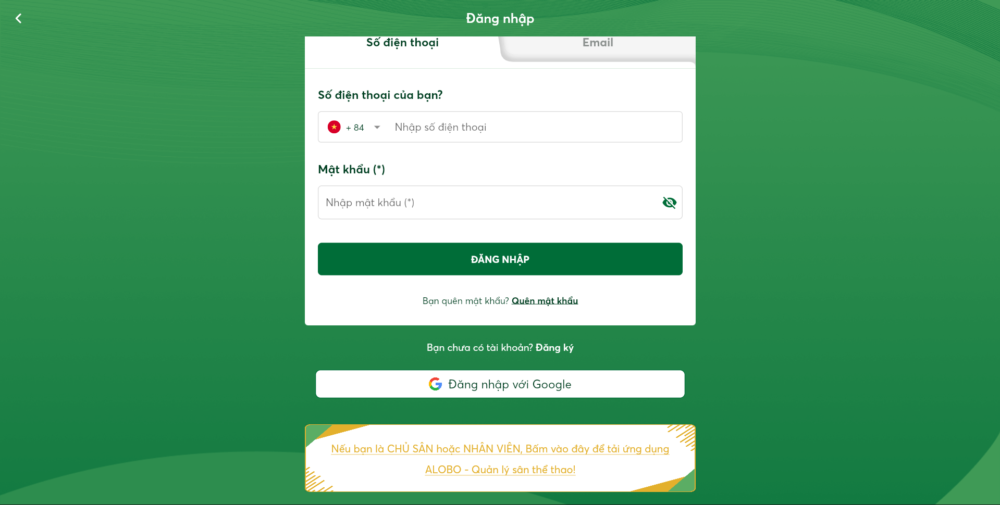
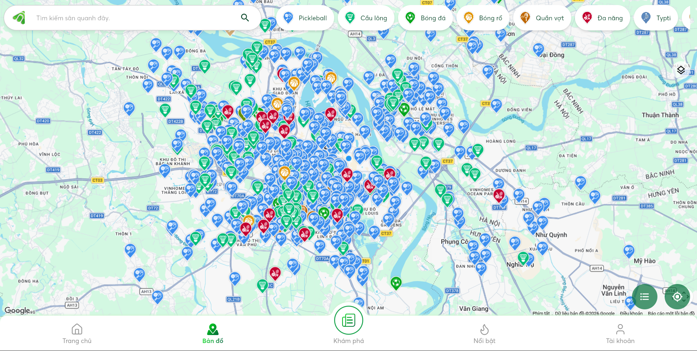
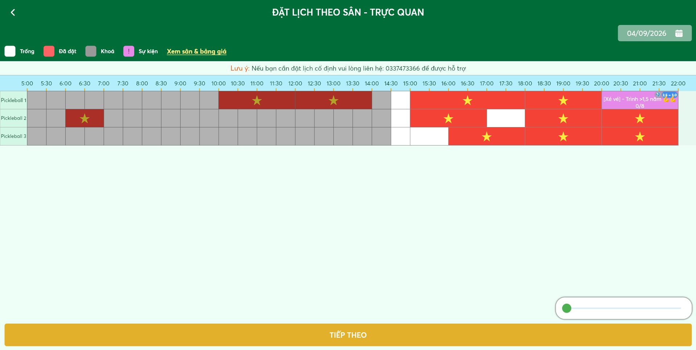
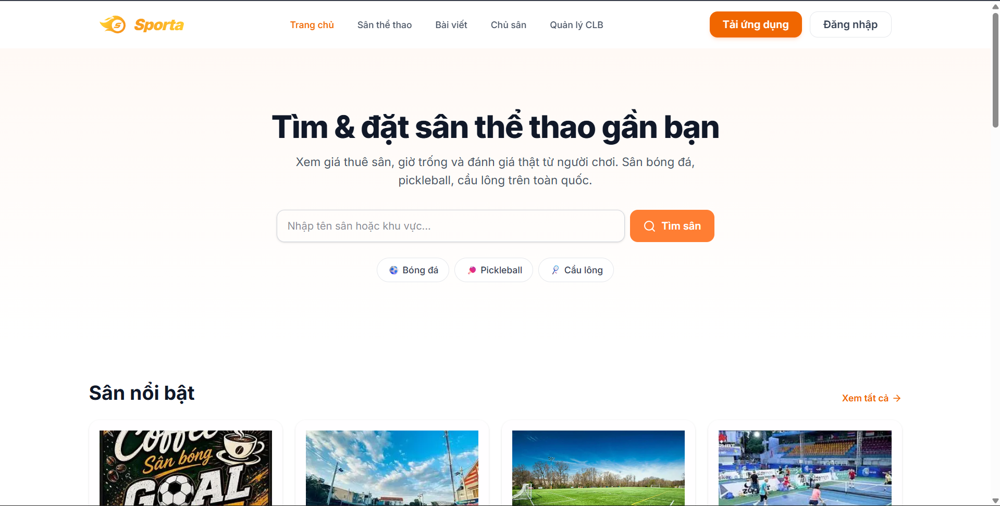
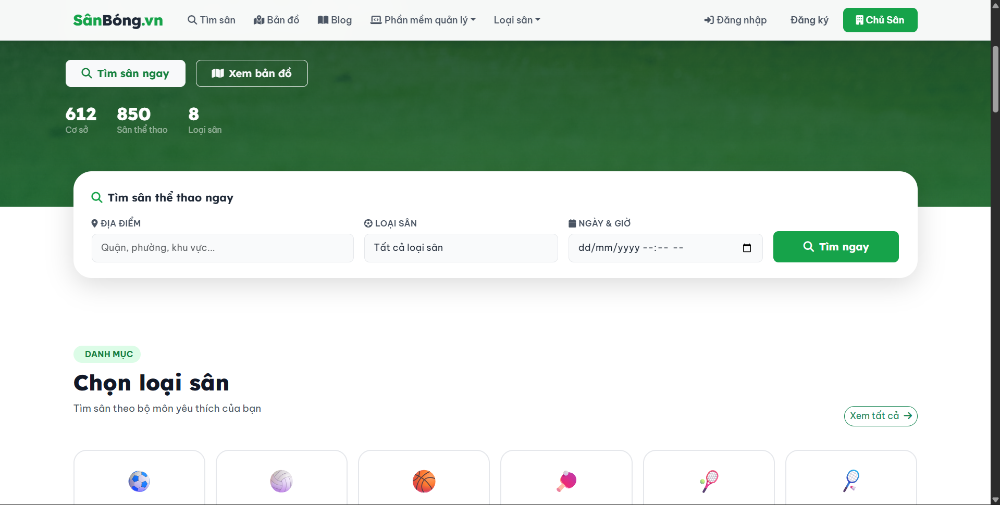
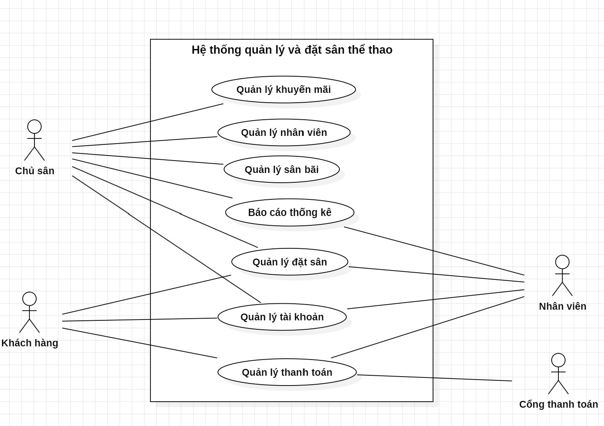
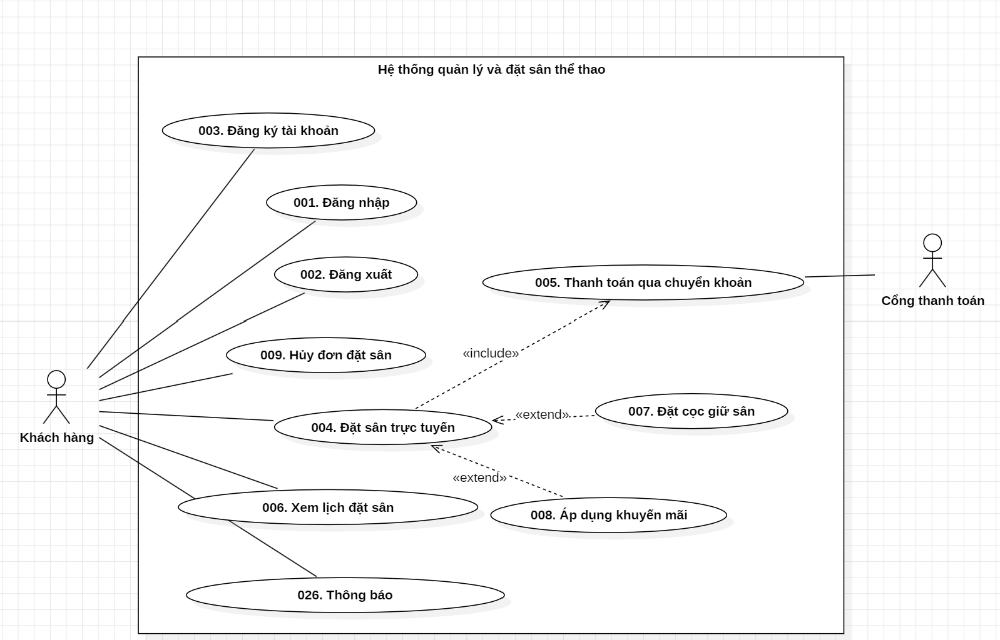
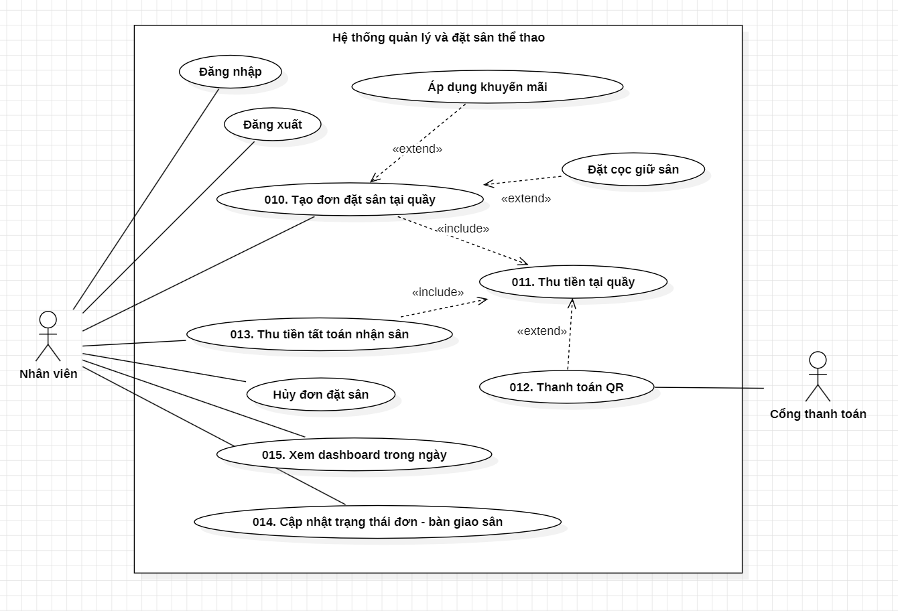
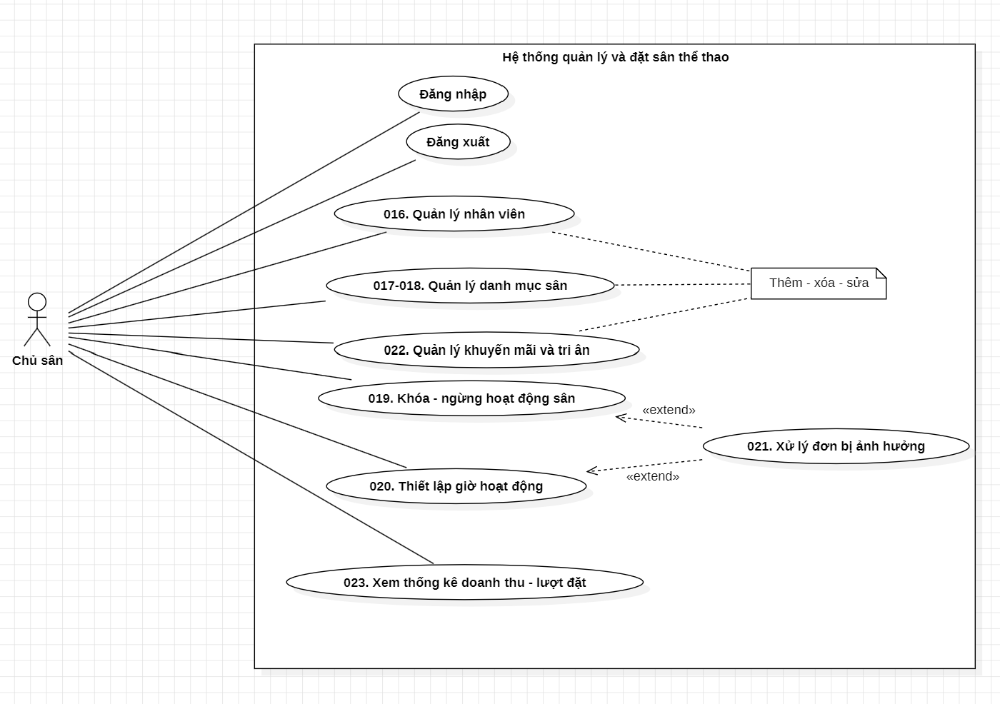

# CHƯƠNG 1. KHẢO SÁT HỆ THỐNG

## I. Khảo sát thực tế

### 1. Mục tiêu khảo sát

Nhu cầu tham gia các hoạt động thể thao như bóng đá, cầu lông, tennis, bóng rổ và pickleball ngày càng phổ biến tại khu dân cư, trường học và khu đô thị. Cùng với sự gia tăng số lượng sân tư nhân và khu liên hợp thể thao, người chơi cần một phương thức tìm sân, kiểm tra khung giờ trống và đặt lịch thuận tiện hơn thay cho việc gọi điện, nhắn tin hoặc đến trực tiếp từng sân.

Về phía chủ sân, việc quản lý bằng sổ ghi chép, bảng tính hoặc tin nhắn rời rạc làm tăng nguy cơ trùng lịch, thất lạc thông tin khách hàng và khó tổng hợp doanh thu. Khi hoạt động kinh doanh mở rộng ra nhiều cơ sở, mỗi cơ sở có nhiều sân và đội ngũ nhân viên riêng, việc phối hợp lịch, kiểm soát quyền truy cập, theo dõi thanh toán và đối chiếu kết quả giữa các cơ sở càng trở nên phức tạp.

Trên cơ sở đó, nhóm định hướng xây dựng Hệ thống quản lý và đặt lịch sân thể thao với các mục tiêu sau:

- Hỗ trợ khách hàng tìm kiếm sân, xem thông tin sân, kiểm tra lịch trống, đặt sân trực tuyến, theo dõi lịch sử đặt sân và gửi yêu cầu hủy lịch.
- Hỗ trợ Chủ sân quản lý tập trung các cơ sở; hỗ trợ Nhân viên sân vận hành sân, lịch đặt, khách hàng, thanh toán và doanh thu theo đúng phạm vi được phân quyền.
- Cho phép mỗi cơ sở khai báo địa chỉ, thông tin liên hệ, giờ hoạt động, tài khoản nhận thanh toán và sân trực thuộc.
- Tăng tính chính xác, khả năng tra cứu và tính minh bạch của dữ liệu thông qua phân quyền, kiểm tra điều kiện nghiệp vụ và lưu vết các giao dịch phát sinh.

### 2. Phương pháp khảo sát

Nhóm thực hiện khảo sát thực tế kết hợp với tham khảo các nền tảng đặt sân đang được sử dụng. Nội dung khảo sát tập trung vào hành trình của người dùng từ tìm kiếm sân, xem thông tin, kiểm tra khung giờ, tạo lịch đặt đến thay đổi hoặc hủy lịch; đồng thời xem xét cách chủ sân tiếp nhận, lưu trữ và quản lý các thông tin này.

Bên cạnh việc quan sát các hệ thống hiện có, nhóm tổng hợp ý kiến trao đổi với người có nhu cầu sử dụng sân thể thao để nhận diện những bất tiện thường gặp, gồm khó tìm sân phù hợp, không biết chính xác lịch trống, phải liên hệ nhiều lần và khó điều chỉnh lịch khi có thay đổi. Kết quả được đối chiếu với nhu cầu quản lý của chủ sân để xác định phạm vi và yêu cầu chức năng cho hệ thống.

### 3. Khảo sát một số hệ thống hiện có

#### a) Alobo

Alobo là nền tảng hỗ trợ người chơi tìm kiếm và đặt lịch sân thể thao trực tuyến. Trong phạm vi khảo sát, hệ thống hướng đến việc rút ngắn quá trình tìm sân bằng cách cung cấp thông tin sân, vị trí và các khung giờ có thể đặt.

Một số chức năng nổi bật:

  - Đăng nhập: Người dùng có thể đăng nhập để lưu thông tin cá nhân, tiếp tục quy trình đặt sân và theo dõi các hoạt động đã thực hiện. Cơ chế xác thực giúp hệ thống nhận diện người dùng và cung cấp các chức năng phù hợp với tài khoản.

  - Bản đồ tìm kiếm sân: Hệ thống hỗ trợ hiển thị vị trí các sân trên bản đồ hoặc theo khu vực, giúp người dùng lựa chọn sân phù hợp về khoảng cách. Người dùng có thể kết hợp xem thông tin cơ bản như loại sân, địa chỉ và mức giá tham khảo trước khi đi đến bước đặt lịch.

  - Đặt lịch trực tuyến: Người dùng lựa chọn sân, ngày và khung giờ mong muốn; sau đó hệ thống tiếp nhận yêu cầu đặt lịch và hiển thị thông tin cần thiết để người dùng xác nhận. Cách tiếp cận này giảm việc trao đổi thủ công giữa người chơi và sân.

#### b) Sporta

Sporta là nền tảng kết nối người chơi với sân và hoạt động thể thao. Bên cạnh tìm kiếm và đặt sân, hệ thống còn có các chức năng mang tính cộng đồng như tìm đối thủ, kết nối người chơi và quản lý đội bóng. Đồng thời, Sporta cung cấp các công cụ hỗ trợ chủ sân quản lý lịch, sân, khách hàng và doanh thu. Điểm đáng tham khảo là sự kết hợp giữa nhu cầu đặt sân và nhu cầu duy trì cộng đồng thể thao.

#### c) SanBong.vn

SanBong.vn là nền tảng đặt và quản lý sân thể thao, hỗ trợ nhiều loại hình như bóng đá, cầu lông, tennis, pickleball và các môn thể thao khác. Người dùng có thể tìm kiếm, xem lịch trống và đặt sân trực tuyến; trong khi chủ sân có thể quản lý lịch đặt, khách hàng, doanh thu, nhân viên và hoạt động kinh doanh. Hệ thống cũng có khả năng mở rộng sang quản lý hội viên, lớp học, huấn luyện viên và giải đấu tùy theo loại hình thể thao.

Qua khảo sát, nhóm nhận thấy các hệ thống hiệu quả thường đồng thời giải quyết hai nhu cầu: tạo trải nghiệm đặt sân rõ ràng cho khách hàng và cung cấp dữ liệu vận hành tin cậy cho chủ sân. Từ nhu cầu mở rộng phạm vi quản lý, hệ thống đề xuất bổ sung mô hình nhiều cơ sở và phân cấp nhân sự; đây là yêu cầu thiết kế bổ sung của hệ thống, không phải chức năng được xác nhận có ở toàn bộ các nền tảng khảo sát.

## II. Danh sách các yêu cầu chức năng

| **Tác nhân** | **Vai trò và phạm vi chính** |
| --- | --- |
| Chủ sân | Quản trị tất cả cơ sở, quản lý sân, nhân viên, đơn đặt, thanh toán và báo cáo tổng hợp.T |
| Nhân viên | Tiếp nhận đặt sân, chăm sóc khách hàng, cập nhật trạng thái đơn và xác nhận thanh toán theo quyền. |
| Khách hàng | Tìm sân theo cơ sở, đặt trực tuyến, thanh toán cho đúng cơ sở, theo dõi các đơn của mình và yêu cầu hủy. |

| **STT** | **Nhóm chức năng** | **Chức năng** | **Mô tả** |
| --- | --- | --- | --- |
| 1 | Tài khoản | **Đăng nhập** | Xác thực thông tin đăng nhập và đưa người dùng vào giao diện tương ứng của Chủ sân, Nhân viên sân hoặc Khách hàng. |
| 2 | Tài khoản | **Đăng xuất** | Kết thúc phiên làm việc an toàn và đưa người dùng về màn hình đăng nhập. |
| 3 | Quản lý nhân viên | **Thêm, sửa và khóa tài khoản nhân viên** | Chủ sân quản lý tài khoản và trạng thái làm việc của Nhân viên sân; giữ nguyên lịch sử xử lý giao dịch. |
| 5 | Quản lý sân | **Thêm sân** | Chủ sân thêm sân mới, chọn sân thuộc cơ sở nào, cấu hình loại sân, khung giờ, giá thuê và mức đặt cọc. |
| 6 | Quản lý sân | **Sửa thông tin sân** | Chủ sân cập nhật thông tin sân, lựa chọn cơ sở, giá thuê và mức đặt cọc; bảo lưu đơn giá trên các đơn đã tạo. |
| 7 | Quản lý sân | **Thiết lập giờ hoạt động và ngày nghỉ** | Chủ sân cài đặt giờ mở cửa theo ngày trong tuần và lịch nghỉ chung; chặn đặt sân ngoài khung giờ mở cửa. |
| 8 | Quản lý sân | **Khóa hoặc ngừng hoạt động sân** | Chủ sân tạm khóa sân để bảo trì hoặc ngừng khai thác; cảnh báo và xử lý các đơn đặt sân bị ảnh hưởng. |
| 9 | Đặt sân | **Tạo đơn đặt sân tại quầy** | Nhân viên chọn khung giờ trống trên lịch sân, chọn khách đã có tài khoản hoặc ghi nhận là khách hàng vãng lai để lập đơn đặt cọc hoặc trả đủ 100%. |
| 10 | Đặt sân | **Đặt sân trực tuyến** | Khách hàng chọn cơ sở, sân và khung giờ trống trên lịch, áp dụng mã ưu đãi (nếu có) và chọn đặt cọc hoặc thanh toán 100% qua mã QR. |
| 11 | Đặt sân | **Đặt cọc giữ sân** | Hỗ trợ đặt tiền cọc để giữ chỗ, gửi thông báo nhắc lịch trước 1 giờ và thu phần tiền còn lại khi khách đến nhận sân. |
| 12 | Đặt sân | **Hủy đơn đặt sân** | Hủy đơn theo yêu cầu hoặc hủy khi khách không đến nhận sân đúng giờ; giải phóng lịch sân và hoàn tiền theo mốc thời gian hủy (trước từ 5 ngày: 100%, từ 2 đến dưới 5 ngày: 50%, dưới 2 ngày: không hoàn); tiền đặt cọc không được hoàn. |
| 13 | Đặt sân | **Cập nhật trạng thái đơn – bàn giao sân** | Theo dõi và cập nhật trạng thái đơn từ khi tạo, đặt cọc/thanh toán, tất toán nhận sân đến khi hoàn thành hoặc hủy. |
| 14 | Khách hàng | **Đăng ký tài khoản khách hàng** | Khách hàng đăng ký tài khoản để đặt sân trực tuyến, nhận ưu đãi tri ân và thông báo nhắc lịch chơi. |
| 15 | Khuyến mãi và tri ân | **Tạo chương trình sale, tri ân và tăng tương tác** | Chủ sân tạo chương trình giảm giá (sale), phát hành mã ưu đãi tri ân khách hàng và gửi thông báo thu hút, tăng tương tác người chơi. |
| 16 | Thanh toán | **Thanh toán qua chuyển khoản** | Hiển thị mã QR theo đơn đặt sân; khi khách chuyển khoản thành công, hệ thống ghi nhận Đã đặt cọc hoặc Đã thanh toán và xác nhận đơn. |
| 17 | Thanh toán | **Thu tiền tại quầy và tất toán nhận sân** | Nhân viên ghi nhận thu tiền mặt hoặc chuyển khoản tại quầy và thu phần tiền còn lại khi khách đặt cọc đến tiếp nhận sân đấu. |
| 18 | Dashboard | **Thống kê vận hành trong ngày** | Tổng hợp số lượt đặt hôm nay, số sân đang sử dụng, số đơn chờ thanh toán và doanh thu thực thu trong ngày. |
| 19 | Thống kê và báo cáo | **Thống kê doanh thu và lượt đặt sân** | Chủ sân thống kê doanh thu thực thu (gồm tiền thanh toán và tiền cọc) và số lượt đặt sân theo ngày, tháng hoặc theo từng cơ sở, từng sân. |

## III. Chi tiết chức năng

### 1. Nhóm chức năng tài khoản

#### Chức năng 1: Đăng nhập

Người dùng nhập tên tài khoản và mật khẩu để truy cập hệ thống. Hệ thống kiểm tra thông tin đăng nhập và trạng thái tài khoản, sau đó đưa người dùng vào đúng giao diện làm việc của mình: Chủ sân vào giao diện quản lý toàn bộ cửa hàng; Nhân viên sân vào giao diện đặt sân và thu ngân tại quầy; Khách hàng vào giao diện đặt sân trực tuyến. Các tài khoản đã bị khóa sẽ không thể đăng nhập.

#### Chức năng 2: Đăng xuất

Người dùng chọn chức năng Đăng xuất khi kết thúc phiên làm việc. Hệ thống đóng phiên đăng nhập hiện tại, xóa thông tin xác thực lưu tạm trên thiết bị và quay về màn hình đăng nhập. Nếu người dùng truy cập lại các màn hình nghiệp vụ, hệ thống sẽ yêu cầu đăng nhập lại.

### 2. Nhóm chức năng quản lý nhân viên

#### Chức năng 3: Thêm, sửa và khóa tài khoản nhân viên

Chủ sân trực tiếp tạo mới, sửa thông tin hoặc khóa tài khoản của Nhân viên sân mà không cần qua bước cấu hình phân quyền phức tạp. Khi tạo hoặc cập nhật, hệ thống kiểm tra để tránh trùng tên đăng nhập và số điện thoại. Khi nhân viên nghỉ việc, Chủ sân khóa tài khoản để chặn đăng nhập mới nhưng toàn bộ lịch sử đơn đặt sân và giao dịch thu tiền do nhân viên đó thực hiện trước đây vẫn được lưu giữ đầy đủ.

### 3. Nhóm chức năng quản lý sân

#### Chức năng 5: Thêm sân

Chủ sân thêm sân mới vào hệ thống bằng cách nhập tên sân, chọn cơ sở mà sân đó trực thuộc, chọn môn thể thao/loại sân, cấu hình đơn giá thuê theo khung giờ, mức đặt cọc yêu cầu và trạng thái hoạt động. Hệ thống kiểm tra dữ liệu hợp lệ và hiển thị sân mới đúng theo cơ sở đã cài đặt trên lịch đặt sân.

#### Chức năng 6: Sửa thông tin sân

Chủ sân cập nhật thông tin mô tả, thay đổi lựa chọn cơ sở cho sân, điều chỉnh bảng giá thuê hoặc mức đặt cọc khi cần thiết. Hệ thống lưu lại thông tin thay đổi và áp dụng mức giá mới cho các đơn đặt sân tạo sau thời điểm sửa; những đơn đã đặt trước đó vẫn giữ nguyên đơn giá và số tiền cọc ban đầu.

#### Chức năng 7: Thiết lập giờ hoạt động và ngày nghỉ

Chủ sân cài đặt khung giờ mở cửa, đóng cửa theo từng ngày trong tuần và lịch nghỉ lễ hoặc tạm nghỉ chung. Khi lưu cài đặt, hệ thống kiểm tra và báo cho Chủ sân biết nếu có đơn đặt sân đã xác nhận nằm trùng vào khoảng thời gian dự kiến nghỉ. Hệ thống chỉ mở nhận đơn đặt sân trong khung giờ hoạt động hợp lệ.

#### Chức năng 8: Khóa hoặc ngừng hoạt động sân

Chủ sân chọn sân cần tạm khóa để sửa chữa, bảo trì hoặc ngừng khai thác trong một khoảng thời gian xác định. Hệ thống liệt kê các đơn đặt sân còn hiệu lực bị ảnh hưởng để Chủ sân hoặc nhân viên liên hệ sắp xếp chuyển sân cho khách. Trong thời gian sân đang khóa, hệ thống không nhận đơn đặt mới trên sân đó.

### 4. Nhóm chức năng đặt sân

#### Vòng đời trạng thái đơn đặt sân và thanh toán

| **Giai đoạn** | **Trạng thái đơn** | **Trạng thái thanh toán** | **Điều kiện và quy tắc xử lý** |
| --- | --- | --- | --- |
| 1 | Chờ thanh toán | **Chưa thanh toán** | Đơn vừa được tạo; hệ thống giữ chỗ tạm thời trong thời hạn thanh toán và hiển thị mã QR chuyển khoản (đặt cọc hoặc trả đủ 100%) hoặc chờ thu tiền tại quầy. |
| 2 | Đã xác nhận | **Đã đặt cọc / Đã thanh toán** | Khi khách chuyển khoản thành công qua mã QR (hoặc đóng tiền tại quầy), đơn chuyển sang Đã xác nhận; hệ thống gửi thông báo nhắc lịch trước giờ chơi 1 giờ. |
| 3 | Đang sử dụng | **Đã thanh toán (100%)** | Khách đến nhận sân để bắt đầu chơi; nếu đơn mới chỉ đặt cọc, khách cần thanh toán nốt phần tiền còn lại tại quầy trước khi chuyển sang Đang sử dụng. |
| 4 | Hoàn thành | **Đã thanh toán (100%)** | Khách kết thúc giờ chơi; hệ thống hoàn tất đơn đặt sân và ghi nhận toàn bộ giá trị đơn vào doanh thu thực thu. |
| 5 | Đã hủy | **Không hoàn tiền** | Đơn bị hủy trước giờ chơi hoặc bị hủy khi khách không tới nhận sân / quá giờ nhận sân quy định; hệ thống mở lại khung giờ trống và không hoàn lại tiền đã đóng. |
| 6 | Quá hạn thanh toán | **Chưa thanh toán** | Hết thời gian giữ chỗ ban đầu lúc tạo đơn mà khách vẫn chưa hoàn tất chuyển khoản đặt cọc hoặc thanh toán; hệ thống hủy giữ chỗ và mở lại sân. |

#### Chức năng 9: Tạo đơn đặt sân tại quầy

Nhân viên sân mở màn hình đặt sân tại quầy, chọn cơ sở và chọn trực tiếp khung giờ còn trống trên bảng lịch sân. Nếu khách đã có tài khoản trên hệ thống, nhân viên tìm nhanh theo số điện thoại; nếu khách tới đặt trực tiếp mà chưa có tài khoản, hệ thống sẽ ghi nhận luôn là Khách hàng vãng lai (chỉ cần nhập tên và số điện thoại liên hệ trên đơn).

Sau khi chọn hình thức Đặt cọc giữ sân hoặc Thanh toán 100% và áp dụng chương trình giảm giá (nếu có), khách có thể trả tiền mặt tại quầy hoặc quét mã QR chuyển khoản. Khi hoàn tất thu tiền mặt hoặc chuyển khoản thành công, đơn đặt sân được chuyển sang trạng thái Đã xác nhận.

#### Chức năng 10: Đặt sân trực tuyến

Khách hàng chọn cơ sở, xem thông tin sân, giá thuê và bảng lịch trống trực tiếp trên màn hình đặt sân trực tuyến để chọn khung giờ mong muốn. Hệ thống kiểm tra giờ mở cửa, ngăn trùng lịch, hỗ trợ khách chọn mã ưu đãi hoặc chương trình giảm giá đang áp dụng và cho phép chọn Đặt cọc giữ sân hoặc Thanh toán 100%.

Khi khách xác nhận đặt lịch, hệ thống tạo đơn ở trạng thái Chờ thanh toán kèm mã QR chuyển khoản theo đúng số tiền cần đóng. Ngay khi khách chuyển khoản thành công, đơn đặt sân chuyển sang trạng thái Đã xác nhận (với trạng thái tiền tương ứng là Đã đặt cọc hoặc Đã thanh toán). Nếu quá thời gian giữ chỗ ban đầu mà khách chưa chuyển khoản, đơn sẽ chuyển sang Quá hạn thanh toán và trả lại khung giờ trống cho sân.

#### Chức năng 11: Đặt cọc giữ sân

Khi khách hàng hoặc nhân viên chọn hình thức đặt cọc lúc lên đơn, hệ thống tính số tiền cọc cần đóng trước và số tiền còn lại. Sau khi khách hoàn tất chuyển khoản tiền cọc (hoặc đóng tiền mặt tại quầy), hệ thống giữ khung giờ chính thức cho khách ở trạng thái Đã xác nhận (Đã đặt cọc).

Trước giờ bắt đầu chơi 1 giờ, hệ thống gửi thông báo nhắc lịch cho khách hàng kèm thời gian nhận sân và số tiền còn thiếu. Khi người chơi đến tiếp nhận sân đấu, nhân viên thu nốt phần tiền còn lại để chuyển đơn sang trạng thái Đang sử dụng. Trường hợp người chơi không tới hoặc đã quá giờ đặt cọc/nhận sân mà vẫn chưa đến, đơn sẽ trực tiếp bị hủy, sân được mở trống lại và khách không nhận lại được tiền cọc.

*Bổ sung trường hợp trên: Trong trường hợp người chơi không tới hoặc quá giờ nhân sân, nếu họ đã thanh toán 100% cho sân đó rồi thì không hủy sân mà đợi cho tới khi hết giờ người chơi đã đặt và đơn đó được ghi nhận là đã hủy, nguyên nhân là do khách không tới nhận (Bổ sung ngày 24/11/2026)*

#### Chức năng 12: Hủy đơn đặt sân

Đơn đặt sân chuyển sang trạng thái Đã hủy khi khách hàng hoặc nhân viên chủ động hủy trước giờ chơi, hoặc khi khách đã đặt cọc nhưng chưa thanh toán đủ nhưng không tới nhận sân đúng giờ quy định. Khi hủy đơn, hệ thống lưu lại lý do, thời điểm hủy và giải phóng ngay khung giờ trên lịch sân. Chính sách hoàn tiền khi hủy được tính theo khoảng thời gian từ thời điểm hủy đến giờ bắt đầu chơi: hủy trước từ 5 ngày trở lên được hoàn 100%; hủy trước từ 2 ngày đến dưới 5 ngày được hoàn 50%; hủy trước dưới 2 ngày hoặc khách không đến nhận sân thì không được hoàn tiền. Tỷ lệ hoàn chỉ áp dụng trên số tiền khách đã thanh toán ngoài tiền đặt cọc; tiền đặt cọc không được hoàn lại trong bất kỳ trường hợp nào.

#### Chức năng 13: Cập nhật trạng thái đơn và nhận sân

Hệ thống quản lý xuyên suốt luồng trạng thái đơn: Chờ thanh toán → Đã xác nhận → Đang sử dụng → Hoàn thành, cùng hai trạng thái ngoại lệ là Quá hạn thanh toán và Đã hủy. Các đơn Đã xác nhận được gửi thông báo nhắc lịch trước 1 giờ so với giờ bắt đầu chơi. Khi người chơi đến nhận sân để vào trạng thái Đang sử dụng, đơn bắt buộc phải được thanh toán đủ 100% (nếu trước đó mới đặt cọc thì phải tất toán phần tiền còn lại ngay lúc nhận sân).

### 5. Nhóm chức năng khách hàng và quản lý khách hàng

#### Chức năng 14: Đăng ký tài khoản khách hàng

Khách hàng nhập họ tên, số điện thoại, email và mật khẩu để tạo tài khoản trên hệ thống. Khi có tài khoản, khách hàng có thể chủ động đặt sân trực tuyến, theo dõi lịch sử các lần đặt sân của mình, nhận thông báo nhắc lịch trước giờ chơi 1 giờ và hưởng các chương trình ưu đãi, tri ân từ Chủ sân.

### 6. Nhóm chức năng khuyến mãi và tri ân khách hàng

#### Chức năng 15: Tạo chương trình sale, tri ân và tăng tương tác

Chủ sân tạo và quản lý các chương trình khuyến mãi (sale) giảm giá thuê sân theo khung giờ thấp điểm, theo ngày lễ hoặc theo cơ sở, đồng thời phát hành các mã ưu đãi/voucher tri ân dành cho khách hàng thân thiết hoặc quà tặng gắn kết người chơi. Chủ sân có thể thiết lập thời gian áp dụng, mức giảm giá (theo phần trăm hoặc số tiền) và gửi thông báo chương trình ưu đãi tới khách hàng để thu hút đặt sân và tăng tương tác.

### 7. Nhóm chức năng thanh toán

#### Chức năng 16: Thanh toán trực tuyến

Khi khách chọn thanh toán bằng chuyển khoản (lúc đặt sân trực tuyến hoặc quét QR tại quầy), hệ thống hiển thị mã QR chứa sẵn số tiền cần trả (tiền đặt cọc hoặc 100% tiền sân) cùng nội dung mã đơn. Ngay khi khách hoàn tất chuyển khoản, trạng thái thanh toán của đơn chuyển sang Đã đặt cọc hoặc Đã thanh toán, đồng thời đơn đặt sân được xác nhận ngay để giữ lịch cho khách.

#### Chức năng 17: Thu tiền tại quầy và tất toán nhận sân

Nhân viên sân thực hiện thu tiền tại quầy trong hai trường hợp: khách hàng (bao gồm cả khách vãng lai) đến đặt sân trực tiếp tại chỗ và trả tiền mặt/chuyển khoản, hoặc khách đã đặt cọc trước đó nay đến tiếp nhận sân đấu và đóng nốt phần tiền còn lại. Ngay khi thu đủ 100% giá trị đơn, trạng thái thanh toán được cập nhật thành Đã thanh toán và khách bắt đầu vào sử dụng sân.

### 8. Nhóm chức năng dashboard và thống kê

#### Chức năng 18: Thống kê vận hành trong ngày

Màn hình Dashboard giúp Chủ sân và Nhân viên sân nắm bắt nhanh tình hình hoạt động trong ngày, bao gồm: tổng số lượt đặt sân hôm nay, số sân đang trong trạng thái Đang sử dụng, số đơn đang chờ thanh toán hoặc chờ khách đến nhận sân tất toán, và tổng doanh thu thực thu trong ngày (tính cả tiền thanh toán đủ và tiền cọc đã thu).

#### Chức năng 19: Thống kê doanh thu và lượt đặt sân

Chủ sân xem báo cáo doanh thu thực thu và số lượt đặt sân theo ngày, theo tháng, lọc theo từng sân hoặc theo từng cơ sở đã cài đặt. Doanh thu thực thu bao gồm toàn bộ tiền từ các đơn hoàn thành và khoản tiền cọc/thanh toán của các đơn bị hủy do khách không đến nhận sân; báo cáo cũng thống kê rõ số lượt đặt thành công, số đơn hủy và hiệu quả từ các chương trình khuyến mãi.

## IV. Use case

### 1. Sơ đồ use case tổng quan

### 2. Biểu đồ use case phân rã chức năng

#### a. Phân rã usecase tác nhân “Khách hàng” b. Phân rã use case tác nhân “Nhân viên” 

#### c. Phân rã use case tác nhân “Chủ sân”

### 3. Đặc tả chi tiết use case

| **Mã** | **Tên use-case** | **Tác nhân** | **FR phục vụ** | **Ghi chú** |
| --- | --- | --- | --- | --- |
| UC 001 | Đăng nhập | Khách hàng, Nhân viên, Chủ sân | FR 01 |  |
| UC 002 | Đăng xuất | Khách hàng, Nhân viên, Chủ sân | FR 02 |  |
| UC 003 | Đăng ký tài khoản | Khách hàng | FR 14 |  |
| UC 004 | Đặt sân trực tuyến | Khách hàng | FR 10 | include → UC 005 Thanh toán qua chuyển khoản; được extend bởi UC 007 Đặt cọc giữ sân và UC 008 Áp dụng khuyến mãi |
| UC 005 | Thanh toán qua chuyển khoản | Khách hàng, Cổng thanh toán | FR 16 |  |
| UC 006 | Xem lịch đặt sân | Khách hàng | FR 14 | Tách từ UC “Xem lịch và nhận thông báo” cũ (phần nhận thông báo chuyển sang UC 026); từ chi tiết đơn có thể chuyển tới UC 005 hoặc UC 009 |
| UC 007 | Đặt cọc giữ sân | Khách hàng, Nhân viên | FR 11 | extend → UC 004 Đặt sân trực tuyến; extend → UC 010 Tạo đơn đặt sân tại quầy |
| UC 008 | Áp dụng khuyến mãi | Khách hàng, Nhân viên | FR 09, FR 10 | extend → UC 004 Đặt sân trực tuyến; extend → UC 010 Tạo đơn đặt sân tại quầy |
| UC 009 | Hủy đơn đặt sân | Khách hàng, Nhân viên | FR 12 | Khách hàng hủy đơn của mình; Nhân viên hủy đơn thuộc cơ sở được phân công |
| UC 010 | Tạo đơn đặt sân tại quầy | Nhân viên | FR 09 | include → UC 011 Thu tiền tại quầy; được extend bởi UC 007 Đặt cọc giữ sân và UC 008 Áp dụng khuyến mãi |
| UC 011 | Thu tiền tại quầy | Nhân viên | FR 17 | Được include bởi UC 010 và UC 013; được extend bởi UC 012 Thanh toán QR khi khách trả bằng chuyển khoản |
| UC 012 | Thanh toán QR | Nhân viên, Cổng thanh toán | FR 16, FR 17 | extend → UC 011 Thu tiền tại quầy; Cổng thanh toán xác nhận giao dịch chuyển khoản tại quầy |
| UC 013 | Thu tiền tất toán nhận sân | Nhân viên | FR 17, FR 11 | include → UC 011 Thu tiền tại quầy; kích hoạt UC 014 sau khi thu đủ |
| UC 014 | Cập nhật trạng thái đơn – bàn giao sân | Nhân viên | FR 13 | Hoàn thành đơn tự động khi hết giờ thuê; nhân viên chỉ kết thúc sớm khi cần |
| UC 015 | Xem dashboard trong ngày | Nhân viên, Chủ sân | FR 18 | Gộp “Xem dashboard trong ngày” (Nhân viên) và “Xem dashboard vận hành” (Chủ sân) trên sơ đồ |
| UC 016 | Quản lý nhân viên | Chủ sân | FR 03 | Thêm - sửa - khóa/mở khóa tài khoản (không xóa để bảo toàn lịch sử giao dịch) |
| UC 017 | Quản lý danh mục sân – Thêm sân | Chủ sân | FR 05 | Thuộc use case “Quản lý danh mục sân” trên sơ đồ (Thêm - sửa; ngừng khai thác sân thực hiện qua UC 019) |
| UC 018 | Quản lý danh mục sân – Sửa thông tin sân | Chủ sân | FR 06 | Thuộc use case “Quản lý danh mục sân” trên sơ đồ |
| UC 019 | Khóa – ngừng hoạt động sân | Chủ sân | FR 08 | Được extend bởi UC 021 Xử lý đơn đặt sân bị ảnh hưởng |
| UC 020 | Thiết lập giờ hoạt động và ngày nghỉ | Chủ sân | FR 07 | Được extend bởi UC 021 Xử lý đơn đặt sân bị ảnh hưởng |
| UC 021 | Xử lý đơn đặt sân bị ảnh hưởng | Chủ sân, Nhân viên | FR 08 (mở rộng) | extend → UC 019 Khóa - ngừng hoạt động sân; extend → UC 020 Thiết lập giờ hoạt động và ngày nghỉ |
| UC 022 | Quản lý khuyến mãi và tri ân | Chủ sân | FR 15 | Thêm - sửa - tạm dừng - xóa chương trình; khuyến mãi được áp dụng qua UC 008 |
| UC 023 | Xem thống kê doanh thu - lượt đặt | Chủ sân | FR 19 |  |
| UC 026 | Thông báo | Khách hàng | FR 11, FR 15, FR 16 | Tổng hợp thông báo kết quả thanh toán, nhắc lịch và khuyến mãi/tri ân |

#### 3.1. Nhóm use case dùng chung cho tất cả người dùng

#### a. Đăng nhập

<table>
  <tr>
    <th>Mã Use case</th>
    <th colspan="3"><strong>UC 001</strong></th>
    <th>Tên Usecase</th>
    <th colspan="2"><strong>Đăng nhập</strong></th>
  </tr>
  <tr>
    <td>Tác nhân</td>
    <td colspan="6">Khách hàng, Nhân viên, Chủ sân</td>
  </tr>
  <tr>
    <td>Mô tả</td>
    <td colspan="6">Cho phép người dùng đăng nhập vào hệ thống bằng số điện thoại/email và mật khẩu. Hệ thống xác thực thông tin, kiểm tra trạng thái tài khoản và điều hướng người dùng vào giao diện làm việc tương ứng với vai trò (Chủ sân, Nhân viên sân hoặc Khách hàng).</td>
  </tr>
  <tr>
    <td>Sự kiện kích hoạt</td>
    <td colspan="6">Người dùng nhấn vào nút “Đăng nhập” trên giao diện website/ứng dụng.</td>
  </tr>
  <tr>
    <td>Tiền điều kiện</td>
    <td colspan="6">Tác nhân đã có tài khoản được khởi tạo trên hệ thống và đang ở trạng thái chưa đăng nhập.</td>
  </tr>
  <tr>
    <td rowspan="4">Luồng sự kiện chính (Thành công)</td>
    <td><strong>STT</strong></td>
    <td><strong>Tác nhân</strong></td>
    <td colspan="3"><strong>Hệ thống</strong></td>
  </tr>
  <tr>
    <td>1</td>
    <td>Truy cập màn hình Đăng nhập và nhập Số điện thoại/Email cùng Mật khẩu vào biểu mẫu.</td>
    <td colspan="3">Tiếp nhận dữ liệu nhập và kiểm tra định dạng các trường bắt buộc.</td>
  </tr>
  <tr>
    <td>2</td>
    <td>Nhấn nút “Đăng nhập” để gửi yêu cầu xác thực.</td>
    <td colspan="3">Kiểm tra thông tin tài khoản, đối chiếu mật khẩu và kiểm tra trạng thái hoạt động của tài khoản trong cơ sở dữ liệu.</td>
  </tr>
  <tr>
    <td>3</td>
    <td></td>
    <td colspan="3">Khởi tạo phiên làm việc (session), đặt lại bộ đếm số lần nhập sai mật khẩu và điều hướng tới giao diện tương ứng: Chủ sân vào trang Quản trị toàn hệ thống; Nhân viên sân vào trang Đặt sân &amp; Thu ngân tại quầy (chỉ truy cập dữ liệu thuộc cơ sở được phân công); Khách hàng vào trang Đặt sân trực tuyến.</td>
  </tr>
  <tr>
    <td rowspan="6">Luồng sự kiện thay thế</td>
    <td><strong>STT</strong></td>
    <td colspan="4"><strong>Hệ thống</strong></td>
  </tr>
  <tr>
    <td>1a</td>
    <td colspan="4">Hiển thị thông báo lỗi: “Vui lòng nhập đầy đủ số điện thoại/email và mật khẩu” nếu người dùng bỏ trống trường bắt buộc.</td>
  </tr>
  <tr>
    <td>2a</td>
    <td colspan="4">Hiển thị thông báo lỗi: “Tài khoản hoặc mật khẩu không chính xác” nếu thông tin đối chiếu không khớp.</td>
  </tr>
  <tr>
    <td>2b</td>
    <td colspan="4">Hiển thị thông báo lỗi: “Bạn đã nhập sai mật khẩu quá 5 lần liên tiếp. Tài khoản tạm khóa 5 phút” khi vượt ngưỡng thử lại.</td>
  </tr>
  <tr>
    <td>2c</td>
    <td colspan="4">Hiển thị thông báo lỗi: “Tài khoản của bạn đã bị khóa. Vui lòng liên hệ Chủ sân để được hỗ trợ” nếu tài khoản đang ở trạng thái Khóa.</td>
  </tr>
  <tr>
    <td>2d</td>
    <td colspan="4">Lỗi kết nối máy chủ khi xác thực: Hiển thị thông báo “Không thể đăng nhập lúc này. Vui lòng thử lại sau”.</td>
  </tr>
  <tr>
    <td>Hậu điều kiện</td>
    <td colspan="6">Tác nhân đăng nhập thành công vào hệ thống và truy cập được các chức năng theo đúng phân quyền.</td>
  </tr>
</table>

*\*Dữ liệu đầu vào gồm các trường dữ liệu sau:*

| **STT** | **Trường dữ liệu** | **Mô tả** | **Bắt buộc** | **Điều kiện hợp lệ** | **Ví dụ** |
| --- | --- | --- | --- | --- | --- |
| 1 | Số điện thoại / Email | Ô nhập tên đăng nhập (Input text) | Có | Đúng định dạng số điện thoại (10 chữ số) hoặc email hợp lệ, không chứa khoảng trắng | 0912345678 / khachhang@gmail.com |
| 2 | Mật khẩu | Ô nhập mật khẩu (Password field) | Có | Độ dài từ 6–32 ký tự, không chứa khoảng trắng | Matkhau123 |

*\*Thông tin hiển thị / Dữ liệu đầu ra:*

| **STT** | **Trường dữ liệu** | **Mô tả** |
| --- | --- | --- |
| 1 | Thông tin phiên đăng nhập | Mã phiên làm việc (Session/Token), họ tên người dùng và vai trò (Chủ sân / Nhân viên sân / Khách hàng). |
| 2 | Giao diện làm việc theo vai trò | Màn hình trang chủ tương ứng với quyền hạn của tài khoản vừa đăng nhập. |

#### b. Đăng xuất

<table>
  <tr>
    <th>Mã Use case</th>
    <th colspan="3"><strong>UC 002</strong></th>
    <th>Tên Usecase</th>
    <th colspan="2"><strong>Đăng xuất</strong></th>
  </tr>
  <tr>
    <td>Tác nhân</td>
    <td colspan="6">Khách hàng, Nhân viên, Chủ sân</td>
  </tr>
  <tr>
    <td>Mô tả</td>
    <td colspan="6">Cho phép người dùng kết thúc phiên làm việc hiện tại một cách an toàn. Sau khi đăng xuất, hệ thống xóa thông tin xác thực tạm thời và yêu cầu đăng nhập lại nếu truy cập các màn hình nghiệp vụ.</td>
  </tr>
  <tr>
    <td>Sự kiện kích hoạt</td>
    <td colspan="6">Người dùng nhấn vào nút “Đăng xuất” trên thanh điều hướng hoặc menu tài khoản.</td>
  </tr>
  <tr>
    <td>Tiền điều kiện</td>
    <td colspan="6">Tác nhân đang trong phiên đăng nhập hợp lệ trên hệ thống.</td>
  </tr>
  <tr>
    <td rowspan="3">Luồng sự kiện chính (Thành công)</td>
    <td><strong>STT</strong></td>
    <td><strong>Tác nhân</strong></td>
    <td colspan="3"><strong>Hệ thống</strong></td>
  </tr>
  <tr>
    <td>1</td>
    <td>Chọn chức năng “Đăng xuất” trên giao diện.</td>
    <td colspan="3">Tiếp nhận yêu cầu và xác định phiên đăng nhập hiện tại của người dùng.</td>
  </tr>
  <tr>
    <td>2</td>
    <td></td>
    <td colspan="3">Đóng phiên làm việc trên máy chủ, xóa token/trạng thái xác thực lưu tạm trên thiết bị và chuyển hướng người dùng về màn hình Đăng nhập.</td>
  </tr>
  <tr>
    <td rowspan="3">Luồng sự kiện thay thế</td>
    <td><strong>STT</strong></td>
    <td colspan="4"><strong>Hệ thống</strong></td>
  </tr>
  <tr>
    <td>1a</td>
    <td colspan="4">Phiên đăng nhập đã hết hạn trước khi yêu cầu được xử lý: Hệ thống tự động xóa trạng thái lưu tạm trên trình duyệt và chuyển thẳng về trang Đăng nhập.</td>
  </tr>
  <tr>
    <td>2a</td>
    <td colspan="4">Mất kết nối mạng hoặc lỗi máy chủ khi hủy phiên: Hiển thị thông báo “Đăng xuất thất bại. Vui lòng thử lại sau”.</td>
  </tr>
  <tr>
    <td>Hậu điều kiện</td>
    <td colspan="6">Phiên làm việc kết thúc thành công; người dùng trở về trạng thái chưa đăng nhập.</td>
  </tr>
</table>

*\*Dữ liệu đầu vào gồm các trường dữ liệu sau:*

| **STT** | **Trường dữ liệu** | **Mô tả** | **Bắt buộc** | **Điều kiện hợp lệ** | **Ví dụ** |
| --- | --- | --- | --- | --- | --- |
| 1 | Yêu cầu đăng xuất | Nút lệnh (Button) Đăng xuất kèm mã phiên hiện tại | Có | Phiên đăng nhập đang tồn tại trên hệ thống | Click nút “Đăng xuất” |

*\*Thông tin hiển thị / Dữ liệu đầu ra:*

| **STT** | **Trường dữ liệu** | **Mô tả** |
| --- | --- | --- |
| 1 | Màn hình Đăng nhập | Giao diện trang Đăng nhập sau khi đã xóa toàn bộ thông tin xác thực tạm thời. |

#### 3.2. Nhóm use case dành cho Khách hàng

#### a. Đăng ký tài khoản

<table>
  <tr>
    <th>Mã Use case</th>
    <th colspan="3"><strong>UC 003</strong></th>
    <th>Tên Usecase</th>
    <th colspan="2"><strong>Đăng ký tài khoản</strong></th>
  </tr>
  <tr>
    <td>Tác nhân</td>
    <td colspan="6">Khách hàng</td>
  </tr>
  <tr>
    <td>Mô tả</td>
    <td colspan="6">Cho phép khách hàng tạo tài khoản mới bằng họ tên, số điện thoại, email và mật khẩu để đặt sân trực tuyến, theo dõi lịch sử đặt sân, nhận thông báo nhắc lịch trước 1 giờ và hưởng ưu đãi tri ân.</td>
  </tr>
  <tr>
    <td>Sự kiện kích hoạt</td>
    <td colspan="6">Khách hàng nhấn vào nút “Đăng ký” trên giao diện trang chủ hoặc màn hình đăng nhập.</td>
  </tr>
  <tr>
    <td>Tiền điều kiện</td>
    <td colspan="6">Khách hàng chưa đăng nhập trong phiên sử dụng hiện tại; số điện thoại và email chưa được đăng ký tài khoản trên hệ thống.</td>
  </tr>
  <tr>
    <td rowspan="4">Luồng sự kiện chính (Thành công)</td>
    <td><strong>STT</strong></td>
    <td><strong>Tác nhân</strong></td>
    <td colspan="3"><strong>Hệ thống</strong></td>
  </tr>
  <tr>
    <td>1</td>
    <td>Nhập các thông tin đăng ký gồm: Họ tên, Số điện thoại, Email, Mật khẩu và Xác nhận mật khẩu.</td>
    <td colspan="3">Tiếp nhận dữ liệu nhập; ẩn các ký tự tại ô Mật khẩu và Xác nhận mật khẩu.</td>
  </tr>
  <tr>
    <td>2</td>
    <td>Nhấn nút “Đăng ký” để gửi biểu mẫu.</td>
    <td colspan="3">Kiểm tra tính đầy đủ, định dạng dữ liệu, sự trùng khớp của mật khẩu và kiểm tra số điện thoại/email chưa tồn tại trong cơ sở dữ liệu.</td>
  </tr>
  <tr>
    <td>3</td>
    <td></td>
    <td colspan="3">Tạo tài khoản Khách hàng mới ở trạng thái Hoạt động, hiển thị thông báo đăng ký thành công và chuyển tới giao diện Đặt sân trực tuyến.</td>
  </tr>
  <tr>
    <td rowspan="6">Luồng sự kiện thay thế</td>
    <td><strong>STT</strong></td>
    <td colspan="4"><strong>Hệ thống</strong></td>
  </tr>
  <tr>
    <td>2a</td>
    <td colspan="4">Hiển thị thông báo lỗi: “Vui lòng điền đầy đủ các trường thông tin bắt buộc” nếu khách hàng bỏ trống dữ liệu bắt buộc.</td>
  </tr>
  <tr>
    <td>2b</td>
    <td colspan="4">Hiển thị thông báo lỗi: “Số điện thoại hoặc Email đã được sử dụng” nếu thông tin trùng với tài khoản đã có.</td>
  </tr>
  <tr>
    <td>2c</td>
    <td colspan="4">Hiển thị thông báo lỗi: “Mật khẩu xác nhận không trùng khớp” hoặc “Mật khẩu phải có từ 6 đến 32 ký tự”.</td>
  </tr>
  <tr>
    <td>2d</td>
    <td colspan="4">Hiển thị thông báo lỗi: “Số điện thoại hoặc Email không đúng định dạng” nếu dữ liệu nhập không hợp lệ.</td>
  </tr>
  <tr>
    <td>3a</td>
    <td colspan="4">Lỗi kết nối cơ sở dữ liệu: Hiển thị thông báo “Đăng ký tài khoản thất bại. Vui lòng thử lại sau”.</td>
  </tr>
  <tr>
    <td>Hậu điều kiện</td>
    <td colspan="6">Tài khoản Khách hàng mới được lưu trữ trong hệ thống; khách hàng có thể sử dụng tài khoản để đặt sân trực tuyến và nhận thông báo.</td>
  </tr>
</table>

*\*Dữ liệu đầu vào gồm các trường dữ liệu sau:*

| **STT** | **Trường dữ liệu** | **Mô tả** | **Bắt buộc** | **Điều kiện hợp lệ** | **Ví dụ** |
| --- | --- | --- | --- | --- | --- |
| 1 | Họ tên | Ô nhập văn bản (Input text) | Có | Không để trống, không chứa ký tự đặc biệt hoặc số, từ 2–100 ký tự | Nguyễn Văn An |
| 2 | Số điện thoại | Ô nhập số điện thoại (Input text) | Có | 10 chữ số, bắt đầu bằng số 0, chưa được đăng ký trên hệ thống | 0987654321 |
| 3 | Email | Ô nhập email (Input email) | Có | Đúng định dạng email chuẩn (ten@domain.com) và chưa được sử dụng | nguyenvanan@gmail.com |
| 4 | Mật khẩu | Ô nhập mật khẩu (Password field) | Có | Độ dài từ 6–32 ký tự, không chứa khoảng trắng | An123456 |
| 5 | Xác nhận mật khẩu | Ô nhập lại mật khẩu (Password field) | Có | Trùng khớp hoàn toàn với trường Mật khẩu | An123456 |

*\*Thông tin hiển thị / Dữ liệu đầu ra:*

| **STT** | **Trường dữ liệu** | **Mô tả** |
| --- | --- | --- |
| 1 | Thông báo kết quả | Thông báo “Đăng ký tài khoản thành công” trên màn hình. |
| 2 | Thông tin tài khoản mới | Mã khách hàng, họ tên, số điện thoại, email và trạng thái tài khoản (Đang hoạt động). |

#### b. Đặt sân trực tuyến

<table>
  <tr>
    <th>Mã Use case</th>
    <th colspan="3"><strong>UC 004</strong></th>
    <th>Tên Usecase</th>
    <th colspan="2"><strong>Đặt sân trực tuyến</strong></th>
  </tr>
  <tr>
    <td>Tác nhân</td>
    <td colspan="6">Khách hàng</td>
  </tr>
  <tr>
    <td>Mô tả</td>
    <td colspan="6">Cho phép khách hàng chọn cơ sở, loại sân, sân cụ thể và khung giờ trống trên bảng lịch trực quan, chọn hình thức thanh toán (mặc định Thanh toán 100%, hoặc Đặt cọc giữ sân qua UC 007), áp dụng mã ưu đãi (UC 008) và thanh toán bằng chuyển khoản QR (UC 005).</td>
  </tr>
  <tr>
    <td>Sự kiện kích hoạt</td>
    <td colspan="6">Khách hàng chọn chức năng “Đặt lịch” / “Đặt sân trực tuyến” trên website hoặc ứng dụng.</td>
  </tr>
  <tr>
    <td>Tiền điều kiện</td>
    <td colspan="6">Khách hàng đã đăng nhập tài khoản; cơ sở và sân được chọn đang trong trạng thái hoạt động bình thường.</td>
  </tr>
  <tr>
    <td rowspan="5">Luồng sự kiện chính (Thành công)</td>
    <td><strong>STT</strong></td>
    <td><strong>Tác nhân</strong></td>
    <td colspan="3"><strong>Hệ thống</strong></td>
  </tr>
  <tr>
    <td>1</td>
    <td>Chọn Cơ sở, Loại môn thể thao/loại sân và Ngày muốn đặt lịch.</td>
    <td colspan="3">Kiểm tra giờ mở cửa, ngày nghỉ của cơ sở và hiển thị bảng lịch trực quan các khung giờ (Trống, Đã đặt, Khóa) kèm bảng giá thuê sân.</td>
  </tr>
  <tr>
    <td>2</td>
    <td>Chọn sân cụ thể và khung giờ còn trống trên bảng lịch.</td>
    <td colspan="3">Kiểm tra ngăn trùng lịch theo thời gian thực, tính tổng tiền thuê sân và số tiền đặt cọc quy định của sân.</td>
  </tr>
  <tr>
    <td>3</td>
    <td>Chọn hình thức thanh toán: Thanh toán 100% (mặc định) hoặc Đặt cọc giữ sân (mở rộng UC 007); nhập/chọn mã ưu đãi nếu có (mở rộng UC 008).</td>
    <td colspan="3">Tính toán lại số tiền được giảm, số tiền cần thanh toán ngay (tiền cọc hoặc 100% giá trị đơn) và số tiền còn lại.</td>
  </tr>
  <tr>
    <td>4</td>
    <td>Nhấn nút “Xác nhận đặt sân”.</td>
    <td colspan="3">Khởi tạo đơn đặt sân ở trạng thái “Chờ thanh toán” (Trạng thái tiền: “Chưa thanh toán”), khóa giữ chỗ tạm thời khung giờ trong thời hạn giữ chỗ và chuyển sang UC 005 Thanh toán qua chuyển khoản.</td>
  </tr>
  <tr>
    <td rowspan="5">Luồng sự kiện thay thế</td>
    <td><strong>STT</strong></td>
    <td colspan="4"><strong>Hệ thống</strong></td>
  </tr>
  <tr>
    <td>1a</td>
    <td colspan="4">Ngày hoặc khung giờ chọn nằm ngoài giờ mở cửa hoặc trùng lịch nghỉ của cơ sở: Hệ thống vô hiệu hóa khung giờ và thông báo “Sân không hoạt động trong khung giờ này”.</td>
  </tr>
  <tr>
    <td>1b</td>
    <td colspan="4">Sân đang bị khóa bảo trì/ngừng hoạt động trong ngày đã chọn, hoặc không còn khung giờ trống: Hệ thống hiển thị khung giờ ở trạng thái “Khóa” hoặc “Đã đặt” và thông báo “Không còn khung giờ trống, vui lòng chọn ngày hoặc sân khác”.</td>
  </tr>
  <tr>
    <td>2a</td>
    <td colspan="4">Khung giờ vừa bị người dùng khác đặt trước tại thời điểm nhấn xác nhận: Hệ thống báo lỗi “Khung giờ đã có người đặt, vui lòng chọn khung giờ khác” và làm mới bảng lịch.</td>
  </tr>
  <tr>
    <td>4a</td>
    <td colspan="4">Quá thời hạn giữ chỗ tạm thời mà khách chưa hoàn tất chuyển khoản: Hệ thống chuyển đơn sang trạng thái “Quá hạn thanh toán” và mở trống lại khung giờ trên lịch sân.</td>
  </tr>
  <tr>
    <td>Hậu điều kiện</td>
    <td colspan="6">Đơn đặt sân được tạo thành công trên hệ thống và chuyển sang bước thanh toán QR để xác nhận giữ sân chính thức.</td>
  </tr>
</table>

*\*Dữ liệu đầu vào gồm các trường dữ liệu sau:*

| **STT** | **Trường dữ liệu** | **Mô tả** | **Bắt buộc** | **Điều kiện hợp lệ** | **Ví dụ** |
| --- | --- | --- | --- | --- | --- |
| 1 | Cơ sở | Danh sách chọn (Dropdown/Map) | Có | Cơ sở đang hoạt động trong hệ thống | Cơ sở 1 - Cầu Giấy |
| 2 | Loại sân / Sân thi đấu | Ô chọn sân trên bảng lịch trực quan | Có | Sân đang mở hoạt động, không bị khóa bảo trì | Sân Pickleball 01 |
| 3 | Ngày đặt sân | Ô chọn ngày (Date picker) | Có | Ngày hiện tại hoặc ngày trong tương lai, không trùng ngày nghỉ lễ của cơ sở | 10/11/2026 |
| 4 | Khung giờ thuê | Các ô khung giờ trống trên lưới lịch | Có | Nằm trong giờ mở cửa và đang ở trạng thái Trống | 18:00 - 20:00 |
| 5 | Hình thức thanh toán | Nút chọn (Radio button): Thanh toán 100% / Đặt cọc giữ sân | Có | Chọn 1 trong 2 hình thức hợp lệ; mặc định Thanh toán 100% | Đặt cọc giữ sân (mức cọc theo cấu hình của sân) |
| 6 | Mã ưu đãi | Ô chọn hoặc nhập mã giảm giá | Không | Mã còn hạn, đúng cơ sở và khung giờ áp dụng | TRIAN10 |

*\*Thông tin hiển thị / Dữ liệu đầu ra:*

| **STT** | **Trường dữ liệu** | **Mô tả** |
| --- | --- | --- |
| 1 | Mã đơn đặt sân | Mã định danh duy nhất của đơn đặt sân vừa tạo (ví dụ: BK2026111001). |
| 2 | Chi tiết chi phí đơn | Tổng tiền gốc, số tiền giảm giá, số tiền cần thanh toán ngay (cọc hoặc 100%), số tiền còn thiếu khi nhận sân. |
| 3 | Trạng thái đơn & thời gian giữ chỗ | Trạng thái “Chờ thanh toán” kèm bộ đếm ngược thời gian giữ chỗ tạm thời và mã QR chuyển khoản. |

#### c. Thanh toán qua chuyển khoản

<table>
  <tr>
    <th>Mã Use case</th>
    <th colspan="3"><strong>UC 005</strong></th>
    <th>Tên Usecase</th>
    <th colspan="2"><strong>Thanh toán qua chuyển khoản</strong></th>
  </tr>
  <tr>
    <td>Tác nhân</td>
    <td colspan="6">Khách hàng, Cổng thanh toán</td>
  </tr>
  <tr>
    <td>Mô tả</td>
    <td colspan="6">Hiển thị mã QR chuyển khoản theo đúng số tiền cần đóng (tiền đặt cọc hoặc 100% tiền sân) và mã đơn đặt sân; tự động ghi nhận kết quả chuyển khoản để xác nhận đơn và giữ lịch chính thức.</td>
  </tr>
  <tr>
    <td>Sự kiện kích hoạt</td>
    <td colspan="6">Đơn đặt sân được khởi tạo ở trạng thái “Chờ thanh toán” (đặt sân trực tuyến UC 004) hoặc khách hàng mở lại đơn “Chờ thanh toán” còn hạn từ mục “Lịch đặt của tôi” (UC 006).</td>
  </tr>
  <tr>
    <td>Tiền điều kiện</td>
    <td colspan="6">Đơn đặt sân đang ở trạng thái “Chờ thanh toán” và còn trong thời hạn giữ chỗ hợp lệ; tài khoản ngân hàng nhận thanh toán của cơ sở đã được cấu hình.</td>
  </tr>
  <tr>
    <td rowspan="4">Luồng sự kiện chính (Thành công)</td>
    <td><strong>STT</strong></td>
    <td><strong>Tác nhân</strong></td>
    <td colspan="3"><strong>Hệ thống</strong></td>
  </tr>
  <tr>
    <td>1</td>
    <td>Khách hàng xem thông tin thanh toán trên màn hình.</td>
    <td colspan="3">Sinh và hiển thị mã QR chuẩn VietQR chứa sẵn Số tài khoản của cơ sở, Số tiền cần chuyển (tiền cọc hoặc 100% tiền sân), Nội dung chuyển khoản (Mã đơn) và thời gian đếm ngược.</td>
  </tr>
  <tr>
    <td>2</td>
    <td>Khách hàng mở ứng dụng ngân hàng, quét mã QR và thực hiện chuyển khoản.</td>
    <td colspan="3">Cổng thanh toán tiếp nhận giao dịch và gửi tín hiệu xác nhận (webhook/callback) kèm mã đơn và số tiền thực nhận về hệ thống; hệ thống thực hiện UC 025 để xác thực giao dịch.</td>
  </tr>
  <tr>
    <td>3</td>
    <td></td>
    <td colspan="3">Sau khi đối chiếu khớp số tiền và mã đơn: cập nhật trạng thái thanh toán thành “Đã đặt cọc” (nếu đóng cọc) hoặc “Đã thanh toán” (nếu trả đủ 100%), chuyển trạng thái đơn sang “Đã xác nhận”, đặt lịch nhắc trước giờ chơi 1 giờ và gửi thông báo kết quả thanh toán tới mục Thông báo của khách hàng (UC 026).</td>
  </tr>
  <tr>
    <td rowspan="6">Luồng sự kiện thay thế</td>
    <td><strong>STT</strong></td>
    <td colspan="4"><strong>Hệ thống</strong></td>
  </tr>
  <tr>
    <td>2a</td>
    <td colspan="4">Hết thời hạn giữ chỗ mà hệ thống chưa nhận được giao dịch chuyển khoản: Hệ thống chuyển trạng thái đơn sang “Quá hạn thanh toán” (Trạng thái tiền: “Chưa thanh toán”) và giải phóng khung giờ sân.</td>
  </tr>
  <tr>
    <td>2b</td>
    <td colspan="4">Giao dịch lỗi hoặc bị từ chối từ phía ngân hàng/Cổng thanh toán: Hệ thống giữ trạng thái “Chờ thanh toán” và cho phép khách hàng quét lại mã QR trong thời gian còn hiệu lực.</td>
  </tr>
  <tr>
    <td>2c</td>
    <td colspan="4">Khách chuyển sai số tiền hoặc sai nội dung chuyển khoản nên không đối chiếu được với đơn: Hệ thống không tự động xác nhận, giữ đơn ở trạng thái “Chờ thanh toán”, ghi nhận giao dịch “Cần đối soát” và gửi cảnh báo tới Chủ sân/Nhân viên của cơ sở để xử lý thủ công.</td>
  </tr>
  <tr>
    <td>2d</td>
    <td colspan="4">Giao dịch thành công nhưng đến sau khi đơn đã “Quá hạn thanh toán” hoặc “Đã hủy”: Hệ thống không tự động xác nhận đơn, ghi nhận giao dịch “Cần đối soát” và gửi cảnh báo để Chủ sân/Nhân viên xử lý theo quy định của cơ sở.</td>
  </tr>
  <tr>
    <td>2e</td>
    <td colspan="4">Cổng thanh toán gửi trùng tín hiệu xác nhận của cùng một giao dịch: Hệ thống chỉ xử lý một lần, bỏ qua các tín hiệu trùng lặp.</td>
  </tr>
  <tr>
    <td>Hậu điều kiện</td>
    <td colspan="6">Giao dịch chuyển khoản được lưu vết; đơn đặt sân chuyển sang trạng thái “Đã xác nhận” (Đã đặt cọc / Đã thanh toán) và lịch sân được giữ chính thức.</td>
  </tr>
</table>

*\*Dữ liệu đầu vào gồm các trường dữ liệu sau:*

| **STT** | **Trường dữ liệu** | **Mô tả** | **Bắt buộc** | **Điều kiện hợp lệ** | **Ví dụ** |
| --- | --- | --- | --- | --- | --- |
| 1 | Mã đơn đặt sân | Truyền tự động từ đơn đặt sân | Có | Mã đơn hợp lệ đang ở trạng thái Chờ thanh toán | BK2026111001 |
| 2 | Số tiền chuyển khoản | Truyền tự động vào mã QR | Có | Bằng đúng số tiền đặt cọc hoặc 100% tổng tiền đơn | 150.000 VNĐ |
| 3 | Nội dung chuyển khoản | Tự động điền trong mã QR | Có | Chứa chính xác mã đơn đặt sân để đối soát tự động | THANHTOAN BK2026111001 |

*\*Thông tin hiển thị / Dữ liệu đầu ra:*

| **STT** | **Trường dữ liệu** | **Mô tả** |
| --- | --- | --- |
| 1 | Mã QR thanh toán | Hình ảnh mã QR động kèm tên chủ tài khoản, số tài khoản của cơ sở, số tiền và nội dung chuyển khoản. |
| 2 | Biên nhận & Trạng thái đơn | Thông báo thanh toán thành công, trạng thái đơn “Đã xác nhận” và trạng thái tiền “Đã đặt cọc” hoặc “Đã thanh toán”. |

#### d. Xem lịch đặt sân

<table>
  <tr>
    <th>Mã Use case</th>
    <th colspan="3"><strong>UC 006</strong></th>
    <th>Tên Usecase</th>
    <th colspan="2"><strong>Xem lịch đặt sân</strong></th>
  </tr>
  <tr>
    <td>Tác nhân</td>
    <td colspan="6">Khách hàng</td>
  </tr>
  <tr>
    <td>Mô tả</td>
    <td colspan="6">Cho phép khách hàng theo dõi danh sách các đơn đặt sân của mình, lọc theo trạng thái hoặc khoảng thời gian và xem chi tiết lịch chơi (cơ sở, sân, khung giờ, trạng thái đơn, số tiền đã đóng và số tiền còn phải thanh toán khi nhận sân); từ chi tiết đơn có thể tiếp tục thanh toán (UC 005) hoặc hủy đơn (UC 009).</td>
  </tr>
  <tr>
    <td>Sự kiện kích hoạt</td>
    <td colspan="6">Khách hàng truy cập mục “Lịch đặt của tôi” hoặc nhấn vào liên kết xem đơn trong một thông báo (UC 026).</td>
  </tr>
  <tr>
    <td>Tiền điều kiện</td>
    <td colspan="6">Khách hàng đã đăng nhập tài khoản trên hệ thống.</td>
  </tr>
  <tr>
    <td rowspan="4">Luồng sự kiện chính (Thành công)</td>
    <td><strong>STT</strong></td>
    <td><strong>Tác nhân</strong></td>
    <td colspan="3"><strong>Hệ thống</strong></td>
  </tr>
  <tr>
    <td>1</td>
    <td>Chọn mục “Lịch đặt của tôi” trên giao diện.</td>
    <td colspan="3">Truy xuất và hiển thị danh sách các đơn đặt sân gắn với tài khoản khách hàng, sắp xếp theo ngày chơi gần nhất.</td>
  </tr>
  <tr>
    <td>2</td>
    <td>Lọc đơn theo trạng thái (Chờ thanh toán, Đã xác nhận, Đang sử dụng, Hoàn thành, Quá hạn thanh toán, Đã hủy) và/hoặc khoảng thời gian tra cứu.</td>
    <td colspan="3">Hiển thị danh sách đơn phù hợp với điều kiện lọc.</td>
  </tr>
  <tr>
    <td>3</td>
    <td>Chọn một đơn đặt sân để xem chi tiết.</td>
    <td colspan="3">Hiển thị chi tiết đơn đặt sân (cơ sở, sân, ngày giờ, trạng thái đơn, số tiền đã đóng, số tiền còn phải thanh toán khi nhận sân). Với đơn “Chờ thanh toán” còn hạn hiển thị nút “Thanh toán” (UC 005); với đơn “Chờ thanh toán” hoặc “Đã xác nhận” trước giờ chơi hiển thị nút “Hủy đơn” (UC 009).</td>
  </tr>
  <tr>
    <td rowspan="4">Luồng sự kiện thay thế</td>
    <td><strong>STT</strong></td>
    <td colspan="4"><strong>Hệ thống</strong></td>
  </tr>
  <tr>
    <td>1a</td>
    <td colspan="4">Khách hàng chưa có đơn đặt sân nào: Hiển thị thông báo “Bạn chưa có lịch đặt sân nào”.</td>
  </tr>
  <tr>
    <td>2a</td>
    <td colspan="4">Lỗi tải dữ liệu từ máy chủ: Hiển thị thông báo “Không thể tải dữ liệu lịch đặt. Vui lòng thử lại sau”.</td>
  </tr>
  <tr>
    <td>2b</td>
    <td colspan="4">Khoảng thời gian tra cứu không hợp lệ (Từ ngày lớn hơn Đến ngày): Hiển thị thông báo “Khoảng thời gian tra cứu không hợp lệ” và giữ nguyên danh sách hiện tại.</td>
  </tr>
  <tr>
    <td>Hậu điều kiện</td>
    <td colspan="6">Khách hàng nắm bắt được lịch đặt sân, trạng thái đơn, trạng thái thanh toán và số tiền còn lại cần đóng khi nhận sân.</td>
  </tr>
</table>

*\*Dữ liệu đầu vào gồm các trường dữ liệu sau:*

| **STT** | **Trường dữ liệu** | **Mô tả** | **Bắt buộc** | **Điều kiện hợp lệ** | **Ví dụ** |
| --- | --- | --- | --- | --- | --- |
| 1 | Bộ lọc trạng thái đơn | Ô chọn trạng thái (Dropdown/Tab) | Không | Tất cả / Chờ thanh toán / Đã xác nhận / Đang sử dụng / Hoàn thành / Quá hạn thanh toán / Đã hủy | Đã xác nhận |
| 2 | Khoảng thời gian tra cứu | Ô chọn từ ngày – đến ngày | Không | Từ ngày nhỏ hơn hoặc bằng Đến ngày | 01/11/2026 - 30/11/2026 |

*\*Thông tin hiển thị / Dữ liệu đầu ra:*

| **STT** | **Trường dữ liệu** | **Mô tả** |
| --- | --- | --- |
| 1 | Danh sách đơn đặt sân | Mã đơn, tên cơ sở, tên sân, ngày chơi, khung giờ, tổng tiền, đã trả, còn thiếu, trạng thái đơn. |
| 2 | Chi tiết đơn đặt sân | Cơ sở, địa chỉ, tên sân, ngày chơi, khung giờ, giá thuê, khuyến mãi đã áp dụng, số tiền đã trả, số tiền còn lại phải thanh toán tại quầy và trạng thái đơn. |
| 3 | Thao tác khả dụng | Nút “Thanh toán” (UC 005) với đơn Chờ thanh toán còn hạn; nút “Hủy đơn” (UC 009) với đơn Chờ thanh toán hoặc Đã xác nhận trước giờ chơi. |

#### e. Thông báo

<table>
  <tr>
    <th>Mã Use case</th>
    <th colspan="3"><strong>UC 026</strong></th>
    <th>Tên Usecase</th>
    <th colspan="2"><strong>Thông báo</strong></th>
  </tr>
  <tr>
    <td>Tác nhân</td>
    <td colspan="6">Khách hàng</td>
  </tr>
  <tr>
    <td>Mô tả</td>
    <td colspan="6">Cho phép khách hàng xem tập trung các thông báo hệ thống gửi tới tài khoản của mình, gồm: thông báo kết quả thanh toán (sau UC 005 hoặc UC 012), thông báo nhắc lịch trước giờ chơi 1 giờ kèm giờ nhận sân và số tiền còn thiếu và thông báo khuyến mãi/tri ân từ Chủ sân (UC 022).</td>
  </tr>
  <tr>
    <td>Sự kiện kích hoạt</td>
    <td colspan="6">Khách hàng nhấn biểu tượng “Thông báo” trên giao diện hoặc nhấn vào một thông báo đẩy do hệ thống gửi.</td>
  </tr>
  <tr>
    <td>Tiền điều kiện</td>
    <td colspan="6">Khách hàng đã đăng nhập tài khoản trên hệ thống.</td>
  </tr>
  <tr>
    <td rowspan="4">Luồng sự kiện chính (Thành công)</td>
    <td><strong>STT</strong></td>
    <td><strong>Tác nhân</strong></td>
    <td colspan="3"><strong>Hệ thống</strong></td>
  </tr>
  <tr>
    <td>1</td>
    <td>Chọn biểu tượng “Thông báo” trên giao diện.</td>
    <td colspan="3">Truy xuất danh sách thông báo gắn với tài khoản khách hàng, sắp xếp mới nhất trước và hiển thị số thông báo chưa đọc.</td>
  </tr>
  <tr>
    <td>2</td>
    <td>Lọc theo loại thông báo (Kết quả thanh toán, Nhắc lịch, Khuyến mãi – tri ân) và chọn một thông báo để xem.</td>
    <td colspan="3">Hiển thị nội dung chi tiết thông báo và chuyển trạng thái thông báo sang “Đã đọc”.</td>
  </tr>
  <tr>
    <td>3</td>
    <td>Nhấn vào liên kết trong thông báo (nếu có).</td>
    <td colspan="3">Điều hướng tới chi tiết đơn đặt sân tương ứng (UC 006) hoặc màn hình đặt sân trực tuyến với ưu đãi được chọn sẵn (UC 004, UC 008).</td>
  </tr>
  <tr>
    <td rowspan="4">Luồng sự kiện thay thế</td>
    <td><strong>STT</strong></td>
    <td colspan="4"><strong>Hệ thống</strong></td>
  </tr>
  <tr>
    <td>1a</td>
    <td colspan="4">Khách hàng chưa có thông báo nào: Hiển thị “Bạn chưa có thông báo nào”.</td>
  </tr>
  <tr>
    <td>1b</td>
    <td colspan="4">Lỗi tải dữ liệu từ máy chủ: Hiển thị “Không thể tải danh sách thông báo. Vui lòng thử lại sau”.</td>
  </tr>
  <tr>
    <td>3a</td>
    <td colspan="4">Chương trình khuyến mãi trong thông báo đã hết hạn hoặc đơn liên kết đã bị hủy: Hiển thị “Chương trình ưu đãi đã kết thúc” hoặc trạng thái hiện tại của đơn và không cho thực hiện thao tác tiếp theo.</td>
  </tr>
  <tr>
    <td>Hậu điều kiện</td>
    <td colspan="6">Khách hàng xem được các thông báo liên quan đến tài khoản; các thông báo đã xem được đánh dấu “Đã đọc”.</td>
  </tr>
</table>

*\*Dữ liệu đầu vào gồm các trường dữ liệu sau:*

| **STT** | **Trường dữ liệu** | **Mô tả** | **Bắt buộc** | **Điều kiện hợp lệ** | **Ví dụ** |
| --- | --- | --- | --- | --- | --- |
| 1 | Loại thông báo | Ô chọn loại thông báo (Dropdown/Tab) | Không | Tất cả / Kết quả thanh toán / Nhắc lịch / Khuyến mãi – tri ân | Nhắc lịch |
| 2 | Trạng thái đọc | Ô chọn trạng thái (Dropdown) | Không | Tất cả / Chưa đọc / Đã đọc | Chưa đọc |

*\*Thông tin hiển thị / Dữ liệu đầu ra:*

| **STT** | **Trường dữ liệu** | **Mô tả** |
| --- | --- | --- |
| 1 | Danh sách thông báo | Tiêu đề, loại thông báo, thời gian gửi và trạng thái đọc; biểu tượng Thông báo hiển thị số thông báo chưa đọc. |
| 2 | Nội dung chi tiết thông báo | Kết quả thanh toán: mã đơn, số tiền đã nhận, trạng thái tiền, số tiền còn lại. Nhắc lịch: giờ nhận sân, địa chỉ cơ sở, tên sân, số tiền còn phải thanh toán tại quầy. Khuyến mãi – tri ân: tiêu đề chương trình, mã voucher và thời hạn áp dụng. |

#### 3.3. Nhóm use case dùng chung cho Khách hàng và Nhân viên

#### a. Đặt cọc giữ sân

<table>
  <tr>
    <th>Mã Use case</th>
    <th colspan="3"><strong>UC 007</strong></th>
    <th>Tên Usecase</th>
    <th colspan="2"><strong>Đặt cọc giữ sân</strong></th>
  </tr>
  <tr>
    <td>Tác nhân</td>
    <td colspan="6">Khách hàng, Nhân viên</td>
  </tr>
  <tr>
    <td>Mô tả</td>
    <td colspan="6">Trong quá trình lập đơn (đặt trực tuyến hoặc tại quầy), cho phép chọn hình thức đặt cọc để giữ chỗ: hệ thống tính số tiền cọc phải đóng trước theo cấu hình của sân và số tiền còn lại; sau khi thu đủ tiền cọc, khung giờ được giữ chính thức; phần còn lại được thu khi khách đến nhận sân (UC 013). Tiền cọc không được hoàn lại khi đơn bị hủy hoặc khách không đến nhận sân.</td>
  </tr>
  <tr>
    <td>Sự kiện kích hoạt</td>
    <td colspan="6">Khách hàng (UC 004) hoặc Nhân viên (UC 010) chọn hình thức “Đặt cọc giữ sân” tại bước chọn hình thức thanh toán.</td>
  </tr>
  <tr>
    <td>Tiền điều kiện</td>
    <td colspan="6">Khách hàng hoặc Nhân viên đang lập đơn đặt sân và đã chọn sân, khung giờ hợp lệ; sân đã được cấu hình mức đặt cọc yêu cầu.</td>
  </tr>
  <tr>
    <td rowspan="5">Luồng sự kiện chính (Thành công)</td>
    <td><strong>STT</strong></td>
    <td><strong>Tác nhân</strong></td>
    <td colspan="3"><strong>Hệ thống</strong></td>
  </tr>
  <tr>
    <td>1</td>
    <td>Chọn hình thức thanh toán “Đặt cọc giữ sân”.</td>
    <td colspan="3">Lấy mức đặt cọc theo cấu hình của sân tại thời điểm lập đơn; tính số tiền cọc phải đóng ngay và số tiền còn lại dựa trên tổng tiền đơn sau giảm giá (nếu có).</td>
  </tr>
  <tr>
    <td>2</td>
    <td>Xem và xác nhận số tiền cọc, số tiền còn lại và quy định về tiền cọc.</td>
    <td colspan="3">Hiển thị rõ số tiền cọc, số tiền còn lại phải thanh toán khi nhận sân và cảnh báo: “Tiền cọc không được hoàn lại nếu hủy đơn hoặc không đến nhận sân đúng giờ”; lưu hình thức thanh toán “Đặt cọc” vào đơn.</td>
  </tr>
  <tr>
    <td>3</td>
    <td>Thanh toán tiền cọc: Khách hàng chuyển khoản QR (UC 005); Nhân viên thu tiền mặt hoặc QR tại quầy (UC 011).</td>
    <td colspan="3">Khi nhận đủ tiền cọc: cập nhật trạng thái tiền “Đã đặt cọc”, chuyển đơn sang “Đã xác nhận”, giữ chính thức khung giờ và lưu số tiền còn lại phải thu khi nhận sân.</td>
  </tr>
  <tr>
    <td>4</td>
    <td></td>
    <td colspan="3">Trước giờ bắt đầu chơi 1 giờ, tự động gửi thông báo nhắc lịch kèm số tiền còn thiếu. Khi khách đến nhận sân, Nhân viên thu phần còn lại theo UC 013.</td>
  </tr>
  <tr>
    <td rowspan="4">Luồng sự kiện thay thế</td>
    <td><strong>STT</strong></td>
    <td colspan="4"><strong>Hệ thống</strong></td>
  </tr>
  <tr>
    <td>1a</td>
    <td colspan="4">Mức đặt cọc của sân được cấu hình bằng 100% giá trị đơn: Hệ thống thông báo số tiền cọc bằng tổng tiền đơn và xử lý đơn như Thanh toán 100% (trạng thái tiền “Đã thanh toán” sau khi thu đủ).</td>
  </tr>
  <tr>
    <td>3a</td>
    <td colspan="4">Hết thời hạn giữ chỗ mà chưa thu được tiền cọc: Hệ thống chuyển đơn sang “Quá hạn thanh toán” và mở lại khung giờ.</td>
  </tr>
  <tr>
    <td>4a</td>
    <td colspan="4">Khách hàng không đến nhận sân hoặc quá giờ nhận sân quy định: Hệ thống tự động hủy đơn, giải phóng sân và không hoàn lại tiền cọc.</td>
  </tr>
  <tr>
    <td>Hậu điều kiện</td>
    <td colspan="6">Đơn đặt sân được giữ chính thức ở trạng thái “Đã xác nhận” (Đã đặt cọc); số tiền cọc và số tiền còn lại được lưu trên đơn.</td>
  </tr>
</table>

*\*Dữ liệu đầu vào gồm các trường dữ liệu sau:*

| **STT** | **Trường dữ liệu** | **Mô tả** | **Bắt buộc** | **Điều kiện hợp lệ** | **Ví dụ** |
| --- | --- | --- | --- | --- | --- |
| 1 | Hình thức thanh toán | Nút chọn: Đặt cọc giữ sân | Có | Sân đã cấu hình mức đặt cọc từ 10% đến 100% giá trị đơn (hoặc số tiền cố định hợp lệ) | Đặt cọc giữ sân (30%) |
| 2 | Phương thức thu tiền cọc | Nút chọn: Chuyển khoản QR (khách trực tuyến) / Tiền mặt hoặc QR (tại quầy) | Có | Chọn 1 phương thức hợp lệ theo kênh đặt sân | Chuyển khoản QR |

*\*Thông tin hiển thị / Dữ liệu đầu ra:*

| **STT** | **Trường dữ liệu** | **Mô tả** |
| --- | --- | --- |
| 1 | Chi tiết tiền cọc | Tổng tiền đơn, số tiền cọc phải đóng ngay, số tiền còn lại phải thanh toán khi nhận sân. |
| 2 | Trạng thái đơn sau khi đặt cọc | Trạng thái đơn “Đã xác nhận”, trạng thái tiền “Đã đặt cọc” và khung giờ được giữ trên lịch sân. |

#### b. Áp dụng khuyến mãi

<table>
  <tr>
    <th>Mã Use case</th>
    <th colspan="3"><strong>UC 008</strong></th>
    <th>Tên Usecase</th>
    <th colspan="2"><strong>Áp dụng khuyến mãi</strong></th>
  </tr>
  <tr>
    <td>Tác nhân</td>
    <td colspan="6">Khách hàng, Nhân viên</td>
  </tr>
  <tr>
    <td>Mô tả</td>
    <td colspan="6">Trong quá trình lập đơn (đặt trực tuyến hoặc tại quầy), cho phép Khách hàng hoặc Nhân viên chọn chương trình khuyến mãi đang hiệu lực hoặc nhập mã ưu đãi/voucher tri ân để giảm trừ chi phí thuê sân.</td>
  </tr>
  <tr>
    <td>Sự kiện kích hoạt</td>
    <td colspan="6">Khách hàng (UC 004) hoặc Nhân viên (UC 010) nhập mã ưu đãi hoặc chọn chương trình từ danh sách khuyến mãi khả dụng trên màn hình lập đơn.</td>
  </tr>
  <tr>
    <td>Tiền điều kiện</td>
    <td colspan="6">Khách hàng hoặc Nhân viên đang lập đơn đặt sân và đã chọn sân, khung giờ hợp lệ; có chương trình khuyến mãi/mã ưu đãi đang hoạt động.</td>
  </tr>
  <tr>
    <td rowspan="4">Luồng sự kiện chính (Thành công)</td>
    <td><strong>STT</strong></td>
    <td><strong>Tác nhân</strong></td>
    <td colspan="3"><strong>Hệ thống</strong></td>
  </tr>
  <tr>
    <td>1</td>
    <td>Nhập mã ưu đãi hoặc chọn chương trình từ danh sách đang có rồi nhấn “Áp dụng”.</td>
    <td colspan="3">Tiếp nhận mã ưu đãi và truy vấn thông tin chương trình khuyến mãi trong cơ sở dữ liệu.</td>
  </tr>
  <tr>
    <td>2</td>
    <td></td>
    <td colspan="3">Kiểm tra điều kiện áp dụng: chương trình đang hoạt động, thời hạn hiệu lực, cơ sở áp dụng, khung giờ áp dụng, số lượt sử dụng còn lại và đối tượng khách hàng.</td>
  </tr>
  <tr>
    <td>3</td>
    <td></td>
    <td colspan="3">Khấu trừ số tiền giảm giá (theo % hoặc số tiền cố định) vào tổng tiền đơn, cập nhật lại số tiền đặt cọc / số tiền thanh toán 100%, lưu vết chương trình đã áp dụng trên đơn và trừ 1 lượt sử dụng còn lại của mã.</td>
  </tr>
  <tr>
    <td rowspan="6">Luồng sự kiện thay thế</td>
    <td><strong>STT</strong></td>
    <td colspan="4"><strong>Hệ thống</strong></td>
  </tr>
  <tr>
    <td>2a</td>
    <td colspan="4">Mã ưu đãi không tồn tại hoặc nhập sai: Hiển thị thông báo “Mã ưu đãi không tồn tại. Vui lòng kiểm tra lại”.</td>
  </tr>
  <tr>
    <td>2b</td>
    <td colspan="4">Mã ưu đãi đã hết hạn, bị tạm dừng hoặc hết lượt sử dụng: Hiển thị thông báo “Mã ưu đãi đã hết hiệu lực hoặc hết lượt áp dụng”.</td>
  </tr>
  <tr>
    <td>2c</td>
    <td colspan="4">Đơn đặt sân không thỏa điều kiện cơ sở hoặc khung giờ của chương trình: Hiển thị thông báo “Mã ưu đãi không áp dụng cho cơ sở hoặc khung giờ đã chọn”.</td>
  </tr>
  <tr>
    <td>2d</td>
    <td colspan="4">Mã chỉ dành cho khách hàng có tài khoản/đối tượng được chỉ định nhưng đơn thuộc khách khác hoặc Khách hàng vãng lai (đơn tại quầy): Hiển thị thông báo “Mã ưu đãi không áp dụng cho khách hàng này”.</td>
  </tr>
  <tr>
    <td>3a</td>
    <td colspan="4">Khách hàng hoặc Nhân viên bỏ mã đang áp dụng trước khi xác nhận đơn: Hệ thống gỡ khuyến mãi, tính lại giá gốc và hoàn lại lượt sử dụng của mã.</td>
  </tr>
  <tr>
    <td>Hậu điều kiện</td>
    <td colspan="6">Mức giảm giá được áp dụng thành công vào đơn đặt sân, hiển thị rõ số tiền được giảm trên chi tiết thanh toán và được lưu vết trên đơn.</td>
  </tr>
</table>

*\*Dữ liệu đầu vào gồm các trường dữ liệu sau:*

| **STT** | **Trường dữ liệu** | **Mô tả** | **Bắt buộc** | **Điều kiện hợp lệ** | **Ví dụ** |
| --- | --- | --- | --- | --- | --- |
| 1 | Mã ưu đãi / Voucher / Chương trình giảm giá | Ô nhập text hoặc chọn từ danh sách/Dropdown | Không | Chuỗi ký tự chữ và số viết liền, chương trình còn hiệu lực áp dụng tại cơ sở | SALEGIOVANG20 / Giảm 15% khung giờ thấp điểm |

*\*Thông tin hiển thị / Dữ liệu đầu ra:*

| **STT** | **Trường dữ liệu** | **Mô tả** |
| --- | --- | --- |
| 1 | Số tiền được giảm | Giá trị khấu trừ được tính toán theo phần trăm hoặc số tiền cố định của mã. |
| 2 | Tổng tiền sau giảm | Tổng chi phí thuê sân sau khi đã trừ khuyến mãi và số tiền cọc/số tiền thực thu tương ứng. |

#### c. Hủy đơn đặt sân

<table>
  <tr>
    <th>Mã Use case</th>
    <th colspan="3"><strong>UC 009</strong></th>
    <th>Tên Usecase</th>
    <th colspan="2"><strong>Hủy đơn đặt sân</strong></th>
  </tr>
  <tr>
    <td>Tác nhân</td>
    <td colspan="6">Khách hàng, Nhân viên</td>
  </tr>
  <tr>
    <td>Mô tả</td>
    <td colspan="6">Cho phép Khách hàng hủy đơn đặt sân của mình hoặc Nhân viên hủy đơn thuộc cơ sở được phân công khi khách yêu cầu hủy trước giờ chơi, hoặc khi khách đã đặt cọc/thanh toán nhưng không đến nhận sân đúng giờ quy định. Hệ thống giải phóng khung giờ trên lịch sân và áp dụng chính sách hoàn tiền theo thời điểm hủy so với giờ bắt đầu chơi: hủy trước từ 5 ngày trở lên hoàn 100%, hủy trước từ 2 ngày đến dưới 5 ngày hoàn 50%, hủy trước dưới 2 ngày hoặc khách không đến nhận sân thì không hoàn tiền. Tỷ lệ hoàn tính trên số tiền đã thanh toán ngoài tiền đặt cọc; tiền đặt cọc không được hoàn lại trong bất kỳ trường hợp nào.</td>
  </tr>
  <tr>
    <td>Sự kiện kích hoạt</td>
    <td colspan="6">Khách hàng chọn một đơn trong mục “Lịch đặt của tôi” và nhấn “Hủy đơn”; hoặc Nhân viên chọn đơn trên bảng lịch/danh sách đơn và nhấn “Hủy đơn”.</td>
  </tr>
  <tr>
    <td>Tiền điều kiện</td>
    <td colspan="6">Tác nhân đã đăng nhập; đơn thuộc sở hữu của khách hàng (hoặc thuộc cơ sở của nhân viên) và đang ở trạng thái “Chờ thanh toán” hoặc “Đã xác nhận”; khách hàng chỉ hủy được trước giờ bắt đầu chơi.</td>
  </tr>
  <tr>
    <td rowspan="4">Luồng sự kiện chính (Thành công)</td>
    <td><strong>STT</strong></td>
    <td><strong>Tác nhân</strong></td>
    <td colspan="3"><strong>Hệ thống</strong></td>
  </tr>
  <tr>
    <td>1</td>
    <td>Chọn đơn đặt sân muốn hủy và nhấn nút “Hủy đơn”.</td>
    <td colspan="3">Kiểm tra trạng thái đơn và thời điểm hủy; hiển thị hộp thoại xác nhận kèm số tiền khách đã đặt cọc/thanh toán, tỷ lệ hoàn áp dụng (100% / 50% / 0%) theo thời gian còn lại trước giờ chơi, số tiền dự kiến được hoàn và lưu ý: “Tiền đặt cọc không được hoàn lại trong mọi trường hợp”.</td>
  </tr>
  <tr>
    <td>2</td>
    <td>Chọn hoặc nhập lý do hủy đơn (Nhân viên chọn thêm phân loại hủy: Khách báo hủy trước giờ / Khách không đến nhận sân - Quá giờ) và nhấn “Xác nhận hủy”.</td>
    <td colspan="3">Kiểm tra lý do hủy, cập nhật trạng thái đơn sang “Đã hủy”; nếu đơn đã có tiền thì giữ nguyên khoản đã thu và ghi nhận “Không hoàn tiền”.</td>
  </tr>
  <tr>
    <td>3</td>
    <td></td>
    <td colspan="3">Lưu lại lý do, người thực hiện (khách hàng hoặc nhân viên) và thời điểm hủy; hủy lịch nhắc tự động; vô hiệu hóa mã QR nếu đơn đang “Chờ thanh toán”; hoàn lại lượt sử dụng mã khuyến mãi nếu đơn chưa phát sinh thanh toán; mở trống lại ngay khung giờ trên bảng lịch đặt sân.</td>
  </tr>
  <tr>
    <td rowspan="10">Luồng sự kiện thay thế</td>
    <td><strong>STT</strong></td>
    <td colspan="4"><strong>Hệ thống</strong></td>
  </tr>
  <tr>
    <td>1a</td>
    <td colspan="4">Đơn đặt sân đang ở trạng thái “Đang sử dụng”, “Hoàn thành”, “Quá hạn thanh toán” hoặc “Đã hủy”: Hệ thống ẩn nút Hủy hoặc từ chối với thông báo “Không thể hủy đơn ở trạng thái hiện tại”.</td>
  </tr>
  <tr>
    <td>1b</td>
    <td colspan="4">Khách hàng hủy khi đã quá giờ bắt đầu chơi: Hệ thống từ chối và thông báo “Đã quá giờ bắt đầu, không thể hủy đơn. Vui lòng liên hệ cơ sở”; việc hủy do khách không đến nhận sân do Nhân viên xác nhận hoặc do hệ thống tự động thực hiện khi quá giờ nhận sân quy định.</td>
  </tr>
  <tr>
    <td>1c</td>
    <td colspan="4">Đơn bị hủy khi thời gian còn lại trước giờ bắt đầu chơi dưới 2 ngày: Hệ thống hiển thị cảnh báo “Đơn hủy trước giờ chơi dưới 2 ngày sẽ không được hoàn tiền”; nếu Tác nhân vẫn xác nhận hủy, đơn được ghi nhận “Không hoàn tiền”.</td>
  </tr>
  <tr>
    <td>1d</td>
    <td colspan="4">Đơn mới chỉ đặt cọc, chưa thanh toán phần còn lại: Hệ thống hiển thị cảnh báo “Tiền đặt cọc không được hoàn lại, đơn này không phát sinh khoản hoàn tiền”; nếu Tác nhân vẫn xác nhận hủy, toàn bộ tiền cọc được giữ lại.</td>
  </tr>
  <tr>
    <td>2a</td>
    <td colspan="4">Chưa nhập/chọn lý do hủy đơn: Hiển thị thông báo “Vui lòng chọn hoặc nhập lý do hủy đơn”.</td>
  </tr>
  <tr>
    <td>2b</td>
    <td colspan="4">Tác nhân nhấn “Đóng / Quay lại” tại hộp thoại cảnh báo: Hệ thống hủy thao tác và giữ nguyên trạng thái đơn.</td>
  </tr>
  <tr>
    <td>2c</td>
    <td colspan="4">Nhân viên chọn phân loại “Khách không đến nhận sân” khi chưa quá giờ nhận sân quy định: Hệ thống từ chối và thông báo “Chưa quá giờ nhận sân quy định”.</td>
  </tr>
  <tr>
    <td>2d</td>
    <td colspan="4">Trạng thái đơn đã thay đổi trong lúc thao tác (vừa thanh toán xong hoặc vừa chuyển sang Đang sử dụng): Hệ thống thông báo “Trạng thái đơn đã thay đổi, vui lòng tải lại” và không thực hiện hủy.</td>
  </tr>
  <tr>
    <td>3a</td>
    <td colspan="4">Giao dịch hoàn tiền không thực hiện được (lỗi cổng thanh toán hoặc thông tin tài khoản nhận hoàn không hợp lệ): Hệ thống vẫn chuyển đơn sang “Đã hủy” và giải phóng khung giờ, ghi nhận trạng thái hoàn tiền “Chờ xử lý” và thông báo cho Nhân viên/Chủ sân để xử lý hoàn tiền thủ công.</td>
  </tr>
  <tr>
    <td>Hậu điều kiện</td>
    <td colspan="6">Đơn đặt sân chuyển sang trạng thái “Đã hủy”, khung giờ sân được giải phóng để nhận khách mới; tiền đặt cọc (nếu có) được giữ lại toàn bộ; phần tiền đã thanh toán ngoài tiền cọc được hoàn theo tỷ lệ 100% / 50% / 0% tùy thời điểm hủy; phần tiền không được hoàn tính vào doanh thu thực thu.</td>
  </tr>
</table>

*\*Dữ liệu đầu vào gồm các trường dữ liệu sau:*

| **STT** | **Trường dữ liệu** | **Mô tả** | **Bắt buộc** | **Điều kiện hợp lệ** | **Ví dụ** |
| --- | --- | --- | --- | --- | --- |
| 1 | Mã đơn đặt sân | Chọn từ danh sách đơn của khách hàng / bảng lịch sân của cơ sở | Có | Đơn đang ở trạng thái Chờ thanh toán hoặc Đã xác nhận | BK2026111001 |
| 2 | Phân loại hủy | Nút chọn (chỉ Nhân viên): Khách báo hủy trước giờ / Khách không đến nhận sân - Quá giờ | Có (với Nhân viên) | “Khách không đến nhận sân” chỉ chọn được khi đã quá giờ nhận sân quy định | Khách báo hủy trước giờ |
| 3 | Lý do hủy đơn | Ô chọn hoặc nhập văn bản (Text/Select) | Có | Không được để trống, tối đa 255 ký tự | Bận công việc đột xuất không thể tham gia |

*\*Thông tin hiển thị / Dữ liệu đầu ra:*

| **STT** | **Trường dữ liệu** | **Mô tả** |
| --- | --- | --- |
| 1 | Trạng thái đơn sau hủy | Đơn hiển thị trạng thái “Đã hủy” kèm trạng thái hoàn tiền (Hoàn 100% / Hoàn 50% / Không hoàn tiền), số tiền được hoàn, số tiền cọc bị giữ lại, thời điểm hủy, người thực hiện và lý do hủy. |
| 2 | Trạng thái lịch sân | Khung giờ tương ứng trên bảng lịch của cơ sở chuyển về trạng thái “Trống”. |

#### 3.4. Nhóm use case dành cho Nhân viên

#### a. Tạo đơn đặt sân tại quầy

<table>
  <tr>
    <th>Mã Use case</th>
    <th colspan="3"><strong>UC 010</strong></th>
    <th>Tên Usecase</th>
    <th colspan="2"><strong>Tạo đơn đặt sân tại quầy</strong></th>
  </tr>
  <tr>
    <td>Tác nhân</td>
    <td colspan="6">Nhân viên</td>
  </tr>
  <tr>
    <td>Mô tả</td>
    <td colspan="6">Cho phép nhân viên sân chọn khung giờ trống trên bảng lịch của cơ sở được phân công, tìm khách hàng đã có tài khoản theo số điện thoại hoặc ghi nhận là Khách hàng vãng lai, chọn hình thức thanh toán (mặc định Thanh toán 100%, hoặc Đặt cọc giữ sân qua UC 007), áp dụng khuyến mãi nếu có (UC 008) và thu tiền tại quầy (UC 011).</td>
  </tr>
  <tr>
    <td>Sự kiện kích hoạt</td>
    <td colspan="6">Nhân viên sân mở màn hình “Đặt sân tại quầy” và nhấp chọn khung giờ còn trống trên bảng lịch sân.</td>
  </tr>
  <tr>
    <td>Tiền điều kiện</td>
    <td colspan="6">Nhân viên sân đã đăng nhập vào hệ thống và thuộc cơ sở được phân công; khung giờ sân được chọn đang ở trạng thái Trống.</td>
  </tr>
  <tr>
    <td rowspan="5">Luồng sự kiện chính (Thành công)</td>
    <td><strong>STT</strong></td>
    <td><strong>Tác nhân</strong></td>
    <td colspan="3"><strong>Hệ thống</strong></td>
  </tr>
  <tr>
    <td>1</td>
    <td>Chọn sân và khung giờ còn trống trên bảng lịch sân của cơ sở.</td>
    <td colspan="3">Hiển thị biểu mẫu tạo đơn tại quầy kèm đơn giá khung giờ và số tiền đặt cọc mặc định của sân.</td>
  </tr>
  <tr>
    <td>2</td>
    <td>Nhập số điện thoại khách hàng để tìm tài khoản; nếu khách chưa có tài khoản thì chọn “Khách hàng vãng lai” và nhập Họ tên + Số điện thoại liên hệ.</td>
    <td colspan="3">Nếu tìm thấy số điện thoại: tự động điền thông tin tài khoản khách hàng; nếu là khách vãng lai: kiểm tra tính hợp lệ của tên và số điện thoại liên hệ trên đơn.</td>
  </tr>
  <tr>
    <td>3</td>
    <td>Chọn hình thức thanh toán: Thanh toán 100% (mặc định) hoặc Đặt cọc giữ sân (mở rộng UC 007); chọn chương trình giảm giá nếu có (mở rộng UC 008).</td>
    <td colspan="3">Tính toán tổng tiền đơn, số tiền giảm giá, số tiền cần thu ngay tại quầy và số tiền còn lại (nếu đặt cọc).</td>
  </tr>
  <tr>
    <td>4</td>
    <td>Nhấn “Tạo đơn &amp; Thu tiền”.</td>
    <td colspan="3">Lưu đơn đặt sân ở trạng thái “Chờ thanh toán”, giữ chỗ tạm thời khung giờ và chuyển sang UC 011 Thu tiền tại quầy bằng Tiền mặt hoặc Chuyển khoản QR để xác nhận đơn.</td>
  </tr>
  <tr>
    <td rowspan="6">Luồng sự kiện thay thế</td>
    <td><strong>STT</strong></td>
    <td colspan="4"><strong>Hệ thống</strong></td>
  </tr>
  <tr>
    <td>2a</td>
    <td colspan="4">Nhân viên bỏ trống tên hoặc số điện thoại của khách hàng vãng lai: Hiển thị thông báo “Vui lòng nhập họ tên và số điện thoại liên hệ của khách hàng”.</td>
  </tr>
  <tr>
    <td>2b</td>
    <td colspan="4">Số điện thoại tìm kiếm không có tài khoản trên hệ thống: Hiển thị thông báo “Không tìm thấy tài khoản. Vui lòng chọn Khách hàng vãng lai hoặc hướng dẫn khách đăng ký tài khoản”.</td>
  </tr>
  <tr>
    <td>2c</td>
    <td colspan="4">Số điện thoại không đúng định dạng 10 chữ số: Hiển thị thông báo “Số điện thoại không hợp lệ”.</td>
  </tr>
  <tr>
    <td>4a</td>
    <td colspan="4">Khung giờ vừa được khách hàng trực tuyến đặt giữ chỗ trước khi nhân viên lưu đơn: Hệ thống cảnh báo “Khung giờ này vừa được đặt trực tuyến, vui lòng chọn sân/khung giờ khác”.</td>
  </tr>
  <tr>
    <td>4b</td>
    <td colspan="4">Sân vừa bị khóa hoặc khung giờ nằm ngoài giờ hoạt động tại thời điểm lưu đơn: Hệ thống từ chối lưu và thông báo “Sân không hoạt động trong khung giờ này”.</td>
  </tr>
  <tr>
    <td>Hậu điều kiện</td>
    <td colspan="6">Đơn đặt sân tại quầy được khởi tạo và chuyển sang bước thu tiền tại quầy để xác nhận lịch.</td>
  </tr>
</table>

*\*Dữ liệu đầu vào gồm các trường dữ liệu sau:*

| **STT** | **Trường dữ liệu** | **Mô tả** | **Bắt buộc** | **Điều kiện hợp lệ** | **Ví dụ** |
| --- | --- | --- | --- | --- | --- |
| 1 | Sân & Khung giờ | Ô chọn trực tiếp trên lịch sân cơ sở | Có | Thuộc giờ hoạt động của cơ sở và đang ở trạng thái Trống | Sân Cầu lông 02 (17:00 - 19:00) |
| 2 | Loại khách hàng | Tuỳ chọn: Khách có tài khoản / Khách vãng lai | Có | Chọn 1 trong 2 loại khách hàng | Khách hàng vãng lai |
| 3 | Số điện thoại khách hàng | Ô tìm kiếm / nhập số điện thoại | Có | 10 chữ số hợp lệ | 0905112233 |
| 4 | Họ tên khách hàng | Ô nhập văn bản (tự điền nếu có TK) | Có | Không để trống, từ 2–100 ký tự | Trần Minh Hoàng |
| 5 | Hình thức thanh toán | Nút chọn: Thanh toán 100% / Đặt cọc giữ sân | Có | Chọn 1 trong 2 hình thức; mặc định Thanh toán 100% | Thanh toán 100% |

*\*Thông tin hiển thị / Dữ liệu đầu ra:*

| **STT** | **Trường dữ liệu** | **Mô tả** |
| --- | --- | --- |
| 1 | Thông tin đơn đặt tại quầy | Mã đơn, thông tin khách hàng (hoặc nhãn Khách vãng lai), sân, khung giờ, tổng tiền, số tiền cần thu ngay và số tiền còn lại. |

#### b. Thu tiền tại quầy

<table>
  <tr>
    <th>Mã Use case</th>
    <th colspan="3"><strong>UC 011</strong></th>
    <th>Tên Usecase</th>
    <th colspan="2"><strong>Thu tiền tại quầy</strong></th>
  </tr>
  <tr>
    <td>Tác nhân</td>
    <td colspan="6">Nhân viên, Cổng thanh toán</td>
  </tr>
  <tr>
    <td>Mô tả</td>
    <td colspan="6">Khi tạo đơn tại quầy, cho phép nhân viên ghi nhận khoản thu tiền mặt hoặc thu bằng mã QR chuyển khoản (UC 012) cho tiền đặt cọc hoặc 100% giá trị đơn.</td>
  </tr>
  <tr>
    <td>Sự kiện kích hoạt</td>
    <td colspan="6">Nhân viên sân nhấn “Tạo đơn &amp; Thu tiền” tại màn hình đặt sân tại quầy (UC 010) hoặc “Xác nhận thu” tại màn hình tất toán nhận sân (UC 013).</td>
  </tr>
  <tr>
    <td>Tiền điều kiện</td>
    <td colspan="6">Đơn đặt sân tại quầy đã có đầy đủ thông tin sân, khung giờ, khách hàng và số tiền cần thu.</td>
  </tr>
  <tr>
    <td rowspan="4">Luồng sự kiện chính (Thành công)</td>
    <td><strong>STT</strong></td>
    <td><strong>Tác nhân</strong></td>
    <td colspan="3"><strong>Hệ thống</strong></td>
  </tr>
  <tr>
    <td>1</td>
    <td>Chọn phương thức thu tiền tại quầy: “Tiền mặt” hoặc “Chuyển khoản QR”.</td>
    <td colspan="3">Nếu chọn Tiền mặt: hiển thị số tiền phải thu để nhân viên đối chiếu. Nếu chọn Chuyển khoản QR: chuyển sang UC 012 để hiển thị mã QR động chứa đúng số tiền và mã đơn.</td>
  </tr>
  <tr>
    <td>2</td>
    <td>Nhận tiền mặt từ khách và nhấn “Xác nhận đã thu tiền” (hoặc khách quét QR chuyển khoản thành công).</td>
    <td colspan="3">Ghi nhận giao dịch thu tiền kèm mã nhân viên thu ngân, thời điểm thu và phương thức thanh toán.</td>
  </tr>
  <tr>
    <td>3</td>
    <td></td>
    <td colspan="3">Cập nhật trạng thái thanh toán của đơn thành “Đã đặt cọc” (nếu thu cọc) hoặc “Đã thanh toán” (nếu thu đủ 100%), đồng thời chuyển trạng thái đơn sang “Đã xác nhận” và phát hành phiếu thu.</td>
  </tr>
  <tr>
    <td rowspan="4">Luồng sự kiện thay thế</td>
    <td><strong>STT</strong></td>
    <td colspan="4"><strong>Hệ thống</strong></td>
  </tr>
  <tr>
    <td>2a</td>
    <td colspan="4">Khách hàng chưa thanh toán hoặc hủy ngang khi tạo đơn tại quầy: Nhân viên chọn “Hủy tạo đơn”, hệ thống chuyển đơn sang “Đã hủy” (chưa phát sinh thanh toán, không tính vào doanh thu) và giải phóng ngay khung giờ trên bảng lịch.</td>
  </tr>
  <tr>
    <td>2b</td>
    <td colspan="4">Lỗi kết nối khi kiểm tra giao dịch QR tại quầy: Hệ thống cho phép kiểm tra lại trạng thái giao dịch hoặc chuyển sang thu tiền mặt (xem UC 012).</td>
  </tr>
  <tr>
    <td>2c</td>
    <td colspan="4">Hết thời hạn giữ chỗ mà chưa thu được tiền: Hệ thống chuyển đơn sang “Quá hạn thanh toán” và giải phóng khung giờ; nhân viên được thông báo trên màn hình.</td>
  </tr>
  <tr>
    <td>Hậu điều kiện</td>
    <td colspan="6">Khoản tiền thu tại quầy được cộng vào doanh thu thực thu trong ngày; đơn đặt sân chuyển sang trạng thái “Đã xác nhận”.</td>
  </tr>
</table>

*\*Dữ liệu đầu vào gồm các trường dữ liệu sau:*

| **STT** | **Trường dữ liệu** | **Mô tả** | **Bắt buộc** | **Điều kiện hợp lệ** | **Ví dụ** |
| --- | --- | --- | --- | --- | --- |
| 1 | Phương thức thanh toán | Nút chọn: Tiền mặt / Chuyển khoản QR | Có | Chọn 1 trong 2 phương thức hợp lệ | Tiền mặt |
| 2 | Số tiền thực thu | Ô hiển thị số tiền thu (Read-only/Confirm) | Có | Bằng đúng số tiền cọc hoặc 100% tiền đơn sau giảm | 200.000 VNĐ |

*\*Thông tin hiển thị / Dữ liệu đầu ra:*

| **STT** | **Trường dữ liệu** | **Mô tả** |
| --- | --- | --- |
| 1 | Phiếu xác nhận đặt sân / Hóa đơn thu | Mã giao dịch, mã đơn, số tiền đã thu, số tiền còn lại, người thu ngân và trạng thái “Đã xác nhận”. |

#### c. Thanh toán QR

<table>
  <tr>
    <th>Mã Use case</th>
    <th colspan="3"><strong>UC 012</strong></th>
    <th>Tên Usecase</th>
    <th colspan="2"><strong>Thanh toán QR</strong></th>
  </tr>
  <tr>
    <td>Tác nhân</td>
    <td colspan="6">Nhân viên, Cổng thanh toán</td>
  </tr>
  <tr>
    <td>Mô tả</td>
    <td colspan="6">Khi khách chọn trả bằng chuyển khoản tại quầy, cho phép nhân viên hiển thị mã QR động chứa đúng số tiền cần thu (tiền cọc, 100% giá trị đơn hoặc phần tiền còn lại khi tất toán) và mã đơn, theo dõi kết quả giao dịch do Cổng thanh toán xác nhận; có thể kiểm tra lại giao dịch hoặc chuyển sang thu tiền mặt khi có sự cố.</td>
  </tr>
  <tr>
    <td>Sự kiện kích hoạt</td>
    <td colspan="6">Nhân viên chọn phương thức “Chuyển khoản QR” trong UC 011 Thu tiền tại quầy (bao gồm khi tất toán nhận sân theo UC 013).</td>
  </tr>
  <tr>
    <td>Tiền điều kiện</td>
    <td colspan="6">Đơn đặt sân đang ở trạng thái “Chờ thanh toán” (thu cọc/thu 100%) hoặc “Đã xác nhận – Đã đặt cọc” (thu phần còn lại); tài khoản ngân hàng nhận thanh toán của cơ sở đã được cấu hình.</td>
  </tr>
  <tr>
    <td rowspan="4">Luồng sự kiện chính (Thành công)</td>
    <td><strong>STT</strong></td>
    <td><strong>Tác nhân</strong></td>
    <td colspan="3"><strong>Hệ thống</strong></td>
  </tr>
  <tr>
    <td>1</td>
    <td>Chọn phương thức “Chuyển khoản QR” trên màn hình thu tiền.</td>
    <td colspan="3">Sinh và hiển thị mã QR động chứa đúng số tiền cần thu và mã đơn kèm bộ đếm thời gian hiệu lực của mã.</td>
  </tr>
  <tr>
    <td>2</td>
    <td>Hướng dẫn khách quét mã QR bằng ứng dụng ngân hàng và chuyển khoản.</td>
    <td colspan="3">Cổng thanh toán gửi tín hiệu xác nhận giao dịch về hệ thống; hệ thống đối chiếu mã đơn và số tiền nhận được với số tiền cần thu của đơn.</td>
  </tr>
  <tr>
    <td>3</td>
    <td></td>
    <td colspan="3">Màn hình quầy tự động cập nhật “Đã nhận tiền”; ghi nhận giao dịch kèm nhân viên thao tác và phương thức “Chuyển khoản QR”; cập nhật trạng thái thanh toán/trạng thái đơn như UC 011 (hoặc UC 013) và gửi thông báo kết quả thanh toán cho khách hàng có tài khoản (UC 026); khách vãng lai nhận phiếu thu tại quầy.</td>
  </tr>
  <tr>
    <td rowspan="5">Luồng sự kiện thay thế</td>
    <td><strong>STT</strong></td>
    <td colspan="4"><strong>Hệ thống</strong></td>
  </tr>
  <tr>
    <td>3a</td>
    <td colspan="4">Khách báo đã chuyển khoản nhưng màn hình chưa cập nhật: Nhân viên nhấn “Kiểm tra lại giao dịch”; hệ thống truy vấn lại trạng thái với Cổng thanh toán và hiển thị kết quả.</td>
  </tr>
  <tr>
    <td>3b</td>
    <td colspan="4">Cổng thanh toán lỗi hoặc mất kết nối: Hệ thống thông báo “Không xác nhận được giao dịch” và cho phép Nhân viên thử lại hoặc quay lại UC 011 để thu bằng tiền mặt.</td>
  </tr>
  <tr>
    <td>3c</td>
    <td colspan="4">Mã QR hết thời gian hiệu lực khi khách chưa chuyển khoản: Nhân viên nhấn “Tạo lại mã QR”, hệ thống sinh mã mới nếu đơn còn trong thời hạn giữ chỗ.</td>
  </tr>
  <tr>
    <td>3d</td>
    <td colspan="4">Khách chuyển sai số tiền hoặc sai nội dung chuyển khoản: Hệ thống không tự động xác nhận, ghi nhận giao dịch “Cần đối soát” và thông báo để Nhân viên/Chủ sân xử lý thủ công.</td>
  </tr>
  <tr>
    <td>Hậu điều kiện</td>
    <td colspan="6">Giao dịch chuyển khoản tại quầy được ghi nhận và gắn với đơn đặt sân; đơn được cập nhật trạng thái thanh toán tương ứng.</td>
  </tr>
</table>

*\*Dữ liệu đầu vào gồm các trường dữ liệu sau:*

| **STT** | **Trường dữ liệu** | **Mô tả** | **Bắt buộc** | **Điều kiện hợp lệ** | **Ví dụ** |
| --- | --- | --- | --- | --- | --- |
| 1 | Mã đơn đặt sân | Truyền tự động từ màn hình thu tiền | Có | Đơn đang ở trạng thái Chờ thanh toán hoặc Đã xác nhận (còn tiền thiếu) | BK2026111005 |
| 2 | Số tiền cần thu | Truyền tự động vào mã QR | Có | Bằng đúng số tiền cọc, 100% giá trị đơn hoặc phần tiền còn lại của đơn | 350.000 VNĐ |
| 3 | Nội dung chuyển khoản | Tự động điền trong mã QR | Có | Chứa chính xác mã đơn đặt sân để đối soát tự động | THANHTOAN BK2026111005 |

*\*Thông tin hiển thị / Dữ liệu đầu ra:*

| **STT** | **Trường dữ liệu** | **Mô tả** |
| --- | --- | --- |
| 1 | Mã QR tại quầy | Mã QR động kèm số tài khoản của cơ sở, số tiền, nội dung chuyển khoản và thời gian hiệu lực. |
| 2 | Kết quả giao dịch | Trạng thái giao dịch (Đã nhận tiền / Chưa nhận / Cần đối soát), mã giao dịch và thời điểm ghi nhận. |

#### d. Thu tiền tất toán nhận sân

<table>
  <tr>
    <th>Mã Use case</th>
    <th colspan="3"><strong>UC 013</strong></th>
    <th>Tên Usecase</th>
    <th colspan="2"><strong>Thu tiền tất toán nhận sân</strong></th>
  </tr>
  <tr>
    <td>Tác nhân</td>
    <td colspan="6">Nhân viên</td>
  </tr>
  <tr>
    <td>Mô tả</td>
    <td colspan="6">Cho phép nhân viên sân tra cứu đơn đặt sân đã đặt cọc khi khách đến tiếp nhận sân đấu, thực hiện thu nốt phần tiền còn lại (tiền mặt hoặc chuyển khoản QR) để đơn đạt trạng thái Đã thanh toán (100%) trước khi bàn giao sân.</td>
  </tr>
  <tr>
    <td>Sự kiện kích hoạt</td>
    <td colspan="6">Khách hàng có đơn đặt cọc đến quầy nhận sân và nhân viên chọn chức năng “Tất toán &amp; Nhận sân” trên đơn.</td>
  </tr>
  <tr>
    <td>Tiền điều kiện</td>
    <td colspan="6">Nhân viên đã đăng nhập; đơn đặt sân thuộc cơ sở được phân công, đang ở trạng thái “Đã xác nhận” và trạng thái thanh toán là “Đã đặt cọc” (còn số tiền thiếu &gt; 0).</td>
  </tr>
  <tr>
    <td rowspan="4">Luồng sự kiện chính (Thành công)</td>
    <td><strong>STT</strong></td>
    <td><strong>Tác nhân</strong></td>
    <td colspan="3"><strong>Hệ thống</strong></td>
  </tr>
  <tr>
    <td>1</td>
    <td>Tra cứu đơn đặt sân theo Số điện thoại khách hàng, Mã đơn hoặc nhấp trực tiếp vào ô lịch sân.</td>
    <td colspan="3">Hiển thị chi tiết đơn đặt sân: Tổng tiền đơn, Số tiền đã đặt cọc và Số tiền còn lại phải thu.</td>
  </tr>
  <tr>
    <td>2</td>
    <td>Chọn phương thức thu phần tiền còn lại (Tiền mặt hoặc Chuyển khoản QR) và nhấn “Xác nhận thu đủ 100%”.</td>
    <td colspan="3">Thực hiện UC 011 (và UC 012 nếu thu bằng QR): kiểm tra và lưu giao dịch thu phần tiền còn lại vào lịch sử thanh toán của đơn (gắn với tài khoản nhân viên thực hiện).</td>
  </tr>
  <tr>
    <td>3</td>
    <td></td>
    <td colspan="3">Cập nhật trạng thái thanh toán của đơn thành “Đã thanh toán (100%)”, số tiền còn thiếu về 0 và kích hoạt bước Cập nhật trạng thái đơn và nhận sân (UC 014).</td>
  </tr>
  <tr>
    <td rowspan="5">Luồng sự kiện thay thế</td>
    <td><strong>STT</strong></td>
    <td colspan="4"><strong>Hệ thống</strong></td>
  </tr>
  <tr>
    <td>1a</td>
    <td colspan="4">Đơn đặt sân đã thanh toán đủ 100% từ trước: Hệ thống thông báo “Đơn đã thanh toán đủ 100%, có thể nhận sân ngay” và chuyển thẳng sang bước nhận sân (UC 014).</td>
  </tr>
  <tr>
    <td>1b</td>
    <td colspan="4">Khách hàng đến quá giờ nhận sân quy định và đơn đã bị hủy: Hệ thống thông báo “Đơn đặt sân đã quá giờ quy định và bị hủy”.</td>
  </tr>
  <tr>
    <td>1c</td>
    <td colspan="4">Không tìm thấy đơn trong cơ sở của nhân viên hoặc đơn đang ở trạng thái “Chờ thanh toán”/“Quá hạn thanh toán”: Hệ thống thông báo “Không tìm thấy đơn hợp lệ để tất toán”.</td>
  </tr>
  <tr>
    <td>2a</td>
    <td colspan="4">Thu bằng Chuyển khoản QR không thành công hoặc Cổng thanh toán lỗi: Nhân viên kiểm tra lại giao dịch hoặc chuyển sang thu tiền mặt; đơn vẫn giữ trạng thái “Đã đặt cọc” cho tới khi thu đủ.</td>
  </tr>
  <tr>
    <td>Hậu điều kiện</td>
    <td colspan="6">Đơn đặt sân được tất toán đủ 100% giá trị; khoản tiền thu thêm được ghi nhận vào doanh thu thực thu trong ngày.</td>
  </tr>
</table>

*\*Dữ liệu đầu vào gồm các trường dữ liệu sau:*

| **STT** | **Trường dữ liệu** | **Mô tả** | **Bắt buộc** | **Điều kiện hợp lệ** | **Ví dụ** |
| --- | --- | --- | --- | --- | --- |
| 1 | Mã đơn / Số điện thoại | Ô tìm kiếm đơn hoặc chọn trên lịch | Có | Đơn đang ở trạng thái Đã xác nhận (Đã đặt cọc) | BK2026111001 / 0987654321 |
| 2 | Phương thức thu phần còn lại | Nút chọn: Tiền mặt / Chuyển khoản QR | Có | Chọn 1 trong 2 phương thức | Chuyển khoản QR |
| 3 | Số tiền tất toán | Số tiền còn lại của đơn | Có | Bằng đúng Tổng tiền đơn trừ đi Tiền đã đặt cọc | 350.000 VNĐ |

*\*Thông tin hiển thị / Dữ liệu đầu ra:*

| **STT** | **Trường dữ liệu** | **Mô tả** |
| --- | --- | --- |
| 1 | Trạng thái thanh toán mới | Cập nhật thành “Đã thanh toán (100%)”, số tiền còn lại = 0 VNĐ. |
| 2 | Lịch sử giao dịch tất toán | Mã phiếu thu, thời gian thu, nhân viên thu ngân và phương thức thanh toán. |

#### e. Cập nhật trạng thái đơn và nhận sân

<table>
  <tr>
    <th>Mã Use case</th>
    <th colspan="3"><strong>UC 014</strong></th>
    <th>Tên Usecase</th>
    <th colspan="2"><strong>Cập nhật trạng thái đơn -bàn giao sân</strong></th>
  </tr>
  <tr>
    <td>Tác nhân</td>
    <td colspan="6">Nhân viên</td>
  </tr>
  <tr>
    <td>Mô tả</td>
    <td colspan="6">Quản lý và cập nhật trạng thái vận hành của đơn đặt sân khi khách nhận sân bắt đầu chơi (chuyển sang “Đang sử dụng”) và khi kết thúc giờ chơi (chuyển sang “Hoàn thành” — tự động khi hết giờ thuê, hoặc do nhân viên kết thúc sớm).</td>
  </tr>
  <tr>
    <td>Sự kiện kích hoạt</td>
    <td colspan="6">Nhân viên sân chọn “Nhận sân (Bắt đầu chơi)” khi khách bắt đầu vào sân hoặc chọn “Hoàn thành đơn” khi khách trả sân sớm.</td>
  </tr>
  <tr>
    <td>Tiền điều kiện</td>
    <td colspan="6">Nhân viên đã đăng nhập; đơn thuộc cơ sở được phân công; để chuyển sang “Đang sử dụng”, đơn bắt buộc phải ở trạng thái “Đã xác nhận” và “Đã thanh toán (100%)”.</td>
  </tr>
  <tr>
    <td rowspan="4">Luồng sự kiện chính (Thành công)</td>
    <td><strong>STT</strong></td>
    <td><strong>Tác nhân</strong></td>
    <td colspan="3"><strong>Hệ thống</strong></td>
  </tr>
  <tr>
    <td>1</td>
    <td>Chọn đơn đặt sân trên bảng lịch trực quan của cơ sở.</td>
    <td colspan="3">Hiển thị thông tin trạng thái đơn hiện tại và trạng thái thanh toán.</td>
  </tr>
  <tr>
    <td>2</td>
    <td>Nhấn nút “Nhận sân (Bắt đầu chơi)” khi khách vào sân.</td>
    <td colspan="3">Kiểm tra điều kiện thanh toán đủ 100%; nếu hợp lệ, chuyển trạng thái đơn từ “Đã xác nhận” sang “Đang sử dụng”, ghi nhận thời điểm nhận sân thực tế và cập nhật màu trạng thái sân trên Dashboard.</td>
  </tr>
  <tr>
    <td>3</td>
    <td></td>
    <td colspan="3">Khi hết giờ thuê sân, hệ thống tự động chuyển trạng thái đơn từ “Đang sử dụng” sang “Hoàn thành”, kết thúc lượt sử dụng sân và chốt toàn bộ giá trị đơn vào doanh thu thực thu.</td>
  </tr>
  <tr>
    <td rowspan="5">Luồng sự kiện thay thế</td>
    <td><strong>STT</strong></td>
    <td colspan="4"><strong>Hệ thống</strong></td>
  </tr>
  <tr>
    <td>2a</td>
    <td colspan="4">Đơn mới chỉ “Đã đặt cọc” (chưa thanh toán đủ 100%) mà nhân viên nhấn Nhận sân: Hệ thống chặn thao tác, hiển thị thông báo “Đơn chưa thanh toán đủ 100%. Vui lòng thu phần tiền còn lại trước khi bàn giao sân” và mở màn hình Thu tiền tất toán (UC 013).</td>
  </tr>
  <tr>
    <td>2b</td>
    <td colspan="4">Đơn đang ở trạng thái “Đã hủy”, “Quá hạn thanh toán” hoặc “Chờ thanh toán”: Hệ thống chặn thao tác và thông báo “Đơn không ở trạng thái có thể nhận sân”.</td>
  </tr>
  <tr>
    <td>2c</td>
    <td colspan="4">Nhân viên nhấn Nhận sân khi đơn trước trên cùng sân vẫn đang “Đang sử dụng”: Hệ thống cảnh báo “Sân đang được sử dụng bởi đơn trước, chưa thể nhận sân” và không đổi trạng thái.</td>
  </tr>
  <tr>
    <td>3a</td>
    <td colspan="4">Khách trả sân sớm trước giờ kết thúc: Nhân viên nhấn “Hoàn thành đơn”, hệ thống chuyển đơn sang “Hoàn thành”, ghi nhận thời điểm trả sân thực tế và chốt giá trị đơn vào doanh thu thực thu.</td>
  </tr>
  <tr>
    <td>Hậu điều kiện</td>
    <td colspan="6">Trạng thái đơn đặt sân được cập nhật chính xác theo vòng đời vận hành thực tế (Đã xác nhận → Đang sử dụng → Hoàn thành).</td>
  </tr>
</table>

*\*Dữ liệu đầu vào gồm các trường dữ liệu sau:*

| **STT** | **Trường dữ liệu** | **Mô tả** | **Bắt buộc** | **Điều kiện hợp lệ** | **Ví dụ** |
| --- | --- | --- | --- | --- | --- |
| 1 | Mã đơn đặt sân | Chọn từ bảng lịch sân hoặc danh sách đơn | Có | Đơn hợp lệ thuộc cơ sở của nhân viên | BK2026111001 |
| 2 | Trạng thái cập nhật | Nút thao tác: Nhận sân (Đang sử dụng) / Hoàn thành sớm | Có | Tuân thủ đúng thứ tự vòng đời trạng thái đơn | Nhận sân (Đang sử dụng) |

*\*Thông tin hiển thị / Dữ liệu đầu ra:*

| **STT** | **Trường dữ liệu** | **Mô tả** |
| --- | --- | --- |
| 1 | Trạng thái đơn & lịch sân | Trạng thái mới của đơn (“Đang sử dụng” hoặc “Hoàn thành”) và thời điểm nhận/trả sân thực tế. |

#### f. Xem dashboard trong ngày

<table>
  <tr>
    <th>Mã Use case</th>
    <th colspan="3"><strong>UC 015</strong></th>
    <th>Tên Usecase</th>
    <th colspan="2"><strong>Xem dashboard trong ngày</strong></th>
  </tr>
  <tr>
    <td>Tác nhân</td>
    <td colspan="6">Nhân viên, Chủ sân</td>
  </tr>
  <tr>
    <td>Mô tả</td>
    <td colspan="6">Tổng hợp và hiển thị trực quan các chỉ số vận hành trong ngày: tổng số lượt đặt sân hôm nay, số sân đang sử dụng, số đơn chờ thanh toán / chờ tất toán nhận sân và tổng doanh thu thực thu trong ngày.</td>
  </tr>
  <tr>
    <td>Sự kiện kích hoạt</td>
    <td colspan="6">Nhân viên sân hoặc Chủ sân truy cập màn hình “Dashboard / Tổng quan trong ngày”.</td>
  </tr>
  <tr>
    <td>Tiền điều kiện</td>
    <td colspan="6">Tác nhân đã đăng nhập vào hệ thống (Nhân viên xem dữ liệu cơ sở được phân công; Chủ sân xem được toàn bộ hoặc lọc theo từng cơ sở).</td>
  </tr>
  <tr>
    <td rowspan="4">Luồng sự kiện chính (Thành công)</td>
    <td><strong>STT</strong></td>
    <td><strong>Tác nhân</strong></td>
    <td colspan="3"><strong>Hệ thống</strong></td>
  </tr>
  <tr>
    <td>1</td>
    <td>Truy cập màn hình Dashboard vận hành trong ngày (Chủ sân có thể chọn lọc theo cơ sở).</td>
    <td colspan="3">Xác định phạm vi cơ sở của người dùng và truy vấn dữ liệu vận hành phát sinh trong ngày hiện tại.</td>
  </tr>
  <tr>
    <td>2</td>
    <td></td>
    <td colspan="3">Tính toán và hiển thị 4 nhóm chỉ số chính: Tổng lượt đặt hôm nay, Số sân đang ở trạng thái Đang sử dụng, Số đơn Chờ thanh toán / Chờ nhận sân tất toán, và Doanh thu thực thu trong ngày (gồm tiền thanh toán 100% và tiền cọc đã thu).</td>
  </tr>
  <tr>
    <td>3</td>
    <td>Nhấp vào từng thẻ chỉ số hoặc danh sách đơn cần xử lý nhanh trong ngày.</td>
    <td colspan="3">Hiển thị danh sách chi tiết các đơn tương ứng (ví dụ: danh sách đơn sắp đến giờ chơi trong 1 giờ tới hoặc đơn chờ tất toán).</td>
  </tr>
  <tr>
    <td rowspan="3">Luồng sự kiện thay thế</td>
    <td><strong>STT</strong></td>
    <td colspan="4"><strong>Hệ thống</strong></td>
  </tr>
  <tr>
    <td>2a</td>
    <td colspan="4">Chưa có giao dịch phát sinh trong ngày: Hệ thống hiển thị các chỉ số ở giá trị 0 kèm trạng thái lịch sân trống.</td>
  </tr>
  <tr>
    <td>2b</td>
    <td colspan="4">Lỗi kết nối máy chủ khi làm mới dữ liệu: Hiển thị thông báo “Không thể cập nhật dữ liệu Dashboard. Vui lòng tải lại trang”.</td>
  </tr>
  <tr>
    <td>Hậu điều kiện</td>
    <td colspan="6">Nhân viên và Chủ sân nắm bắt chính xác tình hình hoạt động và doanh thu thực thu trong ngày.</td>
  </tr>
</table>

*\*Dữ liệu đầu vào gồm các trường dữ liệu sau:*

| **STT** | **Trường dữ liệu** | **Mô tả** | **Bắt buộc** | **Điều kiện hợp lệ** | **Ví dụ** |
| --- | --- | --- | --- | --- | --- |
| 1 | Cơ sở | Dropdown lọc cơ sở (Mặc định theo cơ sở của Nhân viên) | Có | Tất cả cơ sở (với Chủ sân) hoặc cơ sở được phân công | Cơ sở 1 - Cầu Giấy |
| 2 | Ngày xem | Mặc định là ngày hiện tại của hệ thống | Có | Ngày hợp lệ (dd/mm/yyyy) | 06/11/2026 |

*\*Thông tin hiển thị / Dữ liệu đầu ra:*

| **STT** | **Trường dữ liệu** | **Mô tả** |
| --- | --- | --- |
| 1 | Tổng số lượt đặt hôm nay | Tổng số đơn đặt sân có lịch chơi trong ngày hôm nay. |
| 2 | Số sân đang sử dụng | Số lượng sân đang ở trạng thái “Đang sử dụng” tại thời điểm hiện tại trên tổng số sân hoạt động. |
| 3 | Số đơn chờ xử lý | Số đơn đang “Chờ thanh toán” và số đơn “Đã đặt cọc” chờ khách đến nhận sân tất toán. |
| 4 | Doanh thu thực thu trong ngày | Tổng số tiền mặt và chuyển khoản đã thực thu trong ngày (bao gồm tiền thanh toán đủ và tiền đặt cọc). |

#### 3.5. Nhóm use case dành cho Chủ sân

#### a. Quản lý nhân viên

<table>
  <tr>
    <th>Mã Use case</th>
    <th colspan="3"><strong>UC 016</strong></th>
    <th>Tên Usecase</th>
    <th colspan="2"><strong>Quản lý nhân viên</strong></th>
  </tr>
  <tr>
    <td>Tác nhân</td>
    <td colspan="6">Chủ sân</td>
  </tr>
  <tr>
    <td>Mô tả</td>
    <td colspan="6">Cho phép Chủ sân thêm mới tài khoản Nhân viên sân, cập nhật thông tin nhân viên (cơ sở làm việc, số điện thoại, họ tên), đặt lại mật khẩu, khóa/mở khóa tài khoản khi nhân viên nghỉ việc mà vẫn giữ nguyên toàn bộ lịch sử đơn đặt sân và giao dịch thu tiền do nhân viên đó thực hiện.</td>
  </tr>
  <tr>
    <td>Sự kiện kích hoạt</td>
    <td colspan="6">Chủ sân chọn mục “Quản lý nhân viên” trên thanh menu quản trị.</td>
  </tr>
  <tr>
    <td>Tiền điều kiện</td>
    <td colspan="6">Chủ sân đã đăng nhập vào hệ thống với quyền Chủ sân.</td>
  </tr>
  <tr>
    <td rowspan="4">Luồng sự kiện chính (Thành công)</td>
    <td><strong>STT</strong></td>
    <td><strong>Tác nhân</strong></td>
    <td colspan="3"><strong>Hệ thống</strong></td>
  </tr>
  <tr>
    <td>1</td>
    <td>Truy cập màn hình Quản lý nhân viên.</td>
    <td colspan="3">Truy xuất và hiển thị danh sách nhân viên sân thuộc các cơ sở kèm trạng thái làm việc.</td>
  </tr>
  <tr>
    <td>2</td>
    <td>Chọn thao tác: “Thêm nhân viên mới”, “Sửa thông tin”, “Đặt lại mật khẩu” hoặc “Khóa/Mở khóa tài khoản” và nhập dữ liệu tương ứng.</td>
    <td colspan="3">Kiểm tra tính hợp lệ của dữ liệu, kiểm tra không trùng tên đăng nhập và số điện thoại với tài khoản khác.</td>
  </tr>
  <tr>
    <td>3</td>
    <td>Nhấn nút “Lưu / Xác nhận”.</td>
    <td colspan="3">Lưu thông tin nhân viên vào cơ sở dữ liệu. Nếu thực hiện Khóa tài khoản: chuyển trạng thái tài khoản sang “Đã khóa”, ngắt phiên đăng nhập hiện tại của nhân viên đó nhưng bảo toàn 100% lịch sử đơn đặt sân và phiếu thu tiền trước đây.</td>
  </tr>
  <tr>
    <td rowspan="4">Luồng sự kiện thay thế</td>
    <td><strong>STT</strong></td>
    <td colspan="4"><strong>Hệ thống</strong></td>
  </tr>
  <tr>
    <td>2a</td>
    <td colspan="4">Tên đăng nhập hoặc số điện thoại bị trùng khi thêm mới/cập nhật: Hiển thị thông báo lỗi “Tên đăng nhập hoặc số điện thoại đã tồn tại trên hệ thống”.</td>
  </tr>
  <tr>
    <td>2b</td>
    <td colspan="4">Bỏ trống các trường bắt buộc (Họ tên, Số điện thoại, Cơ sở làm việc, Mật khẩu khi thêm mới/đặt lại): Hiển thị thông báo “Vui lòng nhập đầy đủ thông tin bắt buộc của nhân viên”.</td>
  </tr>
  <tr>
    <td>3a</td>
    <td colspan="4">Mở khóa tài khoản: Hệ thống chuyển trạng thái tài khoản về “Đang hoạt động”, nhân viên có thể đăng nhập lại và truy cập đúng cơ sở được phân công.</td>
  </tr>
  <tr>
    <td>Hậu điều kiện</td>
    <td colspan="6">Thông tin hoặc trạng thái khóa của tài khoản nhân viên được cập nhật thành công; lịch sử giao dịch cũ được bảo toàn nguyên vẹn.</td>
  </tr>
</table>

*\*Dữ liệu đầu vào gồm các trường dữ liệu sau:*

| **STT** | **Trường dữ liệu** | **Mô tả** | **Bắt buộc** | **Điều kiện hợp lệ** | **Ví dụ** |
| --- | --- | --- | --- | --- | --- |
| 1 | Họ và tên nhân viên | Ô nhập văn bản (Input text) | Có | Không để trống, từ 2–100 ký tự | Lê Văn Hùng |
| 2 | Số điện thoại / Tên đăng nhập | Ô nhập số điện thoại (Input text) | Có | 10 chữ số, duy nhất trên hệ thống | 0933445566 |
| 3 | Email | Ô nhập email (Input text) | Không | Đúng định dạng email nếu có nhập | hunglv@sanbong.vn |
| 4 | Cơ sở làm việc | Dropdown chọn cơ sở trực thuộc | Có | Cơ sở đang tồn tại trong hệ thống | Cơ sở 2 - Mỹ Đình |
| 5 | Mật khẩu khởi tạo | Ô nhập mật khẩu (khi thêm mới/đặt lại) | Có (khi thêm mới/đặt lại) | Độ dài từ 6–32 ký tự, không chứa khoảng trắng | Nv123456 |
| 6 | Trạng thái tài khoản | Tuỳ chọn: Đang hoạt động / Đã khóa | Có | Chọn 1 trong 2 trạng thái | Đang hoạt động |

*\*Thông tin hiển thị / Dữ liệu đầu ra:*

| **STT** | **Trường dữ liệu** | **Mô tả** |
| --- | --- | --- |
| 1 | Danh sách tài khoản nhân viên | Mã nhân viên, họ tên, số điện thoại, cơ sở được phân công, trạng thái hoạt động và lịch sử giao dịch đã xử lý. |

#### b. Quản lý danh mục sân – Thêm sân

<table>
  <tr>
    <th>Mã Use case</th>
    <th colspan="3"><strong>UC 017</strong></th>
    <th>Tên Usecase</th>
    <th colspan="2"><strong>Quản lý danh mục sân – Thêm sân</strong></th>
  </tr>
  <tr>
    <td>Tác nhân</td>
    <td colspan="6">Chủ sân</td>
  </tr>
  <tr>
    <td>Mô tả</td>
    <td colspan="6">Cho phép Chủ sân thêm sân mới vào hệ thống, chọn cơ sở trực thuộc, cấu hình môn thể thao/loại sân, khung giờ, đơn giá thuê theo khung giờ và mức đặt cọc yêu cầu.</td>
  </tr>
  <tr>
    <td>Sự kiện kích hoạt</td>
    <td colspan="6">Chủ sân truy cập mục “Quản lý sân bãi” và nhấn nút “Thêm sân mới”.</td>
  </tr>
  <tr>
    <td>Tiền điều kiện</td>
    <td colspan="6">Chủ sân đã đăng nhập; hệ thống đã có ít nhất một cơ sở đang hoạt động.</td>
  </tr>
  <tr>
    <td rowspan="4">Luồng sự kiện chính (Thành công)</td>
    <td><strong>STT</strong></td>
    <td><strong>Tác nhân</strong></td>
    <td colspan="3"><strong>Hệ thống</strong></td>
  </tr>
  <tr>
    <td>1</td>
    <td>Nhấn nút “Thêm sân mới” và nhập thông tin: Tên sân, Cơ sở trực thuộc, Loại sân/Môn thể thao, Mô tả sân.</td>
    <td colspan="3">Hiển thị biểu mẫu thêm sân và kiểm tra định dạng dữ liệu cơ bản.</td>
  </tr>
  <tr>
    <td>2</td>
    <td>Cấu hình bảng giá thuê theo các khung giờ (giờ thường, giờ cao điểm) và thiết lập mức đặt cọc yêu cầu (theo % hoặc số tiền cố định).</td>
    <td colspan="3">Kiểm tra tính hợp lệ của các khung giờ (không chồng chéo) và đơn giá thuê (&gt; 0), mức đặt cọc (từ 10% đến 100% giá trị đơn hoặc số tiền cố định &gt; 0).</td>
  </tr>
  <tr>
    <td>3</td>
    <td>Chọn trạng thái “Đang hoạt động” và nhấn “Lưu sân mới”.</td>
    <td colspan="3">Lưu thông tin sân vào cơ sở dữ liệu và hiển thị ngay sân mới trên bảng lịch đặt sân của cơ sở tương ứng.</td>
  </tr>
  <tr>
    <td rowspan="4">Luồng sự kiện thay thế</td>
    <td><strong>STT</strong></td>
    <td colspan="4"><strong>Hệ thống</strong></td>
  </tr>
  <tr>
    <td>1a</td>
    <td colspan="4">Tên sân bị trùng trong cùng một cơ sở: Hiển thị thông báo lỗi “Tên sân đã tồn tại tại cơ sở này, vui lòng đặt tên khác”.</td>
  </tr>
  <tr>
    <td>1b</td>
    <td colspan="4">Bỏ trống trường bắt buộc (Tên sân, Cơ sở trực thuộc, Loại sân): Hiển thị thông báo “Vui lòng nhập đầy đủ thông tin bắt buộc của sân”.</td>
  </tr>
  <tr>
    <td>2a</td>
    <td colspan="4">Đơn giá thuê hoặc mức đặt cọc nhập số âm/ngoài khoảng cho phép, hoặc khung giờ cấu hình giá bị chồng lấp: Hiển thị thông báo “Cấu hình khung giờ, đơn giá hoặc mức đặt cọc không hợp lệ”.</td>
  </tr>
  <tr>
    <td>Hậu điều kiện</td>
    <td colspan="6">Sân mới được khởi tạo thành công và sẵn sàng nhận lịch đặt sân tại cơ sở đã chọn.</td>
  </tr>
</table>

*\*Dữ liệu đầu vào gồm các trường dữ liệu sau:*

| **STT** | **Trường dữ liệu** | **Mô tả** | **Bắt buộc** | **Điều kiện hợp lệ** | **Ví dụ** |
| --- | --- | --- | --- | --- | --- |
| 1 | Tên sân | Ô nhập văn bản (Input text) | Có | Không để trống, không trùng tên trong cùng cơ sở | Sân Bóng đá Mini 03 |
| 2 | Cơ sở trực thuộc | Dropdown chọn cơ sở | Có | Cơ sở hợp lệ trong hệ thống | Cơ sở 1 - Cầu Giấy |
| 3 | Loại sân / Môn thể thao | Dropdown chọn loại hình thể thao | Có | Bóng đá / Cầu lông / Pickleball / Tennis / Bóng rổ | Bóng đá (Sân 7 người) |
| 4 | Mô tả sân | Ô nhập văn bản nhiều dòng (Text area) | Không | Tối đa 500 ký tự | Sân cỏ nhân tạo, có hệ thống đèn chiếu sáng |
| 5 | Bảng giá theo khung giờ | Bảng cấu hình khung giờ & đơn giá (VNĐ/giờ) | Có | Số nguyên dương (> 0 VNĐ), các khung giờ không chồng chéo | 06:00-16:00: 300.000đ/h; 16:00-22:00: 600.000đ/h |
| 6 | Mức đặt cọc yêu cầu | Ô nhập % hoặc số tiền cọc | Có | Từ 10% – 100% giá trị đơn; nếu nhập số tiền cố định thì > 0 VNĐ và khi lập đơn không vượt quá tổng tiền đơn | 30% giá trị đơn |
| 7 | Trạng thái sân | Dropdown trạng thái | Có | Đang hoạt động / Tạm khóa | Đang hoạt động |

*\*Thông tin hiển thị / Dữ liệu đầu ra:*

| **STT** | **Trường dữ liệu** | **Mô tả** |
| --- | --- | --- |
| 1 | Thông tin sân mới trên hệ thống | Mã sân, tên sân, cơ sở, loại sân, bảng giá theo khung giờ, mức cọc và hiển thị trên bảng lịch đặt sân. |

#### c. Quản lý danh mục sân – Sửa thông tin sân

<table>
  <tr>
    <th>Mã Use case</th>
    <th colspan="3"><strong>UC 018</strong></th>
    <th>Tên Usecase</th>
    <th colspan="2"><strong>Quản lý danh mục sân – Sửa thông tin sân</strong></th>
  </tr>
  <tr>
    <td>Tác nhân</td>
    <td colspan="6">Chủ sân</td>
  </tr>
  <tr>
    <td>Mô tả</td>
    <td colspan="6">Cho phép Chủ sân cập nhật thông tin mô tả, cơ sở trực thuộc, bảng giá thuê theo khung giờ hoặc mức đặt cọc của sân; áp dụng mức giá mới cho các đơn tạo sau thời điểm sửa và bảo lưu đơn giá, số tiền cọc trên các đơn đã đặt trước đó.</td>
  </tr>
  <tr>
    <td>Sự kiện kích hoạt</td>
    <td colspan="6">Chủ sân chọn một sân trong danh sách “Quản lý sân bãi” và nhấn nút “Chỉnh sửa”.</td>
  </tr>
  <tr>
    <td>Tiền điều kiện</td>
    <td colspan="6">Chủ sân đã đăng nhập; sân cần chỉnh sửa đã tồn tại trong cơ sở dữ liệu.</td>
  </tr>
  <tr>
    <td rowspan="4">Luồng sự kiện chính (Thành công)</td>
    <td><strong>STT</strong></td>
    <td><strong>Tác nhân</strong></td>
    <td colspan="3"><strong>Hệ thống</strong></td>
  </tr>
  <tr>
    <td>1</td>
    <td>Chọn sân cần sửa và thay đổi các thông tin: Tên sân, Mô tả, Cơ sở, Bảng giá thuê theo khung giờ hoặc Mức đặt cọc.</td>
    <td colspan="3">Tải thông tin hiện tại của sân lên biểu mẫu và tiếp nhận các nội dung chỉnh sửa.</td>
  </tr>
  <tr>
    <td>2</td>
    <td>Nhấn nút “Cập nhật”.</td>
    <td colspan="3">Kiểm tra tính hợp lệ của dữ liệu mới (tên sân không trùng tại cơ sở, đơn giá và khung giờ hợp lệ, mức đặt cọc từ 10% đến 100%) và kiểm tra các đơn đặt chưa hoàn thành nếu có thay đổi cơ sở trực thuộc.</td>
  </tr>
  <tr>
    <td>3</td>
    <td></td>
    <td colspan="3">Lưu cấu hình mới của sân; áp dụng đơn giá và mức cọc mới cho các đơn đặt sân phát sinh sau thời điểm cập nhật, đồng thời giữ nguyên đơn giá và số tiền cọc ban đầu của tất cả các đơn đã tạo trước đó.</td>
  </tr>
  <tr>
    <td rowspan="4">Luồng sự kiện thay thế</td>
    <td><strong>STT</strong></td>
    <td colspan="4"><strong>Hệ thống</strong></td>
  </tr>
  <tr>
    <td>2a</td>
    <td colspan="4">Dữ liệu sửa đổi không hợp lệ hoặc để trống trường bắt buộc: Hiển thị thông báo lỗi tương ứng và yêu cầu nhập lại.</td>
  </tr>
  <tr>
    <td>2b</td>
    <td colspan="4">Thay đổi cơ sở trực thuộc khi sân đang có đơn đặt tương lai còn hiệu lực (Chờ thanh toán / Đã xác nhận): Hệ thống cảnh báo “Sân đang có đơn đặt chưa hoàn thành tại cơ sở hiện tại, vui lòng xử lý các đơn trước khi chuyển cơ sở” và không lưu thay đổi.</td>
  </tr>
  <tr>
    <td>2c</td>
    <td colspan="4">Tên sân trùng với sân khác trong cùng cơ sở: Hiển thị thông báo lỗi “Tên sân đã tồn tại tại cơ sở này, vui lòng đặt tên khác”.</td>
  </tr>
  <tr>
    <td>Hậu điều kiện</td>
    <td colspan="6">Thông tin và bảng giá mới của sân được cập nhật; các đơn đặt sân cũ được bảo toàn nguyên vẹn giá trị ban đầu.</td>
  </tr>
</table>

*\*Dữ liệu đầu vào gồm các trường dữ liệu sau:*

| **STT** | **Trường dữ liệu** | **Mô tả** | **Bắt buộc** | **Điều kiện hợp lệ** | **Ví dụ** |
| --- | --- | --- | --- | --- | --- |
| 1 | Mã sân | Xác định từ sân được chọn | Có | Mã sân đang tồn tại trên hệ thống | SAN_BD_03 |
| 2 | Tên sân & Mô tả | Ô nhập văn bản (Input text) | Có | Không để trống tên sân; không trùng tên trong cùng cơ sở | Sân Bóng đá Mini 03 (Cỏ nhân tạo mới) |
| 3 | Cơ sở trực thuộc | Dropdown chọn cơ sở | Có | Cơ sở hợp lệ; chỉ đổi được khi sân không còn đơn đặt chưa hoàn thành | Cơ sở 2 - Mỹ Đình |
| 4 | Bảng giá thuê mới | Các ô nhập đơn giá theo khung giờ | Có | Số nguyên dương (> 0 VNĐ), các khung giờ không chồng chéo | 16:00-22:00: 650.000đ/h |
| 5 | Mức đặt cọc mới | Ô nhập tỷ lệ % hoặc số tiền cọc | Có | Từ 10% – 100% giá trị đơn; nếu nhập số tiền cố định thì > 0 VNĐ | 40% giá trị đơn |

*\*Thông tin hiển thị / Dữ liệu đầu ra:*

| **STT** | **Trường dữ liệu** | **Mô tả** |
| --- | --- | --- |
| 1 | Thông tin sân sau cập nhật | Cấu hình sân mới được hiển thị trên màn hình đặt sân cho các lượt đặt tiếp theo. |

#### d. Khóa – ngừng hoạt động sân

<table>
  <tr>
    <th>Mã Use case</th>
    <th colspan="3"><strong>UC 019</strong></th>
    <th>Tên Usecase</th>
    <th colspan="2"><strong>Khóa – ngừng hoạt động sân</strong></th>
  </tr>
  <tr>
    <td>Tác nhân</td>
    <td colspan="6">Chủ sân</td>
  </tr>
  <tr>
    <td>Mô tả</td>
    <td colspan="6">Cho phép Chủ sân tạm khóa một sân để bảo trì, sửa chữa trong một khoảng thời gian xác định hoặc ngừng khai thác sân (không thời hạn); hệ thống liệt kê các đơn đặt sân còn hiệu lực bị ảnh hưởng để xử lý (UC 021) và chặn nhận đơn mới trên sân trong thời gian khóa. Chủ sân có thể mở khóa sớm khi bảo trì xong.</td>
  </tr>
  <tr>
    <td>Sự kiện kích hoạt</td>
    <td colspan="6">Chủ sân chọn sân trong danh mục và nhấn nút “Khóa / Ngừng hoạt động sân”.</td>
  </tr>
  <tr>
    <td>Tiền điều kiện</td>
    <td colspan="6">Chủ sân đã đăng nhập; sân được chọn đang tồn tại trên hệ thống.</td>
  </tr>
  <tr>
    <td rowspan="4">Luồng sự kiện chính (Thành công)</td>
    <td><strong>STT</strong></td>
    <td><strong>Tác nhân</strong></td>
    <td colspan="3"><strong>Hệ thống</strong></td>
  </tr>
  <tr>
    <td>1</td>
    <td>Chọn Cơ sở, chọn Sân cần khóa, chọn chế độ (“Tạm khóa bảo trì theo thời gian” hoặc “Ngừng hoạt động”) kèm thời gian bắt đầu – kết thúc (chỉ với Tạm khóa) và lý do khóa.</td>
    <td colspan="3">Tiếp nhận thông tin và truy vấn tất cả các đơn đặt sân còn hiệu lực (Chờ thanh toán / Đã xác nhận) trên sân đó trong khoảng thời gian khóa.</td>
  </tr>
  <tr>
    <td>2</td>
    <td></td>
    <td colspan="3">Hiển thị danh sách cảnh báo các đơn đặt sân bị ảnh hưởng (kèm tên khách, số điện thoại, khung giờ) để Chủ sân hoặc nhân viên xử lý theo UC 021.</td>
  </tr>
  <tr>
    <td>3</td>
    <td>Nhấn nút “Xác nhận khóa sân”.</td>
    <td colspan="3">Chuyển trạng thái sân sang “Tạm khóa / Ngừng hoạt động”, chặn việc tạo đơn đặt sân mới trên sân đó trong khoảng thời gian khóa (với Ngừng hoạt động: từ thời điểm bắt đầu cho tới khi mở lại), hiển thị ô khung giờ màu xám “Khóa” trên bảng lịch.</td>
  </tr>
  <tr>
    <td rowspan="4">Luồng sự kiện thay thế</td>
    <td><strong>STT</strong></td>
    <td colspan="4"><strong>Hệ thống</strong></td>
  </tr>
  <tr>
    <td>1a</td>
    <td colspan="4">Thời gian kết thúc khóa nhỏ hơn thời gian bắt đầu khóa (khi Tạm khóa), hoặc bỏ trống lý do khóa: Hiển thị thông báo “Vui lòng nhập khoảng thời gian khóa hợp lệ và lý do khóa sân”.</td>
  </tr>
  <tr>
    <td>1b</td>
    <td colspan="4">Chủ sân chọn “Mở khóa sân” khi bảo trì xong sớm hơn dự kiến hoặc muốn khai thác lại sân đã ngừng: Hệ thống kích hoạt lại trạng thái “Đang hoạt động” và mở lại lịch trống cho sân.</td>
  </tr>
  <tr>
    <td>3a</td>
    <td colspan="4">Không có đơn đặt sân nào bị ảnh hưởng: Hệ thống bỏ qua bước cảnh báo và khóa sân ngay sau khi Chủ sân xác nhận.</td>
  </tr>
  <tr>
    <td>Hậu điều kiện</td>
    <td colspan="6">Sân được chuyển sang trạng thái khóa trong khoảng thời gian chỉ định; không phát sinh đơn đặt mới trên sân đang khóa và danh sách đơn bị ảnh hưởng được ghi nhận để xử lý.</td>
  </tr>
</table>

*\*Dữ liệu đầu vào gồm các trường dữ liệu sau:*

| **STT** | **Trường dữ liệu** | **Mô tả** | **Bắt buộc** | **Điều kiện hợp lệ** | **Ví dụ** |
| --- | --- | --- | --- | --- | --- |
| 1 | Sân cần khóa | Dropdown chọn cơ sở và sân | Có | Sân đang tồn tại trên hệ thống | Sân Pickleball 02 - Cơ sở 1 |
| 2 | Loại khóa sân | Nút chọn: Tạm khóa có thời hạn / Ngừng khai thác | Có | Chọn 1 trong 2 chế độ | Tạm khóa bảo trì |
| 3 | Thời gian khóa (Từ - Đến) | Ô chọn ngày giờ bắt đầu và kết thúc | Có (Đến: chỉ bắt buộc với Tạm khóa) | Thời gian bắt đầu < Thời gian kết thúc; với Ngừng khai thác chỉ cần thời gian bắt đầu | 12/11/2026 08:00 - 14/11/2026 18:00 |
| 4 | Lý do khóa sân | Ô nhập văn bản (Input text) | Có | Không để trống | Bảo trì mặt sân và thay lưới mới |

*\*Thông tin hiển thị / Dữ liệu đầu ra:*

| **STT** | **Trường dữ liệu** | **Mô tả** |
| --- | --- | --- |
| 1 | Trạng thái khóa trên bảng lịch | Các ô khung giờ của sân trong thời gian bảo trì hiển thị màu xám “Khóa” và không cho phép chọn đặt. |
| 2 | Danh sách đơn đặt sân bị ảnh hưởng | Mã đơn, họ tên khách hàng, số điện thoại, khung giờ đã đặt và trạng thái thanh toán để nhân viên liên hệ hỗ trợ chuyển sân. |

#### e. Thiết lập giờ hoạt động và ngày nghỉ

<table>
  <tr>
    <th>Mã Use case</th>
    <th colspan="3"><strong>UC 020</strong></th>
    <th>Tên Usecase</th>
    <th colspan="2"><strong>Thiết lập giờ hoạt động và ngày nghỉ</strong></th>
  </tr>
  <tr>
    <td>Tác nhân</td>
    <td colspan="6">Chủ sân</td>
  </tr>
  <tr>
    <td>Mô tả</td>
    <td colspan="6">Cho phép Chủ sân cài đặt khung giờ mở cửa – đóng cửa theo từng ngày trong tuần và lịch nghỉ lễ/tạm nghỉ chung cho từng cơ sở; cảnh báo nếu có đơn đặt sân còn hiệu lực bị trùng vào lịch nghỉ và chặn đặt sân ngoài giờ hoạt động.</td>
  </tr>
  <tr>
    <td>Sự kiện kích hoạt</td>
    <td colspan="6">Chủ sân chọn chức năng “Thiết lập giờ hoạt động &amp; Ngày nghỉ” trong mục Quản lý sân bãi.</td>
  </tr>
  <tr>
    <td>Tiền điều kiện</td>
    <td colspan="6">Chủ sân đã đăng nhập vào hệ thống.</td>
  </tr>
  <tr>
    <td rowspan="4">Luồng sự kiện chính (Thành công)</td>
    <td><strong>STT</strong></td>
    <td><strong>Tác nhân</strong></td>
    <td colspan="3"><strong>Hệ thống</strong></td>
  </tr>
  <tr>
    <td>1</td>
    <td>Chọn Cơ sở cần thiết lập, cấu hình Giờ mở cửa – Giờ đóng cửa cho các ngày trong tuần (Thứ 2 đến Chủ nhật) và thêm các Ngày nghỉ lễ / Tạm nghỉ chung.</td>
    <td colspan="3">Tiếp nhận thông số giờ mở/đóng cửa và danh sách ngày nghỉ dự kiến.</td>
  </tr>
  <tr>
    <td>2</td>
    <td>Nhấn nút “Lưu thiết lập”.</td>
    <td colspan="3">Kiểm tra điều kiện Giờ mở cửa &lt; Giờ đóng cửa và quét cơ sở dữ liệu để kiểm tra các đơn đặt sân “Đã xác nhận” hoặc “Chờ thanh toán” có lịch trùng vào khoảng thời gian dự kiến đóng cửa/nghỉ.</td>
  </tr>
  <tr>
    <td>3</td>
    <td>Xác nhận lưu cấu hình.</td>
    <td colspan="3">Lưu lịch hoạt động mới và khóa tất cả các khung giờ nằm ngoài giờ mở cửa hoặc nằm trong ngày nghỉ trên bảng lịch đặt sân; các đơn bị ảnh hưởng (nếu có) được chuyển sang UC 021 để xử lý.</td>
  </tr>
  <tr>
    <td rowspan="4">Luồng sự kiện thay thế</td>
    <td><strong>STT</strong></td>
    <td colspan="4"><strong>Hệ thống</strong></td>
  </tr>
  <tr>
    <td>2a</td>
    <td colspan="4">Giờ đóng cửa nhỏ hơn hoặc bằng Giờ mở cửa: Hiển thị thông báo lỗi “Giờ đóng cửa phải lớn hơn giờ mở cửa”.</td>
  </tr>
  <tr>
    <td>2b</td>
    <td colspan="4">Phát hiện có đơn đặt sân “Đã xác nhận” hoặc “Chờ thanh toán” nằm trùng khoảng thời gian dự kiến nghỉ/đóng cửa: Hệ thống hiển thị danh sách cảnh báo chi tiết các đơn bị ảnh hưởng để Chủ sân nắm bắt và sắp xếp trước khi xác nhận lưu.</td>
  </tr>
  <tr>
    <td>2c</td>
    <td colspan="4">Ngày bắt đầu nghỉ lớn hơn ngày kết thúc nghỉ: Hiển thị thông báo “Khoảng ngày nghỉ không hợp lệ”.</td>
  </tr>
  <tr>
    <td>Hậu điều kiện</td>
    <td colspan="6">Giờ hoạt động và lịch nghỉ được áp dụng; hệ thống chỉ mở nhận đơn đặt sân trong khung giờ hoạt động hợp lệ.</td>
  </tr>
</table>

*\*Dữ liệu đầu vào gồm các trường dữ liệu sau:*

| **STT** | **Trường dữ liệu** | **Mô tả** | **Bắt buộc** | **Điều kiện hợp lệ** | **Ví dụ** |
| --- | --- | --- | --- | --- | --- |
| 1 | Cơ sở áp dụng | Dropdown chọn cơ sở hoặc Toàn hệ thống | Có | Cơ sở hợp lệ | Tất cả cơ sở |
| 2 | Giờ mở cửa – Giờ đóng cửa | Ô chọn giờ (Time picker) theo thứ trong tuần | Có | Định dạng HH:mm, Giờ mở cửa < Giờ đóng cửa | 05:00 - 23:00 (Thứ 2 - Chủ nhật) |
| 3 | Ngày nghỉ / Lịch nghỉ lễ | Chọn khoảng ngày nghỉ và nhập lý do nghỉ | Không | Ngày bắt đầu <= Ngày kết thúc | 01/01/2027 (Nghỉ Tết Dương lịch) |

*\*Thông tin hiển thị / Dữ liệu đầu ra:*

| **STT** | **Trường dữ liệu** | **Mô tả** |
| --- | --- | --- |
| 1 | Lịch hoạt động của cơ sở | Khung giờ mở/đóng cửa hiển thị trên bảng lịch đặt sân. |
| 2 | Danh sách đơn bị ảnh hưởng (nếu có) | Danh sách các đơn đặt sân Đã xác nhận / Chờ thanh toán trùng vào khung giờ/ngày nghỉ vừa thiết lập. |

#### f. Xử lý đơn đặt sân bị ảnh hưởng

<table>
  <tr>
    <th>Mã Use case</th>
    <th colspan="3"><strong>UC 021</strong></th>
    <th>Tên Usecase</th>
    <th colspan="2"><strong>Xử lý đơn đặt sân bị ảnh hưởng</strong></th>
  </tr>
  <tr>
    <td>Tác nhân</td>
    <td colspan="6">Chủ sân, Nhân viên</td>
  </tr>
  <tr>
    <td>Mô tả</td>
    <td colspan="6">Sau khi khóa sân (UC 019) hoặc thiết lập giờ hoạt động/ngày nghỉ (UC 020) làm phát sinh các đơn đặt sân bị ảnh hưởng, cho phép Chủ sân hoặc Nhân viên liên hệ khách hàng và chuyển đơn sang sân/khung giờ khác còn trống trong cùng cơ sở; trường hợp không thể bố trí thì đóng đơn với lý do “Do cơ sở”.</td>
  </tr>
  <tr>
    <td>Sự kiện kích hoạt</td>
    <td colspan="6">Chủ sân hoặc Nhân viên chọn một đơn trong danh sách “Đơn đặt sân bị ảnh hưởng” và nhấn “Chuyển sân / Đổi giờ”.</td>
  </tr>
  <tr>
    <td>Tiền điều kiện</td>
    <td colspan="6">Tác nhân đã đăng nhập (Nhân viên chỉ xử lý đơn thuộc cơ sở được phân công); có ít nhất một đơn “Chờ thanh toán” hoặc “Đã xác nhận” bị ảnh hưởng bởi UC 019 hoặc UC 020.</td>
  </tr>
  <tr>
    <td rowspan="4">Luồng sự kiện chính (Thành công)</td>
    <td><strong>STT</strong></td>
    <td><strong>Tác nhân</strong></td>
    <td colspan="3"><strong>Hệ thống</strong></td>
  </tr>
  <tr>
    <td>1</td>
    <td>Mở danh sách đơn bị ảnh hưởng và chọn một đơn cần xử lý.</td>
    <td colspan="3">Hiển thị chi tiết đơn (khách hàng, số điện thoại, sân, khung giờ, trạng thái thanh toán) và danh sách sân/khung giờ còn trống phù hợp trong cùng cơ sở.</td>
  </tr>
  <tr>
    <td>2</td>
    <td>Liên hệ khách hàng, chọn sân/khung giờ mới theo thỏa thuận và nhấn “Xác nhận chuyển”.</td>
    <td colspan="3">Kiểm tra khung giờ mới còn trống, nằm trong giờ hoạt động và sân không bị khóa.</td>
  </tr>
  <tr>
    <td>3</td>
    <td></td>
    <td colspan="3">Cập nhật đơn sang sân/khung giờ mới, giữ nguyên mã đơn, giá trị đơn và số tiền khách đã đóng; giải phóng khung giờ cũ; ghi nhật ký chuyển (người thực hiện, thời điểm, sân/khung giờ cũ và mới); lập lại lịch nhắc trước giờ chơi 1 giờ và gửi thông báo cho khách hàng.</td>
  </tr>
  <tr>
    <td rowspan="4">Luồng sự kiện thay thế</td>
    <td><strong>STT</strong></td>
    <td colspan="4"><strong>Hệ thống</strong></td>
  </tr>
  <tr>
    <td>2a</td>
    <td colspan="4">Khung giờ mới vừa bị người khác đặt hoặc không hợp lệ: Hiển thị thông báo “Khung giờ không còn trống, vui lòng chọn khung giờ khác” và làm mới danh sách.</td>
  </tr>
  <tr>
    <td>2b</td>
    <td colspan="4">Khách hàng không đồng ý hoặc không có khung giờ thay thế: Tác nhân chọn “Đóng đơn do cơ sở” và nhập ghi chú; hệ thống chuyển đơn sang “Đã hủy” với lý do “Do cơ sở”, giải phóng khung giờ, đánh dấu số tiền đã thu cần Chủ sân xử lý hoàn trả ngoài hệ thống và không tính khoản này vào doanh thu thực thu.</td>
  </tr>
  <tr>
    <td>2c</td>
    <td colspan="4">Nhân viên xử lý đơn không thuộc cơ sở được phân công: Hệ thống từ chối và thông báo “Bạn không có quyền xử lý đơn của cơ sở này”.</td>
  </tr>
  <tr>
    <td>Hậu điều kiện</td>
    <td colspan="6">Đơn bị ảnh hưởng được chuyển sang lịch mới hoặc đóng với lý do “Do cơ sở”; lịch sân không còn đơn trùng thời gian khóa/nghỉ.</td>
  </tr>
</table>

*\*Dữ liệu đầu vào gồm các trường dữ liệu sau:*

| **STT** | **Trường dữ liệu** | **Mô tả** | **Bắt buộc** | **Điều kiện hợp lệ** | **Ví dụ** |
| --- | --- | --- | --- | --- | --- |
| 1 | Mã đơn đặt sân | Chọn từ danh sách đơn bị ảnh hưởng | Có | Đơn đang ở trạng thái Chờ thanh toán hoặc Đã xác nhận và nằm trong khoảng khóa/nghỉ | BK2026111010 |
| 2 | Sân & khung giờ mới | Ô chọn trên bảng lịch (cùng cơ sở) | Có (khi chuyển sân) | Khung giờ đang Trống, thuộc giờ hoạt động, sân không bị khóa | Sân Pickleball 03 (18:00 - 20:00) |
| 3 | Ghi chú xử lý | Ô nhập văn bản (Input text) | Có (khi đóng đơn do cơ sở) | Không để trống, tối đa 255 ký tự | Sân bảo trì, khách không thể đổi giờ |

*\*Thông tin hiển thị / Dữ liệu đầu ra:*

| **STT** | **Trường dữ liệu** | **Mô tả** |
| --- | --- | --- |
| 1 | Thông tin đơn sau xử lý | Sân/khung giờ mới (hoặc trạng thái “Đã hủy - Do cơ sở”), số tiền đã thu giữ nguyên và nhật ký chuyển. |
| 2 | Thông báo cho khách hàng | Nội dung thay đổi lịch (nếu chuyển sân) hiển thị trong mục Thông báo của khách hàng có tài khoản. |

#### g. Quản lý khuyến mãi và tri ân

<table>
  <tr>
    <th>Mã Use case</th>
    <th colspan="3"><strong>UC 022</strong></th>
    <th>Tên Usecase</th>
    <th colspan="2"><strong>Quản lý khuyến mãi và tri ân</strong></th>
  </tr>
  <tr>
    <td>Tác nhân</td>
    <td colspan="6">Chủ sân</td>
  </tr>
  <tr>
    <td>Mô tả</td>
    <td colspan="6">Cho phép Chủ sân tạo, chỉnh sửa, tạm dừng/xóa các chương trình giảm giá (sale) theo khung giờ thấp điểm, ngày lễ hoặc theo cơ sở; phát hành mã voucher tri ân khách hàng thân thiết và gửi thông báo chương trình ưu đãi để thu hút người chơi.</td>
  </tr>
  <tr>
    <td>Sự kiện kích hoạt</td>
    <td colspan="6">Chủ sân chọn mục “Quản lý khuyến mãi &amp; Tri ân” trên menu quản trị.</td>
  </tr>
  <tr>
    <td>Tiền điều kiện</td>
    <td colspan="6">Chủ sân đã đăng nhập vào hệ thống.</td>
  </tr>
  <tr>
    <td rowspan="4">Luồng sự kiện chính (Thành công)</td>
    <td><strong>STT</strong></td>
    <td><strong>Tác nhân</strong></td>
    <td colspan="3"><strong>Hệ thống</strong></td>
  </tr>
  <tr>
    <td>1</td>
    <td>Nhấn nút “Tạo chương trình khuyến mãi / Mã tri ân” và nhập các thông tin: Tên chương trình, Mã ưu đãi (code), Loại giảm giá (% hoặc số tiền), Mức giảm, Cơ sở &amp; Khung giờ áp dụng, Đối tượng áp dụng, Thời gian hiệu lực và Số lượt tối đa.</td>
    <td colspan="3">Tiếp nhận dữ liệu và kiểm tra định dạng các thông số khuyến mãi.</td>
  </tr>
  <tr>
    <td>2</td>
    <td>Tuỳ chọn tích vào ô “Gửi thông báo ưu đãi tới khách hàng” và nhấn nút “Lưu &amp; Phát hành”.</td>
    <td colspan="3">Kiểm tra mã ưu đãi không bị trùng lặp và thời gian hiệu lực hợp lệ.</td>
  </tr>
  <tr>
    <td>3</td>
    <td></td>
    <td colspan="3">Lưu chương trình khuyến mãi vào hệ thống; nếu có chọn gửi thông báo, hệ thống tự động phát thông báo chương trình ưu đãi/voucher tới các tài khoản Khách hàng thuộc đối tượng áp dụng.</td>
  </tr>
  <tr>
    <td rowspan="7">Luồng sự kiện thay thế</td>
    <td><strong>STT</strong></td>
    <td colspan="4"><strong>Hệ thống</strong></td>
  </tr>
  <tr>
    <td>1a</td>
    <td colspan="4">Chủ sân chọn “Sửa” một chương trình: Hệ thống cho phép cập nhật thông tin (không đổi mã đã có lượt sử dụng); các đơn đã áp dụng mã trước đó vẫn giữ nguyên mức giảm.</td>
  </tr>
  <tr>
    <td>1b</td>
    <td colspan="4">Chủ sân chọn “Tạm dừng / Kích hoạt lại” một chương trình: Hệ thống đổi trạng thái chương trình; mã đang tạm dừng không thể áp dụng cho đơn mới (UC 008).</td>
  </tr>
  <tr>
    <td>1c</td>
    <td colspan="4">Chủ sân chọn “Xóa” một chương trình: Nếu chưa có đơn nào áp dụng thì xóa khỏi hệ thống; nếu đã có đơn áp dụng thì chuyển sang trạng thái “Ngừng áp dụng” để bảo toàn lịch sử.</td>
  </tr>
  <tr>
    <td>2a</td>
    <td colspan="4">Mã ưu đãi bị trùng với mã đang tồn tại hoặc mức giảm giá không hợp lệ (ví dụ: giảm &gt; 100%): Hiển thị thông báo lỗi “Mã ưu đãi đã tồn tại hoặc mức giảm giá không hợp lệ”.</td>
  </tr>
  <tr>
    <td>2b</td>
    <td colspan="4">Thời gian hiệu lực không hợp lệ (Ngày bắt đầu lớn hơn Ngày kết thúc) hoặc bỏ trống trường bắt buộc: Hiển thị thông báo lỗi tương ứng và yêu cầu nhập lại.</td>
  </tr>
  <tr>
    <td>3a</td>
    <td colspan="4">Gửi thông báo thất bại: Hệ thống vẫn lưu và phát hành chương trình, ghi nhận trạng thái “Chưa gửi thông báo” và cho phép Chủ sân gửi lại.</td>
  </tr>
  <tr>
    <td>Hậu điều kiện</td>
    <td colspan="6">Chương trình khuyến mãi/voucher tri ân được phát hành và sẵn sàng để Khách hàng hoặc Nhân viên áp dụng khi đặt sân; thông báo ưu đãi được gửi tới người chơi.</td>
  </tr>
</table>

*\*Dữ liệu đầu vào gồm các trường dữ liệu sau:*

| **STT** | **Trường dữ liệu** | **Mô tả** | **Bắt buộc** | **Điều kiện hợp lệ** | **Ví dụ** |
| --- | --- | --- | --- | --- | --- |
| 1 | Tên chương trình | Ô nhập văn bản (Input text) | Có | Không để trống, từ 5–150 ký tự | Ưu đãi khung giờ vàng buổi sáng |
| 2 | Mã ưu đãi (Voucher Code) | Ô nhập mã chữ in hoa và số | Có | Từ 4–20 ký tự, không khoảng trắng, duy nhất | SANGVUI20 |
| 3 | Hình thức & Mức giảm | Chọn % hoặc VNĐ kèm giá trị giảm | Có | Nếu theo %: 1% – 100%; nếu theo tiền: > 0 VNĐ | Giảm 20% (Tối đa 100.000đ) |
| 4 | Phạm vi áp dụng | Chọn Cơ sở, Loại sân và Khung giờ áp dụng | Có | Ít nhất 1 cơ sở và khung giờ hợp lệ | Tất cả cơ sở │ Khung giờ 06:00 - 11:00 |
| 5 | Đối tượng áp dụng | Chọn: Tất cả khách hàng / Khách hàng được chỉ định | Có | Chọn 1 trong 2 đối tượng; khách vãng lai chỉ áp dụng được mã dành cho tất cả khách hàng | Tất cả khách hàng |
| 6 | Thời gian hiệu lực | Từ ngày – Đến ngày | Có | Ngày bắt đầu <= Ngày kết thúc | 01/11/2026 - 30/11/2026 |
| 7 | Số lượng phát hành & Gửi thông báo | Ô nhập số lượt tối đa + Checkbox gửi thông báo | Có | Số nguyên dương (> 0) | 200 lượt │ Có gửi thông báo |

*\*Thông tin hiển thị / Dữ liệu đầu ra:*

| **STT** | **Trường dữ liệu** | **Mô tả** |
| --- | --- | --- |
| 1 | Thông tin chương trình khuyến mãi | Mã chương trình, mã code, mức giảm, thời hạn, số lượt đã dùng / còn lại và trạng thái hoạt động. |
| 2 | Thông báo đẩy cho Khách hàng | Bản tin thông báo ưu đãi hiển thị trong mục Thông báo của Khách hàng. |

#### h. Xem thống kê doanh thu - lượt đặt

<table>
  <tr>
    <th>Mã Use case</th>
    <th colspan="3"><strong>UC 023</strong></th>
    <th>Tên Usecase</th>
    <th colspan="2"><strong>Xem thống kê doanh thu - lượt đặt</strong></th>
  </tr>
  <tr>
    <td>Tác nhân</td>
    <td colspan="6">Chủ sân</td>
  </tr>
  <tr>
    <td>Mô tả</td>
    <td colspan="6">Cho phép Chủ sân xem báo cáo thống kê chi tiết doanh thu thực thu (gồm tiền đã thu của các đơn hoàn thành, đang sử dụng, đã xác nhận và tiền cọc/thanh toán giữ lại của các đơn bị hủy không hoàn tiền) cùng số lượt đặt sân (thành công, hủy, quá hạn) và hiệu quả khuyến mãi theo ngày, tháng, từng cơ sở và từng sân.</td>
  </tr>
  <tr>
    <td>Sự kiện kích hoạt</td>
    <td colspan="6">Chủ sân truy cập mục “Báo cáo &amp; Thống kê” trên thanh điều hướng quản trị.</td>
  </tr>
  <tr>
    <td>Tiền điều kiện</td>
    <td colspan="6">Chủ sân đã đăng nhập vào hệ thống.</td>
  </tr>
  <tr>
    <td rowspan="4">Luồng sự kiện chính (Thành công)</td>
    <td><strong>STT</strong></td>
    <td><strong>Tác nhân</strong></td>
    <td colspan="3"><strong>Hệ thống</strong></td>
  </tr>
  <tr>
    <td>1</td>
    <td>Chọn tiêu chí lọc báo cáo: Kỳ thống kê (Theo ngày / Theo tháng / Khoảng thời gian), Cơ sở và Sân cụ thể, sau đó nhấn “Xem báo cáo”.</td>
    <td colspan="3">Tiếp nhận bộ lọc và truy vấn dữ liệu đơn đặt sân, giao dịch thanh toán trong cơ sở dữ liệu.</td>
  </tr>
  <tr>
    <td>2</td>
    <td></td>
    <td colspan="3">Tổng hợp và hiển thị báo cáo Doanh thu thực thu (tách rõ: tiền đã thu của đơn Hoàn thành và Đang sử dụng, tiền cọc/thanh toán đã thu của đơn Đã xác nhận và tiền giữ lại từ các đơn Đã hủy không hoàn tiền; phân loại theo Tiền mặt và Chuyển khoản).</td>
  </tr>
  <tr>
    <td>3</td>
    <td></td>
    <td colspan="3">Hiển thị thống kê Số lượt đặt sân (Tổng số đơn, Số đơn hoàn thành, Số đơn đã hủy, Số đơn quá hạn thanh toán) và thống kê số lượt / tổng tiền giảm giá từ các chương trình khuyến mãi.</td>
  </tr>
  <tr>
    <td rowspan="4">Luồng sự kiện thay thế</td>
    <td><strong>STT</strong></td>
    <td colspan="4"><strong>Hệ thống</strong></td>
  </tr>
  <tr>
    <td>1a</td>
    <td colspan="4">Ngày bắt đầu lớn hơn Ngày kết thúc trong bộ lọc: Hiển thị thông báo lỗi “Khoảng thời gian tra cứu không hợp lệ (Từ ngày phải nhỏ hơn hoặc bằng Đến ngày)”.</td>
  </tr>
  <tr>
    <td>2a</td>
    <td colspan="4">Không có dữ liệu phát sinh trong kỳ được chọn: Hệ thống hiển thị bảng thống kê với giá trị 0 và thông báo “Không có dữ liệu phát sinh trong khoảng thời gian đã chọn”.</td>
  </tr>
  <tr>
    <td>2b</td>
    <td colspan="4">Lỗi kết nối máy chủ khi tổng hợp báo cáo: Hiển thị thông báo “Không thể tải báo cáo. Vui lòng thử lại sau”.</td>
  </tr>
  <tr>
    <td>Hậu điều kiện</td>
    <td colspan="6">Báo cáo doanh thu thực thu và thống kê lượt đặt sân được hiển thị đầy đủ, chính xác theo bộ lọc của Chủ sân.</td>
  </tr>
</table>

*\*Dữ liệu đầu vào gồm các trường dữ liệu sau:*

| **STT** | **Trường dữ liệu** | **Mô tả** | **Bắt buộc** | **Điều kiện hợp lệ** | **Ví dụ** |
| --- | --- | --- | --- | --- | --- |
| 1 | Kỳ báo cáo (Từ ngày - Đến ngày / Tháng) | Bộ chọn ngày hoặc tháng/năm | Có | Từ ngày <= Đến ngày | 01/11/2026 - 30/11/2026 |
| 2 | Cơ sở | Dropdown chọn cơ sở | Không | Tất cả cơ sở hoặc từng cơ sở cụ thể | Tất cả cơ sở |
| 3 | Sân | Dropdown chọn sân | Không | Tất cả sân hoặc từng sân thuộc cơ sở | Tất cả sân |

*\*Thông tin hiển thị / Dữ liệu đầu ra:*

| **STT** | **Trường dữ liệu** | **Mô tả** |
| --- | --- | --- |
| 1 | Tổng doanh thu thực thu | Tổng tiền thực nhận trong kỳ = Tiền đã thu của đơn Hoàn thành + Tiền đã thu của đơn Đang sử dụng + Tiền cọc/thanh toán đã thu của đơn Đã xác nhận + Tiền cọc/thanh toán giữ lại của đơn Đã hủy (không hoàn tiền); không bao gồm các đơn đóng do cơ sở (UC 021). |
| 2 | Thống kê lượt đặt sân | Tổng số đơn, số đơn Hoàn thành, số đơn Đã hủy, số đơn Quá hạn thanh toán và tỷ lệ lấp đầy khung giờ. |
| 3 | Thống kê theo cơ sở & từng sân | Bảng so sánh doanh thu và số lượt đặt chi tiết theo từng cơ sở và từng sân thi đấu. |
| 4 | Hiệu quả chương trình khuyến mãi | Số đơn áp dụng mã ưu đãi, tổng số tiền đã giảm giá và doanh thu mang lại từ các đơn có khuyến mãi. |
